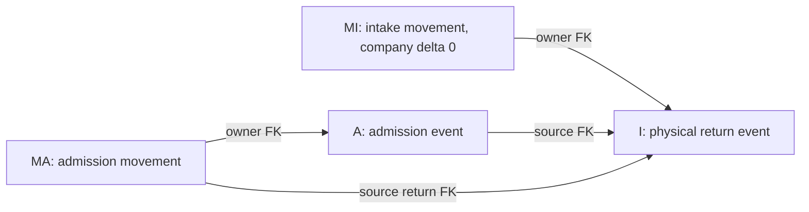

# RMA-0003/C2-WP4 – Return Intake & Stock Admission

Státusz: **REVIEW / NOT MIGRATION READY**. Dátum: 2026-11-03.
Dokumentációs részletes terv; nem elfogadási határozat, végrehajtott DDL vagy RMA-implementáció.

**Központi invariáns:** a fizikai átvétel önmagában nem bizonyít vállalati tulajdont,
készletbefogadást vagy felhasználhatóságot.

## 1. Baseline and authority

Ellenőrzött branch: `feature/returns-repair-management`.
HEAD: `e21e83da44e7ec2228efa6c5c6f8d1021340b73b`.
Induló `git status --short --untracked-files=all`:

```text
?? .kiro/designs/rma-0003c2-wp1-schema-inventory.md
?? .kiro/designs/rma-0003c2-wp3-inventory-mrp-consumer-contracts.md
```

Tracked diff és staging üres. Mindkét előzmény megőrzendő, belépési SHA-256:

| Fájl | SHA-256                                                            |
| ---- | ------------------------------------------------------------------ |
| WP1  | `f4d6682d9bb0b8d58882263199919d9af394cfee58c0c5f0ea704ef6859fa932` |
| WP3  | `1a340ac30113417672869ff0d71bc854ce02f81d4ae2dfd2a5c09ff5ec22d994` |

Autoritás: [Accepted ADR-0006](../decisions/0006-rma-repair-management-architecture.md).
Előzmények: [A adatmodell](rma-0003a-data-model-integrity-design.md),
[B review](rma-0003b-integrity-verification.md),
[C1 döntések/kapuk](rma-0003c1-business-decisions-integrity-gates.md),
[C2 előkészítés](rma-0003c2-detailed-schema-review-plan.md),
[WP1](rma-0003c2-wp1-schema-inventory.md),
[WP3](rma-0003c2-wp3-inventory-mrp-consumer-contracts.md).
Az ADR üzleti döntéseit, a jóváhagyott AM-01–AM-04-et és kötelező AM-02-G1–G4-et
nem írjuk át; C1 ACCEPTED WITH CONDITIONS, G1/G2/G3 technikai bizonyítása továbbra is kapu.
WP1 projektgazda által közölt feltételes elfogadása nem engedély a fájl fejlécének átírására.

**CONFIRMED**: a rögzített repository-forrásban ellenőrzött állítás.
**PROPOSED**: a jelen dokumentum technikai szerződése, review tárgya.
**OPEN / UNVERIFIED**: hiányzó üzleti részlet vagy még nem bizonyított DB/service/deployment feltétel.
Kódból nem következtetünk éles adatminőségre, grantokra vagy sikeres konkurenciatesztre.
A B történeti JSON és PHP változatlan; nincs DB-kapcsolat, script-, migration-, seeder- vagy tesztfutás.

A REV-01–REV-05 forrása a projektgazda korábbi külső review-kiegészítése, amelyet a WP3 11.
fejezete rögzít. Ezek megfigyelések és munkakövetelmények, nem önállóan elfogadott új üzleti szabályok.
A [7. fejezet](#7-event-and-movement-reconciliation) REV-05-re konkrét technikai korrekciót javasol;
ennek tulajdonosi review-ja és WP2-bizonyítása nem tekinthető megtörténtnek.

## 2. Existing MES behavior

### 2.1. Ellenőrzött kód- és sémaállapot

| Forras / metódus                                                                                                                   | CONFIRMED mai viselkedes                                                                                                    | WP4 kovetkezmeny / PROPOSED                                                                                         |
| ---------------------------------------------------------------------------------------------------------------------------------- | --------------------------------------------------------------------------------------------------------------------------- | ------------------------------------------------------------------------------------------------------------------- |
| [StockBalanceRepository::totalQuantityForItem](../../app/Repositories/Admin/StockBalanceRepository.php#L66)                        | Item balance SUM scope/ownership/disposition nelkul; increaseQuantity nullable batch firstOrCreate+increment.               | MI nem hivhatja normal quantity increase-kent; MA company +1 csak guardolt posting; E/R consumer atallitas.         |
| [StockReservationRepository::activeReservedQuantity](../../app/Repositories/Admin/StockReservationRepository.php#L36)              | Full active reserved_quantity SUM; consumed/released counter es repair owner/purpose nincs.                                 | Quarantine es workflow custody ne keruljon company SUM-ba; remaining es global serial kizárás WP3/WP2.              |
| [StockReservationService::reserveForProductionOrder](../../app/Services/Admin/StockReservationService.php#L33)                     | Transaction, de balance/SUM valasztas nem kozos globalis item/serial mutex; release precheck zar elott.                     | Admission/karanten mellett ugyanaz a L lock es current eligibility guard, nem független RMA sziget.                 |
| [ProductionTaskMaterialService::store](../../app/Services/Admin/ProductionTaskMaterialService.php#L28)                             | Physical>=q balance FOR UPDATE; material+movement+balance+full Consumed reservation, owner/partial/quarantine guard nelkul. | Admitted quarantine sem production/repair anyag; WP3 P/R es counter-reader rollout blokk.                           |
| [ProductionTaskService::advanceNextTaskOrFinalize](../../app/Services/Admin/ProductionTaskService.php#L224)                        | Vegso step serial current_status=InStock, nincs output movement/balance/hely ezen a metóduson belul.                        | Status nem stockbefogadási vagy origin/ownership proof; sajat gyartasi történetet megorzi.                          |
| [MaterialRequirementService::calculateBomItem](../../app/Services/Admin/MaterialRequirementService.php#L46)                        | Production quantity x BOM; global physical-full reservation es owner reserve; float upsert.                                 | MI/MA quarantine ne novekedjen MRP available-kent; WP3 M owner/delta/coverage meaning kell.                         |
| [GoodsReceiptService::post](../../app/Services/Admin/GoodsReceiptService.php#L84)                                                  | GR header majd POitems FOR UPDATE; purchase_receive+balance/received counter+audit; post duplazas elutasitva.               | RMA MI/MA nem supplier GR; L lock/scope/quantity contract kozos, nem GR service ujrahivas returnnek.                |
| [ReportingRepository::inventorySummary](../../app/Repositories/Admin/ReportingRepository.php#L124)                                 | Raw physical SUM es full active reservation; nincs quarantine/owner szures.                                                 | Company physical vs eligible/custody/pending/on-site kulon, AM-02-G3 minden readben.                                |
| [ManufacturingIntelligenceRepository::materialForecast](../../app/Repositories/Admin/ManufacturingIntelligenceRepository.php#L103) | Raw balance SUM/full reservation es production_consume trend; nincs return/disposition meaning.                             | Admission fizikai +1 quarantine mellett nem forecast available +1; WP3 E/M/C.                                       |
| [BusinessCacheInvalidator::invalidate](../../app/Services/BusinessCacheInvalidator.php#L123)                                       | Nyitott transactionben DB::afterCommit, egyebkent azonnali generation rotate.                                               | Intake/admission/release/hely/proof projection utan teljes erintett domainlista; rollback nem rotate.               |
| [AuditLogService::log](../../app/Services/AuditLogService.php#L65)                                                                 | Subject/causer/properties activity bejegyzes; nem typed domain-FK vagy stock posting.                                       | Service transactionben historyval egyutt; proof retention/jog es append-only kulon, payload ne tartalmazzon titkot. |
| [StoreProductionTaskMaterialRequest::rules](../../app/Http/Requests/Admin/StoreProductionTaskMaterialRequest.php#L29)              | Item/batch/location/reservation kulon exists; useMaterials policy az authorize utjan.                                       | Exists/permission nem owner/pool/serial/quarantine guard; raw DML es masik entry point is vedendo.                  |

A StockMovementType jelenlegi enumjában nincs `replacement_return_intake` vagy
`return_stock_admission`; ezek korábbi tervnevek, nem működő esetek.
Az item_instances migráció production_order_id mezője nullable, indexelt unsigned BIGINT,
FK nélkül. A modellben nincs productionOrder relation; current_status enum-cast nem origin-proof.
Az item_instance_relations parent CASCADE/child RESTRICT és aktuális qty nem immutable genealogy ledger.
Új RMA-tábla, receipt/admission service, policy vagy return-event modell nem található a baseline-ban.

Ellenőrzött migrációk:
[instances](../../database/migrations/2026_06_21_000010_create_item_instances_table.php),
[relations](../../database/migrations/2026_06_21_000011_create_item_instance_relations_table.php),
[balances](../../database/migrations/2026_06_21_000023_create_stock_balances_table.php),
[reservations](../../database/migrations/2026_06_21_000024_create_stock_reservations_table.php),
[movements](../../database/migrations/2026_06_21_000025_create_stock_movements_table.php),
[locations](../../database/migrations/2026_06_21_000002_create_locations_table.php),
[production orders](../../database/migrations/2026_06_21_000021_create_production_orders_table.php),
[production tasks](../../database/migrations/2026_06_21_000032_create_production_tasks_table.php),
[requirements](../../database/migrations/2026_06_21_000022_create_material_requirements_table.php).
StockBalance nullable batch UNIQUE nem NULL-safe identity. StockMovement source morph nem typed domain-FK;
serial/batch/hely/actor nullable SET NULL kapcsolatai történetvédelmi rések.
Location típus/is_active nem globális karantén- vagy ownership-szabály.

### 2.2. Meglévő tesztbizonyíték határa

Elolvasott releváns tesztforrások: [InventoryTest](../../tests/Feature/InventoryTest.php),
[InventoryManagementUiTest](../../tests/Feature/InventoryManagementUiTest.php),
[ProductionExecutionUiTest](../../tests/Feature/ProductionExecutionUiTest.php),
[ProcurementManagementUiTest](../../tests/Feature/ProcurementManagementUiTest.php),
[BusinessCacheInvalidationTest](../../tests/Feature/BusinessCacheInvalidationTest.php),
[ReportingAnalyticsTest](../../tests/Feature/ReportingAnalyticsTest.php),
[ManufacturingIntelligenceTest](../../tests/Feature/ManufacturingIntelligenceTest.php).
Meglévő stock/movement kapcsolat, teljes production material use, GR partial/retry,
audit rollback és cache rollback/commit eseteik nem igazolják a nem létező RMA intake/admission utat.
E feladatban nem futottak; a 10. fejezet minden új esete **PLANNED**.

## 3. Return intake lifecycle

### 3.1. Két külön belépési út és hét állapothelyzet

**O – Original RMA receipt:** a már létező saját gyártású serial eredeti ügyféltermékének
egyszeri átvétele. Member/origin/owner/active-claim ellenőrzés; `external→customer_custody`,
company balance-hatás 0, original `repair_custodies` projekció. Nincs szükség kitalált
korábbi repair_release-re. Az ügyfél tulajdona megmarad, nem a company-admission előszobája.
Az eredeti termék későbbi tulajdonszerzési/beszerzési ügylete nincs e tervvel automatikusan engedélyezve.

**I → A – Replacement shipment return:** egy már megtörtént, azonosított replacement release
valódi visszaérkezése. I = fizikai intake occurrence, MI = intake movement;
A = későbbi igazolt könyvelési admission occurrence, MA = admission movement.
MI mindig mandatory quarantine és company balance0; A opcionális, nem minden I-hez lesz A.
Verified customer custody besorolás is lehetséges, company balance0 mellett; ettől nem keletkezik
original repair_custodies sor. Admission és karanténfeloldás külön döntés.

| Helyzet                     | Fizikai hely / scope                                                        | Ownership / disposition                                              | Normal company qty / availability                                   |
| --------------------------- | --------------------------------------------------------------------------- | -------------------------------------------------------------------- | ------------------------------------------------------------------- |
| Expected return             | Még nincs igazolt belső érkezés; transit/external                           | Korábbi igazolt owner megmarad, return authorization/intent          | Nincs új mennyiség, nem available                                   |
| Physically received return  | Valós belső karanténhely; I+MI                                              | Owner verified vagy unresolved; quarantined                          | Intake 0, available0 az adott serialra                              |
| Customer-owned custody      | Original O: custody projection; replacement: igazolt custody besorolás      | Customer owner/right bizonyított; továbbra használati korlát         | Company0, nem company available                                     |
| Pending company admission   | I létezik; external könyvelési oldal physically belül                       | Függő/hiányos admission basis; quarantined                           | Company0, külön on-site kategória                                   |
| Company-admitted quarantine | A+MA: company_stock ugyanazon belső helyen                                  | Company könyvelési jogcím igazolt, quarantine marad                  | Physical+1 egyszer, eligible0 az adott serialra                     |
| Eligible company inventory  | Már company-admitted + külön engedélyezett disposition                      | Verified company jogcím, állapot/alkalmasság, nincs tiltó konfliktus | WP3 E/R szerint; foglalás remaining egyszer levonva                 |
| Rejected / returned         | Rejected döntésnél még őrzött/quarantined; tényleges outbound után external | Reject nem ownership change, címzett/right külön igazolt             | Nincs fiktív admission vagy qty-reset; valós outbound scope szerint |

Az állapothelyzetek read-model fogalmak, nem egyetlen új, minden dimenziót összemosó státuszenum.
A várt/előzetesen engedélyezett return nem azonos a ténylegesen megérkezettel: előzetes return
authorization hiánya önmagában nem jogosít a már fizikailag bekövetkezett, G1 szerint
serial/source/hely/idő/proof alapon igazolt replacement intake elhallgatására. I rögzíthető,
quarantine kötelező; a hiányzó releváns authorizationt admission előtt kell rendezni.
Unknown serial/source/proof esetén viszont nincs hamis G1-intake: az eltéréskezelés F08 szerint OPEN.
Mandatory quarantine az AM-02 szerinti replacement return-intake-on kötelező, company ownernél is.
Original O eleve nem normál stock; annak receipthez kapcsolt állapotvizsgálata nem ad company jogosultságot.
Original technikai quarantine-elhelyezés alkalmazható ellenőrzési korlátként, de AM-02-ből
nem következtetünk új, általános original disposition vagy jogátruházási üzleti szabályra.

### 3.2. Actor, evidence és failure közös szerződése

Az alábbi actorok **szükséges képességek**, nem már létező policy-/role-nevek:
intake-rögzítésre jogosult belső user+employee; inspectorre jogosult dolgozó;
ownership/right döntésre jogosult személy; admission/disposition/shipment/close jogosult.
Pontos permission- és szerepszétválasztási mátrix OPEN, nem találunk ki új beosztást.
Permission önmagában nem property right vagy jogi bizonyíték.

Minden írásnál tartós command type/key/hash és üzleti occurrence-azonosság; actor/employee,
case/member/serial/source shipment, occurred_at/recorded_at, before/after projekció,
konkrét document-record+version+checksum, indok és typed evidence-kapcsolatok.
External provider key forrásnévtérrel, UI-nál ellenőrzött intent/occurrence identity;
új command kulcs nem hozhatja létre újra ugyanazt a fizikai tényt.
Hibás payload ugyanarra a kulcsra konfliktus; jogosulatlan retry nem kaphat korábbi titkos eredményt.
Sikeres mutation+history+command+audit egy transaction, bármely hiba teljes rollback.
Sikertelen kísérlet biztonságos hibamegfigyelése nem helyettesíti a rollbackelt domain auditot.

### 3.3. Átmeneti mátrix

| ID / átmenet                                   | Preconditions / actor / evidence                                                                                                            | State és DB writes                                                                                                                                                   | Inventory effect / occurrence                                                                                                  | Failure / audit                                                                                                                                                   |
| ---------------------------------------------- | ------------------------------------------------------------------------------------------------------------------------------------------- | -------------------------------------------------------------------------------------------------------------------------------------------------------------------- | ------------------------------------------------------------------------------------------------------------------------------ | ----------------------------------------------------------------------------------------------------------------------------------------------------------------- |
| L01 Return authorization / expected            | Nyitott jogosult ügy, várt serial és valós előző replacement release vagy original member; intake/shipment jogkör; return intent dokumentum | repair_commands + typed history: expected/authorized return, source/member/serial. Még nincs I/MI vagy receipt pointer                                               | Balance0, custody/hely nem állítható át; stable authorization/intent key                                                       | Hiányzó/idegen serial/source/permission: nincs authorization. Audit actor/idő/reason/proof; authorization nem fizikai érkezés                                     |
| L02 Arrival observation / identity             | Valódi serial-leolvasás, hely/idő/proof, source shipment összevetés; intake actor                                                           | G1-nek megfelelő replacement érkezésnél I+MI+instance location/quarantine, command/history/audit. Originalnál O movement+member receipt pointer+custody              | Replacement external→external, qty1 és company0; original external→customer_custody, company0; physical occurrence kulcs külön | Nem verifikálható serial/source nem írható hamis matchingként. Kezelt eltérés/operatív őrzés és dokumentum szükséges; unmatched goods részletes workflow OPEN F08 |
| L03 Serial/origin/customer verification        | I vagy O után frissebb bizonyíték; identity/origin és ownership review actor                                                                | Immutable inspection/review history és dokumentum-FK; origin proof verzió megőrzött; ownership projection verified/unresolved. Nem írunk át eredeti serialt/gyártást | Stock0; saját gyártás hiánya admissiont tilt, valódi I-t nem töröl                                                             | Rossz origin/owner/case: blocked/quarantined, döntés indoka megmarad; nincs fake új gyártott serial                                                               |
| L04 Condition inspection                       | I+current quarantine, ugyanaz a subject és source; inspector+recording actor; állapot/inspection proof                                      | repair_inspections return_quarantine típusjavaslat, member/serial/return typed FK; history; hibás vizsgálat is immutable                                             | Stock0, karantén marad; inspection occurrence, nem receipt                                                                     | Hiány/eltérés/rejected condition nem automatic scrap/reversal. Korrekció új vizsgálat/verzió, audit a saját attemptre                                             |
| L05 Ownership/right determination              | Alkalmazandó szerződés/policy verzió, előző owner és jogcím, ellenőrzött bizonyíték; ownership-authorized actor                             | Verification history önmagában nem ownership transfer. Tényleges jogváltozás csak külön repair_ownership_event eredeti/predecessor/proof kapcsolattal                | Nincs stock movement vagy qty; külön jogi occurrence és hatályossági idő                                                       | Unknown/ellentmondó proof: unresolved, admission/redispatch blokkolt. Return/delivery acknowledgment nem legal trigger önmagában                                  |
| L06 Company admission                          | 5. fejezet minden guardja; admission actor; aktuális verified basis és admission/disposition authorization                                  | A+MA, company balance/instance scope és last movement, typed history/command/audit; quarantine megmarad                                                              | External→company_stock +1 egyszer, eligible0; I-től eltérő admission key                                                       | Hiányzó I/proof, wrong serial, conflicting claim, prior admission vagy stale decision: nincs részleges A/MA/projection                                            |
| L07 Verified customer custody classification   | I és valid customer custody/right proof, current authorized disposition; jogosult classifier                                                | A target=customer_custody + MA classification0 + instance/history; replacementhez nincs original custody-sor                                                         | External→customer_custody, company0; ugyanazon I legfeljebb egy admission-besorolása                                           | Unknown owner nem customer-default. Company +1 nem keletkezhet puszta disposal/redispatch authorizationből                                                        |
| L08 Quarantine decision / release              | Inspection+identity+rights+prior shipment egyeztetés; disposition actor és evidence                                                         | Új typed history/authorization + allocation projection; company release csak már company-admitted egységen; adott esetben új reservation ugyanott atomikus           | Nincs új receipt/admission. Company physical változatlan; availability csak E/R szerint. Intent/history key                    | Quarantine feloldás nem owner change, nem company stock teremtés. Pending/custody marad nemcompany akkor is, ha fizikailag ép                                     |
| L09 Reject admission / hold                    | Hiányos vagy negatív origin/identity/condition/rights; jogosult döntés és indok                                                             | Append-only rejection/hold history, instance blocked/quarantined; I/MI és korábbi proof megmarad                                                                     | Company0 ha pending; admitted stockot döntési státusszal nem vonjuk ki fizikailag                                              | Reject nem fizikai eltűnés vagy customer shipment; unresolved obligation zárást blokkol; audit a vizsgált returnre                                                |
| L10 Return to customer / authorized redispatch | Verified recipient/custody-right, actual serial/location, D9 prior shipment rendezés+authorization replacementnél; shipment actor/proof     | Original: egyszeri original release+custody outbound+custody megszüntetés. Replacement: új workflow/company reservation, új release+movement+chain history           | Custody→external company0; company-stock→external −1 egyszer ha az ág jogszerűen company volt; saját shipment occurrence       | Nem lehet unknown tulajdonból tetszőleges címzettnek küldeni. Failed delivery nem stockreturn; actual outbound rollback atomikus                                  |
| L11 Authorized scrap                           | Igazolt disposition right és dokumentált scrap authorization, actual hely/serial; disposal actor                                            | Valós scope szerinti scrap movement + disposition/history/projection                                                                                                 | Company-admitted esetben −1; custody esetben company0. Pending external→external scrap nincs általánosan engedélyezve          | Pending scrap típus/cél-jóváhagyás OPEN F04; nincs fake admission/correction, nincs automatikus ownership reversal                                                |
| L12 Evidence-based closure                     | Minden member original outcome, shipment/return/admission/quarantine/ownership és remaining obligation rendezett; close actor               | C1 restricted finalizer: closing command/history/case closed, claim delete, audit egy transaction; nincs event törlés                                                | Nincs új stock; claim csak teljes case-close-kor szűnik                                                                        | Hiányzó proof/QC/rights/credit/procurement handoff: close tiltott, claim megmarad. Visszaadás vagy execution completed önmagában nem elég                         |

Authorization visszavonása vagy admission rejection nem törölheti a már bekövetkezett fizikai érkezést.
Ha I előtt nem engedélyezett/azonosítatlan áru ténylegesen ott van, a fizikai biztonságos őrzés
és eltéréskezelés szükséges; nem készül hamis RMA receipt vagy company stock. Ennek teljes
unmatched-incident identitásmodellje nem szerepel a 25-táblás elfogadott jelöltleltárban:
F08 OPEN, nem vezetünk be itt új táblát vagy fictív membert.

## 4. Ownership and custody contracts

| Fogalom                      | Autoritatív tény / projekció                                                          | Nem következik belőle                                      |
| ---------------------------- | ------------------------------------------------------------------------------------- | ---------------------------------------------------------- |
| Physical possession          | I/O movement, tényleges belső hely/idő, instance current_location                     | Ownership, company stock vagy available                    |
| Legal ownership              | Megőrzött korábbi owner + immutable jogi transfer/reversal/correction, policy/proof   | Fizikai hely vagy készletbefogadás                         |
| Customer custody             | Original O custody projection vagy verified replacement custody besorolás             | Company tulajdon, normál gyártási/repair anyagfelhasználás |
| Company custody / possession | A vállalat őrzi a tárgyat; jogi owner ettől még ügyfél/unresolved lehet               | Nem szinonimája a company_stock könyvelési oldalnak        |
| Company stock                | Igazolt könyvelési jogcím és MA/projection a normál movement-ledgerben                | Hibátlan állapot vagy szabad felhasználhatóság             |
| Quarantine                   | Explicit disposition/allocation restriction, inspection/authorization history         | Új ownership vagy negyedik scope                           |
| Inventory eligibility        | WP3 E/R szerinti verified company physical + alkalmas disposition és nincs konfliktus | Nem egyszerű hely-, státusz-, policy- vagy SUM-ellenőrzés  |

Receipt, location, repair státusz, replacement preparation, shipment és customer acknowledgment
önmagában egyik sem tulajdonátruházás. Az acknowledgment lehet az alkalmazandó szerződéses
trigger egyik bizonyítéka, de a policy+jogalap+actor+from/to owner+serial+occurred_at nélkül
nem elég. A rendszer a jogi döntést támogatja, nem helyettesíti.

Minden ownership-changing event előfeltétele: verified subject/case/source kapcsolat,
korábbi effective owner/predecessor, alkalmazandó szerződés/jogcím verzió, megfelelő bizonyíték,
külön jogosult actor, from/to owner és hatályossági idő. Reversal új immutable esemény
`reverses_ownership_event_id` hivatkozással; korrekció `supersedes` előzményre, nem DELETE/UPDATE.
Későn érkezett bizonyíték recorded_at és jogi occurred_at külön mezőjelentés; nem latest timestamp wins.
Ugyanaz a jogi esemény source occurrence szerint egyszer, nem shipment-retry alapján újra.

Custody-history a movement/event-ledgerből újraépíthető, az aktuális custody-sor törölhető
csak valódi custody outbound/scrap projekciójaként; a tények, proof és actor nem nullázható.
Dokumentum-FK nem védi a fájlt: record/verzió/checksum, soft-delete és storage retention WP2/WP6 kapu.
Pontos jogi feltétel, retention idő és permission matrix OPEN; nincs kitalált automatikus owner-váltás.

## 5. Stock admission contract

### 5.1. Company admission guard – mind kötelező

| Guard                          | Konkrét vizsgálat és bizonyíték                                                                                                                                                                                                                      |
| ------------------------------ | ---------------------------------------------------------------------------------------------------------------------------------------------------------------------------------------------------------------------------------------------------- |
| A1 Serial identity             | Beolvasott item_instance ugyanaz, mint I és source release, azonos member/role/serial tuple; quantity1; batch/cikk/unit összetartozó. Nem új serial-generálás vagy eredeti–csere átnevezés                                                           |
| A2 Manufacturing origin        | Saját gyártás és bizonyítható production_order/QC/origin; semi_finished_product jogosult lehet, típus nem bizonyíték. Legacy FK-hiány nem igazolt eredet                                                                                             |
| A3 Return authorization        | Releváns nyitott case/source shipment/return intent és jogosult befogadási döntés. Nem pusztán létező dokumentum-ID, hanem cél/permisson/tartalom egyezés                                                                                            |
| A4 Legal basis                 | Verified company ownership vagy az alkalmazandó, explicit meghatározott company_stock-befogadási jogcím. Ügyfél custody-engedélye, javítási hozzájárulása vagy selejtjoga önmagában nem ilyen jogcím                                                 |
| A5 Physical receipt            | Commitolt I+MI és G1 serial/hely/idő/source/evidence; nincs csupán delivery_failed, recall vagy expected return. Current physical location továbbra igazolt belső quarantine                                                                         |
| A6 Current custody/disposition | Current scope pending external, quarantined; ugyanazon I még on-site, nincs közben return shipment/scrap vagy ellentmondó late evidence. Admission authorization a konkrét quarantine classificationre vonatkozik, nem szükségszerűen release-to-use |
| A7 Claims/reservations         | Célserialon nincs idegen/conflicting active claim vagy allokáció/obligation. Saját original member aktív claimje nem törölhető admission miatt; azonos case idegen tagja sem automatikus felhatalmazás                                               |
| A8 No duplicate                | I-hez nincs már company vagy custody admission; MA és reverse-dispatch posting még nem létezik. Command retry/source occurrence egyezés és payload hash                                                                                              |
| A9 Prior posting               | ADR 8.3 szerint igazolt korábbi company outbound és megőrzött shipment/serial/qty; nincs már visszakönyvelt ugyanazon teljes kivezetés. Hiány nem automatikus kiegyenlítő correction                                                                 |
| A10 Actor/atomic proof         | Admission permission és employee/actor, változatlan verified basis, typed proof és audit; L sorrendű friss locking reads, nem cached available vagy proof_ok flag                                                                                    |

A4 más jogcímének konkrét jogi jelentése nincs általánosan definiálva; amíg az applicable
feltétel nem igazolt, a company admission tiltott. Ez nem tiltja a valós I rögzítését.
Original customer O termékből puszta RMA-admission nem válhat company stock.
Custody-redispatch utáni későbbi új ownership-ügylet, már kompenzált company outbound vagy
custody→company utólagos átminősítés nem oldható meg ugyanazon I második admissionjével:
a külön szükséges jogcím/workflow OPEN F05, nincs fiktív új physical receipt.

### 5.2. Transaction és projection postcondition

Service-koordinált egy DB-transaction: friss A1–A10 guard → immutable A insert →
typed MA insert → company balance pontos +1 → instance scope=company_stock,
last_stock_movement=MA, allocation=quarantined → typed history → completed command → audit → commit.
Physical receipt ideje I-n marad; MA könyvelési/befogadási idő, nem új fizikai érkezési idő.
Current physical location nem változik admissiontől; MA ugyanazon bizonyított aktuális helyre könyvel.
Ownership proof attól külön jogi történet, A nem új ownership event.

Admission után: company physical +1 **egyszer**, quarantine miatt eligible/available hozzájárulás0,
nincs új automatikus reservation vagy warranty reset. Quarantine release külön command/history,
szükség esetén új company reservationnel egy atomikus, köztes szabad állapot nélküli átmenet.
Customer custody classification A/MA más target scope, company delta0 és szintén nincs original custody-sor.

Bármely constraint/guard/audit hiba: A/MA/balance/instance/history/command együtt rollback,
a már korábban commitolt I/MI és fizikai karantén tény megmarad. AfterCommit inventory cache invalidáció;
cache-hiba commit után nem DB-rollback és nem enged második admissiont. Posting result tartósan visszaolvasható.
Aktív claim felszabadítása és case-close nem ennek mellékhatása.

## 6. Quarantine and disposition

Karantén explicit allocation/disposition korlát, nem csak raktárhely. Minden replacement return
intake kötelezően karantén, akkor is, ha a company owner és a termék hibátlansága valószínű.
Customer quarantine és pending quarantine nem company balance; company-admitted quarantine
lehet physical balance, de nem eligible company. Mindegyik tiltott production/sales/repair consume
és unrelated reservation számára; redispatch is csak külön authorized disposition után.

```text
available = eligible_company_physical - active_remaining_company_quantity_reservations
remaining = reserved_quantity - consumed_quantity - released_quantity
0 <= consumed_quantity + released_quantity <= reserved_quantity
```

Eligibilityből már kizárt company quarantine mennyiség holdját nem vonjuk le másodszor foglalásként.
Custody workflow reservation és logical replacement obligation nem company quantity deduction.
Consumed/released countert régi shipment visszaérkezése nem reseteli.

| Döntés                                     | Kötelező evidence/actor                                                                                        | Hatás / korlát                                                                                                                           |
| ------------------------------------------ | -------------------------------------------------------------------------------------------------------------- | ---------------------------------------------------------------------------------------------------------------------------------------- |
| Continue hold / reject admission           | Inspection/identity/rights hiány vagy ellentmondás, jogosult reviewer                                          | Historyban megőrzött hold/rejection, tényleges hely megmarad, nem törlés és nem shipment                                                 |
| Company classification while quarantined   | A1–A10, admission actor                                                                                        | MA +1, quarantine marad. Condition review lehet negatív is, ha a könyvelési jogcím ettől függetlenül igazolt; ez nem használati engedély |
| Release to eligible company                | Már admitted company; identity/condition/rights/source rendezett, jogosult disposition + inspection/proof      | Allocation projekció feloldható, quantity0; nincs implicit ownership/admission                                                           |
| Prepare company redispatch                 | Ugyanez + D9 authorization és korábbi shipment obligations rendezettek                                         | Új reservation a root/serial/order láncban, quantity1; old→new order-key átadás atomikus                                                 |
| Customer-rights redispatch                 | Verified customer custody/right és explicit kiadási felhatalmazás, condition/identity/prior shipment rendezett | Workflow-only custody reservation és outbound0 company; nem kötelező ownership reversal                                                  |
| Company/custody scrap                      | Dokumentált disposition right+scrap proof, actor, actual movement                                              | Scope szerinti valós kivezetés; original sors külön. Quarantine nem önmagában selejtjog                                                  |
| Pending external quarantine transfer/scrap | Nincs általánosan jóváhagyott mapping                                                                          | OPEN F04: explicit type/purpose/proof és engedélyezés kell; az intake kivétel generic transfer/correction/scrap-ra nem terjed ki         |

Ha pending tárgyat biztonsági okból ténylegesen másik karanténhelyre kell mozgatni, ezt
nem szabad hamis company admissionnel vagy history nélküli location UPDATE-tel megoldani.
A szükséges konkrét restricted movement szerződés/jóváhagyás hiánya itt ismert kapu;
WP4 nem nyit általános external→external kiskaput.

## 7. Event and movement reconciliation

### 7.1. REV-05 – jelenlegi probléma és javasolt jelentés

**CONFIRMED design observation:** A/B és WP1 `repair_delivery_events.return_stock_movement_id`
mezője a physically_returned és return_reconciled soron is nem-NULL lehet;
az elnevezés önmagában nem mondja meg, hogy intake vagy admission movement.
Ez tervambiguitás, nem már telepített RMA-adathiba. A két mozgás ugyanazon occurrence-ként
kezelése AM-02-G2/G4 sérülést és FK-ciklust okozhatna.

**WP4-P01 (PROPOSED):** az immutable delivery-event táblából a generikus
`return_stock_movement_id` mezőt a végleges tervben elhagyjuk. Nem adunk neki új, hallgatólagos
jelentést. A typed posting-kapcsolatok a **stock_movements → event** irányban állnak;
az eseményeknek inverse, név szerint elkülönített `intakeMovement` / `admissionMovement`
lekérdezési kapcsolata lesz. Ezek javasolt új relation-nevek, nem jelenlegi Eloquent metódusok.

- I = `repair_delivery_events.event_type='physically_returned'`: a fizikai intake;
  saját namespace/source event key, source release, member/serial, actual place/time/proof.
- A = későbbi `event_type='return_reconciled'`: az igazolt könyvelési besorolás/admission
  ténye I-re hivatkozva; új `admission_target_scope` company_stock vagy customer_custody,
  megfelelő igazolt basis/decision proof. Nem új fizikai receipt és nem automatikus quarantine release.
- Inspection és ownership verification A előtt külön `repair_inspections`/typed history/proof;
  hiányos vagy negatív review nem hoz létre A-t. `return_reconciled` elnevezésének pontos
  API/UI megjelenítése a végleges séma review-jához tartozik; accepted business event nem változik.
- MI: kizárólag I tulajdonú `replacement_return_intake`, external→external,
  qty1, to_location=actual quarantine, company delta0.
- MA: kizárólag A tulajdonú `return_stock_admission`, external→target scope,
  qty1, ugyanazon aktuális belső hely, company esetben +1, customer custody esetben0.
- T = későbbi valódi belső transfer: új occurrence és movement, nem I vagy A ismétlése.
- S = actual return shipment: új release/stock outbound occurrence, scope szerinti qty,
  külön recipient/time/reference/condition/proof és replacementnél új reservation/attempt.
- W = ownership event: külön immutable jogi occurrence, **nincs** mennyiségi mozgás.

MA company branch `reverses_stock_movement_id` a bizonyított eredeti company dispatchre mutat,
nem MI-re; a marker mennyiségi visszakönyvelési kapcsolat, nem jogi reversal.
MI ezt a unique reverse-kulcsot nem foglalja el. Custody classification nem company dispatch
kompenzálása; nem generál automatikus reverse-t vagy quantityt. A forráslánc eligibilityjét A9 vizsgálja.

### 7.2. Pontos typed kapcsolat- és egyediségjavaslat WP2 számára

Nem executable DDL. A meglévő A/WP1 mezőket nem módosítjuk a repositoryban;
ez új review-javaslat, 25 táblán belül, új táblajelölt nélkül.

| Tábla / javasolt mező                                       | Típus/null                                          | Parent és jelentés                                                                        | Constraint / guard                                                                                                                                 |
| ----------------------------------------------------------- | --------------------------------------------------- | ----------------------------------------------------------------------------------------- | -------------------------------------------------------------------------------------------------------------------------------------------------- |
| repair_delivery_events.related_return_event_id              | unsigned BIGINT nullable FK                         | A esetén I; ugyanaz a release/member/serial                                               | A-n kötelező, I-n NULL; parent U(id,release,serial) és composite FK. Parent type=I cross-row guard                                                 |
| repair_delivery_events.admission_intake_key                 | unsigned BIGINT nullable FK                         | A egyszeri admission identityje, értéke ugyanaz az I, mint related_return_event_id        | U(admission_intake_key); A-n nem-NULL és egyenlő related_return_event_id, más típuson NULL. WP1 admission_return_key technikai névvel egyeztetendő |
| repair_delivery_events.admission_target_scope               | varchar(24) nullable                                | A target company_stock vagy customer_custody                                              | A-n kötelező IN; más típuson NULL. Unknown nem választható egyiknek sem                                                                            |
| repair_delivery_events.return_authorization_history_id      | unsigned BIGINT nullable typed FK                   | I-n opcionális korábbi intent/authorization; A-n a konkrét return/admission felhatalmazás | A-n kötelező, case/member/serial/source és actor/permission guard; későbbi authorization új history, I nem frissül                                 |
| repair_delivery_events.admission_basis_history_id           | unsigned BIGINT nullable typed FK                   | A előtti immutable basis/inspection/rights/disposition review                             | A-n kötelező, I-n NULL; history az I-re és subjectre mutat, nem előre az A-ra. Teljes proof és dokumentumverzió guard                              |
| stock_movements.return_intake_event_id                      | unsigned BIGINT nullable FK                         | Csak MI owner I                                                                           | U(return_intake_event_id); MI-n nem-NULL, MA/más típuson NULL                                                                                      |
| stock_movements.return_admission_event_id                   | unsigned BIGINT nullable FK                         | Csak MA owner A                                                                           | U(return_admission_event_id); MA-n nem-NULL, MI/más típuson NULL                                                                                   |
| stock_movements.source_return_event_id                      | unsigned BIGINT nullable FK                         | MA audit-context I, nem új posting identity                                               | MA-n kötelező, egyezik A.related_return_event_id; MI-n NULL, más típus pontos mappingje külön. Nem UNIQUE, nem új intake                           |
| stock_movements.source_repair_release_id + item_instance_id | unsigned BIGINT typed FKs                           | Source shipment és subject; a movement owner eventjével azonos tuple                      | Event parent U(id,repair_release_id,item_instance_id) és megfelelő child composite index/FK; serial qty1. Release/member/role guard                |
| stock_movements.return_purpose                              | varchar(32) nullable                                | Típusfüggő, explicit könyvelési cél; MI pending_admission_quarantine                      | A WP1 rövidebb javaslatával egyeztetendő, a teljes technikai értéknek el kell férnie; nem új üzleti scope vagy általános exception                 |
| stock_movements.reverses_stock_movement_id                  | meglévő WP1-jelölt unsigned BIGINT nullable self-FK | Csak igazolt company admission teljes mennyiségi dispatch-előzménye                       | U; nem MI, nem ownership reversal; azonos serial/qty/source-lánc guard, nincs már kompenzált outbound újrafelhasználás                             |

Minden új FK delete/update effective NO ACTION/RESTRICT; EVENT UPDATE/DELETE és business
FK-nullázás tiltott. Child tuple indexek és parent U-k teljes sorrenddel; gépi occurrence/hash
kulcs byte-exact összehasonlítás, nem véletlen case-insensitive default. WP2 motoros DDL-kapu.
Megmarad U(command_type,idempotency_key), event source namespace/key, release shipment occurrence,
U(repair_command_id,command_line), U(MI owner), U(MA owner), U(A intake key).
MA source-return egyezéséhez további event parent
U(id,related_return_event_id,repair_release_id,item_instance_id) és movement child
FK(return_admission_event_id,source_return_event_id,source_repair_release_id,item_instance_id)
javasolt ugyanarra a parent tuple-ra. MA-n mind a négy nem-NULL; a rész-NULL tuple nem bypass.
Ez az A/I/source/serial egyezést erősíti, az event-type/rights és child-totality guardot nem váltja ki.
Egy I legfeljebb egy company **vagy** custody A; ugyanarra új command/target nem második admission.
Sok inspection/review/history child lehet: nincs hibás globális U(related_return_event_id).

Required row-shape CHECK (explicit NULL ágakkal):

```text
MI iff movement_type='replacement_return_intake':
  return_intake_event_id NOT NULL; return_admission_event_id IS NULL;
  source_return_event_id IS NULL; reverses_stock_movement_id IS NULL;
  from_scope='external'; to_scope='external'; quantity=1;
  serial/source release/to_location NOT NULL; purpose='pending_admission_quarantine'.
MA iff movement_type='return_stock_admission':
  return_intake_event_id IS NULL; return_admission_event_id NOT NULL;
  source_return_event_id NOT NULL; from_scope='external';
  to_scope IN('company_stock','customer_custody'); quantity=1;
  serial/source release/to_location NOT NULL;
  company branch: validated prior company dispatch/reverse linkage;
  custody branch: no implicit company reverse or company balance.
Other movement types:
  both posting-owner fields NULL; no implicit external->external exception;
  source-return context only when explicit type/purpose contract permits.
```

CHECK nem ellenőrzi más tábla event_type-ját, ownership/jogosultságot, proofot,
prior-source balance-t vagy child-existence teljességet. Ezek restricted posting boundary,
typed cross-row guard és WP2 negatív raw SQL bizonyítás feladatai; csak FormRequest nem elég.

### 7.3. REV-01 – immutable, ciklusmentes insert protokoll

Az ábra a javasolt FK-irányt mutatja, nem a fizikai események időrendjét:



I transaction: command → immutable I teljes proof adatokkal → MI FK→I → instance/location/quarantine
projekció → history/audit → command complete → commit.
A transaction: meglévő I/MI/inspection/ownership proof friss zárolt ellenőrzése → immutable A FK→I
→ MA FK→A és source I → balance/scope/last-movement projekció → history/audit/command → commit.
Nincs event→MI/MA FK, tehát nem kell előre kitalált movement-ID vagy immutable event UPDATE.
A projection pointer mutable egyszeri/célzott frissítése nem történeti tény utólagos kitöltése.
Original O member→receipt movement körét külön, korábbi C1/WP2 insert protokoll kezeli;
nem hozunk létre hozzá hamis release/delivery eventet.

U/FK önmagában csak „legfeljebb egy” movementet ad, **nem garantálja**, hogy minden commitolt
I/A alatt van MI/MA. WP2-nek az event+posting totalitást restricted DML/jogosultság + szűk posting
rutin/guard és pozitív/negatív próbák szintjén ki kell kényszerítenie. Runtime közvetlen orphan-event
INSERT/child DELETE nem maradhat nyitott út. A service teljes transactionje szükséges, de raw SQL
ellen önmagában nem bizonyíték. Nincs belső COMMIT, session-variable bypass vagy deferred MySQL FK.
E megoldás **DESIGN PROPOSED / DDL AND PRIVILEGES UNVERIFIED**, F01 BLOCKER marad.

### 7.4. Migrációs/kompatibilitási hatás

Nincs telepített RMA-schema vagy dokumentált runtime RMA event-adat; nincs most DB-módosítás.
WP2 végleges tervében az ambiguous event mező, WP1 generic return_event_id/purpose és typed owner
mezők egyeztetendők, nem egymással párhuzamos két authoritative pointercsalád.
Ha később legacy/prototípus adat mégis van, WP6 proof alapján osztályozza MI vagy MA szerepre;
puszta név/időpont alapján tilos átnevezni, másolni vagy új physical receiptet generálni.
Unmatched mapping BLOCKER, nincs csendes drop vagy történet-újraírás.
Read API explicit intake_movement/admission_movement fogalmat használ; régi generikus mezőtől
függő writer/reader nem futhat mixed-version módban. A/B/WP1 történeti szövege változatlan marad.

**REV-05 státusz:** konkrét WP4 technikai feloldási javaslat elkészült; projektgazdai review,
WP2 DDL/insert-jog bizonyítás és WP7 végrehajtott próba nélkül **nem CLOSED/Accepted**.

## 8. Transaction and concurrency matrix

**C1 T-C1-04 sorrend változatlan:** case-ek → items → item_instances → repair/production order →
operations/fee/quote → requirements/coverage → reservations → balances → release/proof;
minden csoport ID szerint. Missing balance insertversenyéhez létező item mutex kell, SUM nem zár.
Affected case IDs a lockterv előtt meghatározandók; új claim/owner miatt változó tervnél
teljes rollback és rendezett újrapróba, nem késői case-lock item után.
Command-identity acquire és child FK implicit lockjainak pontos helye WP2-verifikációs feladat.

| Verseny                                | Kötelező transaction / mutex                                                     | DB identity és service guard                                                                             | Konfliktus / rollback                                                                                                               |
| -------------------------------------- | -------------------------------------------------------------------------------- | -------------------------------------------------------------------------------------------------------- | ----------------------------------------------------------------------------------------------------------------------------------- |
| Két user ugyanazt a serialt átveszi    | Source case/item/serial, source release/return intent; I+MI+projekció egy commit | U(source occurrence), MI owner U, command hash; actual serial/location/time/source összevetés            | Egy canonical receipt; azonos jogosult retry ugyanazt a tartós eredményt adhatja, eltérő payload konfliktus; loser nem új qty/event |
| Duplicate intake request új commanddal | Ugyanaz a lock és üzleti occurrence                                              | Új command identity nem új receipt; service source occurrence egyezés                                    | Nincs második I/MI vagy location reset; UI key/label önmagában nem proof                                                            |
| Két admission                          | I/serial/order/balance + current review és claim friss locking reads             | U(A intake key), U(MA owner), source dispatch reverse U és guard                                         | Egy A/MA +1; másik explicit conflict/canonical retry, nem double balance                                                            |
| Admission vs rejection/hold            | Serial/I és current disposition döntési verzió                                   | Current history/projection ellenőrzés; régi snapshotból nem approval                                     | Hold nyer: A nincs; A nyer: subsequent hold nem törölheti MA-t, quarantine és indokolt új döntés megmarad                           |
| Admission vs customer shipment         | Serial/current scope/return/order és reservation/release mutex                   | On-site+current custody guard; ship után nincs admission, admitted után scope szerinti shipment          | Egy soros állapotút, nem custody0 outbound után +1; stale command elutasított vagy teljes retry                                     |
| Admission vs reserve                   | Item/serial/order→reservation→balance, ugyanaz az E/R predicate                  | Admission karantént hagy; unrelated reserve és serial active-key tiltás                                  | Nincs köztes available; admission commit sem teszi azonnal reservable-vé                                                            |
| Admission vs consume                   | Item/serial/order/remaining reservation/balance                                  | Production és repair P guard quarantine/current scope/owner alapján                                      | Nem fogyasztható sem pending, sem company-admitted quarantine; nincs +1/−1 rejtett bypass                                           |
| Concurrent ownership change            | Case/serial és effective owner/predecessor, referenced proof/current version     | Immutable W occurrence/predecessor/reversal guard, fresh legal basis                                     | A nem használhat közben superseded/ellentmondó proofot; új W nem automatikus MA vagy quarantine release                             |
| Late acknowledgment/evidence           | Saját release/attempt/serial/return context zár                                  | Provider occurrence dedupe; occurred_at ≠ recorded_at, current conflict guard                            | Régi delivered nem rendezi új shipmentet és nem old quarantine-t; ellentmondás blocked+review                                       |
| Close vs intake/admission/child write  | C1 case mutex és restricted finalizer; minden gyermekíró ugyanazt kérje          | Open parent guard, teljes typed proof és completed command; active claim csak teljes close-kor törölhető | Close/open/child race soros; bármely audit/constraint hiba egész rollback, claim nem veszhet el                                     |
| GR/production vs RMA posting           | Közös L sorrend és item/batch identity                                           | WP3 full writer/reader váltás, purpose/scope/counters, PR/PO/GR rootok sorrendje                         | A mai GR→POitem→balance és production order→instance eltérései WP2/WP3 deadlockpróba; biztonságot nem állítunk teszt nélkül         |

Retry csak teljes transaction rollback után, ugyanazon command/occurrence/hash és friss permission mellett,
korlátozott deadlock/timeout politikával. External carrier/doc/ownership hálózati hívás nem nyitott
tranzakció közben történik; előzetesen rögzített bizonyítékot validálunk friss domainállapothoz.
Audit failure visszavon domainírást; afterCommit cache failure nem. Projection rebuild nem új posting.

## 9. MES integration impact

| Component / confirmed behavior                                                                  | Required new behavior                                                                                          | Bypass / integrity guard                                                                                                                 | Planned verification    |
| ----------------------------------------------------------------------------------------------- | -------------------------------------------------------------------------------------------------------------- | ---------------------------------------------------------------------------------------------------------------------------------------- | ----------------------- |
| item_instances: serial+status+location, origin FK nélkül                                        | Scope/ownership verification/allocation/last movement/typed disposition projection; actual receipt idő külön   | InStock vagy location önmagában nem company/eligible; origin+serial+claim+movement proof; current projection csak posting transactionből | V03/V04/V11/V19/V25     |
| item_instance_relations: aktuális parent/child qty, parent CASCADE                              | Régi relation megőrzött, genealogy events correctionnel; return nem újragyártás                                | Kiszerelés nem stock admission; hard/soft delete és gráf/current install guard WP2/WP6                                                   | V04/V19/V31             |
| stock_movements: source morph, nincs scope/typed return                                         | MI/MA/S/T valódi típus és typed owner FK; sole authoritative stock ledger                                      | Generic correction/transfer/scrap nem intake kivétel; raw DML/immutable event bypass zárása                                              | V01/V08/V24/V26/V29/V30 |
| stock_balances: nullable-batch U, increaseQuantity firstOrCreate                                | Company physical projection; MA +1 egyszer, MI0; sentinel key/mutex                                            | Custody/pending nem balance; quarantined company nem available; duplicate cleanup auditált                                               | V05–V12/V15–V18/V20     |
| stock_reservations: teljes reserved SUM/status, soft-delete                                     | Remaining counter/owner/purpose/serial/root/order-key; logical vs physical külön                               | Generic release/full Consumed és active soft-delete nem adhat új availabilityt; custody workflow nem company SUM                         | V11/V16/V17/V27/V30     |
| locations: type/is_active, soft-delete                                                          | Valós quarantine hely és mindegyik consumer disposition-filter                                                 | UI/helynév nem isolation; hivatkozott hely/proof retention; pending helyváltás explicit restricted type kell                             | V01/V11/V20/V26         |
| production_orders/tasks: serial-generálás/státusz és InStock, nincs output posting ezen az úton | RMA origin proof és eredeti workflow megőrzése; P guard a manufacturing fogyasztásban                          | RMA nem új production_task; origin FK/model relation és output/balance reconciliation WP2/WP6                                            | V04/V17/V25/V31         |
| material_requirements: customer owner és global physical/full active számítás                   | WP3 M eligible/remaining/owner netting; quarantine nem szabad supply                                           | Company admission +1 sem ad MRP-free unitot quarantine alatt; inner join repairt ne dobja el                                             | V06/V07/V11/V20         |
| InventoryQuery/ReportingRepository: közvetlen listák és aggregate-ek                            | Physical company / custody / pending / quarantine / transit külön meaning                                      | physical_on_site diszjunkt instance-halmaz, quarantine nem dupla subtraction; cache/export/direct SQL ugyanaz                            | V05–V07/V11/V20/V30     |
| ManufacturingIntelligenceRepository: physical és full reserve, customer joins                   | WP3 E/M/C; admission/quarantine hatás forecast/recommendationben helyes                                        | Item/PO SUM nem owner supply; InStock és received status nem proof; production-only trend külön                                          | V11/V20/V31             |
| BusinessCacheInvalidator: inventoryChanged + DB::afterCommit                                    | MI/hely/ownership/disposition/MA/release/ship minden érintett projection/domain után commit-only invalidálás   | Supplier/PO procurement-only rotate nem elég inventory change-re; rollback nem rotate, shared key scope nem szivárogtat                  | V18/V20/V24             |
| Request/policy: exists és permission, nincs RMA policy                                          | Intake/inspection/ownership/admission/disposition/shipment/close képesség mátrix, service guard+DB control     | Nem elég exists:documents vagy inventory.release; external/raw/queue út sem kivétel. Pontos permissionek OPEN                            | V03/V09/V12/V14/V19/V29 |
| AuditLogService + documents: domain audit és morph/file/version                                 | Actor/time/command/occurrence/serial/source/decision/document-version typed history+audit, immutable retention | JSON proof_ok/morph nem FK, audit fail rollback; titok nem kerül outputba; doc soft-delete nem eltüntetési út                            | V18–V20/V24/V29         |

physical_on_site = company physical + verified customer custody + pending admission,
egymást kizáró serialbesorolással. Quarantine ezek részhalmaza, nem hozzáadandó negyedik készlet.
MI után pending1, MA company után pending0/company1; összes belső fizikai darab továbbra1.
Custody classification után pending0/custody1; company0. Shipment után belső0, transit/external külön.
Available csak WP3 E/R, nem e három on-site kategória összege.

## 10. Verification matrix

Minden eset **PLANNED / NOT EXECUTED**. `B` = az adott serial return-intake előtti normál
company physical baseline (a source dispatch már lekönyvelt). `E0` = ugyanazon pool más, eligible
egységekből származó availabilityje. A serial quantity1; tesztönként külön izolált fixture.
`I/MI` és `A/MA` a 7. fejezet typed kapcsolatai. Custody állapot itt tényleges őrzési helyzet,
replacement esetén nem original repair_custodies sort jelent.
Audit oszlop successful domain auditot vagy a tiltott kísérlet biztonságos failure-evidence-ét jelenti;
rollbackelt transaction auditját nem nevezzük megmaradt domainbejegyzésnek.

| Test / status                                       | Setup                                                                        | Action                                                       | Expected DB state                                                                                               | Expected stock / available                                    | Expected custody                                                   | Expected ownership                                  | Expected audit evidence                                                    |
| --------------------------------------------------- | ---------------------------------------------------------------------------- | ------------------------------------------------------------ | --------------------------------------------------------------------------------------------------------------- | ------------------------------------------------------------- | ------------------------------------------------------------------ | --------------------------------------------------- | -------------------------------------------------------------------------- |
| V01 **PLANNED** – Valid physical intake             | Jogosult replacement serial/source/proof, actual arrival                     | I/MI intake                                                  | Egy I es MI, location+quarantine+command commit                                                                 | B; available E0                                               | Belső pending quarantine                                           | Korabbi owner megmarad vagy unresolved              | Intake actor/time/source/serial/doc + history                              |
| V02 **PLANNED** – Duplicate intake retry            | V01 commitolt, azonos jogosult key/hash                                      | Intake retry                                                 | Ugyanaz I/MI/result, nincs uj posting                                                                           | B; E0                                                         | Valtozatlan quarantine                                             | Valtozatlan                                         | Original audit megmarad; retry identity nyoma, nincs masodik receipt audit |
| V03 **PLANNED** – Conflicting serial claim          | I/MI pending; targetserialon idegen claim                                    | Company admission                                            | A/MA nincs, conflicting claim es I megmarad                                                                     | B; E0                                                         | Quarantine tartott                                                 | Nem kovetkeztetett company                          | Tiltas claim/case/serial indokkal, nincs successful admission              |
| V04 **PLANNED** – Wrong manufacturing origin        | I/MI mar actual receipt; origin proof negativ/hamis                          | Admission review                                             | A/MA nincs; blocked/rejected review; serial/origin nem atirt                                                    | B; E0                                                         | Valos orzes quarantine                                             | Korabbi/unknown, nem company-default                | Origin discrepancy es review/proof evidence                                |
| V05 **PLANNED** – Customer-owned original           | Valid original member/claim, customer proof                                  | Original O receipt                                           | Receipt movement+member pointer+original custody egyszer; nincs fake release I                                  | B; E0                                                         | Customer custody actual helyen                                     | Customer megmarad                                   | Original receipt/member/actor/move proof                                   |
| V06 **PLANNED** – Pending admission                 | I/MI, identity/source valid; owner unresolved                                | Admission kerese                                             | Nincs A/MA; pending proof megmarad                                                                              | B; E0                                                         | Pending quarantine                                                 | Unresolved, korabbi owner nem torolt                | Blocked reason+missing evidence                                            |
| V07 **PLANNED** – Valid company admission           | I/MI, origin/outbound/legalbasis/decision valid; nincs konfliktus            | A1-A10 admission                                             | Egy A/MA, instance company_stock+quarantined, balance+1                                                         | B+1; E0                                                       | Company quarantine                                                 | Verified company jogcim; W nem implicit             | Admission actor/key/I/MI/MA/basis/history es audit                         |
| V08 **PLANNED** – Duplicate admission               | V07 commitolt                                                                | Azonos vagy uj command ugyanarra I-re                        | Nincs masodik A/MA, reverse es intake U véd                                                                     | B+1; E0                                                       | Quarantine megmarad                                                | Valtozatlan verified                                | Canonical retry vagy conflict evidence; egy admission audit                |
| V09 **PLANNED** – Missing ownership basis           | I/MI es origin valid; jogcim hianyzik                                        | Company admission                                            | A/MA nincs; pending I megmarad                                                                                  | B; E0                                                         | Quarantine                                                         | Unknown/customer nem lesz company                   | Legal-proof hiany es jogosult review nyom                                  |
| V10 **PLANNED** – No physical receipt               | Csak expected/failure/recall, nincs I/MI                                     | Admission                                                    | Nincs A/MA, nincs location/receipt hamisitas                                                                    | B; E0                                                         | Nincs igazolt belso custody                                        | Korabbi owner                                       | Missing physical proof reject, nem success                                 |
| V11 **PLANNED** – Quarantine exclusion              | V07 company quarantine + mas eligible pool                                   | Production/sales/repair reserve/consume es riport            | Nincs hasznalat az adott serialbol; counter/balance valtozatlan                                                 | B+1; E0, nem E0+1                                             | Company quarantine                                                 | Verified company megmarad                           | Minden entry point refusal/projection proof, nincs use audit               |
| V12 **PLANNED** – Authorized quarantine release     | V07 + valid inspection/rights/disposition permission                         | Külön release command                                        | History/allocation feloldas, nincs uj MA vagy movement fake receipt                                             | B+1; E0+1 ha nincs foglalas                                   | Company usable; actual hely ugyanaz                                | Valtozatlan verified                                | Inspection/actor/auth/beforeafter/history audit                            |
| V13 **PLANNED** – Rejected return                   | I/MI pending, negativ condition vagy proof                                   | Reject/hold                                                  | Immutable reject history; I/MI/location megmarad; A nincs                                                       | B; E0                                                         | Őrzött quarantine, nem eltunt                                      | Korabbi/unknown, nem atirt                          | Reason/proof/actor rejection audit                                         |
| V14 **PLANNED** – Return shipment                   | Original O customer custody es valid recipient/right                         | Valos original release                                       | Egy release+custody outbound; current custody megszunik, receipt nem torolt                                     | B; E0                                                         | Kulso/transit, nincs belso custody                                 | Customer, shipment nem uj W                         | Recipient/time/ref/condition/document/movement audit                       |
| V15 **PLANNED** – Concurrent admissions             | I/MI, ket kapcsolat ugyanazt a valid A-t akarja                              | Parhuzamos admission                                         | Pont egy A/MA es projection; masik conflict/retry                                                               | B+1; E0                                                       | Company quarantine                                                 | Ugyanaz verified basis                              | Egy successful domain audit, ket request eredmenye ellenorizheto           |
| V16 **PLANNED** – Admission vs reservation          | I pending es rival normal reserve ugyanarra serialra                         | Ket kapcsolat                                                | Admission utan is quarantine; rival reservation nincs                                                           | B+1; E0                                                       | Company quarantine                                                 | Verified ha admission sikeres                       | Admission audit + reserve refusal; nincs intermediate free snapshot        |
| V17 **PLANNED** – Admission vs consumption          | I pending es production/repair material request                              | Parhuzamos admission/consume                                 | MA legfeljebb egy; nincs material/consume movement/counter az adott serialra                                    | B+1 ha admission nyer, egyebkent B; E0                        | Quarantine                                                         | Admission basis szerint verified vagy pending       | Consume elutasitas es admission outcome kulon evidence                     |
| V18 **PLANNED** – Failed admission rollback         | Commitolt I/MI, audit/constraint failure injection A kozben                  | Admission                                                    | A/MA/balance/scope/history/command uj irasai rollback; I/MI megmarad                                            | B; E0                                                         | Pending quarantine                                                 | Korabbi proof/W nem torolt, nincs implicit transfer | Nincs megmaradt successful admission audit; safe failure evidence          |
| V19 **PLANNED** – Immutable ownership               | Meglevo W transfer/reversal/correction proof                                 | Raw UPDATE/DELETE es authorized correction                   | Tiltott raw DML; csak uj indokolt correction eselleg, original megmarad                                         | B vagy B+1 az alapfixture szerint, delta0                     | Korabbi fizikai hely/karanten valtozatlan                          | History immutable, nincs auto reversal              | Denied write proof + legitimate correction actor/source/audit              |
| V20 **PLANNED** – Reporting/cache consistency       | I majd A majd release; cache elomelegitve                                    | Commit/rollback/read/report/export scope                     | Committed projection ugyanaz minden readerben; rollback nem rotate; cache failure nem uj MA                     | I:B/E0; A:B+1/E0; release:B+1/E0+1                            | Pending1->companyQ1->usable1, onsite vegig1                        | Nincs reportbol krealt W                            | Generation/source/transaction evidence, nincs uncommitted payload leak     |
| V21 **PLANNED** – Admission vs rejection            | I/MI+valid basis, current decisionrol ket rival                              | A vagy hold transaction                                      | Soros current decision; hold-nyeresnel nincs A, A-nyeresnel uj hold nem torli MA-t                              | B vagy B+1; quarantine miatt E0                               | Quarantine/blocked mindket agban                                   | Csak verified proof, nem rejectionbol W             | Nyertes dontes es loser conflict/utolagos hold evidence                    |
| V22 **PLANNED** – Concurrent ownership change       | I/MI, referenced basis W kozben konfliktusos uj proof                        | Admission es W command                                       | Fresh predecessor/proof guard; stale basisbol nincs MA                                                          | B ha stale; valid soros A eseten B+1, E0                      | Quarantine megmarad                                                | W history teljes; unresolved konfliktus nem company | W es A/blocked actor/sequence/proof audit                                  |
| V23 **PLANNED** – Late delivery acknowledgment      | I/MI quarantine, regi attemptre delivered webhook                            | Delayed proof                                                | Sajat release child event; konfliktus blocked, nincs automatikus release/A                                      | B vagy korabbi admitted B+1; E0                               | Quarantine/blocked                                                 | Nem acknowledgementbol levezetett W                 | Provider key/attempt/occurred vs recorded/conflict audit                   |
| V24 **PLANNED** – Failed intake rollback            | Actual physical arrival, I+MI transactionben audit failure                   | Intake                                                       | I/MI/location/projection uj irasai nem commitoltak; fizikai aru biztonsagos unposted orzes/eltérés workflow F08 | B; E0                                                         | Physical handling nem tagadhato; domain receipt meg nincs igazolva | Korabbi/unknown                                     | Safe failure/operational followup; nincs megmaradt successful intake audit |
| V25 **PLANNED** – Wrong serial admission            | I es source release tuple mas serialhoz kotott, caller masikat kuld          | Admission                                                    | Composite/guard error, nincs A/MA vagy serial atnevezes                                                         | B; E0                                                         | Eredeti I quarantine megmarad                                      | Nem valtozik                                        | Wrong-subject mismatch evidence                                            |
| V26 **PLANNED** – Pending transfer/scrap bypass     | I/MI external pending, nincs kulon approved mapping                          | Generic transfer/correction/scrap                            | Tiltott posting; nincs fake admission vagy location-only update                                                 | B; E0                                                         | Pending quarantine valtozatlan                                     | Unresolved/customer nem company                     | Denied type/purpose evidence, F04 review nyom                              |
| V27 **PLANNED** – Custody-rights redispatch         | I+valid customer classification A/MA0; D9 condition/rights/auth rendezett    | Uj custody workflow reservation+release                      | Uj attempt/reservation/shipment; old quantity nem resetelt; original custody-sor nincs                          | B vegig; E0                                                   | Custody->external, belso0                                          | Customer/right verified, nincs forced reversal      | Right/auth/root/attempt/recipient/movement audit                           |
| V28 **PLANNED** – Company quarantine scrap          | V07 + valid scrap right es actual disposal proof                             | Company scope scrap                                          | Uj scrap movement/disposition, allocation scrapped, MA nem torolt                                               | B+1 -> B; E0                                                  | Nincs felhasznalhato custody                                       | Nem scrapbol implied W                              | Actual disposal/actor/authorization/serial audit                           |
| V29 **PLANNED** – Cycle-safe/raw integrity          | WP2 teljes typed event->movement DDL es runtime role terve                   | I->MI/A->MA insert; orphan-event raw commit es child delete  | Legitim path event UPDATE nelkul; orphan/child-delete runtime tiltott, rollback mindket oldalon                 | MI0 / MA+1 egyszer, hiba baseline                             | Koherens pending/company quarantine                                | Proof nem utolag atirt                              | DB/grant/trigger/routine negative evidence + domain audit                  |
| V30 **PLANNED** – Cross-target duplicate/source key | I-hez company A vagy custody A mar van                                       | Masik target/uj command vagy payload ugyanarra occurrence-re | U(intake admission key), source/hash guard; nincs masodik besorolas/posting                                     | Company branch B+1 vagy custody branch B, nincs masodik delta | Meglevo canonical classification                                   | Nem keycserebol uj owner                            | Conflict + original canonical audit/proof megmarad                         |
| V31 **PLANNED** – Warranty/manufacturing history    | Eredeti+replacement serial warranty/QC/sequence tortenet                     | Receipt/admission/return lifecycle                           | Garancia/gyartasi/relations elozmenyek nem atirtak, serial nem ujrageneralt                                     | Csak legitim MI/MA/S delta, nincs warranty qty                | Lifecycle szerinti actual custody                                  | Ownership kulon bizonyitott                         | History diff es command/audit trace, nincs auto warranty reset             |
| V32 **PLANNED** – Evidence-based close              | Tobb member, egy unresolved return/quarantine/ownership vagy credit/coverage | Case close                                                   | Finalizer elutasit, case nyitott es minden active claim megmarad; teljes proof utan csak kulon authorized close | Nincs close-eredetu stock delta                               | Valos unresolved custody megmarad                                  | Nem statusbol krealt owner                          | Close refusal/full-proof audit, missing fact azonosithato                  |

Motoros és raw SQL próbáknál actual MySQL verzió/isolation/InnoDB/collation/strict/grant és
SQLite eltérés rögzítendő; SQLite nem MySQL runtime/definer grant ekvivalens.
V01 kötelező variánsa: nincs előzetes return authorization, de a valós serial/source/hely/idő/proof
G1 szerint igazolt és a rögzítő jogosult. I/MI+quarantine rögzül, company delta0;
A3 authorization rendezéséig A/MA nincs. Ez nem azonos az ismeretlen serial/source V24/V25 eltéréssel.
Service guard, DB unique/FK/CHECK, restricted DML és kétkapcsolatos race külön bizonyíték.
Pozitív service teszt nem helyettesíti a közvetlen tiltott UPDATE/DELETE/INSERT és orphan-event próbát.

## 11. Open findings and dependencies

### 11.1. WP4 finding register

Minden finding **OPEN**, a részletes terv nem végrehajtott feloldás.
A BLOCKER a migration/rollout readiness-re vonatkozik, nem az Accepted ADR státuszát módosítja.

**2 BLOCKER / 6 HIGH / 1 MEDIUM / 1 LOW; mind OPEN.**

| ID / severity       | Evidence                                                                                                                        | Risk                                                                                              | Proposed resolution                                                                                                               | Responsible package                           | Acceptance criterion                                                                                 |
| ------------------- | ------------------------------------------------------------------------------------------------------------------------------- | ------------------------------------------------------------------------------------------------- | --------------------------------------------------------------------------------------------------------------------------------- | --------------------------------------------- | ---------------------------------------------------------------------------------------------------- |
| WP4-F01 **BLOCKER** | WP1 3.17 es REV-01/05: event->movement kor es generic pointer; totality nincs FK-val bizonyitva.                                | Orphan I/A, ket posting, immutable event UPDATE vagy raw bypass.                                  | WP4-P01 typed movement->event + restricted posting boundary.                                                                      | WP2 + WP7                                     | Executable DDL/insert/jog es V01/V07/V15/V24/V29/V30; nincs orphan commit vagy immutable update.     |
| WP4-F02 **BLOCKER** | WP3-F01/F02/F03/F14 es mai balance/full reserve/consume queryk a 2. fejezetben.                                                 | Company quarantine normal availability vagy idegen/dupla reservation/fogyasztas.                  | WP3 E/R/P/M/C/L osszes writer/reader kozos rollout.                                                                               | WP2/WP3/WP6/WP7                               | V11/V16/V17/V20 es minden catalogus-consumer/bypass coverage; mixed-version nem aktiv.               |
| WP4-F03 **HIGH**    | ADR 8.3 es item_instances origin FK hianya, nullable-batch balance U.                                                           | Wrong origin/unmatched outbound/duplicate stock admit, fake correction.                           | Read-only legacy audit terv, verified serial/dispatch/batch mapping, fail-closed A1-A10.                                          | WP2/WP6/WP7                                   | V03/V04/V05/V08/V10/V25 es audit/adatmapping bizonyitek; nincs automatikus SUM/default company.      |
| WP4-F04 **HIGH**    | C1 G3 pending scrap/transfer igeny es C2 WP4 explicit external->external allowlist kapu.                                        | Intake kivetel generic scrap/transfer loophole vagy location-only historyvesztes.                 | Kulon restricted type/purpose/proof es szuk jovahagyas; addig nincs altalanos kivetel.                                            | Projektgazdai pontositas + WP2/WP6/WP7        | V26 negativ; ha konkret uj ut keszul, explicit engedely es pozitiv/negative posting/qty proof.       |
| WP4-F05 **HIGH**    | D5/D10 es ADR 8.3: actual jogcim, prior company dispatch es egyszeri admission.                                                 | Customer property companyve minositese authorizationtol; mar compensated/custody lanc masodik +1. | Applicable legalbasis/rights/current source-chain spec; eredeti O es custody->company kulon ugylet nem automatikus.               | Projektgazdai uzleti pontositas + WP2/WP6/WP7 | A4/A9 konkret proof/permission; V09/V19/V22/V27/V30. Nincs jogalap nelkuli stock/jogi reversal.      |
| WP4-F06 **HIGH**    | C1 T-C1-04 vs mai GR header->POitem->balance, production order->instance; implicit FK/command lockok.                           | Deadlock, stale proof/admission-vs-shipment race, partial commit.                                 | Teljes L lockterv es restricted-routine/service transaction egyeztetes, full rollback+retry.                                      | WP2/WP3/WP5/WP7                               | V15-V18/V21-V23/V29 ketkapcsolatos motor/isolation evidence; nem pusztan application validation.     |
| WP4-F07 **HIGH**    | documents soft-delete/morph, StockMovement SET NULL, relations CASCADE; AuditLogService nem typed proof.                        | History/ownership/custody evidence kesobbi nullazas/torles, laza auditpayload.                    | Typed FK/append-only DML es fileversion/checksum retention, permission matrix.                                                    | WP2/WP6/WP7                                   | V18/V19/V24/V29/V31; hard/soft/bulk/cascade/storage negativ prova, audit fail rollback.              |
| WP4-F08 **HIGH**    | AM-02-G1 verified identity/source elofeltetel; 25-tablás leltar nem ir le unidentified/rejected-before-intake incident modellt. | Valos megérkezett aru nyom nelkul marad vagy hamis member/serial/receipt keletkezik.              | Operational secure quarantine + discrepancy evidence; unmatched receipt workflow identity es role pontositas, nincs itt uj tabla. | Projektgazdai scope-pontositas + WP2/WP6/WP7  | V04/V24/V25; fizikailag őrzött eltérés kovetett es nem available, formalis G1 intake nem hamisitott. |
| WP4-F09 **MEDIUM**  | WP1/WP3 generic pointer/projection tervek, konkret runtime RMA schema nincs.                                                    | Uj terv utan ket authoritative pointer, nev-alapu legacy backfill vagy regi reader compatibility. | WP2 kozosvegleges mezolista es WP6 inventory/mapping; inverse relation/API nevek explicit.                                        | WP2/WP6/WP7                                   | V20/V29/V30; ambiguous mezofuggo mixed reader/writer tiltott, semmilyen historical result nem atirt. |
| WP4-F10 **LOW**     | Kizarolag statikus baseline review, a jovobeli method/line/API/permission nevek meg nem leteznek.                               | Terv javaslatat kesobb CONFIRMED implementacionak olvassak.                                       | Proposed/confirmed/PLANNED statusok es handoff trace kovetkezetes; review owner dont kulon acceptance-rol.                        | WP7 + projektgazdai review                    | Checklist es teszteredmeny kulon; nincs accepted/migration-ready allitas vegrehajtott proof nelkul.  |

### 11.2. Döntés- és kapukövetés

| Forrás                                                          | Megőrzött szabály / WP4 kapcsolat                                                                                                                               |
| --------------------------------------------------------------- | --------------------------------------------------------------------------------------------------------------------------------------------------------------- |
| RMA-BD-001/003/004/011                                          | Egy owner ügy több member/orderrel, külön actor/reporter; intake/admission nem old claimet; evidence-based close C1 finalizerrel                                |
| RMA-BD-002/005/012/015                                          | Own manufacture+serial+origin, manuális warranty/evidence és teljes history; return/admission nem warranty reset                                                |
| RMA-BD-006/009/010/013/014                                      | Repair approval/QC/attempt/time/quote/diagnostic credit változatlan; intake/stockbefogadás nem munkakezdési vagy credit-engedély                                |
| RMA-BD-007/016/017/018                                          | Original custody0 company, egyszeri identity-ellenőrzött receipt, quarantine/idegen stock kizárás, normál repair material és owner demand                       |
| RMA-BD-008/019/020                                              | Authorized original outcome külön; címzett/time/reference/proof/condition; replacement reservation/preparation/shipment/ownership független                     |
| D1/D2/D3                                                        | Három scope; serialos semi_finished_product is origin-proof mellett; case owner és reporter külön                                                               |
| D4/D5                                                           | Csere nem automatikus új garancia; physical és legal event/idő külön, nincs receiptből ownership                                                                |
| D6/D7                                                           | Verified fee/approval-only credit és review/correction history; unresolved credit close-kapu WP5                                                                |
| D8/D9/D10                                                       | Failed delivery0, actual return mandatory quarantine, authorized új attempt új reservation, reversal külön jogi esemény                                         |
| D11                                                             | Demand/coverage/commitment/supply külön; befogadás nem beszerzési GR vagy PO-cancel, explicit responsibility handoff close-hoz                                  |
| AM-01                                                           | Shipment occurrence és logical obligation külön, új shipment nem régi reservation reset                                                                         |
| AM-02-G1                                                        | I+MI verified serial/hely/idő/source/proof atomikus, unresolved owner mellett is valódi intake                                                                  |
| AM-02-G2                                                        | MI company0; MA company csak A1–A10; unknown nem company                                                                                                        |
| AM-02-G3                                                        | Pending/custody/company quarantine nem consume/reserve/sales/available, minden reader/writerben                                                                 |
| AM-02-G4                                                        | I/MI és A/MA külön owner/idempotencia, egyszeri projection; MA nem második receipt                                                                              |
| AM-03/AM-04                                                     | Fee-credit és causal ownership/coverage immutable history nem íródik át receiptből                                                                              |
| F1                                                              | Company reservation/preparation és physical shipment/delivery/ownership szétválasztva, idempotens qty                                                           |
| F2                                                              | Zárás státusz helyett movement/proof/reservation/QC/auth alapon, transaction és claim integrity                                                                 |
| F3                                                              | Eredeti–csere serialpár tartós reservation/release/history; original sors külön                                                                                 |
| F4                                                              | Meg nem kezdett operation módosítása historyval és új scope approval; admission nem bypass                                                                      |
| C1 G1                                                           | Acquire-trigger/restricted close-finalizer és teljes proof; WP4 child writes ugyanazt a case-lockot kérik                                                       |
| C1 G2                                                           | WP3 E/R/P/M/Q/C/L minden consumerre; nincs csak UI- vagy quarantine-location-szűrés                                                                             |
| C1 G3                                                           | Teljes return/quarantine/redispatch életciklus, logical obligation/physical quantity külön                                                                      |
| WP1-F01/F02/F03/F04/F05/F06/F07/F08/F09/F10                     | Claim/consumer/legacy/return/retention/fee/coverage/key/cycle/history kapuk megmaradnak; WP4 részletezi, nem minősíti futtatott sikernek                        |
| WP3-F01/F02/F03/F04/F05/F06/F07/F08/F09/F10/F11/F12/F13/F14/F15 | E/R/consume/lock/batch/demand/source/commitment/GR/cache/output/report/key/runtime/catalogus hatások; 9. fejezet és V01–V32 függőségek                          |
| REV-01 HIGH                                                     | Typed movement→event irány cikluskerülő javaslat; totality/grant/insert order WP2, immutable UPDATE nincs                                                       |
| REV-02 HIGH                                                     | Generation/source cardinality WP5/WP2-ben nyitott; intake nem PR-generation, nem fogadunk el új U-t                                                             |
| REV-03 HIGH                                                     | Remaining quantity, company custody vs logical obligation és all-reader consistency WP3 szerint                                                                 |
| REV-04 MEDIUM                                                   | Employee cross-operation overlap nem intake-kérdés; későbbi execution design, új globális tiltás nincs elfogadva                                                |
| REV-05 HIGH                                                     | Generikus return_stock_movement_id elhagyására és typed inverse intake/admission kapcsolatokra WP4-P01; nem silently redefined event, review+DDL+teszt még kell |

## 12. WP2/WP6/WP7 handoff

**WP2:** a 7. fejezet javaslatát egyeztesse a 25-táblás jelöltlistával; pontos type/nullability,
composite parent U/child IX/FK, explicit NULL CHECK, source namespace collation és DML-jogok.
MySQL executable creation/insert sorrend, runtime/definer boundary és event→posting totality,
eredeti member↔receipt és credit/history/requirement ciklusok külön. Pozitív, raw-negative,
kétkapcsolatos claim/intake/admission/ownership/reservation lockpróba. Nincs deferred FK-feltételezés.

**WP5:** fee/credit és procurement outstanding responsibility/claim-close proof; legitimate source/generation
split nincs WP4-ben eldöntve. RMA admission nem actual supplier GR, nem demand teljesítés vagy repair anyagfogyasztás.
Owner/right és company inventory jogcím konkrét üzleti részlete szükség esetén projektgazdai specifikáció.

**WP6:** read-only legacy origin/outbound/serial/balance/batch/claim/doc audit terve és későbbi bizonyítéka;
unknown mapping fail-closed; no fake stock correction. Expand/backfill/contract és event-movement compatibility,
régi generic pointer/morph usage felmérése, storage retention, backup/rollback és minden külső writer/reader/BI/cron.
WP3 összes reader/writer együtt váltandó; old counter/full status vagy old scope nélküli SUM nem maradhat aktív.

**WP7:** V01–V32 futtatható MySQL/SQLite eltérés-, service-, policy-, raw SQL-, projection/cache- és concurrency
bizonyíték; tervezett/futtatott külön. AM-02-G1–G4 minden sora pozitív+negatív coverage;
failure injection audit/DB/cache külön, late evidence és immutable correction. WP4-acceptance és
migration-readiness csak projektgazdai review és a vonatkozó későbbi kapuk eredményével állítható.

## 13. Acceptance checklist

| Tétel                    | WP4 eredmény / korlát                                                                                                         |
| ------------------------ | ----------------------------------------------------------------------------------------------------------------------------- |
| Baseline és megőrzés     | Branch/HEAD és két untracked előzmény ellenőrzött; csak új WP4 készül, WP1/WP3 hash megőrzendő                                |
| Actual MES behavior      | Valós fájl/metódus/migráció/enum/tesztforrás a 2. és 9. fejezetben; nincs kitalált működő RMA API                             |
| Lifecycle/actor/evidence | O és replacement I/A szétválasztva; L01–L12 precondition/actor/evidence/write/qty/identity/failure/audit                      |
| Ownership/custody        | Physical/company possession/legal owner/scope/quarantine/eligible külön; jogalap OPEN ott, ahol nincs accepted részletszabály |
| Company admission        | A1–A10 guard, partial/duplicate/claim/ownership/quarantine bypass tiltott; stock_movements authoritative                      |
| REV-05                   | Konkrét typed inverse kapcsolatjavaslat és migrációs hatás, nem accepted vagy végrehajtott megoldás                           |
| Concurrency              | C1 L sorrend, race/rollback/retry mátrix; totality és implicit FK/command lock konfliktus WP2 BLOCKER                         |
| Verification             | V01–V32 mind PLANNED, setup/action/DB/qty/custody/ownership/audit előírással; nem futási siker                                |
| Findings / handoff       | OPEN findingok, evidence/risk/resolution/felelős/acceptance; WP1/WP3 és REV01–05 trace megőrzött                              |
| Review státusz           | REVIEW / NOT MIGRATION READY, projektgazdai review szükséges; WP4 nincs elfogadottnak nyilvánítva                             |

### Lefutott dokumentációs ellenőrzések – 2026-11-03

| Ellenőrzés                               | Eredmény / bizonyítékhatár                                                                                                                                                                                               |
| ---------------------------------------- | ------------------------------------------------------------------------------------------------------------------------------------------------------------------------------------------------------------------------ |
| Helyi Prettier `--check` WP1/WP3/WP4     | Exit 0; csak az új WP4-en futott formázó `--write`, nincs dependency install                                                                                                                                             |
| Közvetlen relatív fájl/anchor-vizsgálat  | WP4: 38 link / 13 fragment; WP1: 65/3; WP3: 345/319. A PHP Lnn fragmentek valós sorokra, a Markdown-fragment létező címsorra mutat                                                                                       |
| UTF-8/whitespace/fence és sensitive scan | Mindhárom untracked fájl szigorúan UTF-8, BOM/hibás helyettesítő karakter/trailing whitespace nélkül; zárt fence-ek. Nem talált credential-érték, token, privát kulcs, személyes elérhetőség vagy abszolút környezeti út |
| Struktúra és traceability                | 13 kötelező fejezet; L01–L12, A1–A10; 32 egyedi PLANNED tesztsor minden kért postconditionnel; 10 OPEN finding, 2/6/1/1 súlyossági megoszlás; 20 RMA-BD, D1–D11, F1–F4, AM-01–AM-04, AM-02-G1–G4 és REV-01–REV-05 nyoma  |
| `git diff --check`                       | Exit 0; az untracked tartalmakat külön közvetlen whitespace-vizsgálat is ellenőrizte                                                                                                                                     |
| Git/scope és előzmény-integritás         | Tracked diff és staging üres; WP1/WP3 hash az 1. fejezet értékével egyező; csak WP4 új az induló két untracked fájl mellett; B történeti JSON változatlan                                                                |

A Python-ellenőrzések memóriából futottak, új script vagy eredményfájl nem készült.
Ez dokumentációs ellenőrzés; a Mermaid ábra deklaratív FK-irányábra, nem futtatható DDL
vagy renderelt DB-bizonyíték. A tervezett verifikációkat nem minősíti sikeresen lefutottnak.

A [Definition of Done](../../docs/project-management/definition-of-done.md) releváns típusa dokumentáció;
[Layered Quality Gates](../../docs/development/quality-gates.md) szerint helyi formázás/hivatkozások/teljes
scope és whitespace vizsgálat. Pint/PHP/backend/frontend/build/DB teszt nem releváns futtatás itt,
mert nincs kódváltozás és a feladat nem enged DB-s végrehajtást. A PLANNED proofok nyitottak maradnak.
Nem készült script, migráció, tesztadat vagy más új fájl, és nem történt staging/commit/push/merge.
Az átadás a projektgazdai review-ra vár.
