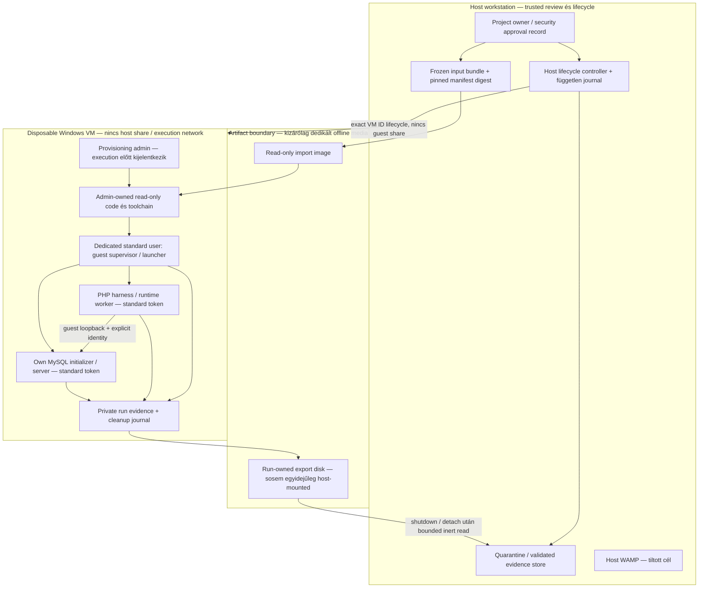

# RMA C3-02.8 — Execution Architecture Specification

Dátum: 2026-11-16. Hatókör: dokumentáció és statikus elemzés.
Verdikt: **SPECIFICATION COMPLETE — IMPLEMENTATION APPROVAL REQUIRED**.
Az A1/B2/C2 a C3-02.8 feladatban elfogadott architekturális korlát;
az alábbi új interfészek és fájlok specifikációk, nem létező implementációk.

**Aktuális alkalmazhatóság:** a 2026-11-24-i owner amendment (§1.1) szűkíti
az alábbi korábbi A1/B2/C2 profil kötelező hatókörét. A korábbi PoC-leírás
nem általános RMA-fejlesztési előfeltétel.

## 1. Vezetői összefoglaló

A PoC kizárólag eldobható **Windows VM-ben (C2)**, dedikált standard local
userként **(B2)**, külön trusted kiválasztott, verziózott input manifesttel
**(A1)** futhat majd. Hoston nincs MySQL/PHP PoC-végrehajtás. A host csak
review-zott csomagot ad át, VM-lifecycle-t felügyel és nem futtatható
evidenciát fogad vissza; host filesystem sharing és execution network nincs.

A történeti `evidence/results.json` byte-szinten változatlan marad. A jelenlegi
launcher/runner létezési blokkolóját majd történeti hash-ellenőrzés és külön
input/run szerződés váltja fel, nem törlés. A trusted manifest digestet a
futó vendég által nem írható owner approval record választja ki. A hashlista
önmagában nem bizonyít eredetet. A provisioning admin külön fázis, nem a
Phase B szülője; minden runtime child indulás előtt standard token-kapun megy át.

A `Prototype` executor-owned explicit Laravel/PDO rootja és a szűk
single-INSERT/trigger irány marad a vizsgálat tárgya. T01–T14 nem futott,
változatlan harness nem felel meg e szerződésnek. A két eredeti PARTIAL
eset, a hiányzó fault-scope és az oracle-hiányok külön láthatók. **WP7-F01
OPEN — BLOCKER; WP7-F02 OPEN — PARTIALLY VERIFIED — HIGH**, kizárólag
operátori filesystem-részproof. Ez nem implementation-, migration- vagy execution approval.

### 1.1. Owner amendment — RMA application focus (2026-11-24)

Autoritatív döntés: [ADR-0006 §14.2.2](../decisions/0006-rma-repair-management-architecture.md).
Az ordinary RMA DB-integrációs tesztek elsődleges környezete a meglévő
[guardolt Laravel/Pest/MySQL/CI tesztút](../../docs/backend-quality-gate.md),
dedikált tesztadatbázissal és credentiallel. Saját manifest-verifikáció,
natív Windows inspection, VM-provisioning és child-token infrastruktúra
nem kapuja ennek az útnak. A1.3 és a kapcsolódó custom infrastruktúra fejlesztése
felfüggesztett; nem kerül törlésre vagy sikertelennek átminősítésre.

A §1 és §3–13 VM/token/import/export és custom manifest mechanizmusai a
korábbi standalone C3-02 PoC-profilhoz tartoznak. Az ordinary tesztút nem e
harness másik indítási módja: L/R/W guardjai nem távolíthatók el vagy kerülhetők meg.
A profil-specifikus A/B/V/M/E acceptance-mechanizmusok nem ordinary teszt-előfeltételek;
az eredeti integritási, DB-jogosultsági, izolációs, audit-, no-production és
failure-evidence követelmények továbbra is igazolandók. VM/token-próba nem
jelölhető ordinary teszteredményből PASS-nak; az új út tesztjei az eredeti
WP2/WP7 követelményazonosítókhoz kötendők, kihagyás csak explicit indoklással.

Laravel service-owned root az elfogadott technikai irány, nem bizonyított
WP7-F01-megoldás. Nem kötelező a Prototype single-INSERT/trigger megoldását
alkalmazási architektúrává emelni; a szükséges DB-enforcement, raw bypass-védelem,
atomikus command/audit és failure/retry bizonyítás WP2 feladata marad.
**WP7-F01/F02 OPEN; Transaction PoC NOT READY.** Meglévő verifier-kód és minden
történeti report/evidence megőrzendő. Nincs új futtatási vagy implementációs engedély.
Fejlesztési prioritás: [C2-terv §2.1–2.2](rma-0003c2-detailed-schema-review-plan.md).

## 2. Baseline és források

### 2.1. Repository és megőrzési baseline

| Ellenőrzés            | Közvetlen eredmény                                                                  |
| --------------------- | ----------------------------------------------------------------------------------- |
| Repository            | `C:\wamp64\www\km\KM_Production`                                                    |
| Branch                | `feature/returns-repair-management`                                                 |
| HEAD                  | `c8c01cae0df454674fd39c9f26a04015fa105c98`, elvárt `c8c01ca` egyezik                |
| Teljes kezdeti status | Kizárólag az alábbi két `??` fájl; tracked és index diff üres                       |
| Untracked 1           | `.kiro/designs/rma-0004-c3-02-6-preflight-evidence-and-poc-readiness.md`            |
| Untracked 2           | `.kiro/designs/rma-0004-c3-02-7-poc-execution-safety-remediation-plan.md`           |
| Eltérés               | Váratlan vagy kapcsolódás nélküli módosítás nincs                                   |
| C3-02.6 SHA-256       | `59c52b2e9a2f5981b99d1813593db92faf341d9393f878c0e2294dfee4239a55`                  |
| C3-02.7 SHA-256       | `30e03b89ac61e1d33d8dfa96a07c308c8f8bfd0ce6b05eaacfdb7fa4afd94c0e`                  |
| Kezdő leltár          | 936 fájl, digest `d3534826a5c1d0e3070484c0db0638b7c9bd6bdec032b5d115b50879bccc7583` |

A leltár algoritmusa: read-only `git ls-files -z --cached --others
--exclude-standard`; egyedi UTF-8 pathok Python-rendezése, regular file-onként
raw-byte SHA-256, `(path,hash)` listára `json.dumps(..., ensure_ascii=False,
separators=(',', ':'))`, UTF-8 bájtok SHA-256. Ignored/outside-inventory
környezetre nem megőrzési bizonyíték. Külön leltárfájl nem készült.

### 2.2. Forráskulcsok és pontos hivatkozások

A `L:338–340` jelölés 1-alapú baseline-sorokat, a `§` dokumentumfejezetet
jelent. A későbbi változtatás előtt ezek újraellenőrzendők.

| Kulcs | Közvetlenül vizsgált forrás                                                                       | Releváns rész                                                                       |
| ----- | ------------------------------------------------------------------------------------------------- | ----------------------------------------------------------------------------------- |
| ADR   | [ADR-0006](../decisions/0006-rma-repair-management-architecture.md)                               | Státusz, §3.2–3.4, §10–11: accepted integrity/traceability/transaction határok      |
| C01   | [C3-01 terv](rma-0004-c3-01-transaction-integrity-proof-plan.md)                                  | §5.3, §6–9, §12–15: Model C, caller/root, proof és authorization                    |
| C02   | [C3-02 eredmény](rma-0004-c3-02-transaction-boundary-poc-results.md)                              | §2, §4–12: környezeti stop, előkészített szűk prototype, nem futott tesztek         |
| C022  | [C3-02.2 ACL-diagnosztika](rma-0004-c3-02-2-windows-acl-diagnostic-results.md)                    | §5/8/10–12: restricted token, native exit és határok                                |
| C024  | [C3-02.4 hardening](rma-0004-c3-02-4-launcher-hardening-results.md)                               | §2–3/6–13/15–16: L/D változás, unit/static/runtime elkülönítés                      |
| C026  | [C3-02.6 review](rma-0004-c3-02-6-preflight-evidence-and-poc-readiness.md)                        | §4–8: közölt Preflight-részhalmaz, G01–G12                                          |
| C027  | [C3-02.7 terv](rma-0004-c3-02-7-poc-execution-safety-remediation-plan.md)                         | §3–8/10–13: A/B/C alternatívák, függőségek és tervezett kapuk                       |
| WP2   | [C2 WP2](rma-0003c2-wp2-mysql-schema-integrity-review.md)                                         | §13/17: runtime permissions, V38/V40–V43 és selected profile proof                  |
| WP7   | [C2 WP7](rma-0003c2-wp7-verification-migration-readiness.md)                                      | §6/12.8/13–16: WP7-F01/F02 és canonical48 closure                                   |
| D     | [PoC README](../../tests/ProofOfConcept/RmaTransactionBoundary/README.md)                         | Phase A/B, exact DACL, contract és cleanup limits                                   |
| L     | [launch.ps1](../../tests/ProofOfConcept/RmaTransactionBoundary/launch.ps1)                        | 59–201 path/token/ACL; 259–330 sandbox; 333–393 Phase B; 396–462 lifecycle/output   |
| P     | [Prototype.php](../../tests/ProofOfConcept/RmaTransactionBoundary/Prototype.php)                  | 13 autoload; 28–64 config/PDO; 75–108 state/CALL; 113–167 ownership/retry           |
| R     | [run.php](../../tests/ProofOfConcept/RmaTransactionBoundary/run.php)                              | 11–13 stop; 37–56 error helpers; 60–107 setup; 132–359 T01–T14; 370–392 output/stop |
| W     | [worker.php](../../tests/ProofOfConcept/RmaTransactionBoundary/worker.php)                        | 7–29 runtime-only config, pipe barrier, state és execute                            |
| S     | [schema.mysql](../../tests/ProofOfConcept/RmaTransactionBoundary/schema.mysql)                    | 3–29 öt tábla; 30–42 complete trigger; 44–77 `poc_post`                             |
| H     | [történeti results.json](../../tests/ProofOfConcept/RmaTransactionBoundary/evidence/results.json) | 2–54 agent-recorded failure/counts; 267–275 scope és hat source hash                |

H hat forrás byte-hash-ét őrzi: L/P/D/R/S/W. A mai L és D eltér a hardening
előtti hashtől, dokumentált C024 §2–3 változásként; ez nem bizonyított tamper.
L:338–340 csak H létezését vizsgálja, nem ellenőrzi tartalmát/hash-eit;
R:11–13 ugyanezt tiltja. R:375–383 utólag öt source hash-ét írná a fix H
célra, checked write nélkül. P:13 vendor autoloadja nincs e listában.
H nem A1 input manifest, nem C3-02.5 output, és nem pre-execution verifier.
H saját raw-byte hash-e:
`a2e52bc4f68efea95035caa8ec8ddcac9bf941ee13bf30f516f39312449bc9b5`.

A repository és statikus mechanizmus közvetlenül ellenőrzött. C026 §4
elevated operátori Preflight-sikere közölt részhalmaz, nem most reprodukált
runtime. Platform/API/MySQL-config/VM capability e specifikációra nincs
runtime igazolva; a tervezett kontrollok követelmények, nem meglévő képességek.

## 3. Architektúra és trust boundary-k



| Szereplő                | Felelősség                                                                                     | Tiltott átlépés                                                                      |
| ----------------------- | ---------------------------------------------------------------------------------------------- | ------------------------------------------------------------------------------------ |
| Host owner/reviewer     | Accepted A1/B2/C2, approved bundle/manifest/profile digest, run-scope és expiry kiválasztása   | Guestből visszaírt approval, automatikus authorization a manifest booleanjéből       |
| Host controller         | Exact VM/disk ID provisioning/import/detach/destroy, independent UTC journal és export receipt | Host WAMP start/connect/credential átadás; processnév alapján globális kill          |
| VM provisioning admin   | Template/toolchain/test account/ACL/firewall/trusted verifier provisioning, import ellenőrzés  | Runtime DB/PHP elevated parentként indítása; provisioning secrets megtartása         |
| Standard execution user | Fresh saját run-root, token/environment/input gate, own-process supervision, runner indítás    | Host access, admin group, arbitrary script/binary/config vagy live input update      |
| MySQL process           | Csak VM-local datadir/explicit guest loopback; synthetic schema/roles                          | WAMP/default datadir/config, host listener vagy alternatív DB fallback               |
| Evidence custodian      | Guest artifact finalizálás, host quarantine-validálás, readback hash és retention              | Exportált script/HTML/macro futtatása; raw secret publikálása vagy history felülírás |

A guest runtime untrusted a host szempontjából. Guest evidence logikai
append-only és hash-kapcsolt, de ugyanazon SID memóriája/írásai nem önmaguktól
hitelesek. Független host receipt/journal és lezárt artifactok korlátozzák a
visszamenőleges átírást. Guest/host admin és hypervisor kompromittálás nem
teljesen eliminálható; a §11 külön residual riskként kezeli.

Állapotgép: `IMPORTED -> INPUT_VERIFIED -> IDENTITY_VERIFIED ->
ENVIRONMENT_VERIFIED -> AUTHORIZED -> MYSQL_INITIALIZED -> INSTANCE_VERIFIED
-> SCHEMA_VERIFIED -> TESTING -> EVIDENCE_SEALED -> GUEST_STOPPED ->
EXPORTED -> DESTROYED -> REVIEWED`. Bármely gate ERROR/UNKNOWN esetén az új
üzleti/test művelet tiltott; `BLOCKED/INTERRUPTED -> OWNED_CLEANUP` ág lép életbe.
Cleanup/evidence writer és containment előzetes fixture-proofja az AUTHORIZED
előfeltétele, nem a későbbi teardown eredményével alkotott körkörös függőség.

## 4. A1 — Versioned input manifest specifikáció

### 4.1. Fájl- és sémahatár

Javasolt, **most nem létrehozott** elrendezés: a frozen bundle gyökere alatt
`integrity/inputs-v1.json`; H változatlan eredeti relatív útján; külön
`run-output/<run-id>/` csak runtime output diskre mutató approved fizikai root
alatt, nem reparse/symlink alias formájában. A manifest nem tartalmazza saját
hash-ét: exact byte-digestje a független approval recordban van.

| Mező                           | Kötelező típus / szabály                                                                                                         |
| ------------------------------ | -------------------------------------------------------------------------------------------------------------------------------- |
| `schema_version`               | Exact string `1.0`; unknown version és unknown mező tiltott                                                                      |
| `manifest_id`, `poc_version`   | ASCII azonosító `[A-Za-z0-9._-]{1,80}`, explicit verzió; reuse más tartalommal tiltott                                           |
| `created_at_utc`               | Exact UTC `YYYY-MM-DDTHH:mm:ssZ`, csak egész másodperc; A1.1-T01 szerint, nem provenance önmagában                               |
| `example_only`                 | Boolean; production verifier csak `false` értéket fogad el                                                                       |
| `baseline_commit`              | 40 lowercase hex; dirty approved inputs külön exact inventoryval, nem HEAD-only proof                                            |
| `profile_id`, `profile_sha256` | Approved immutable execution profile ID és raw-byte digest; profile tartalmazza a bináris/config/identity/VM/deadline szerződést |
| `historical_artifacts`         | Nem üres lista, elemenként `path`, `size_bytes`, `sha256`, `provenance_ref`; H és a csomagolt történeti reportok byte-azonossága |
| `inputs`                       | Nem üres exact file-lista, elemenként `path`, `category`, `size_bytes`, `sha256`; explicit entrypointok is benne                 |
| `category`                     | Enum: `poc_code`, `schema`, `toolchain`, `dependency`, `configuration`, `documentation`; más érték STOP                          |
| `size_bytes`, `sha256`         | Nemnegatív 64 bites integer; 64 lowercase hex; raw bytes, nincs newline/encoding-normalizálás                                    |
| `provenance_ref`               | Approval/archive ID, nem credential/abszolút személyes path; az érvényességet külső record adja                                  |

**A1.1-T01 — Timestamp Contract (Accepted, 2026-11-17).** A manifest timestamp
formátuma kizárólag `YYYY-MM-DDTHH:mm:ssZ`: UTC, literális nagybetűs `T` és
`Z`, pontosan egész másodperc; törtmásodperc és timezone offset nem engedett.
Szigorú Gergely-naptári dátumellenőrzés szükséges, hibás dátum automatikus
normalizálása nélkül. E konkrét konfliktusban a
[C3-02.9-A §4](rma-0004-c3-02-9a-manifest-integrity-implementation-plan.md)
timestamp-szerződése az irányadó; a C3-02.8 ennek megfelelően összehangolva.
A döntés nem módosít történeti manifestet, evidence-t vagy végrehajtási eredményt.

| Érték                       | Elvárt eredmény |
| --------------------------- | --------------- |
| `2026-11-17T12:00:00Z`      | VALID           |
| `2026-11-17T12:00:00.123Z`  | INVALID         |
| `2026-11-17T13:00:00+01:00` | INVALID         |
| `2026-02-30T12:00:00Z`      | INVALID         |
| `2026-11-17 12:00:00Z`      | INVALID         |

A teljes bundle minden regular file-ja szerepel vagy `inputs`, vagy
`historical_artifacts` alatt; a manifest maga az egyetlen külön pinned file.
Listák növekvő ASCII path-sorrendben, duplicate nélkül. Egymás közötti
átfedés és üres/extra file tiltott. Runtime generált secret/data/log/output
nem része a bundle-nak; újonnan létrehozott tárhelyen él. A bemeneti lista
P:13 miatt lefedi a tényleges vendor dependency closure-t, PHP/MySQL/PowerShell
toolchain és betöltött DLL/plugin/ini/config állományokat is. Az OS-image
komponensei image ID/build/provenance szerint külön pinned baseline-hoz tartoznak.

Javasolt v1 parser/profile felső korlát: manifest 16 MiB, legfeljebb 100000
file-entry, egy file 2 GiB, teljes bundle 8 GiB, canonical relative path
240 ASCII karakter. Túlméret vagy szám-overflow ERROR, nincs részleges verify.
Exporthoz legfeljebb 10000 file, file-onként 256 MiB és összesen 1 GiB;
az exact approved profil szigoríthat, bővítés új security review/digest.
E limitek tervezett értékek, nem a repositoryban mért csomagméretek.

### 4.2. Csak szemléltető, nem futtatható manifestpélda

Az alábbi hash-ek, méretek, azonosítók és időpont kizárólag illusztratívak.
Az `example_only=true`, a nulla hash-ek és a hiányos inventory miatt ezt a
verifiernek el kell utasítania. Ez Markdownba ágyazott példa, nem tényleges manifest.

```json
{
    "schema_version": "1.0",
    "manifest_id": "example-inputs-v1",
    "poc_version": "example-0.1",
    "created_at_utc": "2000-01-01T00:00:00Z",
    "example_only": true,
    "baseline_commit": "0000000000000000000000000000000000000000",
    "profile_id": "example-windows-standard-v1",
    "profile_sha256": "0000000000000000000000000000000000000000000000000000000000000000",
    "historical_artifacts": [
        {
            "path": "tests/ProofOfConcept/RmaTransactionBoundary/evidence/results.json",
            "size_bytes": 0,
            "sha256": "0000000000000000000000000000000000000000000000000000000000000000",
            "provenance_ref": "example-history-record"
        }
    ],
    "inputs": [
        {
            "path": "tests/ProofOfConcept/RmaTransactionBoundary/launch.ps1",
            "category": "poc_code",
            "size_bytes": 0,
            "sha256": "0000000000000000000000000000000000000000000000000000000000000000"
        }
    ]
}
```

### 4.3. Authenticity, canonical path és TOCTOU

Az owner/security a hoston külön approval recordban rögzíti az exact manifest
byte-digestet, bundle/profile/image digestet, engedett entrypointokat és scope-ot.
Guest által írható fájl vagy CLI-vel választott tetszőleges expected hash nem
trust anchor. A host összehasonlítja az import-media digestet a recorddal; a VM
template admin-owned, standard user által nem írható trusted bootstrap verifierje
ugyanezt az offline approval inputot használja. A bootstrap/verifier digestje
a template provenance része, nem saját magát hitelesíti egy mutable bundle-ból.
Aláírás választható későbbi mechanizmus; most nem feltételezünk signing szolgáltatást.

Path grammar: `/` elválasztó, relatív ASCII szegmensek `[A-Za-z0-9._-]+`;
tilos `.`/`..`, üres szegmens, leading slash, backslash, drive/UNC, `:`, NUL,
trailing dot/space és Windows reserved device basename. A verifier nem
javítja át a tiltott pathot. Ordinal-ignore-case összehasonlítással duplicate/
case collision STOP, kicsomagolás **előtt** is. Egyeztetni kell a target OS
teljes pathkorlátját; túl hosszú input elutasított, nem rövidnévre fallback.
Minden komponens és minden felsorolt file no-reparse, nincs symbolic link,
junction vagy mount-point traversal. Hardlink count eltérés és nem jóváhagyott
named alternate stream tiltott. Root canonical path és volume/file identity
handle alapján vizsgált, a rooton kívüli resolved target STOP.

Raw-byte hash egyszeri ellenőrzése nem zárja ki a verify/use versenyt. A bundle
admin-owned, run usernek read/execute-only; input volume nem runtime output,
live update nincs. Trusted supervisor indítás előtt és run végén újraellenőriz;
runtime child csak exact verified pathról, sanitized working directory/loader
profilból indulhat. Módosuló input vagy file identity esetén az új child tiltott,
futó run INTERRUPTED/INTEGRITY_FAIL. Privileged/same-user attacker korlátját a
token/VM/provisioning separation kezeli; a rehash nem atomi security proof.

### 4.4. Verifikációs sorrend és eredmény

1. Bounded JSON-beolvasás, strict UTF-8, duplicate JSON-key/unknown schema/
   mező/type elutasítása; byte-digest összevetése a **külön trusted** recorddal.
2. Profile/baseline/entrypoint/history referenciák egyeztetése; example/digest
   substitution/stale approval elutasítása. Timestamp nem helyettesíti a jóváhagyást.
3. Teljes media inventory ellenőrzése kicsomagolás előtt; safe create-new staging,
   canonical/no-reparse/duplicate/size/hash checks, unexpected file kizárása.
4. H és minden felsorolt history byte-hash ellenőrzése. A régi source hash-eket
   történeti tényként őrizzük, nem követeljük tőlük a mai hardening-hash egyezését.
5. Új code/vendor/bináris/config inputok exact ellenőrzése és read-only staging;
   ismételt entrypoint verification trusted wrapperben **autoload/initialize előtt**.
6. Result artifact kiadása: `verification_status=PASS|FAIL|ERROR`, mismatched
   pathok és reason code; `input_eligibility=ELIGIBLE_FOR_IDENTITY_GATE|DENIED`.
   PASS önmagában nem engedélyez SQL-t: B/C és owner run-authorization is kell.

Verification-result kötelező mezők: `schema_version`, `run_id`,
`manifest_id`, `expected_manifest_sha256`, `actual_manifest_sha256`,
`trusted_approval_ref`, `verifier_image_ref`, `checked_files`, `checked_bytes`,
`history_status`, `input_status`, `failure_codes[]`, `started_at_utc`,
`finished_at_utc`, `elapsed_ms`, `input_eligibility`. Hiányzó adat ERROR/DENIED;
nem használunk boolean default-success értéket.

Failure code-ok: `MANIFEST_UNTRUSTED`, `MANIFEST_SCHEMA_INVALID`,
`PROFILE_MISMATCH`, `PATH_INVALID`, `CASE_COLLISION`, `REPARSE_FOUND`,
`INPUT_MISSING`, `INPUT_UNEXPECTED`, `SIZE_MISMATCH`, `HASH_MISMATCH`,
`HISTORY_CHANGED`, `VERIFIER_UNVERIFIED`, `EVIDENCE_WRITE_FAILED`.
Minden failure-nél initializer/test executed count=0; direct R/W belépés
trusted run contract nélkül elutasított, nem elég az environmentben lévő
`isolation_gate` string (P:28–43 jelenlegi korlát).

### 4.5. Migration, rollback és recovery

Az új implementáció előbb H-t pineli, megőrzi a régi JSON státusz/provenance/
hat source-hash mezőit, majd külön A1 manifestet vezet be. L:339 és R:11
létezési STOP-ját csak az új history/input/output kapuk együttes bevezetése
válthatja fel. A régi output filename nem lesz újrahasznált futási cél.
R:375–383 helyett checked create-new run-output és actual cleanupot külön
lezáró supervisor index szükséges; a source hash-ek futás előtt is mérendők.

Rollback: új entrypoint/profil deaktiválása, utolsó owner-approved frozen bundle
visszaválasztása; a régi verzió is csak saját scope authorizationnel futhat.
History és már létrejött új run evidence nem törölhető/írható át. Invalid import
quarantine-ba kerül; érvénytelen inputon nincs DB recovery-kísérlet. Retained
run erőforrás exact VM/disk ID alapján külön teardown; a rollback nem host DB-restore.

## 5. B2 — Dedicated standard identity specifikáció

### 5.1. Identity, permission és secret contract

Dedikált VM-local standard account; neve profilparaméter, a tényleges SID
provisioning után az approved VM/run recordba kerül. Nem host/domain account,
nincs host credential forwarding. Kötelező local membership csak a standard
`Users` (`S-1-5-32-545`); gépenkénti implicit csoportokat a token evidence
rögzíti. Administrators (`S-1-5-32-544`), Backup/Server/Account/Print Operators,
Hyper-V/remote-management/Remote Desktop és más privilegizált local/domain
group tagság tiltott, **deny-only admin membership is tiltott e dedikált accountnál**.
SYSTEM/LOCAL SERVICE/NETWORK SERVICE nem execution identity. A guest login
local interactive; service-logon, batch-logon, impersonation vagy debug/take-
ownership/backup/restore/load-driver jog nem követelmény, nem adható implicit módon.
Unexpected privilege/membership esetén STOP, nem automatikus token reduction.

A v1 alapprofilban csak `SeChangeNotifyPrivilege` lehet enabled; a templateben
szükséges további standard privilege-ek csak név szerint approved, disabled
állapotban szerepelhetnek. Debug, impersonate, assign-primary-token, TCB,
backup/restore/take-ownership/load-driver privilege jelenléte tiltott akkor is,
ha disabled. Az exact token-privilege lista template capability-review és
negatív próba tárgya; nem állítjuk, hogy a jelenlegi gépen ez a lista mérve van.

| Erőforrás                               | Provisioning identity                                      | Standard run identity                                                                                                                          |
| --------------------------------------- | ---------------------------------------------------------- | ---------------------------------------------------------------------------------------------------------------------------------------------- |
| Frozen code/toolchain/verifier/profile  | Owner/admin, írhat provisioning alatt, futás előtt lezárja | Read/execute, nincs modify/delete/WRITE_DAC/owner change                                                                                       |
| User temp parent                        | Guest OS profile szerint; parent ACL nem lazítható         | Saját random root create joga kell; actual effective proof                                                                                     |
| Fresh run-root, data/log/private config | Nem live handoff, nincs retained admin-owned futási root   | Owner a dedikált user SID; protected DACL, egy explicit user FullControl OI/CI, opcionális shape-azonos SYSTEM/admin; más ordinary SID tiltott |
| Evidence working directory              | Védett guest output disk/root előkészítése                 | Saját run output create/write/readback; input/history felülírás nincs                                                                          |
| Host stores/WAMP/host-drive             | Guest számára nincs mount/credential/network route         | Nincs hozzáférés vagy host identity                                                                                                            |
| Process objects                         | Nem indít runtime childot elevated szülőből                | Saját initializer/server/PHP/worker query/wait/terminate és containment; idegen processhez nem kér debug jogot                                 |

FullControl kizárólag a saját disposable writable rootra kell a jelenlegi
ACL/cleanup kontraktus megtartásához (L:187–201/259–305); ez nem általános
filesystem jog. Evidence-directory write access miatt a standard user által
készített napló nem önmagában immutable: host seal adja a következő bizalmi határt.

OS-account credential csak interaktív approved provisioning/login csatornán,
nem source/CLI/JSON outputban. DB setup/admin/runtime/definer secret runonként
új, legalább 32 random bájt; csak private bootstrap és explicit runtime channel.
DB-root szerep nem Windows admin. W-nek csak runtime secret adható (W:9–11),
PHP parent setup- és runtime-scope keveredése marad szintetikus harness-határ,
nem production credential-isolation proof. Process memory/dump/VM-disk retention
kockázatot külön kezeljük; string nullázása nem garantált secure erase.

### 5.2. Token-, parent- és child-kapuk

Execution elvárás: approved exact user SID, primary token, nincs thread
impersonation, `elevated=false`, admin sem enabled sem deny-only groupként,
**Medium integrity (`S-1-16-8192`)**, `restricted=false` az első approved
profilban. UAC változatlan/enabled a template-policy szerint; UAC-off/elevated/
High/System/Low/unknown integrity nem helyettesíti az approved profilt.
Restricted token nem automatikusan veszélyes, de más AccessCheck feltétel;
külön profil/proof nélkül fail closed, nem workaround a Codex-tokenre.

Trusted bootstrap és standard guest supervisor saját tokent, parent image/
creation-time/SID-t és current logon contextet ellenőriz. Provisioning admin
kijelentkezése és normál standard-user login után indul a supervisor; elevated
provisioner nem a Phase B parentje. Minden initializer/server/PHP/W childnál
exact image hash/path, primary token/SID/elevation/groups/integrity, parent
process identity és inherited handles ellenőrzendő. Ennek **írás/végrehajtás
előtti** biztosítására a tervezett process helper suspended creation + job
assignment + token verification + resume állapotgépet köteles megvalósítani.
Az exact Windows API megvalósítása capability-reviewed új kód lesz, ma nincs
ilyen helper; ha standard joggal nem állítható elő a kontroll, BLOCKED, nem elevation.

Inherited env explicit allowlistből újraépül: szükséges Windows/SystemRoot,
approved toolchain PATH, saját TEMP/TMP, locale/time profil és per-role private
config/run ID. App DB\_\*/DATABASE_URL, host secrets, PHP ini-scan/auto-prepend,
user profile module/script/plugin és arbitrary current-directory loading
nem örökölhető. Absolute tool path, approved ini/extension closure és explicit
working directory kell; a PATH-szűrés önmagában nem teljes loader proof.

### 5.3. Cleanup és szükséges launcher-változások

Guest supervisor ugyanazon standard SID alatt tartja az own process handles,
PID+creation-time+image/job/run ID bindinget. Parent-death containment,
independent host VM deadline és durable run journal együtt kell; finally
önmagában nem elég. Orphan esetén csak az exact run process/VM állítható le,
bare PID vagy globális `mysqld` név nem. Ha own-root identity/DELETE/journal
bizonytalan: retained/unknown, owner recovery; nincs broad grant/take-ownership.

**A mai launcher változtatás nélkül nem megfelelő:** L:120–140 mér, de nem
tilt elevated Phase B-t; L:364/373 normál Start-Process, PHP L:387 nem külön
identity/child-token gate. L:259–305 saját invocation identityt és kezdeti
ownert vár; nem támogat admin->standard live root-handoffot, és Preflight
után törli az üres könyvtárat. Pontos adaptáció: új B2 policy a preflight
és minden spawn előtt; fresh standard-owned root; trusted process helper;
role-env allowlist; own-job/handle tracking; separate evidence/cleanup result;
nincs implicit elevated kivétel. Preflight default és PoC explicit
authorization/confirmation megmarad; a korábbi Preflight PASS nem skip gate.

## 6. C2 — Disposable Windows VM specifikáció

### 6.1. Minimum profil, hálózat és artifact boundary

Product/hypervisor nincs kiválasztva: repositoryból elérhető platform nem
igazolható. Követelmény: támogatott, patch-elt 64 bites Windows guest,
NTFS local fixed disk, PS7.4+ (L:1), approved PHP8.4+ és MySQL8.4 exact build,
admin/standard identity separation, offline import/export media, explicit
VM/disk ID, default-deny network, no-host-integration és bounded lifecycle
controller capability. A kiválasztott exact Windows/arch/toolchain kombináció
alkalmassága későbbi elfogadási kapu, nem most bizonyított kompatibilitás.

| Fázis              | Hálózat                                                                                     | Artifact mechanizmus és policy                                                                                                              |
| ------------------ | ------------------------------------------------------------------------------------------- | ------------------------------------------------------------------------------------------------------------------------------------------- |
| Image/provisioning | Csak approved package/update források célzott allowlistje; időkorlátos, acquisition journal | Csak provenance/hash ellenőrzött csomag; sem production secret, sem WAMP connection                                                         |
| Freeze/import      | NIC disconnected/default-deny; provisioning credential/session eltávolítva                  | Owner-approved read-only import image/virtuális optikai media; nincs shared folder/drive                                                    |
| Execution          | NIC leválasztva és guest default-deny; kizárólag guest loopback MySQL/PHP                   | Nincs internet, host service, DNS/proxy, clipboard, drag/drop, shared memory file bridge, drive mapping, credential/USB passthrough         |
| Export             | Nincs hálózat és nincs clipboard                                                            | Kizárólag run-owned virtual output disk; guest process stop és shutdown után detach, host quarantine-ban offline read-only inert extraction |

A virtuális import/output media nem host directory és nem host-drive mapping:
dedikált csereartifact, soha nincs egyszerre írható guest- és host-mount.
Import read-only, runtime input read-only staging; output export nem használja
az input médiát. Host evidence reader bounded, no-auto-run/no-execute,
nem tölthet be exported executable/plugin/macro-t. Guest által módosítható
filesystem image-et a host untrusted adatként kezel, nem automountolja normál
desktop sessionbe. A megfelelő offline reader/controller kiválasztása §13 döntés.

Host WAMP nincs a VM-ben: nincs megosztott adatkönyvtár, drive, backup mount,
credential vagy host-network route. Pozitív izolációs proof a controller
config/integration inventory + guest interface/route/firewall snapshot +
külön engedélyezett synthetic denial trial; nem WAMP-login vagy élő production
probe. Execution alatt új device/network/share megjelenés INTERRUPTED/STOP.
Hypervisor management credential és host-control socket nem kerül a guestbe.

### 6.2. VM-lifecycle és recovery

1. Platform owner exact image/build/provenance és provisioning input hash-eket
   rögzít; acquisition elkülönül a teszt-run VM-től.
2. Admin provisionálja a standard usert, code ACL-t, trusted verifiert és
   policyt; secrets/user run data nélküli immutable baseline template/snapshot készül.
3. Host exact run ID-hez új disposable clone és data/output disk ID-t rendel;
   snapshot nem élő MySQL-datadir mentés és nem tartalmaz tesztsecretet.
4. Approved read-only artifact import; trusted manifest/media digest verify;
   import media leválasztás a staged verified input után.
5. Provisioning admin session lezárul; dedikált standard login, actual SID/token
   binding és profile/env/ACL/network/clock evidence készül.
6. Guest/host izoláció és supervisor/writer/cleanup előzetes fixture-proof
   ellenőrzött; owner által jóváhagyott run descriptor érvényesítve.
7. Csak explicit lifecycle authorization után fresh datadir/init/server,
   independent OS mapping, metadata identity, synthetic schema/grant proof.
8. Csak explicit transaction scope engedély után T01–T14; nincs fallback
   másik VM-re/toolchainre/instance-ra ugyanazon run alatt.
9. Eredmények és cleanup snapshot lezárása, secrets kizárása/redakció,
   output disk flush/readback, guest shutdown.
10. Host exact output disk detach/quarantine export hash/schema validation;
    saját VM/data/input clone destroy, host lifecycle receipt hozzáfűzése.

Hiba esetén az új műveletek tiltottak, own cleanup, evidence partial és
quarantine; biztonságos export hiányában nincs success vagy bizonyíték nélküli
closure. Forced shutdown/OS failure után nem garantált utolsó log/flush vagy
vendég cleanup; host journal `INTERRUPTED/UNKNOWN` és retained exact resource ID.
Új run új clone-ból, régi disk csak owner recovery alatt. VM destruction a
guest own-process cleanupjától külön evidence; backup/snapshot maradványokat
és export media retentiont is inventoryzni kell, nem ígérünk fizikai secure erase-t.

### 6.3. Reprodukálhatóság

Run manifest rögzíti: image/template/snapshot/provisioning recipe digest,
Windows edition/version/build/patch és architecture, PHP exact version/build/
PDO/mysqlnd/ini/extensions, MySQL exact patch/executable/DLL/plugin/config,
PowerShell version/edition, Laravel lock+vendor ref és tényleges dependency
digest, charset/collation/sql_mode/isolation/autocommit/timezone, supervisor/
verifier/tool hashes. A korábbi C02 verzióadatok történetiek, nem új VM-profil.

Clock: execution előtt host/guest UTC összevetés; javasolt profile-limit
legfeljebb 5 másodperc eltérés, exact profil owner által jóváhagyandó. Futás
közben nincs network time dependency; időtartam/deadline monotonic clockból,
UTC csak korreláció. Clock anomaly jelölt evidence, nem vélelmezett timestamp.
Reprodukálhatóság azonos input/profile és invariáns-eredmény; random secret,
SID/UUID/connection ID/run timestamp nem várható byte-azonosnak két futás között.

## 7. Izolált MySQL execution contract

### 7.1. Input, filesystem, config és process

Accepted környezet csak a C2 guest. Standard run user fresh
`RmaBoundaryPoc-<32 lowercase hex>` rootja alatt `data`, `logs`, `private`,
`tmp`; output külön approved guest disk root. Parent local NTFS OS-temp
allowlistet tartja meg L:79–92 szerint; ha guest profil nem kompatibilis,
előre reviewed profile-amendment kell, nem tetszőleges path fallback.
Atomic create-new, canonical root/descendants, unchanged volume/file ID,
no-reparse/junction/hardlink escape szükséges; meglévő datadir elutasított.

Explicit executable és **run-specifikus config file** kell: proposed private
`my.ini` template A1-hash alatt, resolved secretmentes config hash a runhoz.
MySQL exclusive defaults-file mód pontos első argumentumával kell működnie
az exact approved builden; ez a mai L:360–376 `--no-defaults` CLI-only profil
tudatos adaptációja. Nem kombinálunk két feltételezetten ekvivalens mode-ot.
Az exact option semantics capability review és negatív próba tárgya; config
hiány/unknown option/parse failure STOP, sem implicit WAMP/default option-file,
sem env config fallback nem megengedett.

Config-contract: explicit basedir/datadir/tmp/error log/PID file, loopback
`127.0.0.1`, egy recorded nonstandard port 20000–65535 között, X endpoint és
named-pipe/shared-memory/extra network endpoint tiltása, binlog/local-infile
tiltás, server-side file import/export tiltás, approved engine/charset/collation/
SQL mode/UTC/isolation és resource limit. Unsupported option nem elnyelhető.
Bootstrap root-secret külön private file, nem public ini/log/argumentum.
Initializer nem indíthat hálózati tesztet; csak új run-owned datadirhoz fér.

Process identity: dedicated standard SID az initializer/server/PHP/W esetén;
trusted supervisor pre-resume token/image/job gate (§5.2). Mindegyik childhoz
PID, creation-time, image canonical path/digest, parent/job ID, start/end és
exit, run resource binding. A mai L:355–356 port foglalás-elengedés race nem
garancia; bind collision STOP, nincs opportunista port/instance fallback.
Selected port a run descriptorba kerül, majd PID-listener tényleges egyezés kell.

Javasolt explicit tesztprofil deadline-ok: init 60 s, readiness 30 s, worker
barrier 15 s, egy test 120 s, teljes guest run 600 s, graceful stop 15 s,
forced-stop wait 15 s, export 60 s. Ezek **új ajánlott tesztprofilértékek**,
owner elfogadásig nem konfigurált vagy production limitek. Túllépés külön
TIMEOUT, nem retry-val elrejtett PASS. Korlátozott whole-command retry a
synthetic P:153 contract szerint maximum két próbálkozás, csak exact1205/1213,
fresh root/session; más hiba nem retryzható automatikusan.

### 7.2. Endpoint és független instance identity

Csak explicit guest loopback/port + allowlisted `rma_c302_disposable`, új run
tesztprincipalok: setup root, `poc_actor101`, locked `poc_definer`. Runtime
protected-table SELECT + complete API EXECUTE, synthetic U INSERT; protected
DML/DDL/private helper deny (R:75–105). Setup/observer privilege nem runtime-
security PASS. P:47–64 native/nonpersistent explicit PDO és CALL-cursor drain
megmarad, default Laravel/app `.env`/WAMP connection nincs.

**Identity a credential elküldése előtt:** a trusted guest supervisor a már
verified suspended/resumed process handle + creation-time + image + own datadir
és loopback listener mappingből állítja elő az approved instance descriptor-t.
Ez az OS-megfigyelés független a SQL-válaszoktól; foreign listener esetén még
admin connect sincs. Process exit/mapping változás érvényteleníti a descriptor-t.

Az instance UUID-t az initializer által létrehozott run-owned identity metadata
független olvasásából kell a descriptorhoz kötni. Az exact MySQL8.4 buildhez
ehhez szükséges generated-file formátum/API nincs igazolva a repositoryban;
C3-02.9-C előfeltétele a pontos adapter és negatív capability proof, nem
találunk ki meglévő támogatást. Ha nincs függetlenül ellenőrizhető UUID-forrás,
az adapter BLOCKED, SQL first-read UUID nem nevezhető expected UUID-nak.

Ezután csak metadata probe engedett: UUID/datadir/port/version/system-schema
allowlist és resolved settings összevetése a descriptorral, native PDO/profile
attributes és connection ID rögzítése. **Bármely CREATE/DML előtt** minden
identity mezőnek egyeznie kell; a mai R:60–75 csak lekéri az UUID-t és datadir/
port/versiont ellenőriz, ezért bővítés szükséges. Minden runtime/W új connection
ugyanezen instance contracthoz kötött. Connect/read/identity failure STOP;
idegen serveren nincs schema-cleanup, fallback/reconnect másik endpoint tiltott.

### 7.3. Cleanup és megszakítás

| Esemény                           | Harness/supervisor kötelesség                                                                                                          | VM-controller kötelesség / korlát                                                                                   |
| --------------------------------- | -------------------------------------------------------------------------------------------------------------------------------------- | ------------------------------------------------------------------------------------------------------------------- |
| Normál befejezés                  | Saját root/cursor/worker close; actual snapshots; graceful own-server shutdown, exit wait; identity-checked root cleanup; külön result | Guest shutdown, export receipt, exact VM/data disk destroy                                                          |
| Init/start failure                | R nem indul; initializer és bármely server child tracked stop; init/error log, partial root retained vagy own cleanup                  | Deadline/journal és exact clone teardown, nem host service-stop                                                     |
| SQL error                         | Original SQLSTATE/vendor/exception, saját rollback/discard; unrelated caller munkáját nem zárhatja le; no blind retry                  | VM destroy nem rollback proof; előbb snapshot/export ha lehetséges                                                  |
| PHP error/hang                    | Külső guest supervisor stop/reap az own jobnak; server own-handle stop; partial evidence                                               | Host deadline megszünteti az exact VM-et, ha guest nem reagál                                                       |
| Timeout                           | Új execute tiltása, bounded graceful majd forced own-tree stop; outcome/cleanup külön UNKNOWN lehet                                    | Nem lehet timeoutból PASS; host artifact incomplete jelölés                                                         |
| Parent-process termination        | Containment és independent host watchdog; parent finally nem garancia                                                                  | Run journalból orphan VM/disk reconciliation                                                                        |
| Forced process termination        | Utolsó transaction outcome INCONCLUSIVE/UNKNOWN, csak független observer recovery teheti tisztázhatóvá; partial log megőrzendő         | Destroy biztosíthatja az ephemeral guest erőforrás eltávolítását, nem az adatbázis helyes rollbackjének bizonyítéka |
| Guest shutdown / OS/power failure | Guest cleanup/flush/utolsó rekord nem garantálható; nincs fiktív COMPLETE                                                              | Host inventory/retained disk quarantine, offline export lehetőség, explicit destruction/retention outcome           |
| Export/delete failure             | Original artifact és cleanup fail külön; write-error ne ugorhassa át a stop finally-t                                                  | Quarantine + owner recovery; nincs success override és nincs broad recursive host delete                            |

Root törlés csak verified run ownership/canonical file ID/owner/no-reparse,
own-process exit és exportálható evidence mellett. Külön guest data disk
destroy fallback csak host exact resource binding alapján, nem pathnév-glob.
Törlés és path-ellenőrzés nem atomi, privileged actor maradványkockázat.
Logical destruction nem minden storage/snapshot/backup secure erase; retention
inventory és operator policy kell. Harness cleanup PASS és VM destruction
PASS két külön mező; egyik sem pótolja a transaction oracle-t.

## 8. T01–T14 test-oracle mátrix

### 8.1. Közös oracle- és evidence-szabályok

Minden sor **specifikált jövőbeli oracle, ma NOT EXECUTED**. Közös **E**:
A1/B2/C2/authorization/instance/schema/grant kapuk PASS; fresh synthetic DB,
native PDO/nonpersistent connection, autocommit independent observer. **Q**:
`poc_commands`, `poc_business`, `poc_evidence`; **M**: `poc_mutex`; **U**:
`poc_caller_sentinel`; **API**: `poc_post`, `poc_complete`, R:84–96 immutable
UPDATE/DELETE triggerek. **K**: saját cursor/root/connection lezárása, snapshot,
utána közös own server/datadir teardown. E nem current runtime eredmény.

**EV** minden case-hez: run/manifest/profile/image/instance digest és ID,
principal/login/actor, seed/key/payload hash, observer és writer connection ID,
Laravel depth/PDO-active/autocommit előtte/közben/utána, operation order,
before/after row count **és érték/hash**, SQLSTATE/vendor/original exception,
barrier/fault/deadline/elapsed, callback és commit/rollback trace, cleanup,
test oracle version, `operation_outcome`, `oracle_verdict`, `coverage`.
Trace-olási hiba nem fedheti el az eredeti exceptiont (P:150–153 state-read kockázat).

`oracle_verdict=PASS` csak bizonyított összes scoped assertion; `FAIL` megfigyelt
invariánssértés vagy exact expected-rejection hiánya; `INCONCLUSIVE` hiányos
megfigyelés/harness/timeout/process loss, ha nincs már bizonyított sértés;
`BLOCKED` nem teljesült előfeltétel, `NOT_EXECUTED` el nem ért eset. Két külön
tengely: T10/T14 scoped oracle lehet PASS, de `coverage=PARTIAL`; ebből nem lesz
full transaction proof. Bizonyított FAIL-t utólagos cleanup-hiba nem minősít vissza.

### 8.2. Invariáns, előfeltétel, objektum és konceptuális lépések

| Test / current source | Intended invariant                                                   | Preconditions / objects                                  | Conceptual steps                                                                                              | Expected observations                                                                           |
| --------------------- | -------------------------------------------------------------------- | -------------------------------------------------------- | ------------------------------------------------------------------------------------------------------------- | ----------------------------------------------------------------------------------------------- |
| T01 R:132–143         | Executor az egyetlen root/commit owner, nincs korai láthatóság       | E; Q/M/API; fresh executor és observer                   | Execute valid key, afterCall pause; observer read; service commit; új observer read                           | Root depth1/PDO-active; Q=0 commit előtt, Q=1 utána; hash/amount/actor egyezik                  |
| T02 R:144–150         | Fault rollback minden command tényt eltüntet                         | E; Q/M/API; after_business hook                          | Inject fault business után, executor unwind/discard; observer                                                 | 45000, Q=0 minden táblán, root lezárt és lock feloldult, nincs success callback                 |
| T03 R:151–167         | Nested entry reject CALL/factory előtt, caller megmarad              | E; U + Q/API; caller depth2/trans2, sentinel3            | Invoke executor regisztrált callerrel; explicit factory-called flag; caller saját savepoint művelet és commit | Exact unsupported-caller rejection, factory count0, depth2/active megmarad, U=1/Q=0             |
| T04 R:168–180         | Raw caught error nem tart partial commandot, nem rollbackeli U-t     | E; U/Q/M/API; raw root és no-BEGIN variáns               | U insert; raw fault catch, caller commit; no-BEGIN másik fault                                                | Mindkét fault45000; U megmarad, mindkét command Q=0; root a caller tulajdona                    |
| T05 R:181–193         | Protected direct DML/DDL/system read deny és flag bypass nincs       | E; Q/API; T01 PASS és original snapshot                  | Session flags, explicit protected INSERT/UPDATE/DELETE/TRUNCATE/CREATE/system read kísérletek                 | Minden listed deny1142/1044; original row/value/hash változatlan, nincs unauthorized object     |
| T06 R:194–202         | Complete public API működik, helper EXECUTE tiltott                  | E; Q/M/API + `poc_private_helper`; actual grants         | Runtime valid command, majd private helper CALL                                                               | Q=1 valid canonical result; helper1370; actual runtime/definer grants megőrizve                 |
| T07 R:203–211         | Ugyanaz command egyszer, changed payload konfliktus                  | E; Q/M/API; fixed key/amount7/hash                       | Kétszer execute amount7, majd amount8 azonos key-vel                                                          | Replay flag1, Q=1/eredeti amount7/hash; conflict45000, nincs második hatás                      |
| T08 R:212–264, W:7–29 | Két valódi session unique-key wait, egy hatás                        | E; Q/M/API/P_S views; independent worker és pipe barrier | Parent uncommitted command; W ready/go; observer actual wait; parent commit; W replay                         | Külön connection ID; wait workerhez kötött; replay/Q=1; worker clean exit                       |
| T09 R:265–289         | 1205 whole-root retry friss connectionnel                            | E; Q/M/API; admin mutex hold, timeout1s                  | Első root timeout, hook lock release, új rooton teljes command                                                | Exact vendor1205/SQLSTATE; error1/entry2, két session, failed effect0/final Q=1                 |
| T10 R:290–304         | Confirmed commit utáni simulated UNKNOWN lookup, nincs új execute    | E; Q/M/API; deterministic loseAcknowledgement            | Commit után ack withholding; fresh primary canonical lookup                                                   | Execute count1, persisted Q=1/hash; UNKNOWN signal resolved, coverage PARTIAL                   |
| T11 R:305–320         | Business/evidence atomikus, immutable tény admin DML-re sem változik | E; Q/M/API/immutable triggers; T01 PASS                  | Mindkét fault point; setup observer UPDATE/DELETE T01 evidence                                                | Fault45000/Q=0; mutation45000; original row/hash változatlan                                    |
| T12 R:321–329         | Failed lease discard és tiszta következő root                        | E; Q/M/API; egy executor, fresh factory                  | Bad command fault, majd good command                                                                          | Két session; entry depth0/PDO-inactive; bad Q=0/good Q=1, nincs state/cursor/callback szivárgás |
| T13 R:330–345         | Login-bound actor/hash deny, effect0                                 | E; Q/M/API; runtime101, actor102 és session flags        | Actor substitution majd invalid payload hash más key-vel                                                      | Mindkettő45000; mindkét key Q=0; nincs session flag authority                                   |
| T14 R:346–359         | Másik connection caller rootja megmarad, nincs független RMA commit  | E; U/Q/API; regisztrált outer depth1, sentinel14         | Entry reject, caller-state capture; caller saját rollback                                                     | Exact reason, Q=0, depth1/PDO-active; caller rollback után U=0; coverage PARTIAL                |

### 8.3. PASS, FAIL, INCONCLUSIVE, evidence és cleanup

| Test | Pass criteria                                                       | Fail criteria                                                        | Inconclusive criteria                                    | Required evidence                                             | Cleanup expectations / current gap                                                                                    |
| ---- | ------------------------------------------------------------------- | -------------------------------------------------------------------- | -------------------------------------------------------- | ------------------------------------------------------------- | --------------------------------------------------------------------------------------------------------------------- |
| T01  | Minden §8.2 visibility/state/hash assertion teljesül                | Korai observer láthatóság, partial/missing commit, rossz owner/state | Precommit barrier vagy observer snapshot hiányzik        | EV + pre/post commit rows és root boundary                    | K; current count/state assertion van, actual run nincs                                                                |
| T02  | Exact45000, Q=0, root0/lock released                                | Partial durable row, aktív failed root, success callback             | Eredeti hiba/rollback trace vagy fresh observer hiányzik | EV + fault location + rollback/discard trace                  | Failed lease K; current code root/lock/final state proofot erősíteni kell                                             |
| T03  | Exact rejection és factory count0, caller savepoint/U sértetlen     | Factory/CALL elérve, caller commit/rollback mellékhatás              | Refusal reason/savepoint usage nem mérhető               | EV + factory counter + caller trans2 usability                | Caller saját cleanup + K; R:48 broad RuntimeException és factory-sentinel ma false-positive-t engedhet                |
| T04  | Két exact45000/Q0; U megmarad/caller root saját lezárása            | Partial row vagy unrelated U rollback/commit                         | Raw cursor/caller state/error code nem teljes            | EV + mindkét raw connection és U snapshot                     | Caller close + K; current a/b kódot külön assertelni és raw success/no-BEGIN határt külön scoped gapként kezelni kell |
| T05  | Minden expected deny és teljes original row/object snapshot egyezik | Listed jogosulatlan művelet sikerül/érték változik                   | T01 hiányzik, grant vagy snapshot nem megbízható         | EV + statement category/code/SHOW GRANTS, no secrets          | PDO close + K; current count-only snapshot és részleges verb/table coverage erősítendő                                |
| T06  | API success + helper1370 + Q1 canonical                             | Public API hibás vagy helper jogosulatlanul működik                  | Setup/grant ok nem bizonyított                           | EV + public result + helper code + grants                     | K; SQL syntax/definer/effective grants ma nem futott                                                                  |
| T07  | Replay1/Q1/hash/amount változatlan, exact conflict45000             | Dupla effect, changed-payload accept vagy rossz result               | Conflict oka nincs rögzítve                              | EV + első/replay/conflict és full row snapshot                | K; current code nem assertel exact conflict kódot/összes értéket                                                      |
| T08  | Külön session + actual bound wait + replay/Q1 + worker exit0        | Ugyanaz session, dupla effect vagy rossz replay                      | Nem látható wait/P_S, pipe EOF/timeout, worker loss      | EV + barrier/process/token/lock wait/worker stderr/exit       | Worker/job terminate/reap, parent saját rollback + K; current exit/stderr/deadline/result capture hiányos             |
| T09  | Exact1205 + distinct sessions + fresh whole-root retry + egy effect | Nem engedett retry, szennyezett root, dupla hatás                    | Vendor/error classification/fresh observer hiányzik      | EV + original vendor/SQLSTATE, retry hook order/session IDs   | Admin mutex close + K; current trace nem őrzi külön vendor1205-t, valódi1213 nem covered                              |
| T10  | Scoped simulated UNKNOWN és lookup, execute1/Q1                     | Blind replay/rossz hash vagy eltérő durable result                   | Fresh lookup vagy execute-count nem bizonyítható         | EV + confirmed commit point + injected UNKNOWN + fresh lookup | Fresh PDO close + K; **PARTIAL**, nem valós ambiguous COMMIT/network fault                                            |
| T11  | Mindkét fault atomikus és immutable row unchanged                   | Partial fact/evidence vagy admin mutation megmarad                   | T01 dependency/error/after snapshot hiányzik             | EV + fault és admin deny + original row/hash                  | K; current fault code és full immutable-row oracle erősítendő                                                         |
| T12  | Bad0/good1, fresh session, entry/root/final state tiszta            | Bad partial vagy old state/lease újrahasználat                       | State/discard/cursor trace hiányzik                      | EV + két complete lease lifecycle                             | K; current ID/count megvan, callback/cursor/final-state assertions nem teljesek                                       |
| T13  | Actor/hash exact45000 és mindkét Q0                                 | Actor forgery/hash bypass vagy retained row                          | Hash-error code/zero-row evidence hiányzik               | EV + actor és T13_hash külön key/error/snapshot               | Raw cursor drain/close + K; current T13_hash zero-row/kód assert nincs; nem shared-login HTTP proof                   |
| T14  | Exact rejection, caller sértetlen/own rollback, Q0/U0               | Független executor commit vagy caller state megváltozik              | Refusal oka/caller trace nem megbízható                  | EV + two-connection caller/executor boundary                  | Caller rollback/disconnect + K; broad refused helper javítandó, actual service integration nincs, **PARTIAL**         |

T05/T11 T01-függők: T01 FAIL/INCONCLUSIVE/BLOCKED után nem lehetnek
önálló PASS-ok. R:110–130 folytató logikáját explicit dependency resulttal
kell bővíteni. Independent diagnosztikai eset csak ismert tiszta fixtureben
folytatható; identity/integrity/security/cleanup uncertainty hard stop az egész runra.

### 8.4. Külön hiányzó coverage — nem új T01–T14-ként feltüntetve

| Gap label         | Forrásból igazolható hiány                                                           | Későbbi külön engedélyezett proof                                                               |
| ----------------- | ------------------------------------------------------------------------------------ | ----------------------------------------------------------------------------------------------- |
| GAP-TX-ROOT-ABORT | T02 routine fault, nem sikeres teljes CALL utáni explicit caller rollback (C01 §9.2) | Successful command + own root abort + observer minden row0                                      |
| GAP-TX-1213       | T09 timeout1205; R limitations nem genuine1213                                       | Valódi kétirányú deadlock/barrier, victim és bounded fresh-root retry                           |
| GAP-TX-UNKNOWN    | T10 confirmed commit utáni ack-szimuláció                                            | Actual connection/process/network fault COMMIT körül, primary outcome/wait/UNKNOWN protokoll    |
| GAP-LC-KILL       | T01–T14 nem öl MySQL/PHP/parent processzt váratlanul                                 | Init/server/PHP/parent forced-kill, process tree/journal/unknown cleanup; külön lifecycle suite |
| GAP-TX-SERVICE    | T14 standalone registered caller shape                                               | Tényleges service/audit/cache/afterCommit és cross-connection compatibility külön scope-ban     |
| GAP-TX-PROFILE    | Mode0, persistent/pool/worker/reset és teljes canonical48 nincs lefedve              | Külön approved driver/profile/domain proof, C01/WP7 closure szerint                             |

E gap-labelök dokumentációs hiányazonosítók, nem új executed test-ID-k és
nem e feladatban engedélyezett tesztek. Nem vezetnek be új üzleti szabályt,
és nem adnak routine-owned COMMIT/ROLLBACK jogot vagy Model B-re váltást.

## 9. Evidence architecture

### 9.1. Run record és állapotok

Run ID: UTC prefix + 128 random bit lowercase hex; egyszer használatos,
create-new target. Nem credential, nem authorization önmagában. Külön schema
version és immutable artifact inventory/index; actual pathokat csak védett
raw record tartalmazhat. A következő mezők kötelezők:

| Csoport            | Mezők és bizonyíték                                                                                                                                            |
| ------------------ | -------------------------------------------------------------------------------------------------------------------------------------------------------------- |
| Provenance         | run ID, authorization ref/scope/expiry, manifest ID+expected/actual digest, bundle/profile/verifier/oracle digest, Git baseline és approved changed-input list |
| VM                 | host journal ref, image/template/provisioning ID+digest, exact VM/disk/resource IDs, Windows build/arch, integration/network policy snapshot                   |
| Identity           | actual execution SID, logon/parent PID+creation time/image, token elevation/integrity/groups/restricted/privilege profile, child actual token checks           |
| Runtime            | PHP/PDO/mysqlnd/Laravel/vendor/PS/MySQL exact versions, executable/config/ini/plugin digests, clock offset és monotonic elapsed                                |
| MySQL              | OS PID/image/datadir/listener mapping, expected/actual server UUID, endpoint, engine/settings/schema/routine/grant hashes, connection IDs/principals           |
| Tests              | Exact 14 test-ID inventory, EV szerinti per-case precondition/steps/expected/actual/outcome/oracle/coverage/error/cleanup; dependency BLOCKED külön            |
| Process lifecycle  | Init/server/runner/worker create/resume/exit/stop/order/exit/deadline és exact own-job/handle binding                                                          |
| Cleanup            | harness own-process/root result, retained reason/resource ID, guest shutdown, export, VM/data disk destruction külön státuszok                                 |
| Time/error/verdict | UTC stage times + monotonic durations, `error_class`, original SQLSTATE/vendor/OS/exit code, diagnostic errors külön, final state és completeness              |

Error-class enum: `INTEGRITY`, `AUTHORIZATION`, `IDENTITY`, `ENVIRONMENT`,
`INSTANCE`, `SETUP`, `ASSERTION`, `DATABASE`, `PROCESS`, `TIMEOUT`,
`EVIDENCE`, `CLEANUP`, `INTERRUPTION`. Unknown hiba nem PASS.
Final run verdict: `BLOCKED` (test nem indult), `FAILED` (bizonyított sértés),
`INCONCLUSIVE` (hiányos proof), vagy `PARTIALLY_VERIFIED` (minden scoped oracle
PASS, explicit PARTIAL coverage és cleanup/export completeness külön értékelve).
T10/T14 és GAP-lista miatt full RMA VERIFIED nem adható. Launcher/runner
exit0 nem helyettesíti a case/results/cleanup evidence vizsgálatát.

### 9.2. Védelem, completeness és export

Guest journal create-new stage artifactokból áll; lezárt file nem írható át
a protokoll szerint. Hash-ek raw bytes, indexben méret/path/digest és előző
stage digest; hash-chain nem signature és nem véd ugyanazon kompromittált SID
ellen. Trusted host a received bundle digestjét és exact resource journalját
külön, guest által nem írható archive receiptben őrzi. Host receipt a VM
destructiont később külön hozzáfűzi, nem módosítja a guest originalt.

Private raw és redacted derived evidence külön namespace/ACL/hash/provenance.
Password/token/private config/DSN/query binding/full personal path nem public
artifact. Base64 natív stdout/stderr **nem redakció**. Whitelistelt metadata
és synthetic rows kerülnek megosztható recordba, SQL-errornál secret-bearing
statement text tiltott. Sanitization nem törölheti a szükséges code/state/
expected/actual proofot; redaction map/rule version és raw reference megmarad.

Output write checked byte-count/close/flush/readback/hash; artifact-hiba
nem ugorhatja át az own process stopot. Guest `RUNNING` marker után sealed
`COMPLETE|FAILED|INTERRUPTED` rekord; crash után nincs automatikus COMPLETE.
Minden staged file-lista/schema-limit/test inventory ellenőrzött. Test-hiba és
cleanup-hiba egymástól független; sértés mellett is megőrzendő eredeti FAIL.

Export: guest run/process stop -> approved raw/redacted file-lista és index
output diskre -> flush/readback -> guest shutdown -> host exact disk detach
-> quarantine read-only extraction -> size/path/schema/no-executable/secret
validation -> raw-byte digest egyezés -> host archive receipt -> VM/disk
destruction receipt. Nincs hálózat vagy host folder megnyitás a guestben.
Invalid/malicious export quarantine, sem autorun, sem host-default viewer/plugin
execution. Unsafe export esetén partial/retained record, nem csendes újrafuttatás.

Retention: owner által kijelölt evidence custodian, protected raw archive,
külön shareable archive és lejárat/hozzáférési log. History H és a régi reportok
nem időbélyeg alapján felülírható cache. A retention időtartam és crash-disk
secret recovery policy §13 nyitott operatív döntés; jóváhagyás nélkül nincs run.

## 10. Jövőbeli implementációs work package-ek

Minden alábbi fájlnév új implementáció esetén **javasolt allowlist**, nem most
létrehozott fájl. A PoC-root rövidítése: `tests/ProofOfConcept/RmaTransactionBoundary/`.
Minden csomagnál tiltott app/migration/ADR/history módosítás, host WAMP elérés,
staging/commit/push/merge és scope-on kívüli execution. A manifest-generálás is
csak külön jövőbeli A-csomag engedéllyel történhet.

| Package   | Objective / allowed files                                                                                                                                                                                      | Dependencies                                                                                 | Acceptance / required evidence                                                                                                                     | Rollback                                                                                  | Owner approval gate / forbidden operations                                                                                                       |
| --------- | -------------------------------------------------------------------------------------------------------------------------------------------------------------------------------------------------------------- | -------------------------------------------------------------------------------------------- | -------------------------------------------------------------------------------------------------------------------------------------------------- | ----------------------------------------------------------------------------------------- | ------------------------------------------------------------------------------------------------------------------------------------------------ |
| C3-02.9-A | A1 schema/verifier/frozen inventory és output interface; új `integrity/inputs.schema.json`, `integrity/verify-inputs.ps1`, approved `integrity/inputs-v1.json`, L/R pre-load gate, D                           | Approved specification + trusted owner record format                                         | §4 és AC-A01–04, actual diff/history hashes; offline tamper/substitution/path/extra/missing/write-failure fixture proof                            | Disable új entrypoint, előző approved bundle; H/run evidence változatlan                  | Implementáció külön owner/security approval; DB/VM/account/ACL/start tiltott; source hash regenerálás nem approval                               |
| C3-02.9-B | B2 token/env/parent-child gates; új `support/identity-policy.ps1`, `support/process-supervisor.ps1`, L/P/W env és entry adapter, D                                                                             | A schema/interface frozen                                                                    | AC-B01–04, exact group/privilege/token policy, unit/static negative; külön engedélyezett guest identity/ACL/job fault proof                        | Profil deaktiválás; no elevated fallback; exact own resources recovery                    | Account/ACL provisioning és process-fixture próba külön operational approval; MySQL/transaction run tiltott                                      |
| C3-02.9-C | C2 controller/profile/MySQL identity adapter; új `tools/rma-poc/host-controller.ps1`, PoC `support/guest-lifecycle.ps1`, `config/execution-profile.schema.json`, `config/mysql-template.ini`, L/P/R adapter, D | A+B gate interface és kiválasztott VM platform/profile                                       | AC-V01–04/AC-M01–04; capability review incl. independent UUID source, product-specific mappings, separate authorized lifecycle trial evidence      | Exact run VM/disk disable/destroy/quarantine; rollback template nem WAMP-restore          | Product/config/image provisioning külön owner/platform approval; lifecycle DB-init/connect csak külön engedéllyel; transaction execution tiltott |
| C3-02.9-D | §8 oracle/dependency és §9 evidence; P/R/W, új `evidence-schema/run.schema.json`, `evidence-schema/test.schema.json`, D; S csak hash-pin, változatlan                                                          | A output schema + B/C instance descriptor interfaces; offline fejleszthető C execution előtt | AC-T01–04/AC-E01–04; 14 oracle traceability, PARTIAL és missing-gap címkék, synthetic writer/parser/dependency checks                              | Adapter kikapcsolás, evidence megőrzés; history target nem kerül vissza runtime outputnak | Harness-only change approval; SQL/business semantics/S módosítás új scope; T01–T14 futtatás most tiltott                                         |
| C3-02.9-E | Integrált safety/authorization assessment, runbook és negative fixture matrix; új scoped `.kiro/designs/` verification report, PoC D és reviewed fixture fájlok                                                | A–D code review és approved offline tests; separate provisioning/lifecycle permissions       | Mind a §12 AC konkrét evidence vagy BLOCKED; full diff, input hashes, actual identity/network/lifecycle/export/cleanup proof; owner go/no-go draft | No execution eligibility, retained resources reconcile; külön runok története megmarad    | E assessment nem implicit transaction permission; actual T01–T14 csak új explicit owner authorization és A/B/C actual PASS után                  |

Ha csomagok ugyanazt az L/R fájlt érintik: A gate/interface előbb, B identity,
C lifecycle, D oracle/output integráció sorrend, teljes hash-verzió csak
review-zott összefüggő change-setre. D offline fejlesztése C runtime nélkül
lehetséges; E csak mindkét ág után. Nincs körkörös feltétel és nincs PR/commit
felhatalmazás ebből a táblából. Új helper dependency/plugin hozzáadása külön
listed input és quality review, nem megkerülhető általános wildcard.

## 11. Threat és failure mátrix

| Threat / source gap                                      | Project-level kontroll és felismerés                                                                   | Failure action                                                  | Residual / nem teljesen eliminálható kockázat                                                  |
| -------------------------------------------------------- | ------------------------------------------------------------------------------------------------------ | --------------------------------------------------------------- | ---------------------------------------------------------------------------------------------- |
| Wrong MySQL instance — L:355–382/R:60–75                 | OS own-handle/listener mapping connect előtt, expected UUID/config/DB allowlist CREATE előtt           | INSTANCE/BLOCKED, idegen endpointon nincs SQL-cleanup           | Compromised privileged guest kernel/observer hamisíthat                                        |
| Host database exposure — L ma csak path/network profile  | C2 no host mounts/credential/network, host controller és guest deny proof                              | Share/route megjelenésre INTERRUPTED, exact VM stop             | Host/hypervisor admin megkerülheti a policyt                                                   |
| Manifest tamper/substitution — L:339/R:11                | Trusted external digest + frozen code + bootstrap image provenance + full inventory                    | INTEGRITY, no initializer                                       | Trust anchor/signer/reviewer kompromittálás                                                    |
| Elevated execution — L:120–140/363–387                   | B2 exact SID/groups/Medium/non-elevated parent és pre-resume child gate                                | IDENTITY/BLOCKED; nincs reduction/elevation fallback            | Hibás platform token-query/helper implementáció külön próba tárgya                             |
| Unexpected host share/clipboard/device                   | Provisioning/controller integration inventory + guest evidence; execution drift stop                   | ENVIRONMENT/INTERRUPTED                                         | Hypervisor implementation és malicious privileged host                                         |
| Unexpected network/proxy/connectivity                    | Execution NIC detach + guest deny, sanitized env; approved profile hash                                | ENVIRONMENT/BLOCKED vagy INTERRUPTED                            | Rejtett platform channel nem zárható ki csak guest route-listával                              |
| Credential leakage — L bootstrap/env, R setup/W boundary | Fresh secrets, private ACL, role allowlist, no CLI/raw statement, redaction/export quarantine          | EVIDENCE/SECURITY fail, protect artifact, stop saját run        | Same-user process memory/dump, snapshot és storage retention                                   |
| Orphaned process — L finally/R:383–390                   | Pre-resume job containment, independent host deadline, handles+creation-time, resource journal         | PROCESS/INTERRUPTED, own-tree vagy exact VM teardown            | OS/power failure után guest cleanup nem garantált                                              |
| Partial cleanup / junction/TOCTOU — L:259–305            | Identity/no-reparse/owner gates, own-only stop, separate destruction receipt                           | CLEANUP retained/unknown, operator recovery                     | Check/delete race privileged actor ellen; physical secure erase nem garantált                  |
| Evidence corruption/truncation — R:375–392               | Checked create-new/readback/index, host quarantine digest és immutable receipt                         | INCONCLUSIVE/EVIDENCE, nem success; stop továbbra megkísérlendő | Crash utolsó record elveszhet; guest log authenticity korlátozott                              |
| False-positive transaction result — R:48/151/265/330     | §8 exact reason/code/full-row oracles, independent observer, dependency BLOCKED, PARTIAL coverage      | ASSERTION FAIL vagy INCONCLUSIVE ok szerint                     | Szintetikus fixture nem teljes RMA/domain/service proof                                        |
| VM escape/isolation failure                              | Supported patched platform, minimal integration, no host secrets/shares, bounded inert artifact reader | Run stop/quarantine, platform/security incident review          | Nem nulla hypervisor/kernel/parser exploit kockázat; termékválasztás után új capability review |

Reális projektkockázat a wrong-target/config drift, elevated run, hiányos
cleanup és false PASS; ezekre konkrét tesztelhető kapu van. Host-admin/VM
escape/áramvesztés abszolút kizárását nem állítjuk, és elfogadásuk nem indokol
gyengébb projektkontrollt. A/B/C elfogadott döntéseket egyik residual risk sem
nyitja újra konkrét, owner-review-t igénylő inkompatibilitás nélkül.

## 12. Mérhető acceptance criteria

Minden AC tervezett, **NOT EXECUTED**. Konkrét proof: command/lépések,
exact version/hash/profile/run ID, expected/actual, exit/reason, actual artifact
és reviewer. Negatív próba csak külön authorized synthetic környezetben.

| AC     | Kötelező megfigyelhető eredmény                                                                                                                                               |
| ------ | ----------------------------------------------------------------------------------------------------------------------------------------------------------------------------- |
| AC-A01 | H raw hash és minden historical artifact eredeti byte-ja változatlan előtte/utána, régi státusz/provenance/hash-ek megmaradnak                                                |
| AC-A02 | Trusted approval digestből teljes input inventory/size/hash/vendor/bináris/config verified; test byte-mutation/missing/extra/tampered manifest elutasított, init/test count0  |
| AC-A03 | Traversal/reparse/junction/hardlink/case-collision/duplicate key/unknown schema/example manifest negatív eset mind DENIED; nincs outside-root extraction                      |
| AC-A04 | Kód+manifest együttes csere más trusted digest mellett elutasított; direct R/W nem tud auth/instance/input gate-et kihagyni; verify/use drift megállítja a run-t              |
| AC-B01 | Dedikált exact standard SID, Users-only approved memberships, Medium primary/unrestricted/non-elevated token és no impersonation actual mérve                                 |
| AC-B02 | Initializer/server/PHP/W minden child pre-resume token/image/job check PASS; elevated/admin/unknown token inputon sem init, sem SQL nincs                                     |
| AC-B03 | Code read-only, run root owner standard SID, exact protected ACL/effective create/WRITE_DAC/FullControl/DELETE; unrelated ordinary identity actual deny                       |
| AC-B04 | Parent-kill és child-token failure fixture own process stop/retained ID-t ad; nincs idegen PID/path törlés vagy elevation fallback                                            |
| AC-V01 | Host shares/drive/clipboard/drag-drop/credential/management socket hiánya host-controller és guest evidence alapján igazolt, drift STOP                                       |
| AC-V02 | Execution NIC disconnected/default-deny; host/WAMP route/mount/credential nincs; synthetic connectivity-denial proof élő WAMP-login nélkül                                    |
| AC-V03 | Image/build/toolchain/profile/provision recipe és exact VM/disk IDs rögzítettek; clone reuse és stale snapshot/run secret tiltott                                             |
| AC-V04 | Import/output media never simultaneously writable host/guest; shutdown/detach/read-only quarantine/export/destruction receipt végig ellenőrzött                               |
| AC-M01 | Fresh VM-local datadir canonical identity/no-reparse, explicit config/binary hash; existing/colliding/wrong-path input STOP                                                   |
| AC-M02 | Before-connect OS own-PID mapping és before-DDL expected/actual UUID/datadir/port/version/system-schema/config egyezés; wrong listener/schema count=0 DDL/DML                 |
| AC-M03 | Bad/missing config/extra endpoint/process exit/connect failure nem redirectálhat; original failure és exact owned cleanup evidence megvan                                     |
| AC-M04 | Normal/init failure/SQL/PHP error/timeout/parent forced-kill/VM failure mind külön lifecycle probe; harness cleanup és VM destruction külön PASS/FAILED/UNKNOWN               |
| AC-T01 | T01–T14 minden sorhoz §8 összes explicit precondition/object/step/PASS/FAIL/INCONCLUSIVE/EV/K/gap implementált és review-zott                                                 |
| AC-T02 | Authorization vagy A/B/C bármely missing/failed gate esetén test executed count0; dependency-T01 nélkül T05/T11 BLOCKED                                                       |
| AC-T03 | Scoped test evidence exact reason/code/full-row/state/connection identity és actual observer/barrier trace; broad exception/count-only false PASS negatív fixture-ben blokkol |
| AC-T04 | T10/T14 coverage PARTIAL; real1213/unknown commit/process-kill/service/root-abort hiány külön, nem kitalált T01–T14 coverage; FAIL és INCONCLUSIVE különbözik                 |
| AC-E01 | Run record §9 minden kötelező provenance/identity/version/instance/test/process/cleanup/timestamp/error mezőt és 14 case állapotot tartalmaz                                  |
| AC-E02 | Write/close/readback/export digest mismatch/disk-full/truncation/create-existing hiba nem success és nem hagyja ki a stop-kísérletet                                          |
| AC-E03 | Raw/redacted külön scope+hash; secret query/CLI/env/backup nem jut public artifactba; inert host extraction no-executable és schema/size-limit ellenőrzött                    |
| AC-E04 | Host archive receipt és destruction journal guest által nem írható; failed/interrupted run completeness és retained resource reason megmarad, retention owner/policy kijelölt |

## 13. Nyitott implementációs/operatív döntések

Az A1/B2/C2 **elfogadott**, nincs alternatív alaparchitektúra választási kérdés.
Az alábbi ajánlások új részletdöntések, nem automatikusan accepted beállítások.

| Döntés       | Opciók / trade-off                                                                                                    | Ajánlás és következmény                                                                                                                 | Required authorization                                                                                            |
| ------------ | --------------------------------------------------------------------------------------------------------------------- | --------------------------------------------------------------------------------------------------------------------------------------- | ----------------------------------------------------------------------------------------------------------------- |
| OD-PLATFORM  | Jóváhagyott Windows hypervisor/image közül capability-alapú választás; termékspecifikus media/token/lifecycle eltérés | Olyan platform, amely teljesíti §6 no-share/offline-media/exact-ID contractját; product pin nélkül C-csomag operacionalizálása blokkolt | Platform/security/project owner konkrét product/image approval, nem C2 újranyitása                                |
| OD-TRUST     | Protected external digest approval record vagy később signature/key infrastruktúra; utóbbi nagyobb ops-teher          | Elsőként host-protected digest record + immutable template verifier; guest nem választhat saját trust anchort                           | Security/owner store/access/verifier provenance jóváhagyása                                                       |
| OD-BUILD     | Exact Windows/PHP/MySQL8.4/PS/toolchain és independent generated UUID metadata adapter                                | Pinelt native Windows profil; metadata adapter pontos fájl/API/formátuma capability-proof után, mismatch STOP                           | DBA/backend/platform review; unsupported identity adapter esetén külön owner review, nem gyengített SQL-only UUID |
| OD-EXPORT    | Platform-specifikus offline read-only output disk extraction vagy egyenértékű inert media reader                      | Exact disk-ID, shutdown/detach és bounded quarantine reader, nincs share/network; unsafe parser nem elfogadható                         | Security/platform export/reader/schema/size policy                                                                |
| OD-PROFILE   | §7 javasolt határidők, clock5s és resource limits elfogadása vagy mért capability alapján módosítása                  | Frozen versioned profile, minden változás új digest/review; nem runtime opportunista tuning                                             | QA/DBA/platform/owner exact numeric limits                                                                        |
| OD-RETENTION | Raw protected és redacted shared archive időtartama, crash disk secrets/quarantine SLA                                | Owner/custodian + explicit retention/delete policy, history immutable, cleanup unknown látható                                          | Security/QA/storage/project owner                                                                                 |
| OD-EXECUTION | Offline implementáció, identity/filesystem, lifecycle DB-probe és transaction-run külön engedélyezési lépcsők         | §10 A–E szétválasztva; actual T01–T14 csak explicit run-scope go/no-go után                                                             | Project owner külön scope/ref/expiry és reviewer kijelölése                                                       |

Konkrét A1/B2/C2 inkompatibilitást a statikus review nem igazolt. A capability
és exact adapter hiánya nyitott implementation gate, nem bizonyított működés.
Ha a választott platform a required boundary-t nem tudja biztosítani, STOP
és konkrét incompatibility owner-review; nincs néma host/C1/B1/B3 fallback.

## 14. Végső architecture readiness verdikt

**SPECIFICATION COMPLETE — IMPLEMENTATION APPROVAL REQUIRED.** A szerződések,
sémák, trust boundary-k, identity/lifecycle/instance kapuk, 14 oracle és
evidence/rollback/AC csomagok implementációs review-ra specifikáltak. Exact
platform/profile/metadata/export adapter kiválasztása és capability proof
kötelező, ezért implementáció vagy execution nem indul automatikusan.

| Terület          | Mostani állapot                                                                                                            |
| ---------------- | -------------------------------------------------------------------------------------------------------------------------- |
| A1/B2/C2         | Owner által elfogadott constraints, e dokumentumban részletezve, implementáció nélkül                                      |
| Launcher/harness | Prepared legacy forrás; A1 verification/B2 child gate/C2 lifecycle és oracle/output adaptáció nélkül nem megfelelő         |
| T01–T14          | NOT EXECUTED; változatlanul nem futtatható; szűk synthetic scope és PARTIAL coverage nyílt                                 |
| WP7-F01          | OPEN — BLOCKER, Laravel/PDO/MySQL ownership/rollback/raw CALL runtime proof nincs                                          |
| WP7-F02          | OPEN — PARTIALLY VERIFIED — HIGH; csak közölt operátori filesystem-siker, teljes isolated environment/evidence proof nincs |

Releváns DoD-típus: dokumentáció. Security/tesztinfra elemzett felület, nem
módosított implementáció. Kötelező célzott Markdown/szerkezet/relatív link/
JSON-példa/UTF-8/whitespace/Git scope és kezdő file-digest megőrzési ellenőrzés.
Alkalmazás/PHP/Pint/PHPStan/frontend/build/DB/full teszt nem futott: nincs
executable változás, a feladat runtime/provisioning executiont tilt. ADR/
README/steering/knowledge/playbook/workflow/memory/backlog/UI/i18n módosítás
N/A: a felhasználó pontosan ezt az egy új dokumentumot engedélyezte, accepted
üzleti döntés/status és alkalmazásműködés nem változott. A runtime hiányokat
nem nevezzük dokumentációs validációval lezártnak.

Átadási ellenőrzés: 14 főfejezet, Mermaid source, 14+14 oracle-mátrixsor,
24 AC, A–E csomag, relatív célfájlok, illusztratív JSON parse, lokális
Prettier-check, whitespace és 936 kezdeti fájl digest-egyezése az új dokumentum
kizárásával. Csak tényleges eredmény kerülhet az átadási összegzésbe; a Mermaid
vizuális render és Windows/VM/API/runtime proof nem állított ellenőrzés.

Nincs actual manifest/evidence létrehozás vagy export, meglévő file módosítás,
VM/account/ACL/token/UAC konfigurálás, launcher/PoC indítás, MySQL/DB-kapcsolat,
SQL/PHP transaction teszt, migration vagy Git staging/commit/push/merge/rebase/
branchváltás. Csak ez az új Markdown specifikáció jött létre.
**A következő lépés projektgazdai review; itt a munka megáll.**
