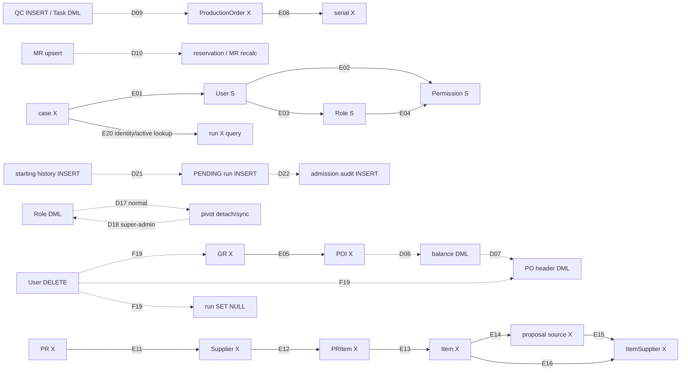
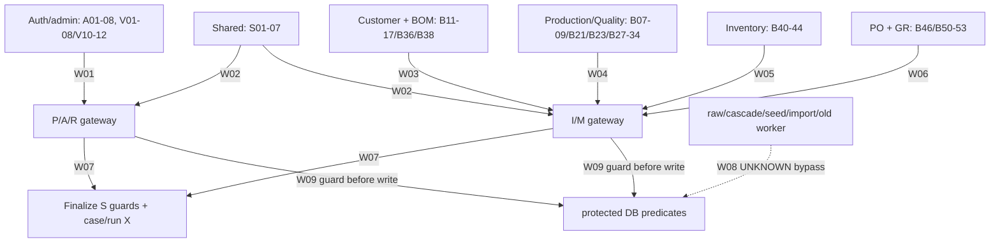

# Merlin L1 / TC-02 / 4 — C4 anchor és L2 lock-order szerződéstervezet

- **Azonosító:** `MERLIN_TC02_C4_ANCHOR_AND_LOCK_ORDER_CONTRACT_DRAFT`.
- **Dátum:** 2026-10-23.
- **Dokumentum: DRAFT. TC-02: BLOCKED. C4: PROPOSED. L2: PROPOSED.**
- **Ellenőrzött kiindulás:** `feature/merlin-candidate`; helyi HEAD, követőág és `git ls-remote` szerinti távoli HEAD: `15ee78b75009419a39fb7a04ed41da080c6161c5`; tiszta worktree, üres staging, nincs untracked fájl.
- **Hatókör:** read-only forrásvizsgálat és kizárólag ez az új magyar Markdown. Nincs implementáció, tesztfuttatás, DB-művelet, csomagtelepítés, korábbi dokumentummódosítás, staging, commit, push vagy külső AI-hívás.

## 1. Vezetői összefoglaló

**INFERRED:** meglévő User/Role/Permission/Item és üzleti parent sorokból
felépíthető olyan C4-jelölt, amelyben a finalizer S, a predikátumot módosító
writer pedig inkompatibilis X védelmet tart ugyanazon tranzakció végéig.
Új numerikus guard-version vagy guardtábla szükségessége nem bizonyított.
A meglévő sorok létezése ugyanakkor nem bizonyít writer closure-t,
phantom-védelmet vagy deadlockmentességet. **Egyetlen anchorcsalád sem
tekinthető itt teljes körűen, kétmotoros futással bizonyított guardnak.**

**PROPOSED:** a `P → A → R → I → M → case → run → execution → receipt/event`
logikai rang pontosítása fizikai sorazonosságokra, teljes old/new scope-ra,
előre meghatározott lockmódokra és hiányos discovery esetén teljes rollbackra.
Az M-en belüli lent megadott sorrend konkrét elemzési jelölt, nem minden
implicit FK/index/sequence lockot már lefedő globális bizonyítás.

**SOURCE_CONFIRMED:** a [Checkpoint 005 leltára][COV] 120 sort / 58 fájlt
tartalmaz; mind a 120 hivatkozott metódus deklarációját az aktuális forrásban
újraellenőriztük. A 29 fájl / 57 metódus C4–L2 változtatási jelöltminimum,
nem végleges költség vagy bizonyított minimum. A 10. rész mind a 120 ID-t
egyenként hozzárendeli az enrollment szerződéshez, a readereket és feltételes
kivételeket is megőrizve. Külső SQL, minden import és régi worker teljessége UNKNOWN.

Két forráspontosítás különösen lényeges:

- **SOURCE_CONFIRMED:** a [super-admin Gate-before][SUPER] `hasRole('super-admin')` hívása nem ad át guard argumentumot. A [package string ága][HASROLE] csak megadott guardnál szűr. A minden role-ra automatikusan előírt `web` szűrés ezért nem igazolt parity.
- **SOURCE_CONFIRMED:** a [ProductionTask modell][TASKMODEL] `HasFactory`-t, de nem `SoftDeletes`-et használ. A [delete metódus][TASKDELETE] normál `delete()` hívása így hard delete út; a Checkpoint 005 B26 sorának „soft-delete” szövege pontatlan. Az auditfájl változatlan marad; a jelen leltár e részletet kifejezetten javítva értelmezi. A kaszkádok runtime-hatása külön bizonyítandó.

**BLOCKED:** admission case-first eltérésének elfogadása, auth evaluator
parity, teljes writer-enrollment és scope closure, implicit lockgráf,
MySQL/SQLite adapter, DB-óra/clock rollback és unknown COMMIT bizonyítása,
tesztkörnyezet és rollout. A legkisebb implementációs szelet is BLOCKED.

## 2. Kiinduló döntések és invariánsok

### 2.1. Forrásprioritás és bizonyítékszintek

1. [Decision 003][DEC], különösen 2–5. rész: ACCEPTED időszemantika.
2. [L1 baseline][BASE], [ADR 0017][ADR17], [ADR 0018][ADR18]: elfogadott követelmények az ott megjelölt határral; a PROPOSED/OPEN részek nem elfogadott részletszerződések.
3. [L1 Technical Contract DRAFT][TC], [Authorization & Business Guard Contract DRAFT][GUARD]: műszaki javaslatok.
4. [Writer coverage review][COV]: auditbizonyíték és feltételes javaslat, nem architekturális jóváhagyás.
5. [ADR 0009][NETADR], [ADR 0016][ELIGADR], [planning knowledge][PLAN]: változatlan netting/eligibility domain; az ADR-ek történeti „nem implementált” mondatait az aktuális forrásoktól külön kezeljük.
6. [Projektkonvenciók][CONVENTIONS], [DoD][DOD], [quality gates][QG], [backend gate][BACKEND]: magyar dokumentáció, arányos ellenőrzés, dedikált tesztadatbázis és csak valóban futott ellenőrzés jelentése.

| Jelölés          | Jelentés                                                                               |
| ---------------- | -------------------------------------------------------------------------------------- |
| ACCEPTED         | Korábban elfogadott követelmény; önmagában nem implementációs vagy tesztbizonyíték     |
| SOURCE_CONFIRMED | Rögzített HEAD helyi forrásában ellenőrzött tény; nem élő DB-schema vagy runtime-mérés |
| INFERRED         | Statikus adatútból levezetett feltételes érv/kockázat                                  |
| PROPOSED         | Az összes új anchor-, SQL-, sorrend-, hibakezelési, teszt- és rollout-javaslat         |
| UNKNOWN          | Hiányzó hívó-, konfiguráció-, motor-, deployment- vagy teljességi bizonyíték           |
| BLOCKED          | Hiányzó döntés/bizonyítás miatt nincs implementációs vagy aktiválási készültség        |

Az alábbi táblákban a forrásoszlop SOURCE_CONFIRMED, a javasolt lock és
protokoll PROPOSED/INFERRED, a hiány UNKNOWN/BLOCKED. Motorleírásra
hivatkozás sem válik helyi tesztbizonyítékká. Alkalmazás-/DB-protokollra
itt nincs TEST_CONFIRMED állítás. A kötelező dokumentumok mind elérhetők.
Nem létező lifecycle API-nak vagy execution sornak nem találunk ki forrást.

### 2.2. ACCEPTED — megőrzendő követelmények

Forrás: [L1-D03–D11][BASEINV], [Decision 003 döntés][DECTIME],
[ADR 0017 authorization][ADR17AUTH], [ADR 0018 ownership][ADR18CLAIM].

- A sikeres claim 180 másodperces, immutable deadline-t rendel a runhoz; a tartós authority DB UTC epoch seconds.
- A sikeres FinalizeRun határideje a szerializált tranzakciós döntési ponton szigorúan `db_now < execution_deadline_epoch`. Egyenlőségnél tilos.
- A fizikai COMMIT történhet később, akár a deadline után, kizárólag érvényesen linearizált és COMMIT-ig védett döntésnél.
- A szükséges jogosultsági és üzleti feltételeket a COMMIT-ig kell védeni.
- State, execution-adat és kötelező audit/receipt egy tranzakcióban atomikus; tartós siker és receipt konzisztens.
- Az első érvényes terminális állapot immutable; cancellation/recovery/late result nem írhatja felül.
- Unknown COMMIT után nincs vak retry; hiányzó receipt nem rollbackbizonyíték. Csak bizonyított rollback után jöhet ellenőrzött újrapróba.
- Jogvesztés, historical actor, worker token vagy receipt nem ad új AI-/tool-/üzleti végrehajtási jogot. Belső lezárás szűk authority.
- A jelenlegi eligibility, unit/date/quantity, legacy lineage, exact decimal és teljes versengő netting szabályok változatlanok. Nincs új user-active, employee-active vagy email-verification gate.

A [Decision 003 eltérésnyilvántartása][DECDIFF] az L1-D06 fizikai
COMMIT-kori időkövetelményét kifejezetten módosítja. A régi baseline, ADR-ek
és TC DRAFT megfelelő részei még összehangolandók; itt egyik sem változik.
Az L2 a case-first admission és az ADR 0018 lockszekvenciáját is érinti,
ezért külön döntést igényel. Az L1-D02 két lifecycle táblájának iránya
nem engedélyez automatikusan új közös guard-sémát.

## 3. C4 anchor inventory

`A=User`, `R=Role`, `P=meglévő Permission`, `I=Item`;
`M=meglévő üzleti parent/membership sor`, nem új guardtábla.
F = pozitív finalizer; W = releváns writer. S/X MySQL tervezési módok;
SQLite-ra ezek logikai konfliktuskövetelmények, nem SQL row-lock utasítások.

| Anchor               | Fizikai tábla/sor                             | Létezés garantált?                                                 | Létrehozás/törlés                                   | Milyen predikátumot véd?                                                | Lock típusa                                           | Bizonyíték                                                      | Hiány                                                             |
| -------------------- | --------------------------------------------- | ------------------------------------------------------------------ | --------------------------------------------------- | ----------------------------------------------------------------------- | ----------------------------------------------------- | --------------------------------------------------------------- | ----------------------------------------------------------------- |
| A / User             | `users.id`                                    | Csak élő pozitív ágon; run live FK nullable                        | Admin create/delete; nincs User SoftDeletes         | Live actor; direct/role tagság gyökere; run identity külön ellenőrzendő | F S; tagság/delete W X                                | [User][USER], [UserRepo][USERREPO], [run FK][RUNFK]             | Hard delete, SET NULL fanout, teljes writer closure               |
| R / Role             | `roles.id`                                    | Actorhoz felfedezett role lehet közben törölt                      | Create/update/delete, hookos pivot detach           | Role név/guard/létezés és role-permission halmaz                        | F S minden aktuális role-ra; W X                      | [schema][ROLESCHEMA], [role writer][ROLESVC]                    | Új tagság A-n, reverse model API és cascade enrollment            |
| P / Permission       | `permissions.id`, név+guard unique            | Két név létezése nem garantált                                     | Catalog create/rename/delete, cascade               | A normál grantben felhasznált definition identity                       | F S; catalog W X régi létező soron                    | [schema][PERMSCHEMA]                                            | Hiányzó névnek nincs C4 soranchora; nem állítunk namespace-lockot |
| User-role membership | `model_has_roles` összetett PK                | Üres halmaz is lehet                                               | Attach/detach/sync; role FK cascade                 | Actor rolehalmaza és super-admin tagság                                 | Gyökér A S/X; létező pivot leaf-lock csak kiegészítés | [schema][MHR], [syncRoles][SYNCROLE]                            | Hiányzó pivot nem lockolható meglévő sorként; nincs User FK       |
| Direct grant         | `model_has_permissions` összetett PK          | Üres lehet                                                         | Direct grant/revoke, permission cascade             | Két ability direct ága                                                  | A S/X + használt P S / catalog P X                    | [schema][MHP], [syncPermissions][SYNCPERM]                      | Morph/guard/teams és nyers writer kizárása                        |
| Role grant           | `role_has_permissions(permission_id,role_id)` | Üres lehet                                                         | Role sync, role/permission delete                   | Role-derived ability                                                    | R S/X + használt P S / catalog P X                    | [schema][RHP]                                                   | Cascade nem model event; hiányzó élhez R enrollment kell          |
| Super-admin proof    | `model_has_roles` + `roles.name`              | Nem általánosan garantált                                          | Membership revoke, role rename/delete               | Meglévő Gate-before szerinti permission-kivétel                         | A S + érintett R S; W megfelelő A/R X                 | [Gate][SUPER], [hasRole][HASROLE]                               | Nincs automatikus web szűrés; collation/collection parity         |
| I / Item             | `items.id`, soft-deleted sorral együtt        | Pozitív required item FK alapján jelölt; runtime schema ismeretlen | Create/soft/hard-delete/restore/unit update         | Item-wide demand/supply pool és base-unit input                         | F S; pool W X minden old/new I-re                     | [schema][ITEMSCHEMA], [incoming join][INCOMING]                 | Hard delete/recreate/PK update kizárása vagy bizonyítása          |
| MaterialRequirement  | `material_requirements.id`                    | Selected esetben szükséges; új konkurens még nincs                 | Upsert, soft/hard-delete, restore, rebind           | Quantity/date/unit, lineage, competition                                | I S/X elsődleges; szükséges M/leaf S/X                | [schema][MRSCHEMA], [upsert][MRWRITE], [lineage][MRLINEAGE]     | Egy MR-row lock nem védi más competing MR insertjét               |
| CustomerOrder        | `customer_orders.id`                          | Meglévő valid lineage-ben igen; nem minden legacy adatban          | Header create/update/soft/hard-delete               | Parent lifecycle, teljes COI/MR fanout                                  | F szükséges M S; header W X; child membership W S     | [schema][COSCHEMA], [update][COWRITE]                           | Üres childhalmaz, teljes cascade és reparent                      |
| CustomerOrderItem    | `customer_order_items.id`                     | Valid source-hoz kell                                              | Replace, soft/hard-delete, restore                  | Item status/delete, MR/production lineage                               | M S/X + minden érintett I                             | [schema][COISCHEMA], [eligibility][ELIG]                        | COI→MR→reservation old/new unió                                   |
| ProductionOrder      | `production_orders.id`                        | Legacy nullable lineage esetén nem kell                            | Generate, status/completion, delete/restore         | Production validity és komponensfanout                                  | M S/X + komponens I-k                                 | [schema][PRODSCHEMA], [completion][COMPLETE]                    | Product item nem azonos BOM-komponenspoollal                      |
| ProductionTask       | `production_tasks.id`                         | Adott művelethez igen; új task még nincs                           | Create/update/hard delete; nincs SoftDeletes        | Completion/consumption workflow, közvetett production validity          | W M/leaf X; F csak ha ténylegesen olvasott input      | [schema][TASKSCHEMA], [modell][TASKMODEL], [delete][TASKDELETE] | Új task és completion versenye; nem új netting predicate          |
| BOM                  | `boms.id`                                     | Lineage/fanout esetén jelölt                                       | Create/update/soft/hard-delete/restore              | BOMItem tagság, komponens-discovery                                     | M S/X a membershiphez                                 | [schema][BOMSCHEMA], [replace][BOMWRITE]                        | Parent soft delete nem közvetlen resolver predicate               |
| BOMItem              | `bom_items.id`                                | Teljes lineage-nél kell; legacy ágon nem                           | Replace hard delete/create; nincs SoftDeletes       | BOM/item identity-egyezés, MR-hivatkozás                                | M/leaf S/X + régi/új I                                | [schema][BOMISCHEMA], [lineage check][ELIGLINEAGE]              | FK RESTRICT miatt delete hibázhat; nincs policyfeloldás           |
| StockBalance         | `stock_balances.id`                           | Lehet teljesen üres pool                                           | firstOrCreate/increment, consumption decrement      | Pozitív fizikai quantity                                                | I S/X; W leaf X                                       | [schema][BALSCHEMA], [increase][BALWRITE], [read][STOCK]        | Nullable batch unique és új sor: I enrollment kell                |
| StockReservation     | `stock_reservations.id`                       | Lehet üres                                                         | Reserve/release/consume, soft/hard-delete/restore   | Pozitív active reserved quantity                                        | I S/X; W leaf X + fanout M                            | [schema][RESSCHEMA], [release][RELEASE], [read][STOCK]          | Release újraszámítja az összes production komponenst              |
| PurchaseOrder        | `purchase_orders.id`                          | Firm incoming ágon igen                                            | Draft create, approve/close/date/delete/restore     | Header status/date/delete minden itemhez                                | M S/X + teljes header I-halmaz                        | [schema][POSCHEMA], [PO service][POSVC]                         | Új POI üres header alatt, multi-item status                       |
| PurchaseOrderItem    | `purchase_order_items.id`                     | Csak meglévő incomingra                                            | Insert/rebind/status/received/delete/restore        | Unit, remaining quantity, status                                        | I S/X; M/leaf S/X                                     | [schema][POISCHEMA], [incoming][INCOMING]                       | Egy eligible sorhalmaz zárása nem phantom-védelem                 |
| GoodsReceipt         | `goods_receipts.id`                           | Postnál igen                                                       | Draft create, post, soft/hard-delete                | Post tranzakció és receipt membership, nem közvetlen netting input      | W M X + összes receipt/PO-header I                    | [schema][GRSCHEMA], [post][GRPOST]                              | Mai GR→POI sorrend nem C4–L2                                      |
| GoodsReceiptItem     | `goods_receipt_items.id`                      | Draft lehet üres                                                   | Create/delete/rebind                                | Receipt item→balance és POI binding                                     | W parent S + szükséges leaf X                         | [schema][GRISCHEMA], [post load][GRLOAD]                        | Receipt-item és POI item eltérését újra kell ellenőrizni          |
| ProblemCase          | `problem_cases.id` UUID                       | Routing hint nem garantálja; lock után kell                        | Belső create; model delete tiltott; raw út UNKNOWN  | OPEN/type/MR binding, lifecycle arbitration                             | Új transition case X                                  | [schema][CASESCHEMA], [lock][CASELOCK], [model][CASEMODEL]      | Raw lifecycle írók, case→MR lockélek                              |
| Merlin run           | `merlin_runs.id` UUID                         | Lifecycle commandnál kell; admissionkor új                         | Admission insert, későbbi lifecycle terv, retention | Initiator/case binding, state, egy aktív run                            | Meglévő run X; új run a case alatt                    | [schema][RUNSCHEMA], [model][RUNMODEL]                          | Model hook nem raw SQL terminal enforcement                       |
| Execution            | Tervezett `merlin_run_executions`, run kulcs  | **Nem létezik a jelen migrációkban**                               | Claim vagy engedett pending stop része lenne        | Owner, immutable deadline, event sequence                               | PROPOSED X run után; hiányt run X sorosítja           | [L1-D02][BASESTORE], [mezőterv][TCEXEC]                         | Nincs kész tábla, adapter vagy unmanaged backfill                 |
| Receipt/event        | Tervezett `merlin_run_execution_events`       | **Nem létezik a jelen migrációkban**                               | Csak atomi append, retention kivétel                | Command identity/fingerprint és tartós outcome                          | Run X alatt lookup/unique insert                      | [event-terv][TCEVENT], [L1-D04][BASEINV]                        | Nem külön új operation ledger; DDL/unique bizonyíték hiányzik     |

### 3.1. Hiány, törlés és újralétrehozás

**PROPOSED:** nem létező User/Item/required parent esetén nincs pozitív
finalization. Nem hozunk létre helyettesítő User/Item/Permission sort a
finalizerből. Új entity writer saját insertje után még láthatóság előtt
ugyanabban a tranzakcióban alakítja ki az anchor/context védelmet.
Ez nem általános determinisztikus guard-bootstrap bizonyítás.

A hiányzó ability normál ágon denial; a super-admin ág a saját stabil
A/R proofjával külön értékelhető. Nincs hiányzó névtérre kitalált P row lock.
Ha a két definition felfedezése és zárása között csere történt, csak a
ténylegesen zárolt és frissen újraellenőrzött ID-k használhatók; új ID-ért
tilos A/R alatt visszamenni P-re. Rollback vagy denial következik.

Az üres childhalmazt nem létező child-zár, hanem minden érintett writer által
használt I és szükséges parent M konfliktusa védi. Soft-deleted sor fizikai
anchorként megtalálható lehet `withTrashed`/nyers PK read mellett; ez **nem**
teszi üzletileg eligible-lé. Hard delete, PK-update és azonos ID-val új insert
az ABA-veszély miatt külön kontroll: az identity nem használható újra aktív
referenciák/commandok alatt. A sémabeli RESTRICT csak részleges bizonyíték.
Ennek runtime/privilégium/retention lezárása UNKNOWN/BLOCKED; tartós
namespace/tombstone szükségessége esetén C4 önmagában nem elegendő.

## 4. Anchor suitability — bizonyítási kötelezettségek

Minden ajánlott A/R/P/I/M/case/run anchorra kötelező az alábbi tíz feltétel.
Az execution/event sorokra ugyanez jövőbeli DDL-bizonyítás is; a létezésük
most nem SOURCE_CONFIRMED.

| Kötelezettség                      | Jelen bizonyíték                                                         | Hiányzó igazolás / STOP                                                                         |
| ---------------------------------- | ------------------------------------------------------------------------ | ----------------------------------------------------------------------------------------------- |
| O1 létezés/identity                | SOURCE_CONFIRMED schema és pozitív readút a 3. részben                   | UNKNOWN runtime schema, reinsert/PK update, hiányzó anchor; nincs opportunista finalizer-create |
| O2 teljes writer-részvétel         | SOURCE_CONFIRMED 120 ID, INFERRED hatás                                  | BLOCKED külső/raw/quiet/cascade/old-worker closure                                              |
| O3 guard az első védett írás előtt | SOURCE_CONFIRMED jelen első műveletek, például A07 detach és B46 GR lock | PROPOSED root gateway; nincs jelen megvalósítás                                                 |
| O4 lock COMMIT/ROLLBACK-ig         | PROPOSED azonos owned primary/PDO és root tx                             | BLOCKED implicit commit, connection csere, nested release és driverhibák bizonyítása            |
| O5 mód/izoláció                    | INFERRED S/X konfliktus; hivatalos motorleírás                           | BLOCKED pontos SQL, index/plan, isolation és kétmotoros futás                                   |
| O6 membership/phantom              | PROPOSED I X minden poolíráshoz, M S childhoz / M X headerhez            | BLOCKED minden fanout és üres→nem üres bejárás                                                  |
| O7 friss discovery                 | PROPOSED hint→guard→current recheck; eltéréskor rollback                 | BLOCKED RR snapshot/current read keveredés és old/new closure                                   |
| O8 determinisztikus acquisition    | PROPOSED 7. rész osztály/kulcs/mód                                       | UNKNOWN implicit FK/index/sequence élek, engine acquisition sorrend                             |
| O9 deletion safety                 | SOURCE_CONFIRMED FK-k/modelhookok részhalmaza                            | BLOCKED cascade/restore/retention/ABA és raw delete                                             |
| O10 cache-függetlenség             | SOURCE_CONFIRMED registrar és relation cache használat                   | PROPOSED SQL evaluator; BLOCKED parity és deployment-hook inventory                             |

**INFERRED feltételes érv:** ha minden releváns predicate-változás olyan
writer X-et igényel, amely a finalizer COMMIT-ig tartott S-ével ütközik,
akkor a guardok utáni friss true állapotot ilyen writer nem változtathatja meg
a COMMIT előtt. Ez csak a teljes O1–O10 és helyes read szemantika mellett
áll. Egyetlen NO_CHANGE/UNKNOWN besorolás nem pótolja a feltételek bizonyítását.

| Anchorcsalád    | Most bizonyítható                                                           | Nem bizonyítható most                                            |
| --------------- | --------------------------------------------------------------------------- | ---------------------------------------------------------------- |
| A/R/P           | Sorok/kapcsolatok és mutátorok léteznek, kezdeti admission shared query van | Friss teljes auth parity, catalog-hiány, cascade closure         |
| I               | Meglévő Item és FK-k; ItemSupplier is használ explicit Item-zárat           | Teljes item-pool writer enrollment, read parity, delete/ABA      |
| M               | Létező parentek és hat konkrét fanout                                       | Teljes parenthalmaz, üres halmaz, keresztlink és phantom closure |
| case/run        | Case X admissionben, run binding/unique és model terminal hook              | Lifecycle arbitration és raw SQL immutability két motoron        |
| execution/event | Elfogadott tárolási irány és DRAFT mezőterv                                 | Még a fizikai sor létezése sem; nincs protokollteszt             |

## 5. Authorization guard contract — PROPOSED

### 5.1. Predikátum és minimális jelölthalmaz

`live_actor && same_initiator && (super_admin_role || (inventory.view && item-suppliers.view))`

**SOURCE_CONFIRMED:** [User][USER] nem soft-deleted modell és nem definiál
`is_active`-ot; [Start::replay][STARTIDENT] live/historical actorazonosságot
ellenőriz; [Start::authorized][STARTAUTH] két Gate abilityt kér.
Az új SQL evaluator nem vezethet be employee státuszt vagy email-verificationt.
Worker session helyett a trusted run initiating/historical actor kötése kell;
a super-admin sem kerülheti meg a same initiator ellenőrzését.

**PROPOSED minimális, nem optimalitásbizonyított készlet:** egy A S; A alatt
felfedezett összes aktuális R S, nem csak az első grantet adó role;
normál ágon a két ability ténylegesen használt Permission ID-jának P S
védelme. Üres rolehalmazhoz A S önmagában stabil membership gyökérjelölt.
A pivot sorok olvashatók a gyökérguardok alatt, saját pivot S nem helyettesíti
a hiányzó membership védelmét. Super-admin proofhoz A/R kell, a hiányzó P
nem lehet automatikus super-admin denial, ha a meglévő Gate ezt nem követeli.

### 5.2. Acquisition és friss SQL-értékelés

1. Trusted actor/run/case és konfiguráció routing hint; két ability definition ID-jának preflight feloldása. Nincs jogosultsági döntés cache-ből.
2. A létező P-jelöltek numerikus ID szerint S módon; friss name/guard/ID ellenőrzés. Hiányzó/cserélt ID nem pótolható későbbi rangból.
3. A actor S; friss live user read. Több actoros writer minden érintett A-t numerikusan, az eleve szükséges X módban veszi fel.
4. A alatt aktuális `model_has_roles` lista; R ID növekvő S; utána friss role és membership újraellenőrzés. Hiány/törlés esetén nincs korábbi objektum alapján grant.
5. Friss direct pivot és role-permission pivot olvasás ugyanazon primary/PDO-n; minden ability külön `direct OR valamely assigned role` eredmény. A két permission külön role-ból/directből is teljesülhet.
6. A super-admin ágat a meglévő `hasRole` tényleges szemantikájához mérni; a normál ágon a konfigurált guard/morph/table/pivot kulcsokhoz igazodni. Pozitív proof csak tartott A/R/P sorból származhat.
7. Case/run X után same initiator és immutable binding újraellenőrzés; authority után receipt-disclosure. Új transition előtt végső cache-független értékelés; guardok COMMIT-ig maradnak.

A P→A→R körkörös discoveryt preflight és validálás oldaná fel; az R alatt
újonnan talált, nem tartott P pozitív grant nem használható. A hiányzó
definition későbbi megjelenése normál ágon nem lehet friss grant ugyanebben
a próbában. Ez biztonsági denial/rollback lehet, nem igazolt elérhetőségi optimum.

### 5.3. Tagság-, catalog- és super-admin writerek

| Írás                                  | Kötelező konfliktus a finalizerrel                       | Discovery / első írás előtti belépés                               | Nyitott rész                                                        |
| ------------------------------------- | -------------------------------------------------------- | ------------------------------------------------------------------ | ------------------------------------------------------------------- |
| User direct grant/revoke/sync         | A X; P definition S, ahol feloldás kell                  | P-k hintje → A X → current direct halmaz; detach előtt             | Hiányzó target, generic direct API callerek                         |
| User role attach/detach/sync          | A X; érintett R legalább S                               | Old/new role ID unió, A alatt recheck, R rangban                   | A01/A02 saved hook, több useres API                                 |
| Role permission/name/guard update     | R X; szükséges régi/új P S                               | P előre; R X előtt nincs pivot detach                              | A07 saját root tx szükséges a parent::update előtt                  |
| Role reverse assign/remove/syncModels | Teljes régi/új actorhalmaz A X; R X                      | Előzetes actorlista → minden A X → R X → teljes membership recheck | Új actor R alatt → rollback; nincs késői alacsonyabb A              |
| Role delete                           | R X, és a membershipet törlő scope-ra előzetes A-védelem | Model deleting hook előtt; reverse actor-fanout mint fent          | P/actor/FK fanout és hook sorrend teljes fizikai bizonyítása        |
| Permission rename/delete              | P X; érintett direct A-k és role R-ek előzetes feltárása | Régi/új definition ID és cascade membership old/new closure        | Új név hiányának védelme; delete-hook és cascade enrollment         |
| User delete                           | A X a detach előtt; összes további érintett scope előre  | UserAdminService→Abstract delete audit/hook/DML előtt root tx      | SET NULL érinti CO/production/PO/GR/reservation/run sorokat; INV-08 |
| Super-admin revoke/rename/delete      | A X tagságvesztéskor, R X név/delete esetén              | Ugyanaz a gateway; nincs külön worker-token kivétel                | Admin tiltás nem minden raw/vendor writer tiltása                   |

**PROPOSED:** a membershipet ténylegesen változtató cascade/hook ugyanazt az
A/R szabályt követi, mint az explicit detach. E konzervatív closure esetleg
több writer-munkát igényel a 005 jelöltminimumnál. Permission/Role delete
fanout nélkül nem tekinthető kész protokollnak; opcionális kevesebb lock csak
külön, hamis pozitív grantet kizáró bizonyítással választható.

Direct→role vagy role→direct átváltás egy közös védett tranzakcióban történik;
a köztes detach nem látható positive döntésként. Ha a revoke writer commitol
előbb, F frissen deny-t lát; ha F S guardja volt előbb, a writer COMMIT-ja F
után következhet. Nincs ígéret arra, hogy egy még csak várakozó revoke-kérés
visszamenőleg érvénytelenít már sorosított döntést.

### 5.4. Parity és cache — BLOCKED

**SOURCE_CONFIRMED:** [Spatie hasPermissionViaRole][PERMVROLE] a Permission
rolekapcsolatát használja; a [registrar][REGCACHE] permission-kollekciót
cache-el. A friss User eager load ezért nem bizonyítja a két string Gate
döntés cache-függetlenségét. Cache flush és after-commit invalidation nem lock.

A pontos evaluator táblázatának tartalmaznia kell: default guard feloldás,
User morph alias, teams/wildcard konfiguráció, custom Gate-before sorrend,
name/guard összehasonlítás és DB collation versus PHP collection viselkedés,
hiányzó Permission kivétel→false kezelése, direct/role vegyes grant,
super-admin név/guard és több role. [Konfiguráció][PERMCONFIG] szerint teams
és wildcard alapból false; a deployment override nem igazolt.
A super-admin ágra automatikus `guard_name='web'` szűkítés nem paritybizonyíték.
Ismeretlen hook/konfiguráció mellett nincs pozitív aktiválás. A meglévő
általános Gate működését ez a tervezet nem cseréli le.

## 6. Business guard contract — PROPOSED

### 6.1. Minimális pool és read parity

**SOURCE_CONFIRMED:** [resolver][RESOLVER] a selected requirementet a teljes
normál netting eredményéből választja ki. Az [eligibility][ELIG] invalid
tényeket, legacy/null és ellentmondó production lineage-et külön kezel.
A [netting][NETTING] Itemenként oszt meg készlet- és incoming poolt;
[requirements][REQUIREMENTS], [stock/reservation][STOCK], [PO incoming][INCOMING]
adják a DB inputot. Case-only vagy selected-MR-only zár túl szűk lenne.

**INFERRED:** F legkisebb indokolható pooljelöltje a selected MR
`required_item_id` szerinti teljes versengő Item-pool I S, minden ehhez
szükséges source-parenttel M S, plusz case/run/execution X. A parentkészlet
a teljes versengő demand lineage-ét is tartalmazza, nem csak a selectedét.
Más itemre új üzleti függőséget nem állítunk; az itemre célzott reader
ekvivalenciája még BLOCKED. A jelen globális reader használata részleges
guardokkal nem nevezhető már guardolt lifecycle readernek.

Read parity pontok: összes potenciálisan eligible MR; timed date/id sorrend,
NULL-date utolsó; exact három tizedes; pozitív balance mínusz minden pozitív
active reservation; PO/POI status/date/delete; unit-egyezés és remaining
quantity; legacy lineage; selected ID és pozitív exact net requirement;
authoritative VALID + ACTIVE + OPEN case. Nincs új location/batch/quality
allocation, ár/preferred/supplier ranking vagy draft PR/PO/GR incoming.

**SOURCE_CONFIRMED:** az [incoming nyers Item join][INCOMING] nem szűr
`items.deleted_at`-ra. Item soft delete fizikai I-anchorát ezért meg lehet
őrizni a proofhoz anélkül, hogy új active-item eligibilityt vezetnénk be.
Hard delete, unitcsere és rebind viszont scope/input hatású. A [BOM replace][BOMWRITE]
nem azonos a BOM parent soft delete-tel; az utóbbi nem közvetlen resolver gate.

### 6.2. Discovery és hat fanout-szerződés

Közös **PROPOSED** algoritmus: (a) preflight read old/new scope-hint;
(b) minden szükséges I növekvő numerikus kulccsal, F-nek S, W-nek X;
(c) minden előre tervezett parent M megfelelő S/X módban a 7. rész szerint;
(d) ugyanazon PDO friss olvasás, identity és teljes fanout újraellenőrzése;
(e) ha új I vagy már elhagyott M-rang kell, teljes rollback, később új
discovery és új tranzakció. Nincs parent alatt visszafelé Item-lock.
Minden régi és új item/parent uniója kell; üres halmaz sem kivétel.

| Fanout                                          | I-unió és szükséges parent                                                                   | Membership-védelem                                                               | Recheck / regressziós bizonyíték                                                                                                              |
| ----------------------------------------------- | -------------------------------------------------------------------------------------------- | -------------------------------------------------------------------------------- | --------------------------------------------------------------------------------------------------------------------------------------------- |
| CO→COI→MR                                       | Minden érintett MR.required_item_id, törölt/restore/reparent ág és új payload; CO+COI        | Header változás M X; minden kapcsolódó child/lineage writer parent M S, I X után | Confirm/cancel/delete/replace vs MR insert; üres COI; cascade reservation; [CO replace][COWRITE]                                              |
| ProductionOrder→MR                              | Összes current és recalculation BOM-komponens; COI/CO/BOM/BOMItem/production szükség szerint | Production header X; lineage/MR child S; új MR is I X                            | Product item önmagában nem elég; complete/cancel/rebind/legacy; [recalc][RECALC]                                                              |
| BOM→BOMItem→MR                                  | Régi BOMItemre mutató MR itemek és új payload, nem csak current BOMItem.item_id              | BOM X childhalmaz cseréhez, hivatkozó production/MR lánc recheck                 | Üres BOM, új komponens, eltérő régi MR item, hard delete RESTRICT; [BOM writer][BOMWRITE]                                                     |
| PO→POI                                          | A teljes header összes old/new itemje, nem csak eligible vagy received sorok                 | PO X headerhez; POI membership writer PO S + saját I X                           | Approve/date/close/delete vs POI insert/rebind/restore; [PO][POSVC]                                                                           |
| GR→balance/POI/PO                               | Minden receipt item + hivatkozott POI item + érintett PO összes itemje                       | GR X, szükséges PO X/POI X; child writer GR/PO parent S                          | Mismatch, partial receipt és a receiptben nem szereplő PO item incomingja; [post][GRPOST], [header refresh][GRHEADER]                         |
| Task→consumption/completion/reservation release | Payload/balance/reservation item és teljes production recalc-komponenshalmaz                 | Task/production/MR lineage parentek; balance/reservation leafek                  | Quality INSERT előtt guard, finish/start, release teljes BOM, új task/hard delete; [consume][CONSUME], [quality][QUALITY], [release][RELEASE] |

F parent S-e a header X-ét állítja meg; I S-e a pool child-writer I X-ét.
A child writer parent S-e a header fanout-discovery X-ét akadályozza.
Két parent S önmagában nem tilt child insertet: a finalizer az Item
konfliktusára is támaszkodik. Hiányzó row result és teljesen üres pool mellett
is meglévő I és szükséges parent védelem kell. Incidental FK S nem azonos
a megkövetelt explicit enrollmenttel. Új draft parent atomikus létrehozása
külön eset; a későbbi approve/post már friss childhalmazt igényel.

### 6.3. Friss read és hiánykezelés

**PROPOSED:** lifecycle C4 MySQL adapter saját READ COMMITTED / READ WRITE
tranzakciót használna; minden authoritative read a guardok megszerzése után.
Egy RR-ben korábban megnyitott consistent snapshot nem cserélhető fel
hallgatólagosan current állapottal. A meglévő admission RR marad a forrásban;
annak átalakítását a 8. rész külön döntési kapuként kezeli.
RC önmagában nem phantom-védelem: itt a teljes writer-enrollment feltétele
adná a stabilitást. [MySQL izolációs dokumentáció](https://dev.mysql.com/doc/refman/8.4/en/innodb-transaction-isolation-levels.html).

Ha a szükséges parent/lineage hiányos, a tényleges source assessment
eredménye az irányadó, hiányzó vagy ellentmondó lineage-nél
`UNDETERMINED` is lehet; nincs kitalált resolution vagy Finalize siker.
Bizonyított invalid/resolved basis és
bizonytalan basis a korábbi ACCEPTED osztályozás szerint elkülönül,
terminális mappingjük részleteit nem döntjük el újra.

## 7. L2 lock hierarchy — konkrét elemzési jelölt, PROPOSED

### 7.1. Kulcsok, módok és sorrend

A rang nem kérési idő vagy alkalmazásbeli loop-sorrend, hanem a következő
teljes logikai kulcs. Egy rangon a teljes kulcshalmaz rendezett; a mód előre
a legerősebb szükséges S/X. S→X upgrade, nested helperből új alacsonyabb
rang, illetve rankot átugró default-connection írás tilos a javaslat szerint.

| Rang / lock class | Fizikai lock key                                                       | F / releváns W                                         | Discovery és acquisition                                                             |
| ----------------- | ---------------------------------------------------------------------- | ------------------------------------------------------ | ------------------------------------------------------------------------------------ |
| 10 P              | `permissions.id` növekvő integer                                       | F S; definition W X; referáló W S                      | Előzetes név/guard→ID; PK-zár után friss identity; hiány nincs namespaceként lefedve |
| 20 A              | `users.id` növekvő integer                                             | F S; actor/direct/membership W X                       | Actor trusted bindingből; több useres old/new lista hint, később recheck             |
| 30 R              | `roles.id` növekvő integer                                             | F S; role mutation W X, membership célhoz S            | A után aktuális rolelista; reverse writer előzetes actorlista és R alatti closure    |
| 40 I              | `items.id` növekvő integer                                             | F S; pool W X                                          | Teljes old/new komponens- és fanout-hint, soft-deleted PK is fizikai anchorjelölt    |
| 50 M              | `(table_rank, primary_key)` az alábbi táblából                         | F szükséges S; header W X; membership W S; DML cél W X | Teljes parent/leaf terv; új scope az elhagyott rangban → rollback                    |
| 60 case           | `problem_cases.id` kanonikus kisbetűs UUID, byte-lexikografikus        | Transition/admission X                                 | Run/case hint után lock alatti binding és lifecycle revalidation                     |
| 70 run            | `merlin_runs.id` kanonikus UUID, byte-lexikografikus                   | Transition X                                           | Case binding és initiator/terminal/receipt gate; több run esetén rendezve            |
| 80 execution      | Tervezett execution `run_id`, UUID-sorrend                             | X                                                      | Run X stabilizálja a hiányt/első insertet; nincs legacy pótlás                       |
| 90 receipt/event  | Tervezett `(run_id,command_id)` és `(run_id,sequence)` unique identity | Lookup, majd append                                    | Run X alatt, command fingerprint ellenőrzéssel; nem tartósan létező guard-sor        |

Az M-en belüli **PROPOSED** sorrend: 10 `customer_orders`, 20
`customer_order_items`, 30 `boms`, 40 `bom_items`, 50 `production_orders`,
60 `purchase_orders`, 70 `purchase_order_items`, 80 `goods_receipts`,
90 `goods_receipt_items`, 100 `production_tasks`, 110 `material_requirements`,
120 `stock_balances`, 130 `stock_reservations`; táblán belül numerikus PK.
A parenteket a lineage olvasásánál, a leafeket csak szükséges DML/lock esetén
vesszük fel. A finalizernek nem kell automatikusan minden balance/task/GR sor.

Ez tudatosan erősebb acquisition tervet jelent a mai GR→POI→balance→PO és
task→production írási sorrendnél: minden szükséges meglévő sor X-ét előbb
felfelé rendezve kellene megszerezni, utána a DML nem bővíthet visszafelé.
Új child insertnél a már előre felvett parent guardok sorosítanák a hiányt.
A tényleges FK/index acquisition ettől még nem válik automatikusan rendezetté.

**BLOCKED:** a sorozat nem sorolja be bizonyítottan a Supplier/PR/proposal,
Location/Batch, Employee/ItemInstance/operation-step, StockMovement,
sequence/code, activity-log, evaluation-history összes implicit kulcsát.
Ezek létezését a [PR lock][PRLOCK], [consumption][CONSUME], [quality][QUALITY],
[task generation][TASKGEN] és [starting history írás][STARTWRITE] mutatja.
Újonnan generált surrogate ID-k vagy unique gapek előzetes teljes sorrendje
sem igazolt. E lockok külön algráfja és a fenti rangra vetített kapcsolata
nélkül nincs teljes fizikai lock contract, így nincs implementációs készültség.

### 7.2. SQL-határ, reentrancy és release

**PROPOSED MySQL olvasási forma:** egy ismert, kanonikus PK-ra külön
paraméterezett `SELECT … WHERE id = :id FOR SHARE` F-nek; a writer megfelelő
`FOR UPDATE` módot kérne. A table identifier backend allowlistből származna.
Több kulcsnál egymást követő PK statementekkel lehet a kért sorrendet
láthatóvá tenni; `WHERE IN … ORDER BY` önmagában nem fizikai lock-order proof.
Egy join/eager-load kívülről ráírt lockja nem bizonyítja minden pivot és
hiányzó sor lefedését. Konkrét SQL/EXPLAIN/lock trace még hiányzik.
[MySQL locking reads](https://dev.mysql.com/doc/refman/8.4/en/innodb-locking-reads.html).

Reentrancy csak ugyanazon root tx/PDO contextben: tartott kulcsra azonos vagy
gyengébb mód assertionje, új savepoint/root transaction nélkül. A helper
nem engedhet el guardot és nem commitolhat. Új alacsonyabb kulcs vagy
S→X igény → teljes rollback, nem lock-upgrade retry. Külső callback/network
nincs a tranzakcióban. Minden guard a root COMMIT/ROLLBACK-ig marad.
Ismeretlen release/connection outcome nem APPLIED.

**PROPOSED SQLite adapter:** file-backed saját connection, IMMEDIATE a
domain read előtt; egy DB-fájlon egy writer. Az S/X táblázat a logikai
konfliktusok és tesztesetek nyelve, nem SQLite `FOR SHARE`/`FOR UPDATE` SQL.
A BUSY/COMMIT BUSY, journal mód, foreign_keys és read_uncommitted külön
igazolandó. Nem fut többprocesszes bizonyítás `:memory:` adatbázison.
[SQLite tranzakciók](https://www.sqlite.org/lang_transaction.html).

Timeout/busy/deadlock esetén a 11. rész szerinti teljes outcome-osztályozás
kell. A várakozási budget számértéke OPEN; nem módosíthatja a claim deadline-t.
Új DB-idő csak az összes szükséges blokkolás után, az LP-ben használható.

### 7.3. LP és atomi siker

**PROPOSED:** új Finalize transitionnél az összes guard, binding, claim/token,
status, sequence, result validation és friss auth/business gate után külön
DB-óra statement t értéke adná az LP-t. Csak `t < immutable deadline` esetén
következhet conditional run/execution update és egy kötelező event/receipt
ugyanazon tx/PDO-n. Affected-row eltérés vagy event hiba teljes rollback.
Execution/event/LP SQL-je nincs elfogadva vagy implementálva.

LP után nem jöhet új domain read/guard-discovery/AI/tool/business callback.
A saját terminal DML/unique insert várakozhat; a szükséges auth/business
védelem közben megmarad. Fizikai COMMIT tetszőlegesen későbbi ideje nem
határidő-hosszabbítás vagy új claim. Abortált tx-nek nincs sikeres LP-je.
Success válasz csak commit-ack után; ack-hiány unknown, nem failure-rewrite.
Óra-visszalépés és DB-health hiányában az LP érvényessége is BLOCKED.

## 8. Admission compatibility

### 8.1. Jelenlegi és javasolt szekvenciák

**SOURCE_CONFIRMED:** a [transaction wrapper][TX] caller-tx tiltást, saját
PDO-t, MySQL RR/READ WRITE-t, SQLite IMMEDIATE-et, reconnect-tiltást és
attempts=1-et ad. Első domain SQL-je case X, utána [freshActor][CTXACTOR]
User/permission/role shared query, identity/active-run X locking read és resolver,
majd starting history + PENDING run + admission audit. [Start::admit][STARTADMIT].
Az identity/active lekérdezés `lockForUpdate()`-ja a
[MerlinRunRepository::findIdentity/hasActive][RUNREPO] forrásában explicit;
hiányzó találatnál a unique/index/gap hatás motorfüggő és nem mért.
Ez koherens indulási megfigyelés; nem mai COMMIT-ig tartó üzleti freeze.

| Művelet            | Jelenlegi implementáció / tervezet                                                                                      | C4–L2 elemzési javaslat                                                                                                   | Kötelező különbség / kapu                                                                            |
| ------------------ | ----------------------------------------------------------------------------------------------------------------------- | ------------------------------------------------------------------------------------------------------------------------- | ---------------------------------------------------------------------------------------------------- |
| Admission/start    | Forrás: preflight Gate → owned RR → case X → User S / P-R shared eager → identity/active → resolver → history/run/audit | P/A/R a case előtt → case X → identity/active/replay → friss koherens resolver → változatlan atomikus admission írás      | Csak auth-before-case nem igényel automatikus I/M business freeze-t; ha I/M kell, külön scope-döntés |
| ClaimRun           | Nincs command implementáció; TC 3.2./5.1. case→run→execution→auth→current                                               | P/A/R/I/M → case/run/execution → auth/binding/replay → current → claim t, t+180 és event                                  | Egyszeri claim és eligibility megmarad; pontos claim LP/COMMIT-határ külön véglegesítendő            |
| FinalizeRun        | Nincs implementáció; TC 3.3. / Decision 003                                                                             | P/A/R/I/M → case/run/execution → authorized receipt → új transition gate → LP → conditional terminal+event → COMMIT       | Az ACCEPTED LP-szemantika kötelező, konkrét adapter BLOCKED                                          |
| CancelRun          | Nincs implementáció; TC 3.5.                                                                                            | P/A/R → case/run/execution → saját friss auth → receipt/active → conditional cancel+event                                 | Aktuális ACTIVE shortage nem cancellation gate; nem kérünk indokolatlan I/M-et                       |
| StopRunForContext  | Nincs implementáció; TC 3.6.                                                                                            | Szűk system capability → az ok bizonyításához szükséges korábbi rangok → case/run/execution → recheck → terminal+event    | User hiánya/revoke nem ad új munkaengedélyt; hiányzó User X/S nem pótolható                          |
| RecoverRun         | Nincs implementáció; TC 3.7.                                                                                            | Szűk recovery authority → case/run/execution → receipt/outcome → claim/deadline → expiry write+event                      | Nem fresh-user grant és nem új netting/AI; unknown command előbb reconciliation                      |
| TerminateFailedRun | Nincs implementáció; TC 3.4.                                                                                            | WORKER ágon P/A/R + case/run/execution; SYSTEM ágon szűk capability és szükséges proof-rangok → conditional failure+event | Worker deadline és owner kötelező; nincs arbitrary exceptionból üzleti uncertainty átnevezés         |

A commandnevek és execution/event táblák jelenleg tervszintűek:
`app/routes/database/migrations` keresés nem találja a hat commandot;
[TC commandfejezet][TCCOMMANDS] az irányadó javaslat. „Jelenlegi sorrend”
ezeknél nem futó API-t jelent. A subset-rangokat használó belső stop/recovery
nem szerezhet utólag auth/Item-lockot a case után: ha szükséges, már a hint
alapján előre kell tervezni vagy új tranzakció kell.

### 8.2. L1 / L2 / L3 és szükséges változási helyek

| Változat            | Megtartható szemantika                                                                             | Hiányzó bizonyítás / státusz                                                                                     |
| ------------------- | -------------------------------------------------------------------------------------------------- | ---------------------------------------------------------------------------------------------------------------- |
| L1 case-first       | Jelen admission első domain SQL case X változatlan; lifecycle is ehhez igazítható                  | Teljes case→auth/Item és writer/FK ciklusvizsgálat; BLOCKED, nem eleve lehetetlen                                |
| L2 guard-first      | Auth/binding, idempotencia, egy aktív run, fresh resolver, history/run/audit együttese megőrizendő | Első domain SQL és ADR-rang változik; explicit approval és regresszió kell; PROPOSED/BLOCKED                     |
| L3 eltérő sorrendek | Meglévő admission mellett más lifecycle rang, ha a közös kulcs/mód vetület ciklusmentes            | S/S reversal önmagában nem bizonyítás sem veszélyre, sem biztonságra; teljes fizikai graph kell; UNKNOWN/BLOCKED |

L2 változtatási jelöltek a 005 ID-k szerint: A03
`UserRepository::findForMerlinAdmission`; M01 `MerlinAdmissionTransaction::run`;
M02/M03 `MerlinAdmissionContext::freshActor/resolveCurrent`; M04/M05
`StartMerlinInvestigationService::admit/authorized`; M06
`ProblemCaseRepository::lockForAdmission`. A `start/attempt/replay`
szekvenciát és a szerződés/interfész/tesztforrásokat is újra kell vizsgálni;
ezek nem rejtett „0 további metódus” költségek. [Start forrás][START].

**PROPOSED első discovery:** csak kanonikus request case ID és trusted actor;
role/definition hint a saját auth preflightból. Nem fut current resolver
case lock előtt. A case X után type/lifecycle/MR binding újraellenőrzendő;
replay előtt fresh auth, azonos canonical request/fingerprint/initiator;
új run előtt active-run gate és a jelen resolver teljes feltételei.
I/M business guard csak claim/finalize jelöltkövetelmény: admissionbe
beemelése erősebb befagyasztás és új contention lenne, nem hallgatólagos javítás.

Admission izolációt két módon lehet tovább vizsgálni: RR megtartása úgy,
hogy a koherens business snapshot csak a szükséges admission zárak után
keletkezzen; vagy RC külön, megőrzött koherenciát bizonyító protokollal.
Az auth discovery RR consistent readje és a későbbi current read nem
keverhető bizonyíték nélkül. Egyiket sem választjuk ACCEPTED módon.

Legkisebb későbbi regressziós csomag: caller tx/PDO/reconnect/attempts=1;
első-domain-SQL sorrend; warm-cache revoke és super-admin parity; auth deny
és missing case disclosure; canonical replay/fingerprint konfliktus;
azonos identity/active-run párhuzamos unique ütközések; case lifecycle/MR
revalidation; friss full netting és legacy lineage; history/run/audit
rollback; commit-ack loss és külön valódi mid-COMMIT kapcsolatvesztés;
MySQL RR vs SQLite file-backed IMMEDIATE. Meglévő [admission service][ADMTEST]
és [infrastructure tesztek][INFTEST] források, nem most futott bizonyítékok.

## 9. Lock dependency graph

### 9.1. Jelenlegi gráf és élnapló

E = explicit query-lock (SOURCE_CONFIRMED); D = forrásbeli DML-sorrend
(SOURCE_CONFIRMED, lockhatása INFERRED); F = FK miatti lehetséges él
(INFERRED/UNKNOWN); P = javasolt él (PROPOSED). A gráf aggregált, eltérő
ágakból áll; egy rajzolt kör nem megfigyelt deadlock.

| Él              | Forrásfájl/metódus és acquisition                                                                                                        | Sorrendi indok, bizonyítékszint                                                                           |
| --------------- | ---------------------------------------------------------------------------------------------------------------------------------------- | --------------------------------------------------------------------------------------------------------- |
| E01             | [TX::run:79][TXCASE] → [Context::freshActor:60][CTXACTOR] → [UserRepo:20][USERREPO]                                                      | Case a wrapper első domain SQL-je, callback később; SOURCE_CONFIRMED                                      |
| E02/E03/E04     | [UserRepo::findForMerlinAdmission:20–24][USERREPO] shared eager queryk                                                                   | A → direct P / R → role P a deklarált lekérdezésekben; pontos pivot/engine locks UNKNOWN                  |
| E05/D06/D07     | [GoodsReceiptService::post:89–139][GRPOST], [increaseQuantity:75][BALWRITE], [refreshPurchaseOrderStatus:183][GRHEADER]                  | GR X → POI X explicit; balance írás → header írás DML; engine él INFERRED                                 |
| E08             | [ProductionTaskService::generateFromOrder:97][TASKGEN] → [nextSerialNumber:285][SERIAL]                                                  | Production lock után serial query; SOURCE_CONFIRMED                                                       |
| D09             | [QualityCheckService::store:41–52][QUALITY], [advanceNextTaskOrFinalize:224][ADVANCE] → [completeProductionOrderWhenReady:271][COMPLETE] | Insert/Task/instance módosítás után production update; lockhatás INFERRED                                 |
| D10             | [reserveForProductionOrder:36,61,82][RESERVE], [release:100–103][RELEASE]                                                                | MR upsert→reservation és reservation update→MR újraszámítás külön ágak; nem feltétlen runtime kör         |
| E11/E12/E13/E14 | [PRRepository::lockForPurchaseOrderGeneration:102–121][PRLOCK]                                                                           | PR→Supplier→PRItem→Item→proposalSource, explicit; SOURCE_CONFIRMED                                        |
| E15             | [PRService::generatePurchaseOrder][PRGENERATE] → [lockExecutionSources:160][SOURCELOCK]                                                  | PR-root után source lock; SOURCE_CONFIRMED hívó, fizikai terv UNKNOWN                                     |
| E16             | [ItemSupplierRepository::lockItem:92][ITEMLOCK] és [preferred út][PREFERRED]                                                             | Item→ItemSupplier irány, SOURCE_CONFIRMED; E14/E15-tel nem fordított source→Item                          |
| D17/D18         | [RoleRepository::update:51–54][ROLEREPO], [RoleAdminService::update:34–37][ROLESVC]                                                      | Normál Role→pivot, super-admin pivot→parent update eltérő ágak; SOURCE_CONFIRMED DML, konfliktus INFERRED |
| F19             | [User delete][USERDELETE], [GR FK][GRSCHEMA], [PO FK][POSCHEMA], [run FK][RUNFK]                                                         | User törlésből SET NULL több üzleti sorra; schema SOURCE_CONFIRMED, implicit acquisition UNKNOWN          |

További élek: **E20** a [Start::admit:93/97][STARTADMIT] által meghívott
[MerlinRunRepository::findIdentity/hasActive:18–28][RUNREPO] explicit
`lockForUpdate()` lekérdezése, case X és fresh auth után; a hiányzó sor
range-hatása UNKNOWN. **D21/D22** a [Start::admit:119–121][STARTWRITE]
és [MerlinRunRepository::appendStarting/createPending][RUNREPO] szerinti
history→run→audit INSERT sorrend. A queryk és a DML-sorrend SOURCE_CONFIRMED,
az FK/unique/index acquisition INFERRED/UNKNOWN. Ezek az élek a main
admission callbackben már léteznek, nem új lifecycle parancsok.

### 9.2. Javasolt C4–L2 és cross-module gráf

```mermaid
flowchart LR
  P["P: permission PK"] -->|P01| A["A: user PK"]
  A -->|P02| R["R: role PK"]
  R -->|P03| I["I: sorted item PKs"]
  I -->|P04| M["M: table-rank + PK"]
  M -->|P05| C["case X"]
  C -->|P06| RUN["run X"]
  RUN -->|P07| EX["execution X"]
  EX -->|P08| EV["receipt/event"]
  EV -->|P09| LP["LP + conditional state/event DML"]
  LP -->|P10| COMMIT["COMMIT: guards held"]
```

Az EV az LP előtti identity lookup/előállítás; az event insert csak LP után.
A P01–P04 élek a [Guard DRAFT 9. részének][GUARDORDER] továbbpontosított
jelöltjei a 7. rész kulcsaival; P05–P08 a [TC tranzakciós terv][TCORDER]
L2 szerint átrendezett részei. P09–P10 a [Guard LP-javaslat][GUARDLP] és az
[ACCEPTED időfeltétel][DECTIME] kapcsolata. **Mind a tíz acquisition él
PROPOSED**, nincs jelenlegi lifecycle forrásmetódusuk. Sorrendi indok:
alsóbb scope lezárása a magasabb rangú state-arbitration előtt; nincs késői
guard-bővítés. Csak a szükséges osztályrészhalmazokat veszi fel egy command.

W01 forrásai [UserRepo][USERWRITE], [RoleService][ROLESVC] és a 10. rész
V-sorai; W02 [AbstractAdminService/Repository][SHARED]; W03 [CO replace][COWRITE]
és [BOM replace][BOMWRITE]; W04 [recalc][RECALC], [task][TASKGEN], [quality][QUALITY];
W05 [reserve/release][RESERVE] és [balance][BALWRITE]; W06 [GR][GRPOST], [PO][POSVC].
A hívó/DML SOURCE_CONFIRMED, a gatewaybe belépő élek **PROPOSED**.
W07 konfliktuskapcsolat, nem acquisition: writer X és F S ugyanazon fizikai
scope-on; INFERRED, O1–O10 feltételes. W08 UNKNOWN bypass; W09 PROPOSED
guard-before-first-write követelmény. E rajz nem állít meglévő gatewayt.

### 9.3. INV-01–09 újbóli ellenőrzése

| ID     | Újraellenőrzött forrás / feltételes kockázat                                                                                                                                                                                   | C4–L2 kötelezettség és fennmaradó blokk                                                                                                            |
| ------ | ------------------------------------------------------------------------------------------------------------------------------------------------------------------------------------------------------------------------------ | -------------------------------------------------------------------------------------------------------------------------------------------------- |
| INV-01 | E01 case→auth valós; case→Item jelen admissionben nem explicit Item-lock. I→case új P04/P05 terv. Négyszereplős F/admission/User-delete/GR-post ellenpélda csak inkompatibilis módokkal és késői I-t kérő writerrel lehetséges | L2 admission döntés vagy L1/L3 teljes mód/kulcs proof; shared/shared reversal önmagában nem deadlock                                               |
| INV-02 | E05 GR→POI; mai POI→Item C4-lock nincs, csak késői wrapper vezetné be; új I→POI terv konfliktust hozhat                                                                                                                        | B46 root I-k és PO/POI/GR előre, header teljes itemlistájával; runtime lock trace hiányzik                                                         |
| INV-03 | E08/D09 production/task/quality előtt lehet első DML; Task→I új késői guard lenne                                                                                                                                              | Root I-k a Task/QC insert előtt, M-ben production a task előtt; instance/serial/FK closure hiányzik                                                |
| INV-04 | D17/D18 Role↔pivot aggregált irány, ténylegesen eltérő ágak                                                                                                                                                                   | A07 tx és R/P context detach előtt; ugyanazon role/key és old/new worker bizonyítandó                                                              |
| INV-05 | [CO][COWRITE]/[BOM][BOMWRITE]/[PO][POSVC] parent→child DML, parent→I csak késői C4-belépésnél                                                                                                                                  | I old/new unió→rendezett M→fanout recheck; gyermek előbb→parent implicit FK szint külön UNKNOWN                                                    |
| INV-06 | [release][RELEASE] reservation→MR recalc, több komponens; I(b)→I(a) csak hiányos root scope esetén                                                                                                                             | Összes komponens előre növekvő I, nem reservation-item-only; reverse multi-item concurrency teszt kell                                             |
| INV-07 | E11–16 PR→Item→source és preferred Item→source; a látható forrásban nem fordított Item/source kör                                                                                                                              | PR/source nem finalizer input; új I→PR szabályt nem kényszerítünk rá. PR lokális algráf globális kapcsolata továbbra UNKNOWN                       |
| INV-08 | F19 User→GR/PO/run és más SET NULL táblák; role→user reverse API is belépési kockázat                                                                                                                                          | User-delete és reverse membership teljes preflight A/parent/FK halmaza, A→R terv; a R alatt új A-t kérő út rollback. Implicit FK irány nem igazolt |
| INV-09 | [serial][SERIAL], [CodeCreationService][CODE] és order-number unique/query lockok hozzáadott algráfot alkotnak                                                                                                                 | Teljes sequence/unique/gap/hook rang kell; generic retry nem ismételheti a root műveletet vagy külső hívást                                        |

**INFERRED:** a felsorolt case↔Item, POI↔Item, Task↔Item, Role↔User és
Parent↔Child ciklusok egy része csak jövőbeli hibás/késői guarddal keletkezne.
A mai statikus gráf nem bizonyít megfigyelt deadlockot vagy annak hiányát.
Az uncertain F/D indexéleket a 7.1. teljes-rang blokkja miatt nem rejtjük el.
Mind a kilenc kockázathoz célzott barrieres motorpróba és lock trace kell.

## 10. Writer enrollment contract

### 10.1. Egyedi ID-k és szerződésprofilok

Az alábbi 120 sor a [005 inventory][COV] ID-it, belépőit, első műveletét és
tranzakcióhatárát őrzi, aktuális metódusdeklaráció-ellenőrzéssel. A guardmező
C4 gyökér/parent szerepként olvasandó az 5–7. rész szerint, nem külön
tartós P/A/R/I/M guardtáblaként. A forrás szerinti első művelet olvasóknál
**nem írás**; náluk writer-regresszió N/A, read parity szükséges.

Minden sorhoz a profil adja a parent-fanout/bypass/módosítás/regresszió
kötelező kiegészítését; a sor guardja és a profil együtt a teljes bejegyzés.
A változtatási osztály a 005 szerinti PROPOSED/INFERRED becslés marad.

A belépőkódok a [005 route-térképére](MERLIN_TC02_GUARD_PROTOCOL_SCOPE_AND_WRITER_COVERAGE_REVIEW.md#L90)
utalnak: H-U User-admin, H-R Role-admin, H-I Item-admin, H-BOM BOM-admin,
H-CO customer order, H-PP production plan, H-T task/material/quality,
H-RES reservation, H-PR purchase requisition, H-PO purchase order,
H-GR goods receipt, H-IS ItemSupplier, H-P profile, H-A password/reset.
Ezek forrásban bekötött belépők, nem igazolt production-hozzáférési jogok.

| Profil | Scope és parent fanout                                                   | Bypass / szükséges változtatás                                                                                                   | Regressziós proof                                                                                    |
| ------ | ------------------------------------------------------------------------ | -------------------------------------------------------------------------------------------------------------------------------- | ---------------------------------------------------------------------------------------------------- |
| AU     | 5.3. A/R/P old/new actor/role/catalog; delete teljes cascade             | Package API, generic repo és pre-parent detach; root gateway a hook/első DML előtt, azonos tx/PDO                                | AUTH: direct/role/mixed grant, empty set, super-admin revoke/rename/delete, cache-warm és no-event   |
| SH     | Modell szerint AU vagy üzleti I/M a 6.2. teljes fanouttal                | Generic CRUD közvetlen hívása, optional audit első persistence; típusonként context/assert, root tx rendezés                     | SHARED: minden bevont típus és nem érintett modul, audit failure rollback, nested context            |
| RD     | Teljes 5. és 6. predicatehalmaz, több parent és minden competing MR      | Stale model/cache/default connection, globális reader részleges lockkal; belső friss evaluator/scoped reader, admission L2 külön | READ: normál full netting selected result parity és auth-Gate parity; nincs új üzleti policy         |
| CO     | CO/COI→MR teljes régi/új itemhalmaz                                      | Direct service/repo/bulk/cascade; I→M→current fanout, leaf assert/root tx                                                        | BUS-CO: confirm/cancel/replace/delete/restore/üres/new MR és reparent                                |
| MR     | Production/BOM/COI lineage, összes régi és új komponens                  | Upsert/root nélkül, helperben késői I; gyökérből teljes scope és owned context                                                   | BUS-MR: legacy/null/contradiction, recalculation insert/update/date/unit és parent change            |
| PT     | Task/production/instance/QC, teljes completion/consumption komponensunió | Első Task/QC/material DML előtt root I/M; private/public helper csak assert, FK/sequence tail külön                              | BUS-PT: start/finish/quality/consume/generate, hard delete/new task, concurrent completion és serial |
| BM     | BOM/BOMItem és hivatkozó MR itemek uniója                                | Child replace/hard delete/rebind; BOM X és teljes old/new I, RESTRICT nem kerülhető meg                                          | BUS-BOM: üres/new/replace és eltérő MR item, soft parent vs hard child                               |
| IV     | Balance/reservation és recalc összes production komponense               | firstOrCreate, bulk consume, release; I teljes scope, root tx, movement és traceability megőrzése                                | BUS-INV: reserve/release/consume/üresbalance/újreservation, reverse item ordering                    |
| PR     | PO/POI/GR/GRI és teljes érintett PO-header itemhalmaz                    | Post/direct header/bulk/cascade; I→M előre, snapshotból új lista nem authority                                                   | BUS-PO: approve/date/close/post/partial/mismatch, másik item incomingja, empty/new POI               |
| NC     | Csak a sorban és a 005-ben megadott feltételes scope-kizárás             | Nem guardmentességi bizonyítás; új predicate/caller/cascade esetén újraosztályozás, nem automatikus 0 költség                    | EXCL: az inputot nem érintő határ és meglévő workflow megőrzésének célzott igazolása                 |
| OFF    | D01–D15/O01 seed/migration/fixture teljes writerhalmaz                   | Csak izolált test DB vagy lifecycle-t kizáró maintenance/privilégium; live-ban külön enrollment kell                             | OFFLINE: nincs együtt élő positive runtime, no-event/raw útvonal negatív kontroll                    |
| UN     | M07/V01–08/V10–17: ismert képesség, teljes aktív caller ismeretlen       | Caller discovery, gatewayes wrapper vagy igazolt kizárás; vendor patch nem alapértelmezés                                        | BYPASS: direct/reverse/quiet/restore/force API-k; UNKNOWN mellett nincs aktiválás                    |

| ID / metódus                                        | Pontos forrás                                                                                                                                                            | Belépési pont                                                              | Első művelet / írás                                                                 | Guard és scope                                                                       | Jelenlegi tranzakcióhatár                          | 005 osztály            | Profil |
| --------------------------------------------------- | ------------------------------------------------------------------------------------------------------------------------------------------------------------------------ | -------------------------------------------------------------------------- | ----------------------------------------------------------------------------------- | ------------------------------------------------------------------------------------ | -------------------------------------------------- | ---------------------- | ------ |
| `A01` — `create()`                                  | [app/Repositories/Admin/UserRepository.php:44](../../../app/Repositories/Admin/UserRepository.php#L44)                                                                   | H-U store → örökölt admin create                                           | User insert parent::create :52; syncRoles :53                                       | új A row, pivot előtt A X                                                            | admin caller transaction; direkt API nem garantált | `WRAPPER_ONLY`         | AU     |
| `A02` — `update()`                                  | [app/Repositories/Admin/UserRepository.php:61](../../../app/Repositories/Admin/UserRepository.php#L61)                                                                   | H-U update                                                                 | User update :73; syncRoles :76                                                      | A X minden pivot előtt                                                               | admin caller; nincs lokális                        | `WRAPPER_ONLY`         | AU     |
| `A03` — `findForMerlinAdmission()`                  | [app/Repositories/Admin/UserRepository.php:18](../../../app/Repositories/Admin/UserRepository.php#L18)                                                                   | Merlin internal admission                                                  | read: User S + eager permissions/roles sharedLock :20–24                            | connection/parity és lock-order újratervezés                                         | owned admission                                    | `REPOSITORY_CHANGE`    | RD     |
| `A04` — `delete()`                                  | [app/Services/Admin/UserAdminService.php:27](../../../app/Services/Admin/UserAdminService.php#L27)                                                                       | H-U destroy                                                                | ellenőrzések után parent delete :42 → audit/detach                                  | A X a legelső persistence/hook előtt                                                 | jelenleg nincs saját                               | `TRANSACTION_REDESIGN` | AU     |
| `A05` — `create()`                                  | [app/Repositories/Admin/RoleRepository.php:29](../../../app/Repositories/Admin/RoleRepository.php#L29)                                                                   | H-R store                                                                  | Role insert :36, syncPermissions :37                                                | R/P writer context; új role anchor                                                   | admin caller                                       | `WRAPPER_ONLY`         | AU     |
| `A06` — `update()`                                  | [app/Repositories/Admin/RoleRepository.php:45](../../../app/Repositories/Admin/RoleRepository.php#L45)                                                                   | H-R update                                                                 | Role update :51, syncPermissions :54                                                | R X; catalog lookup sorrend                                                          | admin caller                                       | `WRAPPER_ONLY`         | AU     |
| `A07` — `update()`                                  | [app/Services/Admin/RoleAdminService.php:29](../../../app/Services/Admin/RoleAdminService.php#L29)                                                                       | H-R update, super-admin külön ág                                           | super-admin syncPermissions :34 még parent::update :37 előtt                        | R/P a pre-parent detach előtt                                                        | super-admin ág nincs benne az örökölt tx-ben       | `TRANSACTION_REDESIGN` | AU     |
| `A08` — `delete()`                                  | [app/Services/Admin/RoleAdminService.php:40](../../../app/Services/Admin/RoleAdminService.php#L40)                                                                       | H-R destroy                                                                | super-admin tiltás, más role parent delete :49                                      | R X hookok előtt                                                                     | nincs saját                                        | `TRANSACTION_REDESIGN` | AU     |
| `A09` — `update()`                                  | [app/Http/Controllers/ProfileController.php:31](../../../app/Http/Controllers/ProfileController.php#L31)                                                                 | H-P PATCH profile                                                          | User save :39; name/email/verification                                              | nincs új permission-predicate; User row DML zára                                     | autocommit                                         | `NO_CHANGE`            | NC     |
| `A10` — `password()`                                | [app/Http/Controllers/ProfileController.php:47](../../../app/Http/Controllers/ProfileController.php#L47)                                                                 | H-P PUT password                                                           | User update :54                                                                     | password nem V1 current permission input                                             | autocommit                                         | `NO_CHANGE`            | NC     |
| `A11` — `store()`                                   | [app/Http/Controllers/Auth/NewPasswordController.php:35](../../../app/Http/Controllers/Auth/NewPasswordController.php#L35)                                               | H-A reset-password POST                                                    | reset callback User save :49                                                        | nem új actor/permission authority                                                    | Password broker callback                           | `NO_CHANGE`            | NC     |
| `A12` — `boot()`                                    | [app/Providers/AppServiceProvider.php:154](../../../app/Providers/AppServiceProvider.php#L154)                                                                           | Laravel provider boot                                                      | Gate::before :184 nem DB-write                                                      | policyparity rögzítés; meglévő hook megmarad                                         | N/A                                                | `NO_CHANGE`            | NC     |
| `V01` — `assignRole()`                              | [vendor/spatie/laravel-permission/src/Traits/HasRoles.php:218](../../../vendor/spatie/laravel-permission/src/Traits/HasRoles.php#L218)                                   | UserRepository/AdminUserSeeder/E2E; nyilvános package API                  | attach :234; unsaved modellnél saved hook :245                                      | caller A X a hívás előtt                                                             | nincs saját tx                                     | `UNKNOWN`              | UN     |
| `V02` — `removeRole()`                              | [vendor/spatie/laravel-permission/src/Traits/HasRoles.php:271](../../../vendor/spatie/laravel-permission/src/Traits/HasRoles.php#L271)                                   | potenciális API; aktív HTTP caller nem azonosított                         | detach :275                                                                         | caller A X                                                                           | nincs saját tx                                     | `UNKNOWN`              | UN     |
| `V03` — `syncRoles()`                               | [vendor/spatie/laravel-permission/src/Traits/HasRoles.php:298](../../../vendor/spatie/laravel-permission/src/Traits/HasRoles.php#L298)                                   | UserRepository::create/update; E2E                                         | detach :308, majd assignRole                                                        | A X a detach előtt                                                                   | nincs saját tx                                     | `UNKNOWN`              | UN     |
| `V04` — `bootHasRoles()`                            | [vendor/spatie/laravel-permission/src/Traits/HasRoles.php:27](../../../vendor/spatie/laravel-permission/src/Traits/HasRoles.php#L27)                                     | User/Permission model delete hook                                          | roles detach :36; Permission users detach :38                                       | User A / Permission P X már model::delete előtt                                      | caller/hook                                        | `UNKNOWN`              | UN     |
| `V05` — `givePermissionTo()`                        | [vendor/spatie/laravel-permission/src/Traits/HasPermissions.php:387](../../../vendor/spatie/laravel-permission/src/Traits/HasPermissions.php#L387)                       | package API; direct grant/role; app HTTP direct grant nincs                | attach :398 vagy saved hook :409                                                    | A vagy R X callerben                                                                 | nincs saját tx                                     | `UNKNOWN`              | UN     |
| `V06` — `syncPermissions()`                         | [vendor/spatie/laravel-permission/src/Traits/HasPermissions.php:442](../../../vendor/spatie/laravel-permission/src/Traits/HasPermissions.php#L442)                       | RoleRepo/super-admin service/E2E/seeder                                    | detach :446 majd givePermissionTo                                                   | A/R X a legelső detach előtt                                                         | nincs saját tx                                     | `UNKNOWN`              | UN     |
| `V07` — `revokePermissionTo()`                      | [vendor/spatie/laravel-permission/src/Traits/HasPermissions.php:459](../../../vendor/spatie/laravel-permission/src/Traits/HasPermissions.php#L459)                       | potenciális API; direct HTTP caller nincs azonosítva                       | detach :463                                                                         | A/R X                                                                                | nincs saját tx                                     | `UNKNOWN`              | UN     |
| `V08` — `bootHasPermissions()`                      | [vendor/spatie/laravel-permission/src/Traits/HasPermissions.php:33](../../../vendor/spatie/laravel-permission/src/Traits/HasPermissions.php#L33)                         | User/Role delete hook                                                      | permissions detach :43; Role users detach :46                                       | delete előtt A/R/P X; hook sorrend runtime                                           | caller/hook                                        | `UNKNOWN`              | UN     |
| `V09` — `bootRefreshesPermissionCache()`            | [vendor/spatie/laravel-permission/src/Traits/RefreshesPermissionCache.php:9](../../../vendor/spatie/laravel-permission/src/Traits/RefreshesPermissionCache.php#L9)       | Role/Permission saved/deleted event                                        | registrar cache-forget :12/:16, nem domain lock                                     | nem guard; wrapper nem támaszkodhat erre                                             | cache store önálló                                 | `NO_CHANGE`            | NC     |
| `V10` — `assignToModels()`                          | [vendor/spatie/laravel-permission/src/Traits/HasAssignedModels.php:21](../../../vendor/spatie/laravel-permission/src/Traits/HasAssignedModels.php#L21)                   | potenciális Role API; app/database/routes/tests caller nem talált, UNKNOWN | Role→model_has_roles attach :33                                                     | teljes érintett régi/új actorhalmaz A + R, discovery/recheck; nem csak egy User hívó | nincs saját tx                                     | `UNKNOWN`              | UN     |
| `V11` — `removeFromModels()`                        | [vendor/spatie/laravel-permission/src/Traits/HasAssignedModels.php:47](../../../vendor/spatie/laravel-permission/src/Traits/HasAssignedModels.php#L47)                   | potenciális Role API; app/database/routes/tests caller nem talált, UNKNOWN | Role→model_has_roles detach :50                                                     | teljes érintett régi/új actorhalmaz A + R, discovery/recheck; nem csak egy User hívó | nincs saját tx                                     | `UNKNOWN`              | UN     |
| `V12` — `syncModels()`                              | [vendor/spatie/laravel-permission/src/Traits/HasAssignedModels.php:64](../../../vendor/spatie/laravel-permission/src/Traits/HasAssignedModels.php#L64)                   | potenciális Role API; app/database/routes/tests caller nem talált, UNKNOWN | role összes model_has_roles raw pivot DELETE :67, attach :73                        | teljes érintett régi/új actorhalmaz A + R, discovery/recheck; nem csak egy User hívó | nincs saját tx                                     | `UNKNOWN`              | UN     |
| `S01` — `create()`                                  | [app/Services/Admin/AbstractAdminService.php:42](../../../app/Services/Admin/AbstractAdminService.php#L42)                                                               | H-U/H-R, Item öröklés                                                      | első domain írás: repository::create; audit utána                                   | A/R/I kontextus                                                                      | saját default DB::transaction                      | `WRAPPER_ONLY`         | SH     |
| `S02` — `update()`                                  | [app/Services/Admin/AbstractAdminService.php:69](../../../app/Services/Admin/AbstractAdminService.php#L69)                                                               | H-U/H-R/H-I                                                                | első domain írás: repository::update                                                | A/R/I kontextus                                                                      | saját default transaction                          | `WRAPPER_ONLY`         | SH     |
| `S03` — `delete()`                                  | [app/Services/Admin/AbstractAdminService.php:96](../../../app/Services/Admin/AbstractAdminService.php#L96)                                                               | H-U/H-R/H-I és generic hívók                                               | első perzisztencia-kísérlet: audit log :98; domain delete :99                       | guard audit és detach előtt                                                          | nincs lokális transaction                          | `TRANSACTION_REDESIGN` | SH     |
| `S04` — `create()`                                  | [app/Repositories/Admin/AbstractAdminRepository.php:78](../../../app/Repositories/Admin/AbstractAdminRepository.php#L78)                                                 | H-U/H-R/H-I; potenciális közvetlen API                                     | query()->create :80                                                                 | kötelező gateway context/allowlist                                                   | caller; nincs saját                                | `REPOSITORY_CHANGE`    | SH     |
| `S05` — `update()`                                  | [app/Repositories/Admin/AbstractAdminRepository.php:90](../../../app/Repositories/Admin/AbstractAdminRepository.php#L90)                                                 | admin service-ek; potenciális közvetlen API                                | model->update :92                                                                   | scope/context ellenőrzés                                                             | caller                                             | `REPOSITORY_CHANGE`    | SH     |
| `S06` — `delete()`                                  | [app/Repositories/Admin/AbstractAdminRepository.php:102](../../../app/Repositories/Admin/AbstractAdminRepository.php#L102)                                               | admin service-ek; potenciális közvetlen API                                | model->delete :104; hookok megelőzik SQL DELETE-et                                  | delete context/assert                                                                | caller                                             | `REPOSITORY_CHANGE`    | SH     |
| `S07` — `create()`                                  | [app/Services/Admin/CodeAwareAdminService.php:31](../../../app/Services/Admin/CodeAwareAdminService.php#L31)                                                             | H-I és kódos master data                                                   | CodeCreationService::create :35 → repo create                                       | új objektum-context, más modul ne kapjon új business guardot                         | default transaction :34                            | `WRAPPER_ONLY`         | SH     |
| `S08` — `log()`                                     | [app/Services/AuditLogService.php:65](../../../app/Services/AuditLogService.php#L65)                                                                                     | admin delete stb.                                                          | activity()->log :83; buffer/connection configfüggő                                  | nem lifecycle receipt; caller gate előtt kell scope                                  | saját transaction nincs                            | `NO_CHANGE`            | NC     |
| `S09` — `invalidate()`                              | [app/Services/BusinessCacheInvalidator.php:123](../../../app/Services/BusinessCacheInvalidator.php#L123)                                                                 | domain service-ek                                                          | afterCommit :126 vagy cache generation írás                                         | nem TC-02 guard                                                                      | default connection transactionLevel                | `NO_CHANGE`            | NC     |
| `M01` — `run()`                                     | [app/Support/Merlin/MerlinAdmissionTransaction.php:22](../../../app/Support/Merlin/MerlinAdmissionTransaction.php#L22)                                                   | StartMerlinInvestigationService::start belső API                           | case X :79; callback írhat history/run/auditot                                      | L2 guard-first esetén wrapperhatár változna                                          | owned RR / SQLite IMMEDIATE; attempts=1            | `TRANSACTION_REDESIGN` | RD     |
| `M02` — `freshActor()`                              | [app/Support/Merlin/MerlinAdmissionContext.php:57](../../../app/Support/Merlin/MerlinAdmissionContext.php#L57)                                                           | admission callback                                                         | read: UserRepository::findForMerlinAdmission :60                                    | auth guard/connection explicit                                                       | owned context                                      | `SERVICE_CHANGE`       | RD     |
| `M03` — `resolveCurrent()`                          | [app/Support/Merlin/MerlinAdmissionContext.php:43](../../../app/Support/Merlin/MerlinAdmissionContext.php#L43)                                                           | admission callback                                                         | read: resolver + scoped repositories :47–49                                         | új composition/policy, nem automatikus reuse                                         | owned context                                      | `SERVICE_CHANGE`       | RD     |
| `M04` — `admit()`                                   | [app/Services/Merlin/StartMerlinInvestigationService.php:87](../../../app/Services/Merlin/StartMerlinInvestigationService.php#L87)                                       | start → attempt → callback                                                 | history :119, PENDING run :120, audit :121                                          | L2 scope-hint recheck; friss auth, nincs worker                                      | owned admission                                    | `SERVICE_CHANGE`       | RD     |
| `M05` — `authorized()`                              | [app/Services/Merlin/StartMerlinInvestigationService.php:143](../../../app/Services/Merlin/StartMerlinInvestigationService.php#L143)                                     | start preflight/admit/reconcile                                            | Gate string decision :145, registrar lehet                                          | cache-független evaluator parity                                                     | preflight / owned context                          | `SERVICE_CHANGE`       | RD     |
| `M06` — `lockForAdmission()`                        | [app/Repositories/Admin/ProblemCaseRepository.php:27](../../../app/Repositories/Admin/ProblemCaseRepository.php#L27)                                                     | owned wrapper :79                                                          | case FOR UPDATE :29                                                                 | L2 lock rang/pontos read                                                             | owned connection                                   | `REPOSITORY_CHANGE`    | RD     |
| `M07` — `createMaterialShortage()`                  | [app/Repositories/Admin/ProblemCaseRepository.php:42](../../../app/Repositories/Admin/ProblemCaseRepository.php#L42)                                                     | belső API; aktív authorized producer hívója UNKNOWN                        | case insert :50; evaluation insert :60                                              | MR/case FK-sorrend és producer enrollment                                            | saját connection transaction :47                   | `UNKNOWN`              | UN     |
| `B01` — `resolve()`                                 | [app/Services/Admin/MaterialShortageProblemCaseResolver.php:20](../../../app/Services/Admin/MaterialShortageProblemCaseResolver.php#L20)                                 | Merlin admission/context és supplier read                                  | read-only: case :22, global netting :45                                             | selected binding + teljes item scope                                                 | caller; nincs saját                                | `SERVICE_CHANGE`       | RD     |
| `B02` — `calculate()`                               | [app/Services/Admin/MaterialRequirementNettingService.php:24](../../../app/Services/Admin/MaterialRequirementNettingService.php#L24)                                     | resolver + normál MRP                                                      | read-only + memóriabeli pool; explicit collection is lehet                          | üzleti algoritmus változatlan                                                        | caller                                             | `NO_CHANGE`            | RD     |
| `B03` — `requirements()`                            | [app/Repositories/Admin/MaterialRequirementNettingRepository.php:38](../../../app/Repositories/Admin/MaterialRequirementNettingRepository.php#L38)                       | calculate(null)                                                            | összes nem soft-deleted MR :40–45                                                   | külön scoped read/explicit collection; normál API megőrzés                           | caller                                             | `REPOSITORY_CHANGE`    | RD     |
| `B04` — `loadDemandSources()`                       | [app/Repositories/Admin/MaterialRequirementNettingRepository.php:25](../../../app/Repositories/Admin/MaterialRequirementNettingRepository.php#L25)                       | calculate                                                                  | eager sources :35                                                                   | owned context és teljes scope recheck                                                | caller                                             | `REPOSITORY_CHANGE`    | RD     |
| `B05` — `usableStockByItem()`                       | [app/Repositories/Admin/MaterialRequirementNettingRepository.php:58](../../../app/Repositories/Admin/MaterialRequirementNettingRepository.php#L58)                       | calculate                                                                  | balance :64 és active reservation SUM :71                                           | I S kontextus ellenőrzés                                                             | caller                                             | `REPOSITORY_CHANGE`    | RD     |
| `B06` — `firmIncomingByItem()`                      | [app/Repositories/Admin/MaterialRequirementNettingRepository.php:99](../../../app/Repositories/Admin/MaterialRequirementNettingRepository.php#L99)                       | calculate                                                                  | POI+PO+items join :105–121                                                          | I S; unit/date/status változatlan                                                    | caller                                             | `REPOSITORY_CHANGE`    | RD     |
| `B07` — `calculateForProductionOrder()`             | [app/Services/Admin/MaterialRequirementService.php:31](../../../app/Services/Admin/MaterialRequirementService.php#L31)                                                   | H-PP generate, reserve/release belső hívások                               | első MR upsert a calculateBomItemben; üres BOM-nál audit :43                        | teljes komponens I X + parent membership                                             | nincs saját transaction; callerfüggő               | `TRANSACTION_REDESIGN` | MR     |
| `B08` — `calculateBomItem()`                        | [app/Services/Admin/MaterialRequirementService.php:51](../../../app/Services/Admin/MaterialRequirementService.php#L51)                                                   | private, B07                                                               | MR repo upsert :72; quantity/date persist                                           | gyökér context/assert, nem itemenként késői lock                                     | B07 caller                                         | `SERVICE_CHANGE`       | MR     |
| `B09` — `updateForProductionOrderBomItem()`         | [app/Repositories/Admin/MaterialRequirementRepository.php:62](../../../app/Repositories/Admin/MaterialRequirementRepository.php#L62)                                     | B08; belső API                                                             | updateOrCreate :72, old/new item/lineage                                            | I X és membership assert                                                             | nincs saját transaction                            | `REPOSITORY_CHANGE`    | MR     |
| `B10` — `create()`                                  | [app/Services/Admin/CustomerOrderService.php:64](../../../app/Services/Admin/CustomerOrderService.php#L64)                                                               | H-CO store                                                                 | repo header insert/items :72                                                        | új atomikus parent, nincs meglévő demand                                             | default transaction                                | `NO_CHANGE`            | NC     |
| `B11` — `update()`                                  | [app/Services/Admin/CustomerOrderService.php:93](../../../app/Services/Admin/CustomerOrderService.php#L93)                                                               | H-CO update                                                                | repo header UPDATE :101, items delete/recreate                                      | régi/new fanout I X, parent X                                                        | default tx + nested repo tx                        | `TRANSACTION_REDESIGN` | CO     |
| `B12` — `confirm()`                                 | [app/Services/Admin/CustomerOrderService.php:121](../../../app/Services/Admin/CustomerOrderService.php#L121)                                                             | H-CO confirm                                                               | repository confirm :127 → header UPDATE                                             | teljes current MR fanout I X                                                         | default transaction                                | `SERVICE_CHANGE`       | CO     |
| `B13` — `cancel()`                                  | [app/Services/Admin/CustomerOrderService.php:143](../../../app/Services/Admin/CustomerOrderService.php#L143)                                                             | H-CO cancel                                                                | repository cancel :153 → header UPDATE                                              | selected és competing fanout I X                                                     | default transaction                                | `SERVICE_CHANGE`       | CO     |
| `B14` — `delete()`                                  | [app/Services/Admin/CustomerOrderService.php:169](../../../app/Services/Admin/CustomerOrderService.php#L169)                                                             | H-CO destroy                                                               | audit :177, soft delete :178                                                        | I X + parent X audit előtt                                                           | nincs lokális tx                                   | `TRANSACTION_REDESIGN` | CO     |
| `B15` — `updateWithItems()`                         | [app/Repositories/Admin/CustomerOrderRepository.php:76](../../../app/Repositories/Admin/CustomerOrderRepository.php#L76)                                                 | B11                                                                        | header UPDATE :79, child delete :80, createMany :81                                 | stabil parent + old/new itemhalmaz assert                                            | saját nested tx                                    | `REPOSITORY_CHANGE`    | CO     |
| `B16` — `confirm()`                                 | [app/Repositories/Admin/CustomerOrderRepository.php:92](../../../app/Repositories/Admin/CustomerOrderRepository.php#L92)                                                 | B12; potenciális direct API                                                | header UPDATE :94                                                                   | writer context assert                                                                | caller                                             | `REPOSITORY_CHANGE`    | CO     |
| `B17` — `cancel()`                                  | [app/Repositories/Admin/CustomerOrderRepository.php:102](../../../app/Repositories/Admin/CustomerOrderRepository.php#L102)                                               | B13; potenciális direct API                                                | header UPDATE :104                                                                  | writer context assert                                                                | caller                                             | `REPOSITORY_CHANGE`    | CO     |
| `B18` — `create()`                                  | [app/Services/Admin/ProductionPlanService.php:49](../../../app/Services/Admin/ProductionPlanService.php#L49)                                                             | H-PP store                                                                 | plan/items insert :76                                                               | nem közvetlen netting input                                                          | default transaction                                | `NO_CHANGE`            | NC     |
| `B19` — `update()`                                  | [app/Services/Admin/ProductionPlanService.php:91](../../../app/Services/Admin/ProductionPlanService.php#L91)                                                             | H-PP update                                                                | plan/item update :113                                                               | MR date csak későbbi recalculationkor változik                                       | default transaction                                | `NO_CHANGE`            | NC     |
| `B20` — `approve()`                                 | [app/Services/Admin/ProductionPlanService.php:126](../../../app/Services/Admin/ProductionPlanService.php#L126)                                                           | H-PP approve                                                               | plan UPDATE :136                                                                    | nem közvetlen resolver predicate                                                     | default transaction                                | `NO_CHANGE`            | NC     |
| `B21` — `generateProductionOrders()`                | [app/Services/Admin/ProductionPlanService.php:146](../../../app/Services/Admin/ProductionPlanService.php#L146)                                                           | H-PP generate                                                              | production inserts :165 → MR :168 → reservation :169                                | összes BOM-komponens I X a gyökérnél                                                 | outer tx + nested repo/reserve                     | `TRANSACTION_REDESIGN` | MR     |
| `B22` — `delete()`                                  | [app/Services/Admin/ProductionPlanService.php:180](../../../app/Services/Admin/ProductionPlanService.php#L180)                                                           | H-PP destroy                                                               | audit :182, plan soft-delete :183                                                   | nem közvetlen source predicate; hard cascade külön                                   | nincs saját                                        | `NO_CHANGE`            | NC     |
| `B23` — `generateProductionOrders()`                | [app/Repositories/Admin/ProductionPlanRepository.php:116](../../../app/Repositories/Admin/ProductionPlanRepository.php#L116)                                             | B21                                                                        | production INSERT :127; order-number lock :171                                      | enrolled context, régi/new parents                                                   | saját nested transaction                           | `REPOSITORY_CHANGE`    | MR     |
| `B24` — `create()`                                  | [app/Services/Admin/ProductionTaskService.php:52](../../../app/Services/Admin/ProductionTaskService.php#L52)                                                             | H-T store                                                                  | Task INSERT :55                                                                     | közvetett completion későbbi guardolt kapun                                          | default transaction                                | `NO_CHANGE`            | NC     |
| `B25` — `update()`                                  | [app/Services/Admin/ProductionTaskService.php:71](../../../app/Services/Admin/ProductionTaskService.php#L71)                                                             | H-T update                                                                 | Task UPDATE :75                                                                     | önmagában nem ír ProductionOrder statust                                             | default transaction                                | `NO_CHANGE`            | NC     |
| `B26` — `delete()`                                  | [app/Services/Admin/ProductionTaskService.php:85](../../../app/Services/Admin/ProductionTaskService.php#L85)                                                             | H-T destroy                                                                | audit :87, Task hard delete (forráspontosítás) :88                                  | önmagában nem ír production completiont                                              | nincs saját                                        | `NO_CHANGE`            | NC     |
| `B27` — `generateFromOrder()`                       | [app/Services/Admin/ProductionTaskService.php:92](../../../app/Services/Admin/ProductionTaskService.php#L92)                                                             | H-T generate-from-order                                                    | production X :97; ItemInstance INSERT :115; production UPDATE :137                  | komponens I X még production lock előtt                                              | default transaction                                | `TRANSACTION_REDESIGN` | PT     |
| `B28` — `start()`                                   | [app/Services/Admin/ProductionTaskService.php:154](../../../app/Services/Admin/ProductionTaskService.php#L154)                                                           | H-T start                                                                  | Task UPDATE :162 → instance :167 → production :171                                  | production demand fanout I X a gyökérben                                             | default transaction                                | `TRANSACTION_REDESIGN` | PT     |
| `B29` — `finish()`                                  | [app/Services/Admin/ProductionTaskService.php:186](../../../app/Services/Admin/ProductionTaskService.php#L186)                                                           | H-T finish                                                                 | Task UPDATE :199, instance/completion ág                                            | minden érintett komponens I X az első Task-write előtt                               | default transaction                                | `TRANSACTION_REDESIGN` | PT     |
| `B30` — `advanceNextTaskOrFinalize()`               | [app/Services/Admin/ProductionTaskService.php:224](../../../app/Services/Admin/ProductionTaskService.php#L224)                                                           | B29 vagy QualityCheckService                                               | next Task UPDATE :238 vagy instance :248 → completion                               | teljes caller guard context; private sink helyett root                               | caller tx; publikus API                            | `SERVICE_CHANGE`       | PT     |
| `B31` — `completeProductionOrderWhenReady()`        | [app/Services/Admin/ProductionTaskService.php:255](../../../app/Services/Admin/ProductionTaskService.php#L255)                                                           | private B30                                                                | ProductionOrder UPDATE :271                                                         | guard meglét assert; nincs késői I-kérés                                             | caller                                             | `SERVICE_CHANGE`       | PT     |
| `B32` — `store()`                                   | [app/Services/Admin/ProductionTaskMaterialService.php:28](../../../app/Services/Admin/ProductionTaskMaterialService.php#L28)                                             | H-T material POST                                                          | balance X :113 → material INSERT :41 → balance decrement :51                        | old/new item I X, task/parent stability                                              | default transaction                                | `TRANSACTION_REDESIGN` | PT     |
| `B33` — `balanceForConsumption()`                   | [app/Services/Admin/ProductionTaskMaterialService.php:104](../../../app/Services/Admin/ProductionTaskMaterialService.php#L104)                                           | private B32                                                                | read: balance lockForUpdate :113                                                    | csak root I guard után                                                               | caller                                             | `NO_CHANGE`            | PT     |
| `B34` — `store()`                                   | [app/Services/Admin/QualityCheckService.php:33](../../../app/Services/Admin/QualityCheckService.php#L33)                                                                 | H-T quality POST                                                           | QualityCheck INSERT :41 → Task UPDATE :50 → B30                                     | komponens I X a Quality INSERT előtt                                                 | default transaction                                | `TRANSACTION_REDESIGN` | PT     |
| `B35` — `create()`                                  | [app/Services/Admin/BomAdminService.php:32](../../../app/Services/Admin/BomAdminService.php#L32)                                                                         | H-BOM store                                                                | BOM INSERT :38 → children                                                           | új anchor; kapcsolódó meglévő MR nincs                                               | default tx                                         | `NO_CHANGE`            | NC     |
| `B36` — `update()`                                  | [app/Services/Admin/BomAdminService.php:53](../../../app/Services/Admin/BomAdminService.php#L53)                                                                         | H-BOM update                                                               | repo header UPDATE :60, children delete/create                                      | old/new BOM-item és hivatkozó MR-item fanout                                         | default + nested repository                        | `TRANSACTION_REDESIGN` | BM     |
| `B37` — `delete()`                                  | [app/Services/Admin/BomAdminService.php:73](../../../app/Services/Admin/BomAdminService.php#L73)                                                                         | H-BOM destroy                                                              | audit :75 → BOM soft-delete :76; hard-delete eltérő potenciális API                 | a BOM parent deleted_at nem közvetlen resolver predicate; hard-delete UNKNOWN        | nincs saját                                        | `NO_CHANGE`            | NC     |
| `B38` — `updateWithItems()`                         | [app/Repositories/Admin/BomRepository.php:30](../../../app/Repositories/Admin/BomRepository.php#L30)                                                                     | B36                                                                        | BOM UPDATE :33, children DELETE :34, INSERT :35                                     | parent X + scope assert                                                              | saját nested tx                                    | `REPOSITORY_CHANGE`    | BM     |
| `B39` — `normalizeAttributes()`                     | [app/Services/Admin/ItemAdminService.php:46](../../../app/Services/Admin/ItemAdminService.php#L46)                                                                       | H-I örökölt create/update                                                  | nincs DML, item_type normalizálás                                                   | nem guard insertion point; inherited Shared sorok                                    | caller                                             | `NO_CHANGE`            | NC     |
| `B40` — `reserveForProductionOrder()`               | [app/Services/Admin/StockReservationService.php:33](../../../app/Services/Admin/StockReservationService.php#L33)                                                         | H-PP generate, belső service                                               | MR recalculation :36 már ír reservation előtt                                       | összes BOM I X a gyökérben                                                           | outer/default tx + MR                              | `TRANSACTION_REDESIGN` | IV     |
| `B41` — `release()`                                 | [app/Services/Admin/StockReservationService.php:91](../../../app/Services/Admin/StockReservationService.php#L91)                                                         | H-RES release                                                              | Reservation UPDATE repo :100 → MR recalc :103                                       | reservation item + újraszámítás teljes komponens unió                                | default transaction                                | `TRANSACTION_REDESIGN` | IV     |
| `B42` — `createReservation()`                       | [app/Repositories/Admin/StockReservationRepository.php:79](../../../app/Repositories/Admin/StockReservationRepository.php#L79)                                           | B40; potenciális API                                                       | Reservation INSERT :81                                                              | I X/context assert                                                                   | caller                                             | `REPOSITORY_CHANGE`    | IV     |
| `B43` — `release()`                                 | [app/Repositories/Admin/StockReservationRepository.php:84](../../../app/Repositories/Admin/StockReservationRepository.php#L84)                                           | B41; potenciális API                                                       | Reservation UPDATE :86                                                              | I X/context assert                                                                   | caller                                             | `REPOSITORY_CHANGE`    | IV     |
| `B44` — `increaseQuantity()`                        | [app/Repositories/Admin/StockBalanceRepository.php:73](../../../app/Repositories/Admin/StockBalanceRepository.php#L73)                                                   | GoodsReceipt::post                                                         | firstOrCreate :75 majd increment :84                                                | I X/context; hiányzó balance is védendő                                              | caller                                             | `REPOSITORY_CHANGE`    | IV     |
| `B45` — `create()`                                  | [app/Services/Admin/GoodsReceiptService.php:46](../../../app/Services/Admin/GoodsReceiptService.php#L46)                                                                 | H-GR store                                                                 | GR INSERT :52, children :62                                                         | draft nem netting input; posting friss childhalmazt ellenőriz                        | default transaction                                | `NO_CHANGE`            | NC     |
| `B46` — `post()`                                    | [app/Services/Admin/GoodsReceiptService.php:84](../../../app/Services/Admin/GoodsReceiptService.php#L84)                                                                 | H-GR post                                                                  | GR X :89; POI X :99; első DML balance firstOrCreate/increment :105                  | GR item + teljes PO-header fanout I X                                                | default transaction                                | `TRANSACTION_REDESIGN` | PR     |
| `B47` — `updatePurchaseOrderItemReceivedQuantity()` | [app/Services/Admin/GoodsReceiptService.php:154](../../../app/Services/Admin/GoodsReceiptService.php#L154)                                                               | private B46                                                                | POI UPDATE :163                                                                     | root scope megmarad, nincs új lockrang                                               | caller                                             | `NO_CHANGE`            | PR     |
| `B48` — `refreshPurchaseOrderStatus()`              | [app/Services/Admin/GoodsReceiptService.php:171](../../../app/Services/Admin/GoodsReceiptService.php#L171)                                                               | private B46                                                                | PO header UPDATE :183                                                               | a PO összes iteme érintett, nem csak receipt item                                    | caller                                             | `NO_CHANGE`            | PR     |
| `B49` — `create()`                                  | [app/Services/Admin/PurchaseOrderService.php:38](../../../app/Services/Admin/PurchaseOrderService.php#L38)                                                               | H-PO store                                                                 | Draft header INSERT :44, POI :56                                                    | új atomic draft; nem firm incoming                                                   | default transaction                                | `NO_CHANGE`            | NC     |
| `B50` — `update()`                                  | [app/Services/Admin/PurchaseOrderService.php:78](../../../app/Services/Admin/PurchaseOrderService.php#L78)                                                               | H-PO update                                                                | PO date/header UPDATE :82                                                           | minden régi/new PO-item I X, parent stability                                        | default transaction                                | `SERVICE_CHANGE`       | PR     |
| `B51` — `delete()`                                  | [app/Services/Admin/PurchaseOrderService.php:96](../../../app/Services/Admin/PurchaseOrderService.php#L96)                                                               | H-PO destroy                                                               | audit :98, PO soft-delete :99                                                       | fanout I X audit előtt; hard cascade külön                                           | nincs saját                                        | `TRANSACTION_REDESIGN` | PR     |
| `B52` — `approve()`                                 | [app/Services/Admin/PurchaseOrderService.php:103](../../../app/Services/Admin/PurchaseOrderService.php#L103)                                                             | H-PO approve                                                               | PO Draft→Ordered UPDATE :111                                                        | összes PO-item I X, üres→nem üres halmaz                                             | default transaction                                | `SERVICE_CHANGE`       | PR     |
| `B53` — `close()`                                   | [app/Services/Admin/PurchaseOrderService.php:124](../../../app/Services/Admin/PurchaseOrderService.php#L124)                                                             | H-PO close                                                                 | PO Received UPDATE :134                                                             | teljes PO-item fanout I X                                                            | default transaction                                | `SERVICE_CHANGE`       | PR     |
| `B54` — `generatePurchaseOrder()`                   | [app/Services/Admin/PurchaseRequisitionService.php:198](../../../app/Services/Admin/PurchaseRequisitionService.php#L198)                                                 | H-PR generate-purchase-order                                               | lock PR :202; első DML új Draft PO :246, POI :267                                   | már lockol Itemet; nettingbe csak külön approve után lép                             | default transaction; PR/Item/source zárak          | `NO_CHANGE`            | NC     |
| `B55` — `lockForPurchaseOrderGeneration()`          | [app/Repositories/Admin/PurchaseRequisitionRepository.php:98](../../../app/Repositories/Admin/PurchaseRequisitionRepository.php#L98)                                     | B54                                                                        | PR X :102 → supplier X :106 → PR item X :110 → Item X :115 → proposal source X :121 | C4 nem vesz PR/source zárat; regression/inversion review                             | caller                                             | `NO_CHANGE`            | NC     |
| `B56` — `create()`                                  | [app/Services/Admin/ItemSupplierService.php:70](../../../app/Services/Admin/ItemSupplierService.php#L70)                                                                 | H-IS store                                                                 | preferred ág bulk clear :76→repo; source INSERT :78                                 | Item row anchorrel közös contention; nincs netting dependency                        | default transaction                                | `NO_CHANGE`            | NC     |
| `B57` — `update()`                                  | [app/Services/Admin/ItemSupplierService.php:92](../../../app/Services/Admin/ItemSupplierService.php#L92)                                                                 | H-IS update                                                                | preferred bulk clear :99 majd source UPDATE :101                                    | Item→source meglévő irány marad                                                      | default transaction                                | `NO_CHANGE`            | NC     |
| `B58` — `deactivate()`                              | [app/Services/Admin/ItemSupplierService.php:113](../../../app/Services/Admin/ItemSupplierService.php#L113)                                                               | H-IS deactivate                                                            | source UPDATE :119                                                                  | nem incoming predicate                                                               | default transaction                                | `NO_CHANGE`            | NC     |
| `D01` — `run()`                                     | [database/seeders/DatabaseSeeder.php:16](../../../database/seeders/DatabaseSeeder.php#L16)                                                                               | CLI db:seed; WithoutModelEvents :11                                        | User updateOrCreate :20, további seederek :28                                       | csak kizárt lifecycle/maintenance; nem model event enforcement                       | nincs közös root tx                                | `NO_CHANGE`            | OFF    |
| `D02` — `run()`                                     | [database/seeders/InitialInstallationSeeder.php:9](../../../database/seeders/InitialInstallationSeeder.php#L9)                                                           | CLI initial installation / DatabaseRoundTrip                               | seedercall :11; auth/master writer                                                  | offline deployment, caller-policy                                                    | nincs közös root tx                                | `NO_CHANGE`            | OFF    |
| `D03` — `run()`                                     | [database/seeders/RolesAndPermissionsSeeder.php:16](../../../database/seeders/RolesAndPermissionsSeeder.php#L16)                                                         | D01/D02/E2E/CLI                                                            | cache-forget :18; első domain upsert permission :147, role :158, sync :179          | offline vagy P/A/R enrollment; concurrent használat tiltott                          | nincs teljes root tx bizonyítva                    | `NO_CHANGE`            | OFF    |
| `D04` — `run()`                                     | [database/seeders/AdminUserSeeder.php:14](../../../database/seeders/AdminUserSeeder.php#L14)                                                                             | D01/D02/CLI                                                                | User updateOrCreate :20, assignRole :29                                             | offline; A/R graph                                                                   | nincs lokális root tx                              | `NO_CHANGE`            | OFF    |
| `D05` — `run()`                                     | [database/seeders/ItemsSeeder.php:11](../../../database/seeders/ItemsSeeder.php#L11)                                                                                     | D02/CLI                                                                    | cache reset :13, Item updateOrCreate :66                                            | offline I/bootstrap                                                                  | nincs root tx                                      | `NO_CHANGE`            | OFF    |
| `D06` — `run()`                                     | [database/seeders/ItemMasterDataSeeder.php:14](../../../database/seeders/ItemMasterDataSeeder.php#L14)                                                                   | D01/CLI                                                                    | Item updateOrCreate :17                                                             | offline I                                                                            | nincs root tx                                      | `NO_CHANGE`            | OFF    |
| `D07` — `seedProductAaaBom()`                       | [database/seeders/ProductionStructureSeeder.php:41](../../../database/seeders/ProductionStructureSeeder.php#L41)                                                         | run :21→private                                                            | BOM upsert :45, BOMItem upsert :60                                                  | offline I/M fanout                                                                   | caller, nincs root tx                              | `NO_CHANGE`            | OFF    |
| `D08` — `run()`                                     | [database/seeders/OrderProductionSeeder.php:26](../../../database/seeders/OrderProductionSeeder.php#L26)                                                                 | D01/CLI                                                                    | Customer upsert :28, CO :47, COI :58, Plan :71, Production :98                      | offline I/M                                                                          | nincs root tx                                      | `NO_CHANGE`            | OFF    |
| `D09` — `run()`                                     | [database/seeders/InventorySeeder.php:16](../../../database/seeders/InventorySeeder.php#L16)                                                                             | D01/CLI                                                                    | seedBatches :19 írása megelőzheti balance upsert :25                                | offline I; seed nem live stock workflow                                              | nincs root tx                                      | `NO_CHANGE`            | OFF    |
| `D10` — `run()`                                     | [database/seeders/ProcurementSeeder.php:26](../../../database/seeders/ProcurementSeeder.php#L26)                                                                         | D01/CLI                                                                    | Supplier :28, PR :37, PO :46, GR :58, POI :86                                       | offline I/M                                                                          | nincs root tx                                      | `NO_CHANGE`            | OFF    |
| `D11` — `run()`                                     | [database/seeders/ProductionExecutionSeeder.php:28](../../../database/seeders/ProductionExecutionSeeder.php#L28)                                                         | D01/CLI                                                                    | Employee :39, instance :50, Task :68, material :89, QC :103                         | offline; közvetlen seed nem service stock/completion                                 | nincs root tx                                      | `NO_CHANGE`            | OFF    |
| `D12` — `run()`                                     | [database/seeders/E2ETestSeeder.php:62](../../../database/seeders/E2ETestSeeder.php#L62)                                                                                 | CLI E2E fixture; safety :687                                               | safety :63 → baseline seed :64 írhat először; User :67, sync :75/86, MR :427/462    | csak elkülönített E2E DB és processz                                                 | nincs egyetlen root tx                             | `NO_CHANGE`            | OFF    |
| `D13` — `resetTestOwnedData()`                      | [database/seeders/E2ETestSeeder.php:543](../../../database/seeders/E2ETestSeeder.php#L543)                                                                               | D12 belső hívás                                                            | DB::table sessions DELETE :545 → bulk role/permission/item/balance                  | isolated teardown; nem runtime writer                                                | nincs root tx                                      | `NO_CHANGE`            | OFF    |
| `D14` — `createPurchaseOrderFixture()`              | [database/seeders/E2ETestSeeder.php:606](../../../database/seeders/E2ETestSeeder.php#L606)                                                                               | D12 private helper                                                         | PO INSERT :614 és child insert                                                      | isolated fixture                                                                     | caller                                             | `NO_CHANGE`            | OFF    |
| `D15` — `createGoodsReceiptFixture()`               | [database/seeders/E2ETestSeeder.php:636](../../../database/seeders/E2ETestSeeder.php#L636)                                                                               | D12 private helper                                                         | Location upsert :647, PO :655, GR :669                                              | isolated fixture                                                                     | caller                                             | `NO_CHANGE`            | OFF    |
| `O01` — `handle()`                                  | [app/Console/Commands/DatabaseRoundTrip.php:20](../../../app/Console/Commands/DatabaseRoundTrip.php#L20)                                                                 | CLI guarded migration smoke                                                | Artisan migration/seeder parancs :35–38                                             | csak dedicated test DB                                                               | külön Artisan folyamatlogika                       | `NO_CHANGE`            | OFF    |
| `O02` — `handle()`                                  | [app/Jobs/AI/ProcessDocumentJob.php:35](../../../app/Jobs/AI/ProcessDocumentJob.php#L35)                                                                                 | queued document job                                                        | Document pipeline, nem netting/auth writer                                          | közvetlen TC-02 target nem azonosított; extension UNKNOWN                            | pipeline saját                                     | `NO_CHANGE`            | NC     |
| `V13` — `forceDelete()`                             | [vendor/laravel/framework/src/Illuminate/Database/Eloquent/SoftDeletes.php:51](../../../vendor/laravel/framework/src/Illuminate/Database/Eloquent/SoftDeletes.php#L51)   | E2E hard cleanup; egyéb runtime caller UNKNOWN                             | delete() :59 → hard delete :124; deleting hookok megelőzhetik                       | parent és régi/új I/A/R scope a hívás előtt, vagy izolált maintenance                | caller; nincs általános saját tx                   | `UNKNOWN`              | UN     |
| `V14` — `forceDeleteQuietly()`                      | [vendor/laravel/framework/src/Illuminate/Database/Eloquent/SoftDeletes.php:73](../../../vendor/laravel/framework/src/Illuminate/Database/Eloquent/SoftDeletes.php#L73)   | potenciális API; app/route/seeder caller nem talált                        | withoutEvents :75 → V13, hookok kihagyva                                            | parent és régi/új I/A/R scope a hívás előtt, vagy izolált maintenance                | caller; nincs általános saját tx                   | `UNKNOWN`              | UN     |
| `V15` — `forceDestroy()`                            | [vendor/laravel/framework/src/Illuminate/Database/Eloquent/SoftDeletes.php:84](../../../vendor/laravel/framework/src/Illuminate/Database/Eloquent/SoftDeletes.php#L84)   | potenciális API; app/route/seeder caller nem talált                        | modelenként forceDelete :108, nem közös teljes tx                                   | parent és régi/új I/A/R scope a hívás előtt, vagy izolált maintenance                | caller; nincs általános saját tx                   | `UNKNOWN`              | UN     |
| `V16` — `restore()`                                 | [vendor/laravel/framework/src/Illuminate/Database/Eloquent/SoftDeletes.php:165](../../../vendor/laravel/framework/src/Illuminate/Database/Eloquent/SoftDeletes.php#L165) | E2E StockReservation restore :226; runtime endpoint UNKNOWN                | deleted_at null után save :181                                                      | parent és régi/új I/A/R scope a hívás előtt, vagy izolált maintenance                | caller; nincs általános saját tx                   | `UNKNOWN`              | UN     |
| `V17` — `restoreQuietly()`                          | [vendor/laravel/framework/src/Illuminate/Database/Eloquent/SoftDeletes.php:195](../../../vendor/laravel/framework/src/Illuminate/Database/Eloquent/SoftDeletes.php#L195) | potenciális API; app/route/seeder caller nem talált                        | withoutEvents :197 → restore/save                                                   | parent és régi/új I/A/R scope a hívás előtt, vagy izolált maintenance                | caller; nincs általános saját tx                   | `UNKNOWN`              | UN     |

### 10.2. Teljesség, kivételek és kontrollhatárok

Összesítés: 120 sor / 58 fájl; 57 C4–L2 jelölt = 7 WRAPPER_ONLY + 13
SERVICE_CHANGE + 18 REPOSITORY_CHANGE + 19 TRANSACTION_REDESIGN;
46 NO_CHANGE és 17 UNKNOWN. A jelöltek 29 meglévő alkalmazásfájlban vannak.
Új gateway/evaluator/adapter fájlok, tesztforrások és a delete-cascade
erősebb closure-ja nem számolhatók ebből végleges implementációs költségként.

B26 **forráspontosítás:** a 005 sor első műveletének soft-delete szavát a
jelen táblában hard delete-re javítottuk, az ID és jelöltosztály megőrzésével.
Az EXCL határ csak arra szól, hogy a Task saját sora nem közvetlen netting
input; a [task schema][TASKSCHEMA] és a kapcsolódó material/quality FK-k
hard cascade-hatásai, illetve completion versenyhelyzete újraigazolandók.
Az utóbbi FK-k forrása a [task materials migráció](../../../database/migrations/2026_06_21_000033_create_production_task_materials_table.php#L16)
és a [quality checks migráció](../../../database/migrations/2026_06_21_000034_create_quality_checks_table.php#L17).
Nem állítjuk, hogy a régi NO_CHANGE besorolás végleges enforcement-döntés.

| Felület                   | Alkalmazáskóddal tervezhető                                                  | DB/üzemeltetési kontroll / még hiányzó bizonyíték                                         |
| ------------------------- | ---------------------------------------------------------------------------- | ----------------------------------------------------------------------------------------- |
| Generic repository        | Modellallowlist + root tx/PDO/scope context assertion                        | Direct Eloquent/raw SQL nem ettől tiltott; callgraph és negatív bypass teszt              |
| Pivot API/reverse models  | Caller gateway a detach/attach/hook előtt, teljes old/new A/R/P              | Minden package caller/extension feltárása; nincs model eventre épített kizárás            |
| Bulk/quiet/no-event       | Explicit root adapter és guard az első query előtt                           | Nem megfigyelt SQL-klienst observer nem védi; külön írási jogosultság/pipeline korlát     |
| Cascade/SET NULL          | Parent delete művelet előzetes teljes guardhalmaza                           | FK/implicit index lock trace, DB cascade nem model hook                                   |
| Queue/cron                | Regisztrált gyökérbejáratok contexttel, hálózati hívás tx-n kívül            | Külső scheduler/worker extension és processzleltár UNKNOWN                                |
| Seed/import/migration     | OFF boundary vagy külön enrollment; DatabaseSeeder WithoutModelEvents ismert | Maintenance, deployment principal és nyers SQL privilégium; nincs live seederfeltételezés |
| Más connection            | Azonos primary/PDO assert minden guarded domain read/write körül             | Routing/replica/trigger és deployment override bizonyítandó                               |
| Külső SQL / admin tooling | Nem garantálható pusztán Laravel gatewayjel                                  | Writer principalok szűkítése, tiltott út auditálása vagy külön DB-enforcement döntés      |
| Régi worker               | Új verzió context nélkül fail-closed tervezhető                              | Stop/drain, új és régi writer együttélésének kizárása minden releváns modulon             |

Források: [DatabaseSeeder][SEED], [Abstract repository][ABSTRACTREPO],
[Spatie syncModels][SYNCMODELS], [business cache invalidator][BCACHE],
[queue config][QUEUE] és a fenti egyedi leltár. Teljes élő trigger/privilégium,
import/factory/tesztfixture és deployment-hook inventory nincs; UNKNOWN.
Nincs új auditálatlan writermentességi állítás puszta keresési negatívumból.

## 11. Failure, retry és rollout contract — PROPOSED / BLOCKED

| Esemény                          | Kötelező kimenet / protokoll                                                                                | Tiltott rövidítés / hiány                                                       |
| -------------------------------- | ----------------------------------------------------------------------------------------------------------- | ------------------------------------------------------------------------------- |
| Deadlock victim                  | Eredeti tx teljes lezárását/rollbackját igazolni; nincs success/event                                       | Automatikus Laravel attempts vagy új commanddal vak replay; lokális teszt nincs |
| Lock wait timeout                | Nem feltételezünk teljes rollbackot; root explicit rollback és outcome-osztályozás                          | Hibás statement után maradó tx-ben továbbírni                                   |
| SQLite BUSY, külön COMMIT BUSY   | Aktív/nem aktív eredeti tx állapot rendezése, nincs APPLIED; adapterben ellenőrzött cleanup                 | MySQL deadlockkal azonosnak kezelni vagy vak commit-wrapper retry               |
| Scope megváltozott               | Teljes rollback; új discovery, új owned tx, azonos command/payload ha változatlan                           | Új alacsonyabb I/A/P/M a már tartott rang alatt, régi LP újrahasználata         |
| Permission revoke                | Ha revoke commitolt előbb, fresh deny; másként inkompatibilis writer vár a védett F COMMIT-jáig             | Cache-ből grant, revoke után ugyanazon workerből új AI jog                      |
| Case cancellation                | Case/run X alatti recheck; már terminális state immutable                                                   | Late resulttal átírni, vagy új Finalize ID-val megkerülni                       |
| Deadline lejárt/egyenlő          | Nincs pozitív Finalize; csak külön, engedett recovery/stop authority                                        | Deadline újraszámolás, claim renewal, LP előtti lock-wait idejének használata   |
| Clock rollback / health          | Claim/event idő alá lépő t completiont tilt; további rollback-detekció és health policy OPEN                | DB-órát monotonnak feltételezni, t+180-at újraindítani                          |
| Unknown COMMIT / connection loss | Nincs új írás vagy külső work; primary outcome/receipt/chain reconciliation                                 | Receipt hiányából rollbackot vagy új failure-state-et következtetni             |
| Idempotency / receipt            | Eredeti run/command/fingerprint; authority a disclosure előtt; unique outcome és koherens state/event chain | Replayt új claimként vagy execution authorityként kezelni                       |
| Audit/event insert hiba          | State/execution/event teljes rollbackja; ack-bizonytalanságnál unknown                                      | Opcionális activity logot lifecycle receiptnek tekinteni                        |
| Cache invalidation               | Guardok alatti DB authority; cache általános invalidation külön scope                                       | Cache flush mint tranzakciós barrier; event nélküli write elfelejtése           |
| Rollout/protokollkeveredés       | Minden releváns writer verzió/principal beléptetése, régi processzek kizárása aktiválás előtt               | Új F régi writer mellett, vagy részleges moduldeploy kész garanciaként          |

A hivatalos [InnoDB hibakezelés](https://dev.mysql.com/doc/refman/8.4/en/innodb-error-handling.html)
szerint deadlock és lock timeout rollbackhatára eltérhet; ez indokolja a
külön root outcome-kezelést, nem helyi konfigurációbizonyíték.
A [SQLite tranzakcióleírás](https://www.sqlite.org/lang_transaction.html)
szerint BUSY a COMMIT-nál is előfordulhat, aktív tx mellett; az adapter
nem mondhat ki sikert pusztán a callback végén.

**PROPOSED reconciliation:** új authorized read a writer primaryn;
azonos run/command/fingerprint, a szükséges guardrészhalmazt még a case/run
előtt felvéve; eredeti tx végállapotának rendezése; receipt és teljes
state/execution/event lánc összevetése. Egyező Finalize receipthez ugyanaz
a terminal result kell. No receipt + bizonyítatlan original tx = unresolved.
Replica, cache, purge vagy utólagos rollback-kísérlet nem bizonyítja, hogy
a COMMIT nem történt meg. A jelen [ack-loss teszt][ACKTEST] sikeres commit
utáni kivételt injektál; valódi mid-COMMIT hálózati hibát nem bizonyít.

Bizonyított teljes rollback, rendezett eredeti PDO, nulla külső mellékhatás
és változatlan command identity mellett később explicit korlátos újrapróba
tervezhető: minden lock, friss auth/business és DB-idő újraellenőrzendő.
Egy már sikeres claim immutable deadline-ja ettől nem hosszabbodik.
Visszavont user, lejárt owner vagy elveszett token nem kaphat új jogot.
Új evidence/payload nem rejtett régi command retry, hanem külön engedett command.

**Rollout-jelölt:** maintenance/új positive-entry tiltás → régi futók és
writerek drain/stop → writer principal és minden entry closure igazolása →
új verziók és protokollkonfiguráció együttes bevezetése → célzott kétmotoros
proof → explicit activation. Rollbacknál először positive-entry stop és
aktív tx-k rendezése, utána egységes writer visszaállítás; vegyes verzióból
nincs „best effort” finalization. Mindez terv, nincs most deployment művelet.
Provider/paid hívás a tervezet alapján továbbra sem aktiválható.

## 12. Minimális implementációs szelet — csak későbbi terv, BLOCKED

**PROPOSED:** izolált authorization writer gateway/context + cache-független
evaluator szerződésének és tesztelhető adapterének későbbi elkészítése;
nincs FinalizeRun, worker/dispatch, provider vagy business writer aktiválás.
Önmagában ez a szelet nem zárja le a TC-02-t.

| Elem                  | Konkrét javasolt határ                                                                                                                                                                                                                                                                                         |
| --------------------- | -------------------------------------------------------------------------------------------------------------------------------------------------------------------------------------------------------------------------------------------------------------------------------------------------------------- |
| Előfeltételek         | Auth writer closure, A/R/P suitability és sorrend elfogadása; super-admin/guard/morph/collation parity; dedicated teszt-DB; külön implementációs engedély                                                                                                                                                      |
| Modulok               | Auth/admin és Shared; Merlin csak belső read boundary tervszinten                                                                                                                                                                                                                                              |
| Fájlok/metódusok      | A01/A02 `UserRepository::create/update`; A04 `UserAdminService::delete`; A05/A06 `RoleRepository::create/update`; A07/A08 `RoleAdminService::update/delete`; S01–S06 `AbstractAdminService/Repository::create/update/delete`; M05 `Start::authorized` interface-határ; forráslinkek a 10. rész egyedi soraiban |
| További feltárt határ | S07 CodeAware wrapper és A03 fresh reader regressziója; Permission inherited generic CRUD; V reverse/detach/delete/quiet callerek. Nincs rejtett kész osztály vagy új fájlszám                                                                                                                                 |
| Invariánsok           | Guard az első detach/DML előtt, egy root tx/PDO, teljes old/new membership, nincs S→X/nested retry, friss true döntés COMMIT-ig védett                                                                                                                                                                         |
| Tesztek               | AUTH/SHARED/BYPASS profilok, warm-cache másprocesszes revoke, super-admin role nélkül/hiányzó definitionnel, empty roles/direct→role, cascade/quiet/reverse API; MySQL lock trace és SQLite file-backed külön                                                                                                  |
| Visszaállítás         | Positive-entry tiltva marad; adapter/context feature activation nélkül; tranzakciók rendezése és együttes writer-visszaállítás; nincs guardot igénylő reader régi writer mellett                                                                                                                               |
| STOP                  | UNKNOWN caller, implicit FK-inversion, hiányos actor-fanout, parityeltérés, több connection, audit/rollback bizonytalanság, hiányzó teszt-DB vagy engedély                                                                                                                                                     |

A `km_production_test` hiánya a [Decision 003 nyitott előfeltétele][DECOPEN];
ebben a feladatban nincs friss DB-kapcsolat vagy adatbázis-létrehozás.
Az [L1-D10][BASEQG] selectorjavítása külön implementációs kapu; kézi
suite-futtatás nem pótolja. Későbbi engedélyezett munka legszűkebb releváns
teszt/affected, majd shared változásnál integration, séma/gate változásnál
full/migration és külön guardolt MySQL kapu szerint igazolandó.
Egyik sem futott most. **A szelet megkezdése nem engedélyezett.**

## 13. Döntési kapuk és blokkolók

| Döntés                     | Lehetséges változatok                                                      | Bizonyíték                                  | Hiányzó bizonyítás                                   | Javaslat                                                           | Státusz                                          |
| -------------------------- | -------------------------------------------------------------------------- | ------------------------------------------- | ---------------------------------------------------- | ------------------------------------------------------------------ | ------------------------------------------------ |
| C4 megtartása/elvetése     | Existing anchors / célzott C1 / teljes locking-read A                      | Meglévő sorok és jelölt writerkör           | O1–O10, arányosság, runtime                          | C4 feltételes további vizsgálata; elégtelenségnél célzott fallback | PROPOSED; implementáció BLOCKED                  |
| L2/L1/L3                   | Guard-first / case-first / eltérő rang proofval                            | Jelen case-first wrapper és kilenc kockázat | Explicit admission döntés és teljes mód/kulcs graph  | L2 elemzési cél, L1/L3 nem kizárt                                  | PROPOSED/BLOCKED                                 |
| Meglévő anchor vs új guard | User/Role/Permission/Item/parent / külön tartós namespace/version          | Fizikai sorok, unique/FK                    | Hiány/ABA/retention és teljes closure                | Új guard nem alapértelmezés; szükségességét bizonyítani            | PROPOSED/UNKNOWN                                 |
| Membership/phantom         | I+parent S/X / exact range-lock / új M guard                               | Hat fanout, jelen írók                      | Üres/new/rebind/restore/cascade kétmotoros proof     | I old/new + M recheck, nincs késői bővítés                         | PROPOSED/BLOCKED                                 |
| Writer enforcement         | App gateway + kizárt raw / külön DB enforcement                            | 120 source ID, bypassok                     | Privilege/trigger/import/old-worker closure          | Gateway önmagában kevés; explicit ops határ kell                   | PROPOSED/BLOCKED                                 |
| DB izoláció                | Lifecycle RC / teljes locking RR; admission RR vagy külön döntött változat | Jelen admission RR, SQLite IMMEDIATE        | Snapshot/current-read parity, SQL/index/driver trace | Külön adapter és admission-koherencia bizonyítás                   | PROPOSED/BLOCKED                                 |
| Auth evaluator parity      | Belső SQL / más igazolt cache-független út                                 | Gate/Spatie/config források                 | Super-admin guardnélküli ág, collation/morph/hookok  | Nincs általános Gate átírás és nincs hamis parityállítás           | PROPOSED/BLOCKED                                 |
| Fizikai lock hierarchy     | 7. rész rang / módosított részrangok                                       | Explicit/DML élek                           | Teljes FK/index/sequence/auxiliary graph             | Egyenként zárt kulcs/mód trace, nem statikus deadlockmentesség     | PROPOSED/BLOCKED                                 |
| LP/óra                     | DB epoch külön statement, guardok után                                     | ACCEPTED időkövetelmény                     | SQL/precision/clock rollback/health                  | Nincs deadline-hosszabbítás vagy app-clock authority               | Követelmény ACCEPTED; protokoll PROPOSED/BLOCKED |
| Unknown COMMIT             | Receipt+original-tx reconciliation                                         | ACCEPTED no-blind-retry                     | Valódi mid-COMMIT fault és state/event proof         | Unresolvednél nincs új írás/work                                   | Követelmény ACCEPTED; adapter BLOCKED            |
| Rollout                    | Maintenance+drain / bizonyított más kizárás                                | Régi writer nem guardolt                    | Processz/principal/config és rollback ellenőrzés     | Egységes enrollment aktiválás előtt                                | PROPOSED/BLOCKED                                 |
| Minimális szelet           | Auth-only izolált terv / előbb további read-only proof                     | 12. rész célpontjai                         | Fenti gate-ek és külön engedély                      | Egyelőre további bizonyítás                                        | BLOCKED                                          |

Felhasználói döntés szükséges a C4 és L2 további irányáról, az admission
garanciahatár változtatásáról, a hiány/identity-reuse kezeléséről, a writer
kizárás DB/üzemeltetési határáról, az izoláció és auth-parity pontos
követelményeiről, valamint a későbbi proof/implementációs szelet scope-járól.
Egyetlen felsorolt javaslatot sem emelünk ACCEPTED státuszba.
**TC-02 teljes státusz: BLOCKED.**

## 14. Következő bizonyítási mérföldkő és átadási határ

**PROPOSED:** `MERLIN_TC02_C4_ANCHOR_SUITABILITY_AND_PHYSICAL_LOCK_PROOF_PLAN`.
Kizárólag külön engedéllyel induló, részletes proof-terv: auth parity
truth table; 120 ID és külső entryk closure-ja; hat fanout exact read/write
statementje és old/new scope-ja; implicit FK/index/sequence kiegészített
kulcs/mód gráf; admission RR/RC választási bizonyíték; MySQL/SQLite
barrier- és connection-loss tesztspecifikáció; DB-óra/rollout kontrollok.
Nem automatikus DB-infra-rendezés, SQL-futtatás vagy implementáció.

A későbbi proof-csomagban rögzítendő: HEAD, motor/driver/journal/isolation,
primary/PDO identity, explicit és implicit lock request/acquire/release,
LP DB-idő és immutable deadline, writer/terminal commit-sorrend,
state/execution/event/receipt szám és fingerprint, assertion/skip/exit code,
külső hívásszám=0 és titokmentes trace. Csak tényleges futás igazol motorviselkedést.

Dokumentációs DoD: 14 fejezet, anchor inventory, O1–O10, auth/business
szerződés, pontos jelöltkulcs/rang és külön fizikai hiányok, admission
összehasonlítás, három gráf élnaplóval, INV-01–09, 120 egyedi enrollment ID,
failure/retry/rollout és döntési kapuk, magyar nyelv, forrás/sor linkek,
Prettier, whitespace és kizárólag az egy új untracked dokumentum.
Korábbi döntések/README/steering/memory/tesztek frissítése N/A a szigorú
egyfájlos scope miatt; a szükséges későbbi összehangolás kifejezetten jelzett.
A tényleges ellenőrzési eredmények és sorszám a zárójelentésben szerepelnek.
Nincs alkalmazás-, E2E-, migrációs vagy DB-teszt, staging, commit, push.

[COV]: ../../../docs/specifications/merlin/MERLIN_TC02_GUARD_PROTOCOL_SCOPE_AND_WRITER_COVERAGE_REVIEW.md#L1
[DEC]: ../../../docs/specifications/merlin/MERLIN_TC02_DECISION_003.md#L1
[DECTIME]: ../../../docs/specifications/merlin/MERLIN_TC02_DECISION_003.md#L30
[DECDIFF]: ../../../docs/specifications/merlin/MERLIN_TC02_DECISION_003.md#L58
[DECOPEN]: ../../../docs/specifications/merlin/MERLIN_TC02_DECISION_003.md#L86
[BASE]: ../../../docs/specifications/merlin/MERLIN_L1_DECISION_BASELINE.md#L1
[BASEINV]: ../../../docs/specifications/merlin/MERLIN_L1_DECISION_BASELINE.md#L54
[BASESTORE]: ../../../docs/specifications/merlin/MERLIN_L1_DECISION_BASELINE.md#L47
[BASEQG]: ../../../docs/specifications/merlin/MERLIN_L1_DECISION_BASELINE.md#L112
[ADR17]: ../../../.kiro/decisions/0017-merlin-investigation-foundation.md#L1
[ADR17AUTH]: ../../../.kiro/decisions/0017-merlin-investigation-foundation.md#L27
[ADR18]: ../../../.kiro/decisions/0018-merlin-execution-lifecycle.md#L1
[ADR18CLAIM]: ../../../.kiro/decisions/0018-merlin-execution-lifecycle.md#L112
[TC]: ../../../docs/specifications/merlin/MERLIN_L1_TECHNICAL_CONTRACT_DRAFT.md#L1
[TCEXEC]: ../../../docs/specifications/merlin/MERLIN_L1_TECHNICAL_CONTRACT_DRAFT.md#L95
[TCEVENT]: ../../../docs/specifications/merlin/MERLIN_L1_TECHNICAL_CONTRACT_DRAFT.md#L129
[TCCOMMANDS]: ../../../docs/specifications/merlin/MERLIN_L1_TECHNICAL_CONTRACT_DRAFT.md#L191
[TCORDER]: ../../../docs/specifications/merlin/MERLIN_L1_TECHNICAL_CONTRACT_DRAFT.md#L404
[GUARD]: ../../../docs/specifications/merlin/MERLIN_TC02_AUTHORIZATION_BUSINESS_GUARD_CONTRACT_DRAFT.md#L1
[GUARDORDER]: ../../../docs/specifications/merlin/MERLIN_TC02_AUTHORIZATION_BUSINESS_GUARD_CONTRACT_DRAFT.md#L372
[GUARDLP]: ../../../docs/specifications/merlin/MERLIN_TC02_AUTHORIZATION_BUSINESS_GUARD_CONTRACT_DRAFT.md#L331
[NETADR]: ../../../.kiro/decisions/0009-material-requirement-netting.md#L1
[ELIGADR]: ../../../.kiro/decisions/0016-material-requirement-demand-eligibility.md#L1
[PLAN]: ../../../.kiro/knowledge/planning-engine.md#L1
[CONVENTIONS]: ../../../docs/architecture/project-conventions.md#L1
[DOD]: ../../../docs/project-management/definition-of-done.md#L1
[QG]: ../../../docs/development/quality-gates.md#L1
[BACKEND]: ../../../docs/backend-quality-gate.md#L1
[SUPER]: ../../../app/Providers/AppServiceProvider.php#L184
[HASROLE]: ../../../vendor/spatie/laravel-permission/src/Traits/HasRoles.php#L346
[SYNCROLE]: ../../../vendor/spatie/laravel-permission/src/Traits/HasRoles.php#L298
[SYNCPERM]: ../../../vendor/spatie/laravel-permission/src/Traits/HasPermissions.php#L442
[PERMVROLE]: ../../../vendor/spatie/laravel-permission/src/Traits/HasPermissions.php#L300
[SYNCMODELS]: ../../../vendor/spatie/laravel-permission/src/Traits/HasAssignedModels.php#L64
[REGCACHE]: ../../../vendor/spatie/laravel-permission/src/PermissionRegistrar.php#L178
[PERMCONFIG]: ../../../config/permission.php#L48
[TASKMODEL]: ../../../app/Models/ProductionTask.php#L67
[USER]: ../../../app/Models/User.php#L61
[RUNMODEL]: ../../../app/Models/MerlinRun.php#L37
[CASEMODEL]: ../../../app/Models/ProblemCase.php#L37
[USERREPO]: ../../../app/Repositories/Admin/UserRepository.php#L18
[USERWRITE]: ../../../app/Repositories/Admin/UserRepository.php#L44
[USERDELETE]: ../../../app/Services/Admin/UserAdminService.php#L27
[ROLESVC]: ../../../app/Services/Admin/RoleAdminService.php#L29
[ROLEREPO]: ../../../app/Repositories/Admin/RoleRepository.php#L45
[RUNFK]: ../../../database/migrations/2026_10_13_000001_create_merlin_run_foundation.php#L93
[RUNSCHEMA]: ../../../database/migrations/2026_10_13_000001_create_merlin_run_foundation.php#L34
[PERMSCHEMA]: ../../../database/migrations/2026_06_22_143508_create_permission_tables.php#L26
[ROLESCHEMA]: ../../../database/migrations/2026_06_22_143508_create_permission_tables.php#L38
[MHP]: ../../../database/migrations/2026_06_22_143508_create_permission_tables.php#L54
[MHR]: ../../../database/migrations/2026_06_22_143508_create_permission_tables.php#L77
[RHP]: ../../../database/migrations/2026_06_22_143508_create_permission_tables.php#L100
[ITEMSCHEMA]: ../../../database/migrations/2026_06_21_000007_create_items_table.php#L15
[MRSCHEMA]: ../../../database/migrations/2026_06_21_000022_create_material_requirements_table.php#L15
[MRLINEAGE]: ../../../database/migrations/2026_08_13_000001_harden_material_requirement_foundation.php#L13
[COSCHEMA]: ../../../database/migrations/2026_06_21_000017_create_customer_orders_table.php#L15
[COISCHEMA]: ../../../database/migrations/2026_06_21_000018_create_customer_order_items_table.php#L15
[PRODSCHEMA]: ../../../database/migrations/2026_06_21_000021_create_production_orders_table.php#L15
[TASKSCHEMA]: ../../../database/migrations/2026_06_21_000032_create_production_tasks_table.php#L15
[BOMSCHEMA]: ../../../database/migrations/2026_06_21_000012_create_boms_table.php#L14
[BOMISCHEMA]: ../../../database/migrations/2026_06_21_000013_create_bom_items_table.php#L14
[BALSCHEMA]: ../../../database/migrations/2026_06_21_000023_create_stock_balances_table.php#L14
[RESSCHEMA]: ../../../database/migrations/2026_06_21_000024_create_stock_reservations_table.php#L15
[POSCHEMA]: ../../../database/migrations/2026_06_21_000028_create_purchase_orders_table.php#L15
[POISCHEMA]: ../../../database/migrations/2026_06_21_000029_create_purchase_order_items_table.php#L15
[GRSCHEMA]: ../../../database/migrations/2026_06_21_000030_create_goods_receipts_table.php#L14
[GRISCHEMA]: ../../../database/migrations/2026_06_21_000031_create_goods_receipt_items_table.php#L14
[CASESCHEMA]: ../../../database/migrations/2026_10_03_000001_create_problem_case_foundation.php#L11
[CASELOCK]: ../../../app/Repositories/Admin/ProblemCaseRepository.php#L27
[MRWRITE]: ../../../app/Repositories/Admin/MaterialRequirementRepository.php#L62
[START]: ../../../app/Services/Merlin/StartMerlinInvestigationService.php#L40
[STARTIDENT]: ../../../app/Services/Merlin/StartMerlinInvestigationService.php#L126
[STARTAUTH]: ../../../app/Services/Merlin/StartMerlinInvestigationService.php#L143
[STARTADMIT]: ../../../app/Services/Merlin/StartMerlinInvestigationService.php#L87
[STARTWRITE]: ../../../app/Services/Merlin/StartMerlinInvestigationService.php#L119
[TX]: ../../../app/Support/Merlin/MerlinAdmissionTransaction.php#L22
[TXCASE]: ../../../app/Support/Merlin/MerlinAdmissionTransaction.php#L76
[CTXACTOR]: ../../../app/Support/Merlin/MerlinAdmissionContext.php#L57
[RESOLVER]: ../../../app/Services/Admin/MaterialShortageProblemCaseResolver.php#L20
[ELIG]: ../../../app/Services/Admin/MaterialRequirementDemandEligibilityService.php#L20
[ELIGLINEAGE]: ../../../app/Services/Admin/MaterialRequirementDemandEligibilityService.php#L63
[NETTING]: ../../../app/Services/Admin/MaterialRequirementNettingService.php#L24
[REQUIREMENTS]: ../../../app/Repositories/Admin/MaterialRequirementNettingRepository.php#L38
[STOCK]: ../../../app/Repositories/Admin/MaterialRequirementNettingRepository.php#L58
[INCOMING]: ../../../app/Repositories/Admin/MaterialRequirementNettingRepository.php#L99
[COWRITE]: ../../../app/Repositories/Admin/CustomerOrderRepository.php#L76
[BOMWRITE]: ../../../app/Repositories/Admin/BomRepository.php#L30
[RECALC]: ../../../app/Services/Admin/MaterialRequirementService.php#L31
[POSVC]: ../../../app/Services/Admin/PurchaseOrderService.php#L78
[GRPOST]: ../../../app/Services/Admin/GoodsReceiptService.php#L84
[GRLOAD]: ../../../app/Services/Admin/GoodsReceiptService.php#L96
[GRHEADER]: ../../../app/Services/Admin/GoodsReceiptService.php#L171
[BALWRITE]: ../../../app/Repositories/Admin/StockBalanceRepository.php#L73
[RESERVE]: ../../../app/Services/Admin/StockReservationService.php#L33
[RELEASE]: ../../../app/Services/Admin/StockReservationService.php#L91
[CONSUME]: ../../../app/Services/Admin/ProductionTaskMaterialService.php#L28
[QUALITY]: ../../../app/Services/Admin/QualityCheckService.php#L33
[TASKDELETE]: ../../../app/Services/Admin/ProductionTaskService.php#L85
[TASKGEN]: ../../../app/Services/Admin/ProductionTaskService.php#L92
[ADVANCE]: ../../../app/Services/Admin/ProductionTaskService.php#L224
[COMPLETE]: ../../../app/Services/Admin/ProductionTaskService.php#L255
[SERIAL]: ../../../app/Services/Admin/ProductionTaskService.php#L279
[PRLOCK]: ../../../app/Repositories/Admin/PurchaseRequisitionRepository.php#L98
[PRGENERATE]: ../../../app/Services/Admin/PurchaseRequisitionService.php#L198
[SOURCELOCK]: ../../../app/Repositories/Admin/ItemSupplierRepository.php#L160
[ITEMLOCK]: ../../../app/Repositories/Admin/ItemSupplierRepository.php#L92
[PREFERRED]: ../../../app/Services/Admin/ItemSupplierService.php#L136
[CODE]: ../../../app/Services/CodeCreationService.php#L27
[SHARED]: ../../../app/Services/Admin/AbstractAdminService.php#L42
[ABSTRACTREPO]: ../../../app/Repositories/Admin/AbstractAdminRepository.php#L78
[SEED]: ../../../database/seeders/DatabaseSeeder.php#L11
[BCACHE]: ../../../app/Services/BusinessCacheInvalidator.php#L123
[QUEUE]: ../../../config/queue.php#L16
[ADMTEST]: ../../../tests/Feature/MerlinAdmissionServiceTest.php#L1
[ACKTEST]: ../../../tests/Feature/MerlinAdmissionServiceTest.php#L413
[RUNREPO]: ../../../app/Repositories/Admin/MerlinRunRepository.php#L18
[INFTEST]: ../../../tests/Feature/MerlinAdmissionInfrastructureTest.php#L1
