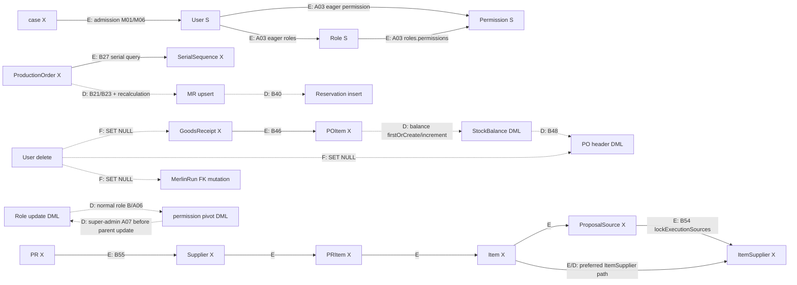

# Merlin L1 / TC-02 / 3 — guard scope és writerlefedettségi felülvizsgálat

- **Feladatazonosító:** `MERLIN_TC02_GUARD_PROTOCOL_SCOPE_AND_WRITER_COVERAGE_REVIEW`.
- **Dátum:** 2026-10-23.
- **Dokumentum: DRAFT. A C protokoll és minden alábbi új műszaki javaslat: PROPOSED. A TC-02 egésze: BLOCKED.**
- **Kiindulás:** `feature/merlin-candidate`, helyi, követőági és `git ls-remote` szerinti távoli HEAD: `4d56222346e145fe199a2ef3766de562d4ab780d`; tiszta munkakönyvtár/staging, nincs untracked fájl.
- **Hatókör:** read-only audit + kizárólag ez az új Markdown. Nincs alkalmazás-, teszt-, migráció-, konfiguráció- vagy korábbi dokumentummódosítás; nincs DB-kapcsolat/kísérlet, seederfuttatás, staging, commit, push vagy providerhívás.

## 1. Vezetői összefoglaló

A kérdés az, hogyan tartható érvényben a Merlin sikeres lezárásának jogosultsági
és üzleti alapja a döntési ponttól a COMMIT-ig. Egy wrapper önmagában nem
elegendő: az első pivot-, készlet-, igény- vagy szülőmódosítás előtt kell
belépni a közös védelembe, ugyanazon tranzakcióban.

**SOURCE_CONFIRMED:** a részletes leltár 120 fájl/metódus sort,
58 külön forrásfájlt fed le. Ebből a kiválasztott C4–L2 tervezési
irányhoz **VERIFIED_MINIMUM: 29 meglévő alkalmazásfájl / 57 metódus**
a konkrétan megnevezett változtatási jelölt: 7 wrapper, 13 service,
18 repository, 19 tranzakciós redesign. A metódusok létezése és adatútja
forrásból igazolt; a változtatási szükségesség/osztály **PROPOSED / INFERRED**,
nem mért implementációs diff és nem teljes költségbecslés.

**Elsődleges ajánlás: C4 meglévő anchorokra építő, verzió nélküli változatának
további bizonyítása, L2 egységes guard-first sorrenddel mint tervezési cél.**
A legkisebb igazolt megoldás még nem ismert. Az ajánlás a sémaigény csökkentésére
irányul, nem a keresztmodulos writer-enrollment elhagyására.
Az admission case-first szerződését csak külön elfogadott döntés módosíthatja;
az L2 jelenleg nem engedélyezett átépítés.

Fontos új scope-pontosítások:

- A super-admin `RoleAdminService::update()` már az örökölt admintranzakció előtt `syncPermissions()`-t hív: A07/V06. A belső repository-wrapper késő lenne.
- A `DatabaseSeeder` `WithoutModelEvents`-et használ: D01. Observer vagy Spatie-cache invalidation nem teljes enforcement.
- A `PurchaseRequisitionRepository::lockForPurchaseOrderGeneration()` már PR → supplier → PR-item → Item → proposal-source zárakat vesz: B55. Nem helyes ezt pusztán „PR/source → Item” sorrendként leegyszerűsíteni.
- A normál BOM delete soft-delete; a BOM parent `deleted_at` nem közvetlen resolver predicate. A BOMItem-csere viszont közvetlen lineage-hatású: B36–B38.
- A PR→Draft PO létrehozás és GR draft létrehozás önmagában nem firm incoming/stock-változás. A C4 a későbbi approve/post kaput védi: B45/B49/B54 vs B46/B52.
- A user törlés `SET NULL` FK-műveletekkel más modulok sorait is érintheti; ennek motoroldali lockgráfja nem vezethető le egyetlen User-zárból.

**UNKNOWN / BLOCKED:** teljes külső writerlefedettség, valódi implicit FK/index
lockok, üres parent-scope lezárása, rollout és régi worker kizárása, valamint
a kétmotoros konkurencia- és hibabizonyíték. E dokumentum ezeket megnevezi,
nem állít TC-02 PASS-t.

## 2. Források, döntési hierarchia és bizonyítékszintek

Irányadó források:

1. [Decision 003](MERLIN_TC02_DECISION_003.md), 2–5. rész: **ACCEPTED** időszemantika, a régi fizikai COMMIT-követelménynél későbbi döntés.
2. [L1 baseline](MERLIN_L1_DECISION_BASELINE.md), [ADR 0017](../../../.kiro/decisions/0017-merlin-investigation-foundation.md), [ADR 0018](../../../.kiro/decisions/0018-merlin-execution-lifecycle.md), [Recovery 002](MERLIN_RECOVERY_002.md): elfogadott határok és nyitott kapuk.
3. [L1 Technical Contract DRAFT](MERLIN_L1_TECHNICAL_CONTRACT_DRAFT.md), különösen 3.3., 5–6., 8–10.; [Guard Contract DRAFT](MERLIN_TC02_AUTHORIZATION_BUSINESS_GUARD_CONTRACT_DRAFT.md), különösen 3–5., 7–11., 15–17.: **DRAFT**, nem elfogadott SQL-, guard- vagy sémaprotokoll.
4. [ADR 0009 netting](../../../.kiro/decisions/0009-material-requirement-netting.md), [ADR 0016 eligibility](../../../.kiro/decisions/0016-material-requirement-demand-eligibility.md), [planning knowledge](../../../.kiro/knowledge/planning-engine.md).
5. [Architecture steering](../../../.kiro/steering/architecture.md), [tesztelési steering](../../../.kiro/steering/testing.md), [Quality Gates](../../development/quality-gates.md), [backend gate](../../backend-quality-gate.md), [DoD](../../project-management/definition-of-done.md), [dokumentációs konvenciók](../../architecture/project-conventions.md).

Változatlan **ACCEPTED** követelmények: immutable claim deadline = 180 másodperc;
DB UTC epoch seconds authority; szerializált tranzakciós döntési ponton
`db_now < execution_deadline_epoch`, egyenlőségnél tiltás; fizikai COMMIT
történhet a deadline után; jogosultsági és üzleti feltételek COMMIT-ig védettek;
state/audit/receipt atomikus; első érvényes terminális állapot immutable;
unknown COMMIT után nincs vak retry; jogvesztés nem ad új execution jogot.
Az L1-D02 két lifecycle táblája nem engedélyez új guard-táblát vagy
keresztmodulos sémaváltoztatást. E dokumentum nem változtatja meg a régi forrásokat.

| Státusz          | Használat                                                                                                                                   |
| ---------------- | ------------------------------------------------------------------------------------------------------------------------------------------- |
| SOURCE_CONFIRMED | A megadott HEAD fájljában olvasott metódus, route, modell vagy migráció. Külső motordokumentáció külön hivatkozva; nem helyi runtime-mérés. |
| INFERRED         | Adatútból levezetett hatás, lehetséges ciklus, scope vagy helyességi érv.                                                                   |
| UNKNOWN          | Hiányzó/teljesen nem feltárt hívó, deployment, SQL-plan, privilégium vagy futási bizonyíték.                                                |
| PROPOSED         | Minden új wrapper, gateway, anchor, sorrend, exclusion és implementációs szelet.                                                            |
| OPEN             | Felhasználói/DB/security/üzemeltetési döntés szükséges.                                                                                     |
| BLOCKED          | Nem bizonyított garancia, hiányzó döntés vagy előfeltétel miatt nincs implementációs/aktiválási készültség.                                 |

A leltár forrásoszlopai **SOURCE_CONFIRMED** állítások; a Guard és
Változtatási osztály oszlopok **PROPOSED / INFERRED**. `NO_CHANGE` nem
biztonsági jóváhagyás: a sorban megadott feltételekkel nincs külön C4-kódmódosítás.
`UNKNOWN` nem rejtett `WRAPPER_ONLY`. `SCHEMA_DEPENDENCY` új, még nem létező
guard/lifecycle schema esetén külön szerepel a 8–9. részben, nem kitalált metódussor.

Vizsgálati kör: `app`, `routes`, `bootstrap`, `database/migrations`,
`database/seeders`, kapcsolódó factory/tesztforrások, konfiguráció és helyi
vendor. Keresési minták: modellosztályok, `create/update/delete/save/upsert`,
`restore/forceDelete`, pivot API-k, raw SQL, lock/transaction/cache és route
deklarációk. Nem indult Laravel-bootstrap vagy DB-kapcsolat.
Telepített verziók a [composer.lock](../../../composer.lock#L1134) szerint
Laravel v13.23.0, [Spatie Permission 8.0.0](../../../composer.lock#L3681);
a korábbi DRAFT rögzített package-forrásreferenciái megmaradnak.

### 2.1. Aktív belépési jelölések

Az „aktív” itt **forrásban route-hoz kötött**, nem production-hozzáférés vagy
sikeres jogosultság bizonyítása. A FormRequest/policy tiltás továbbra is számít.

| Jel                | Route-forrás                                                                                   | Controller/service továbbhívás                                                                                                                                                                                                                                                                               |
| ------------------ | ---------------------------------------------------------------------------------------------- | ------------------------------------------------------------------------------------------------------------------------------------------------------------------------------------------------------------------------------------------------------------------------------------------------------------ |
| H-U / H-R          | [web:100–102](../../../routes/web.php#L100)                                                    | [UserController:45–69](../../../app/Http/Controllers/Admin/UserController.php#L45), [RoleController:43–60](../../../app/Http/Controllers/Admin/RoleController.php#L43); Permission csak index                                                                                                                |
| H-I / H-BOM        | [web:112–116](../../../routes/web.php#L112)                                                    | [ItemController:54–90](../../../app/Http/Controllers/Admin/ItemController.php#L54), [BomController:77–132](../../../app/Http/Controllers/Admin/BomController.php#L77)                                                                                                                                        |
| H-CO               | [web:125–131](../../../routes/web.php#L125)                                                    | [CustomerOrderController:87–163](../../../app/Http/Controllers/Admin/CustomerOrderController.php#L87)                                                                                                                                                                                                        |
| H-PP               | [web:132–138](../../../routes/web.php#L132)                                                    | [ProductionPlanController:50–81](../../../app/Http/Controllers/Admin/ProductionPlanController.php#L50)                                                                                                                                                                                                       |
| H-T                | [web:141–153](../../../routes/web.php#L141)                                                    | [ProductionTaskController:85–180](../../../app/Http/Controllers/Admin/ProductionTaskController.php#L85), [material controller:15](../../../app/Http/Controllers/Admin/ProductionTaskMaterialController.php#L15), [quality controller:15](../../../app/Http/Controllers/Admin/QualityCheckController.php#L15) |
| H-RES              | [web:160–163](../../../routes/web.php#L160)                                                    | [StockReservationController:34](../../../app/Http/Controllers/Admin/Inventory/StockReservationController.php#L34); MR HTTP felület csak olvas                                                                                                                                                                |
| H-PR / H-PO / H-GR | [web:178–203](../../../routes/web.php#L178)                                                    | [PR controller:186](../../../app/Http/Controllers/Admin/PurchaseRequisitionController.php#L186), [PO controller:74–144](../../../app/Http/Controllers/Admin/PurchaseOrderController.php#L74), [GR controller:74–93](../../../app/Http/Controllers/Admin/GoodsReceiptController.php#L74)                      |
| H-IS               | [web item-suppliers route](../../../routes/web.php#L113)                                       | [ItemSupplierController:31–47](../../../app/Http/Controllers/Admin/ItemSupplierController.php#L31)                                                                                                                                                                                                           |
| H-P / H-A          | [web:55–57](../../../routes/web.php#L55), [auth password routes](../../../routes/auth.php#L27) | Profile és password reset; nem új permission/deactivation policy                                                                                                                                                                                                                                             |

## 3. Authorization writer inventory

### 3.1. Alkalmazás- és package-útvonalak

A User create/update nem általános direct permission endpoint: a
[UserRepository:44–79](../../../app/Repositories/Admin/UserRepository.php#L44)
`syncRoles`-t használ. Direct permission API a vendorban és E2E fixture-ben
azonosított; production HTTP grant/revoke caller **UNKNOWN**.
A [RoleAdminService:34](../../../app/Services/Admin/RoleAdminService.php#L34)
super-admin ága `parent::update` előtt detacholhat.
A Role delete super-admin tiltása nem tilt minden potenciális vendor/raw írást.

A User `name/email/password/email_verified_at` frissítése nem változtatja meg
a rögzített V1 live-ID + kétpermission + super-admin feltételt. A C4 ezért
nem követel új fiókflaget vagy külön guardot minden profile/password mentéshez.
A meglévő User sor DML-zára természetesen ütközhet a finalizer S-zárával.
Egy későbbi deactivation vagy verification predicate ezt a besorolást megváltoztatná.

| Modul  | Fájl: sor                                                                                                                                                          | Metódus                                  | Aktív belépési út                                           | Érintett adat                                                | Guard                                            | Tranzakció                                         | Változtatási osztály   | Bizonyíték                                                                                    |
| ------ | ------------------------------------------------------------------------------------------------------------------------------------------------------------------ | ---------------------------------------- | ----------------------------------------------------------- | ------------------------------------------------------------ | ------------------------------------------------ | -------------------------------------------------- | ---------------------- | --------------------------------------------------------------------------------------------- |
| Auth   | [app/Repositories/Admin/UserRepository.php:44](../../../app/Repositories/Admin/UserRepository.php#L44)                                                             | `A01` — `create()`                       | H-U store → örökölt admin create                            | User insert parent::create :52; syncRoles :53                | új A row, pivot előtt A X                        | admin caller transaction; direkt API nem garantált | `WRAPPER_ONLY`         | SOURCE_CONFIRMED metódus/adatút; guard és osztály PROPOSED/INFERRED                           |
| Auth   | [app/Repositories/Admin/UserRepository.php:61](../../../app/Repositories/Admin/UserRepository.php#L61)                                                             | `A02` — `update()`                       | H-U update                                                  | User update :73; syncRoles :76                               | A X minden pivot előtt                           | admin caller; nincs lokális                        | `WRAPPER_ONLY`         | SOURCE_CONFIRMED metódus/adatút; guard és osztály PROPOSED/INFERRED                           |
| Auth   | [app/Repositories/Admin/UserRepository.php:18](../../../app/Repositories/Admin/UserRepository.php#L18)                                                             | `A03` — `findForMerlinAdmission()`       | Merlin internal admission                                   | read: User S + eager permissions/roles sharedLock :20–24     | connection/parity és lock-order újratervezés     | owned admission                                    | `REPOSITORY_CHANGE`    | SOURCE_CONFIRMED metódus/adatút; guard és osztály PROPOSED/INFERRED                           |
| Auth   | [app/Services/Admin/UserAdminService.php:27](../../../app/Services/Admin/UserAdminService.php#L27)                                                                 | `A04` — `delete()`                       | H-U destroy                                                 | ellenőrzések után parent delete :42 → audit/detach           | A X a legelső persistence/hook előtt             | jelenleg nincs saját                               | `TRANSACTION_REDESIGN` | SOURCE_CONFIRMED metódus/adatút; guard és osztály PROPOSED/INFERRED                           |
| Auth   | [app/Repositories/Admin/RoleRepository.php:29](../../../app/Repositories/Admin/RoleRepository.php#L29)                                                             | `A05` — `create()`                       | H-R store                                                   | Role insert :36, syncPermissions :37                         | R/P writer context; új role anchor               | admin caller                                       | `WRAPPER_ONLY`         | SOURCE_CONFIRMED metódus/adatút; guard és osztály PROPOSED/INFERRED                           |
| Auth   | [app/Repositories/Admin/RoleRepository.php:45](../../../app/Repositories/Admin/RoleRepository.php#L45)                                                             | `A06` — `update()`                       | H-R update                                                  | Role update :51, syncPermissions :54                         | R X; catalog lookup sorrend                      | admin caller                                       | `WRAPPER_ONLY`         | SOURCE_CONFIRMED metódus/adatút; guard és osztály PROPOSED/INFERRED                           |
| Auth   | [app/Services/Admin/RoleAdminService.php:29](../../../app/Services/Admin/RoleAdminService.php#L29)                                                                 | `A07` — `update()`                       | H-R update, super-admin külön ág                            | super-admin syncPermissions :34 még parent::update :37 előtt | R/P a pre-parent detach előtt                    | super-admin ág nincs benne az örökölt tx-ben       | `TRANSACTION_REDESIGN` | SOURCE_CONFIRMED metódus/adatút; guard és osztály PROPOSED/INFERRED                           |
| Auth   | [app/Services/Admin/RoleAdminService.php:40](../../../app/Services/Admin/RoleAdminService.php#L40)                                                                 | `A08` — `delete()`                       | H-R destroy                                                 | super-admin tiltás, más role parent delete :49               | R X hookok előtt                                 | nincs saját                                        | `TRANSACTION_REDESIGN` | SOURCE_CONFIRMED metódus/adatút; guard és osztály PROPOSED/INFERRED                           |
| Auth   | [app/Http/Controllers/ProfileController.php:31](../../../app/Http/Controllers/ProfileController.php#L31)                                                           | `A09` — `update()`                       | H-P PATCH profile                                           | User save :39; name/email/verification                       | nincs új permission-predicate; User row DML zára | autocommit                                         | `NO_CHANGE`            | SOURCE_CONFIRMED metódus/adatút; guard és osztály PROPOSED/INFERRED                           |
| Auth   | [app/Http/Controllers/ProfileController.php:47](../../../app/Http/Controllers/ProfileController.php#L47)                                                           | `A10` — `password()`                     | H-P PUT password                                            | User update :54                                              | password nem V1 current permission input         | autocommit                                         | `NO_CHANGE`            | SOURCE_CONFIRMED metódus/adatút; guard és osztály PROPOSED/INFERRED                           |
| Auth   | [app/Http/Controllers/Auth/NewPasswordController.php:35](../../../app/Http/Controllers/Auth/NewPasswordController.php#L35)                                         | `A11` — `store()`                        | H-A reset-password POST                                     | reset callback User save :49                                 | nem új actor/permission authority                | Password broker callback                           | `NO_CHANGE`            | SOURCE_CONFIRMED metódus/adatút; guard és osztály PROPOSED/INFERRED                           |
| Auth   | [app/Providers/AppServiceProvider.php:154](../../../app/Providers/AppServiceProvider.php#L154)                                                                     | `A12` — `boot()`                         | Laravel provider boot                                       | Gate::before :184 nem DB-write                               | policyparity rögzítés; meglévő hook megmarad     | N/A                                                | `NO_CHANGE`            | SOURCE_CONFIRMED metódus/adatút; guard és osztály PROPOSED/INFERRED                           |
| Vendor | [vendor/spatie/laravel-permission/src/Traits/HasRoles.php:218](../../../vendor/spatie/laravel-permission/src/Traits/HasRoles.php#L218)                             | `V01` — `assignRole()`                   | UserRepository/AdminUserSeeder/E2E; nyilvános package API   | attach :234; unsaved modellnél saved hook :245               | caller A X a hívás előtt                         | nincs saját tx                                     | `UNKNOWN`              | SOURCE_CONFIRMED metódus/adatút; guard és osztály PROPOSED/INFERRED; hívó/enforcement UNKNOWN |
| Vendor | [vendor/spatie/laravel-permission/src/Traits/HasRoles.php:271](../../../vendor/spatie/laravel-permission/src/Traits/HasRoles.php#L271)                             | `V02` — `removeRole()`                   | potenciális API; aktív HTTP caller nem azonosított          | detach :275                                                  | caller A X                                       | nincs saját tx                                     | `UNKNOWN`              | SOURCE_CONFIRMED metódus/adatút; guard és osztály PROPOSED/INFERRED; hívó/enforcement UNKNOWN |
| Vendor | [vendor/spatie/laravel-permission/src/Traits/HasRoles.php:298](../../../vendor/spatie/laravel-permission/src/Traits/HasRoles.php#L298)                             | `V03` — `syncRoles()`                    | UserRepository::create/update; E2E                          | detach :308, majd assignRole                                 | A X a detach előtt                               | nincs saját tx                                     | `UNKNOWN`              | SOURCE_CONFIRMED metódus/adatút; guard és osztály PROPOSED/INFERRED; hívó/enforcement UNKNOWN |
| Vendor | [vendor/spatie/laravel-permission/src/Traits/HasRoles.php:27](../../../vendor/spatie/laravel-permission/src/Traits/HasRoles.php#L27)                               | `V04` — `bootHasRoles()`                 | User/Permission model delete hook                           | roles detach :36; Permission users detach :38                | User A / Permission P X már model::delete előtt  | caller/hook                                        | `UNKNOWN`              | SOURCE_CONFIRMED metódus/adatút; guard és osztály PROPOSED/INFERRED; hívó/enforcement UNKNOWN |
| Vendor | [vendor/spatie/laravel-permission/src/Traits/HasPermissions.php:387](../../../vendor/spatie/laravel-permission/src/Traits/HasPermissions.php#L387)                 | `V05` — `givePermissionTo()`             | package API; direct grant/role; app HTTP direct grant nincs | attach :398 vagy saved hook :409                             | A vagy R X callerben                             | nincs saját tx                                     | `UNKNOWN`              | SOURCE_CONFIRMED metódus/adatút; guard és osztály PROPOSED/INFERRED; hívó/enforcement UNKNOWN |
| Vendor | [vendor/spatie/laravel-permission/src/Traits/HasPermissions.php:442](../../../vendor/spatie/laravel-permission/src/Traits/HasPermissions.php#L442)                 | `V06` — `syncPermissions()`              | RoleRepo/super-admin service/E2E/seeder                     | detach :446 majd givePermissionTo                            | A/R X a legelső detach előtt                     | nincs saját tx                                     | `UNKNOWN`              | SOURCE_CONFIRMED metódus/adatút; guard és osztály PROPOSED/INFERRED; hívó/enforcement UNKNOWN |
| Vendor | [vendor/spatie/laravel-permission/src/Traits/HasPermissions.php:459](../../../vendor/spatie/laravel-permission/src/Traits/HasPermissions.php#L459)                 | `V07` — `revokePermissionTo()`           | potenciális API; direct HTTP caller nincs azonosítva        | detach :463                                                  | A/R X                                            | nincs saját tx                                     | `UNKNOWN`              | SOURCE_CONFIRMED metódus/adatút; guard és osztály PROPOSED/INFERRED; hívó/enforcement UNKNOWN |
| Vendor | [vendor/spatie/laravel-permission/src/Traits/HasPermissions.php:33](../../../vendor/spatie/laravel-permission/src/Traits/HasPermissions.php#L33)                   | `V08` — `bootHasPermissions()`           | User/Role delete hook                                       | permissions detach :43; Role users detach :46                | delete előtt A/R/P X; hook sorrend runtime       | caller/hook                                        | `UNKNOWN`              | SOURCE_CONFIRMED metódus/adatút; guard és osztály PROPOSED/INFERRED; hívó/enforcement UNKNOWN |
| Vendor | [vendor/spatie/laravel-permission/src/Traits/RefreshesPermissionCache.php:9](../../../vendor/spatie/laravel-permission/src/Traits/RefreshesPermissionCache.php#L9) | `V09` — `bootRefreshesPermissionCache()` | Role/Permission saved/deleted event                         | registrar cache-forget :12/:16, nem domain lock              | nem guard; wrapper nem támaszkodhat erre         | cache store önálló                                 | `NO_CHANGE`            | SOURCE_CONFIRMED metódus/adatút; guard és osztály PROPOSED/INFERRED                           |

### 3.2. Fordított role→model tagságírások — további bypass-felület

A Role modell [HasAssignedModels traitet használ](../../../vendor/spatie/laravel-permission/src/Models/Role.php#L35).
Az alábbi API-k megkerülik a User::syncRoles callert és tömeges user-tagságot
is változtathatnak. A célzott `app/database/routes/tests` keresés nem talált
hívást; ez nem tiltás vagy teljes külső hívólefedettség.

| Modul  | Fájl: sor                                                                                                                                              | Metódus                      | Aktív belépési út                                                          | Érintett adat                                                | Guard                                                                                | Tranzakció     | Változtatási osztály | Bizonyíték                                                                |
| ------ | ------------------------------------------------------------------------------------------------------------------------------------------------------ | ---------------------------- | -------------------------------------------------------------------------- | ------------------------------------------------------------ | ------------------------------------------------------------------------------------ | -------------- | -------------------- | ------------------------------------------------------------------------- |
| Vendor | [vendor/spatie/laravel-permission/src/Traits/HasAssignedModels.php:21](../../../vendor/spatie/laravel-permission/src/Traits/HasAssignedModels.php#L21) | `V10` — `assignToModels()`   | potenciális Role API; app/database/routes/tests caller nem talált, UNKNOWN | Role→model_has_roles attach :33                              | teljes érintett régi/új actorhalmaz A + R, discovery/recheck; nem csak egy User hívó | nincs saját tx | `UNKNOWN`            | SOURCE_CONFIRMED API; caller/enforcement UNKNOWN; guard PROPOSED/INFERRED |
| Vendor | [vendor/spatie/laravel-permission/src/Traits/HasAssignedModels.php:47](../../../vendor/spatie/laravel-permission/src/Traits/HasAssignedModels.php#L47) | `V11` — `removeFromModels()` | potenciális Role API; app/database/routes/tests caller nem talált, UNKNOWN | Role→model_has_roles detach :50                              | teljes érintett régi/új actorhalmaz A + R, discovery/recheck; nem csak egy User hívó | nincs saját tx | `UNKNOWN`            | SOURCE_CONFIRMED API; caller/enforcement UNKNOWN; guard PROPOSED/INFERRED |
| Vendor | [vendor/spatie/laravel-permission/src/Traits/HasAssignedModels.php:64](../../../vendor/spatie/laravel-permission/src/Traits/HasAssignedModels.php#L64) | `V12` — `syncModels()`       | potenciális Role API; app/database/routes/tests caller nem talált, UNKNOWN | role összes model_has_roles raw pivot DELETE :67, attach :73 | teljes érintett régi/új actorhalmaz A + R, discovery/recheck; nem csak egy User hívó | nincs saját tx | `UNKNOWN`            | SOURCE_CONFIRMED API; caller/enforcement UNKNOWN; guard PROPOSED/INFERRED |

A caller-oldali A/R root gateway tervnek ezek használatát vagy igazoltan
ki kell zárnia, vagy a teljes régi/új actorhalmazra ki kell terjednie.
Különösen a `syncModels` nem csak a megadott új actorokat érinti.
Actor-first rang mellett a szerepkörből történő actor-discovery ugyanúgy
preflight + R alatti recheck/rollback problémát ad, mint az üzleti fanout.
Ennek closure-ja UNKNOWN/BLOCKED; új globális auth-lock nem következik belőle.

### 3.3. Wrapperrel lefedhető és saját átalakítást igénylő részek

A01/A02/A05/A06 a közös admin wrapperbe illeszthető, de a hívóban explicit
scope/connection context kell, és a nested repository nem kérhet később új,
alacsonyabb rangú zárat. A07 külön root transaction redesign, nem a
`syncPermissions` utáni audit köré tett wrapper. A04/A08/S03 esetén az audit,
a deleting hookok és a parent delete közös tranzakciós határba tartoznak.
A Role/User törlés első SQL-je nem feltétlenül a parent DELETE:
[HasRoles:29–38](../../../vendor/spatie/laravel-permission/src/Traits/HasRoles.php#L29)
és [HasPermissions:35–46](../../../vendor/spatie/laravel-permission/src/Traits/HasPermissions.php#L35)
előbb pivotot detacholhat. A két trait-hook egymás közötti pontos runtime
sorrendje nincs lemérve; a guardnak mindkettőt meg kell előznie.

**PROPOSED:** vendorfájlok patch-elése helyett a saját gateway/callerek vagy
külön jóváhagyott model-integráció védjen. A V01–V08 és V10–V12 sorok ezért UNKNOWN,
nem tervezett vendor-módosítási darabszámok. A PermissionRepository nem
deklarál saját writer metódust, hanem S04–S06-ot örökli:
[PermissionRepository:8–14](../../../app/Repositories/Admin/PermissionRepository.php#L8).
A PermissionController csak index, [16–23](../../../app/Http/Controllers/Admin/PermissionController.php#L16);
új catalog endpoint nincs felhatalmazva.

A tényleges auth-read cache-kockázata változatlan:
[Start::authorized:143–145](../../../app/Services/Merlin/StartMerlinInvestigationService.php#L143),
[HasPermissions:173–213](../../../vendor/spatie/laravel-permission/src/Traits/HasPermissions.php#L173),
[Permission::findByName:103](../../../vendor/spatie/laravel-permission/src/Models/Permission.php#L103),
[registrar:178–210](../../../vendor/spatie/laravel-permission/src/PermissionRegistrar.php#L178).
Friss User eager-load nem bizonyít cache-független pozitív döntést.
[AppServiceProvider:184–186](../../../app/Providers/AppServiceProvider.php#L184)
az azonosított egyedi Gate-before; az összes dinamikus/telepítési extension
lefedettsége UNKNOWN. Az általános policy- és Gate-semantika nem változhat
észrevétlenül egy új belső evaluator miatt.

### 3.4. Közös alkalmazási infrastruktúra — egyszer számolva

| Modul  | Fájl: sor                                                                                                                  | Metódus                | Aktív belépési út                           | Érintett adat                                                 | Guard                                                        | Tranzakció                          | Változtatási osztály   | Bizonyíték                                                          |
| ------ | -------------------------------------------------------------------------------------------------------------------------- | ---------------------- | ------------------------------------------- | ------------------------------------------------------------- | ------------------------------------------------------------ | ----------------------------------- | ---------------------- | ------------------------------------------------------------------- |
| Shared | [app/Services/Admin/AbstractAdminService.php:42](../../../app/Services/Admin/AbstractAdminService.php#L42)                 | `S01` — `create()`     | H-U/H-R, Item öröklés                       | első domain írás: repository::create; audit utána             | A/R/I kontextus                                              | saját default DB::transaction       | `WRAPPER_ONLY`         | SOURCE_CONFIRMED metódus/adatút; guard és osztály PROPOSED/INFERRED |
| Shared | [app/Services/Admin/AbstractAdminService.php:69](../../../app/Services/Admin/AbstractAdminService.php#L69)                 | `S02` — `update()`     | H-U/H-R/H-I                                 | első domain írás: repository::update                          | A/R/I kontextus                                              | saját default transaction           | `WRAPPER_ONLY`         | SOURCE_CONFIRMED metódus/adatút; guard és osztály PROPOSED/INFERRED |
| Shared | [app/Services/Admin/AbstractAdminService.php:96](../../../app/Services/Admin/AbstractAdminService.php#L96)                 | `S03` — `delete()`     | H-U/H-R/H-I és generic hívók                | első perzisztencia-kísérlet: audit log :98; domain delete :99 | guard audit és detach előtt                                  | nincs lokális transaction           | `TRANSACTION_REDESIGN` | SOURCE_CONFIRMED metódus/adatút; guard és osztály PROPOSED/INFERRED |
| Shared | [app/Repositories/Admin/AbstractAdminRepository.php:78](../../../app/Repositories/Admin/AbstractAdminRepository.php#L78)   | `S04` — `create()`     | H-U/H-R/H-I; potenciális közvetlen API      | query()->create :80                                           | kötelező gateway context/allowlist                           | caller; nincs saját                 | `REPOSITORY_CHANGE`    | SOURCE_CONFIRMED metódus/adatút; guard és osztály PROPOSED/INFERRED |
| Shared | [app/Repositories/Admin/AbstractAdminRepository.php:90](../../../app/Repositories/Admin/AbstractAdminRepository.php#L90)   | `S05` — `update()`     | admin service-ek; potenciális közvetlen API | model->update :92                                             | scope/context ellenőrzés                                     | caller                              | `REPOSITORY_CHANGE`    | SOURCE_CONFIRMED metódus/adatút; guard és osztály PROPOSED/INFERRED |
| Shared | [app/Repositories/Admin/AbstractAdminRepository.php:102](../../../app/Repositories/Admin/AbstractAdminRepository.php#L102) | `S06` — `delete()`     | admin service-ek; potenciális közvetlen API | model->delete :104; hookok megelőzik SQL DELETE-et            | delete context/assert                                        | caller                              | `REPOSITORY_CHANGE`    | SOURCE_CONFIRMED metódus/adatút; guard és osztály PROPOSED/INFERRED |
| Shared | [app/Services/Admin/CodeAwareAdminService.php:31](../../../app/Services/Admin/CodeAwareAdminService.php#L31)               | `S07` — `create()`     | H-I és kódos master data                    | CodeCreationService::create :35 → repo create                 | új objektum-context, más modul ne kapjon új business guardot | default transaction :34             | `WRAPPER_ONLY`         | SOURCE_CONFIRMED metódus/adatút; guard és osztály PROPOSED/INFERRED |
| Shared | [app/Services/AuditLogService.php:65](../../../app/Services/AuditLogService.php#L65)                                       | `S08` — `log()`        | admin delete stb.                           | activity()->log :83; buffer/connection configfüggő            | nem lifecycle receipt; caller gate előtt kell scope          | saját transaction nincs             | `NO_CHANGE`            | SOURCE_CONFIRMED metódus/adatút; guard és osztály PROPOSED/INFERRED |
| Shared | [app/Services/BusinessCacheInvalidator.php:123](../../../app/Services/BusinessCacheInvalidator.php#L123)                   | `S09` — `invalidate()` | domain service-ek                           | afterCommit :126 vagy cache generation írás                   | nem TC-02 guard                                              | default connection transactionLevel | `NO_CHANGE`            | SOURCE_CONFIRMED metódus/adatút; guard és osztály PROPOSED/INFERRED |

S01/S02/S07 `WRAPPER_ONLY` is konkrét módosítási jelölt: bemeneti scope/context,
owned connection, nested transaction policy és assert szükséges, nem nulla
hívóoldali munka. S04–S06 nyilvános repository API-k: csak service-wrapper
mellett továbbra megkerülhetők. A javasolt context-ellenőrzés nem lehet
széles „minden modell minden írását blokkoló” generic policy; típusonkénti
enrollment és nem érintett modulok regressziója kell.

S03-nál az audit az első perzisztencia-kísérlet. Az
[AuditLogService:65–83](../../../app/Services/AuditLogService.php#L65) és
[LogActivityAction:70–83](../../../vendor/spatie/laravel-activitylog/src/Actions/LogActivityAction.php#L70)
szerint annak tényleges DB-írása config/buffer függő
([activitylog:12](../../../config/activitylog.php#L12),
[buffer:61](../../../config/activitylog.php#L61)). Nem állítunk feltétlenül
első audit INSERT-et vagy lifecycle receipt-atomicitást erről az opcionális
naplóról; a domain detach/write mindenképp guard előtt tiltandó.

## 4. Business writer inventory

### 4.1. A megtartott dependency-gráf

**SOURCE_CONFIRMED:** [Resolver:20–52](../../../app/Services/Admin/MaterialShortageProblemCaseResolver.php#L20)
→ [case current read:32–39](../../../app/Repositories/Admin/ProblemCaseRepository.php#L32)
→ [eligibility:20–81](../../../app/Services/Admin/MaterialRequirementDemandEligibilityService.php#L20)
→ [netting calculate:24–123](../../../app/Services/Admin/MaterialRequirementNettingService.php#L24)
→ [netting repository:25–143](../../../app/Repositories/Admin/MaterialRequirementNettingRepository.php#L25).

Közvetlen input: case type/lifecycle/binding; MR required quantity/date/unit,
lineage és soft delete; customer item/order és production lifecycle;
BOMItem identity/bom/item; pozitív stock balance; pozitív aktív reservation;
PO/POI status/date/unit/ordered/received/delete és Item base unit join.
A kiválasztott requirementet a teljes netting eredményéből választja ki a resolver.

**INFERRED:** egy Item teljes versengő demand/supply poolja a stabil
I-scope-jelölt. Location, batch és kiválasztott requirement önmagában túl szűk.
A globális nettingből egy itemre szűkített read ekvivalenciája még bizonyítandó.
Nem vezetünk be új active-item/soft-delete/unit-conversion/date/quantity
szabályt: az incoming SQL nyers Item joinja nem szűr `items.deleted_at`-ra,
az active item flag pedig a recalculation ellenőrzésében szerepel.
A snapshot `missing_quantity` nem helyettesíti az authoritative nettinget.

### 4.2. Fájlonkénti és metódusonkénti leltár

| Modul       | Fájl: sor                                                                                                                                          | Metódus                                             | Aktív belépési út                                   | Érintett adat                                                                       | Guard                                                                         | Tranzakció                                | Változtatási osztály   | Bizonyíték                                                                                    |
| ----------- | -------------------------------------------------------------------------------------------------------------------------------------------------- | --------------------------------------------------- | --------------------------------------------------- | ----------------------------------------------------------------------------------- | ----------------------------------------------------------------------------- | ----------------------------------------- | ---------------------- | --------------------------------------------------------------------------------------------- |
| Merlin      | [app/Support/Merlin/MerlinAdmissionTransaction.php:22](../../../app/Support/Merlin/MerlinAdmissionTransaction.php#L22)                             | `M01` — `run()`                                     | StartMerlinInvestigationService::start belső API    | case X :79; callback írhat history/run/auditot                                      | L2 guard-first esetén wrapperhatár változna                                   | owned RR / SQLite IMMEDIATE; attempts=1   | `TRANSACTION_REDESIGN` | SOURCE_CONFIRMED metódus/adatút; guard és osztály PROPOSED/INFERRED                           |
| Merlin      | [app/Support/Merlin/MerlinAdmissionContext.php:57](../../../app/Support/Merlin/MerlinAdmissionContext.php#L57)                                     | `M02` — `freshActor()`                              | admission callback                                  | read: UserRepository::findForMerlinAdmission :60                                    | auth guard/connection explicit                                                | owned context                             | `SERVICE_CHANGE`       | SOURCE_CONFIRMED metódus/adatút; guard és osztály PROPOSED/INFERRED                           |
| Merlin      | [app/Support/Merlin/MerlinAdmissionContext.php:43](../../../app/Support/Merlin/MerlinAdmissionContext.php#L43)                                     | `M03` — `resolveCurrent()`                          | admission callback                                  | read: resolver + scoped repositories :47–49                                         | új composition/policy, nem automatikus reuse                                  | owned context                             | `SERVICE_CHANGE`       | SOURCE_CONFIRMED metódus/adatút; guard és osztály PROPOSED/INFERRED                           |
| Merlin      | [app/Services/Merlin/StartMerlinInvestigationService.php:87](../../../app/Services/Merlin/StartMerlinInvestigationService.php#L87)                 | `M04` — `admit()`                                   | start → attempt → callback                          | history :119, PENDING run :120, audit :121                                          | L2 scope-hint recheck; friss auth, nincs worker                               | owned admission                           | `SERVICE_CHANGE`       | SOURCE_CONFIRMED metódus/adatút; guard és osztály PROPOSED/INFERRED                           |
| Merlin      | [app/Services/Merlin/StartMerlinInvestigationService.php:143](../../../app/Services/Merlin/StartMerlinInvestigationService.php#L143)               | `M05` — `authorized()`                              | start preflight/admit/reconcile                     | Gate string decision :145, registrar lehet                                          | cache-független evaluator parity                                              | preflight / owned context                 | `SERVICE_CHANGE`       | SOURCE_CONFIRMED metódus/adatút; guard és osztály PROPOSED/INFERRED                           |
| Merlin      | [app/Repositories/Admin/ProblemCaseRepository.php:27](../../../app/Repositories/Admin/ProblemCaseRepository.php#L27)                               | `M06` — `lockForAdmission()`                        | owned wrapper :79                                   | case FOR UPDATE :29                                                                 | L2 lock rang/pontos read                                                      | owned connection                          | `REPOSITORY_CHANGE`    | SOURCE_CONFIRMED metódus/adatút; guard és osztály PROPOSED/INFERRED                           |
| Merlin      | [app/Repositories/Admin/ProblemCaseRepository.php:42](../../../app/Repositories/Admin/ProblemCaseRepository.php#L42)                               | `M07` — `createMaterialShortage()`                  | belső API; aktív authorized producer hívója UNKNOWN | case insert :50; evaluation insert :60                                              | MR/case FK-sorrend és producer enrollment                                     | saját connection transaction :47          | `UNKNOWN`              | SOURCE_CONFIRMED metódus/adatút; guard és osztály PROPOSED/INFERRED; hívó/enforcement UNKNOWN |
| MRP         | [app/Services/Admin/MaterialShortageProblemCaseResolver.php:20](../../../app/Services/Admin/MaterialShortageProblemCaseResolver.php#L20)           | `B01` — `resolve()`                                 | Merlin admission/context és supplier read           | read-only: case :22, global netting :45                                             | selected binding + teljes item scope                                          | caller; nincs saját                       | `SERVICE_CHANGE`       | SOURCE_CONFIRMED metódus/adatút; guard és osztály PROPOSED/INFERRED                           |
| MRP         | [app/Services/Admin/MaterialRequirementNettingService.php:24](../../../app/Services/Admin/MaterialRequirementNettingService.php#L24)               | `B02` — `calculate()`                               | resolver + normál MRP                               | read-only + memóriabeli pool; explicit collection is lehet                          | üzleti algoritmus változatlan                                                 | caller                                    | `NO_CHANGE`            | SOURCE_CONFIRMED metódus/adatút; guard és osztály PROPOSED/INFERRED                           |
| MRP         | [app/Repositories/Admin/MaterialRequirementNettingRepository.php:38](../../../app/Repositories/Admin/MaterialRequirementNettingRepository.php#L38) | `B03` — `requirements()`                            | calculate(null)                                     | összes nem soft-deleted MR :40–45                                                   | külön scoped read/explicit collection; normál API megőrzés                    | caller                                    | `REPOSITORY_CHANGE`    | SOURCE_CONFIRMED metódus/adatút; guard és osztály PROPOSED/INFERRED                           |
| MRP         | [app/Repositories/Admin/MaterialRequirementNettingRepository.php:25](../../../app/Repositories/Admin/MaterialRequirementNettingRepository.php#L25) | `B04` — `loadDemandSources()`                       | calculate                                           | eager sources :35                                                                   | owned context és teljes scope recheck                                         | caller                                    | `REPOSITORY_CHANGE`    | SOURCE_CONFIRMED metódus/adatút; guard és osztály PROPOSED/INFERRED                           |
| MRP         | [app/Repositories/Admin/MaterialRequirementNettingRepository.php:58](../../../app/Repositories/Admin/MaterialRequirementNettingRepository.php#L58) | `B05` — `usableStockByItem()`                       | calculate                                           | balance :64 és active reservation SUM :71                                           | I S kontextus ellenőrzés                                                      | caller                                    | `REPOSITORY_CHANGE`    | SOURCE_CONFIRMED metódus/adatút; guard és osztály PROPOSED/INFERRED                           |
| MRP         | [app/Repositories/Admin/MaterialRequirementNettingRepository.php:99](../../../app/Repositories/Admin/MaterialRequirementNettingRepository.php#L99) | `B06` — `firmIncomingByItem()`                      | calculate                                           | POI+PO+items join :105–121                                                          | I S; unit/date/status változatlan                                             | caller                                    | `REPOSITORY_CHANGE`    | SOURCE_CONFIRMED metódus/adatút; guard és osztály PROPOSED/INFERRED                           |
| MRP         | [app/Services/Admin/MaterialRequirementService.php:31](../../../app/Services/Admin/MaterialRequirementService.php#L31)                             | `B07` — `calculateForProductionOrder()`             | H-PP generate, reserve/release belső hívások        | első MR upsert a calculateBomItemben; üres BOM-nál audit :43                        | teljes komponens I X + parent membership                                      | nincs saját transaction; callerfüggő      | `TRANSACTION_REDESIGN` | SOURCE_CONFIRMED metódus/adatút; guard és osztály PROPOSED/INFERRED                           |
| MRP         | [app/Services/Admin/MaterialRequirementService.php:51](../../../app/Services/Admin/MaterialRequirementService.php#L51)                             | `B08` — `calculateBomItem()`                        | private, B07                                        | MR repo upsert :72; quantity/date persist                                           | gyökér context/assert, nem itemenként késői lock                              | B07 caller                                | `SERVICE_CHANGE`       | SOURCE_CONFIRMED metódus/adatút; guard és osztály PROPOSED/INFERRED                           |
| MRP         | [app/Repositories/Admin/MaterialRequirementRepository.php:62](../../../app/Repositories/Admin/MaterialRequirementRepository.php#L62)               | `B09` — `updateForProductionOrderBomItem()`         | B08; belső API                                      | updateOrCreate :72, old/new item/lineage                                            | I X és membership assert                                                      | nincs saját transaction                   | `REPOSITORY_CHANGE`    | SOURCE_CONFIRMED metódus/adatút; guard és osztály PROPOSED/INFERRED                           |
| Customer    | [app/Services/Admin/CustomerOrderService.php:64](../../../app/Services/Admin/CustomerOrderService.php#L64)                                         | `B10` — `create()`                                  | H-CO store                                          | repo header insert/items :72                                                        | új atomikus parent, nincs meglévő demand                                      | default transaction                       | `NO_CHANGE`            | SOURCE_CONFIRMED metódus/adatút; guard és osztály PROPOSED/INFERRED                           |
| Customer    | [app/Services/Admin/CustomerOrderService.php:93](../../../app/Services/Admin/CustomerOrderService.php#L93)                                         | `B11` — `update()`                                  | H-CO update                                         | repo header UPDATE :101, items delete/recreate                                      | régi/new fanout I X, parent X                                                 | default tx + nested repo tx               | `TRANSACTION_REDESIGN` | SOURCE_CONFIRMED metódus/adatút; guard és osztály PROPOSED/INFERRED                           |
| Customer    | [app/Services/Admin/CustomerOrderService.php:121](../../../app/Services/Admin/CustomerOrderService.php#L121)                                       | `B12` — `confirm()`                                 | H-CO confirm                                        | repository confirm :127 → header UPDATE                                             | teljes current MR fanout I X                                                  | default transaction                       | `SERVICE_CHANGE`       | SOURCE_CONFIRMED metódus/adatút; guard és osztály PROPOSED/INFERRED                           |
| Customer    | [app/Services/Admin/CustomerOrderService.php:143](../../../app/Services/Admin/CustomerOrderService.php#L143)                                       | `B13` — `cancel()`                                  | H-CO cancel                                         | repository cancel :153 → header UPDATE                                              | selected és competing fanout I X                                              | default transaction                       | `SERVICE_CHANGE`       | SOURCE_CONFIRMED metódus/adatút; guard és osztály PROPOSED/INFERRED                           |
| Customer    | [app/Services/Admin/CustomerOrderService.php:169](../../../app/Services/Admin/CustomerOrderService.php#L169)                                       | `B14` — `delete()`                                  | H-CO destroy                                        | audit :177, soft delete :178                                                        | I X + parent X audit előtt                                                    | nincs lokális tx                          | `TRANSACTION_REDESIGN` | SOURCE_CONFIRMED metódus/adatút; guard és osztály PROPOSED/INFERRED                           |
| Customer    | [app/Repositories/Admin/CustomerOrderRepository.php:76](../../../app/Repositories/Admin/CustomerOrderRepository.php#L76)                           | `B15` — `updateWithItems()`                         | B11                                                 | header UPDATE :79, child delete :80, createMany :81                                 | stabil parent + old/new itemhalmaz assert                                     | saját nested tx                           | `REPOSITORY_CHANGE`    | SOURCE_CONFIRMED metódus/adatút; guard és osztály PROPOSED/INFERRED                           |
| Customer    | [app/Repositories/Admin/CustomerOrderRepository.php:92](../../../app/Repositories/Admin/CustomerOrderRepository.php#L92)                           | `B16` — `confirm()`                                 | B12; potenciális direct API                         | header UPDATE :94                                                                   | writer context assert                                                         | caller                                    | `REPOSITORY_CHANGE`    | SOURCE_CONFIRMED metódus/adatút; guard és osztály PROPOSED/INFERRED                           |
| Customer    | [app/Repositories/Admin/CustomerOrderRepository.php:102](../../../app/Repositories/Admin/CustomerOrderRepository.php#L102)                         | `B17` — `cancel()`                                  | B13; potenciális direct API                         | header UPDATE :104                                                                  | writer context assert                                                         | caller                                    | `REPOSITORY_CHANGE`    | SOURCE_CONFIRMED metódus/adatút; guard és osztály PROPOSED/INFERRED                           |
| Production  | [app/Services/Admin/ProductionPlanService.php:49](../../../app/Services/Admin/ProductionPlanService.php#L49)                                       | `B18` — `create()`                                  | H-PP store                                          | plan/items insert :76                                                               | nem közvetlen netting input                                                   | default transaction                       | `NO_CHANGE`            | SOURCE_CONFIRMED metódus/adatút; guard és osztály PROPOSED/INFERRED                           |
| Production  | [app/Services/Admin/ProductionPlanService.php:91](../../../app/Services/Admin/ProductionPlanService.php#L91)                                       | `B19` — `update()`                                  | H-PP update                                         | plan/item update :113                                                               | MR date csak későbbi recalculationkor változik                                | default transaction                       | `NO_CHANGE`            | SOURCE_CONFIRMED metódus/adatút; guard és osztály PROPOSED/INFERRED                           |
| Production  | [app/Services/Admin/ProductionPlanService.php:126](../../../app/Services/Admin/ProductionPlanService.php#L126)                                     | `B20` — `approve()`                                 | H-PP approve                                        | plan UPDATE :136                                                                    | nem közvetlen resolver predicate                                              | default transaction                       | `NO_CHANGE`            | SOURCE_CONFIRMED metódus/adatút; guard és osztály PROPOSED/INFERRED                           |
| Production  | [app/Services/Admin/ProductionPlanService.php:146](../../../app/Services/Admin/ProductionPlanService.php#L146)                                     | `B21` — `generateProductionOrders()`                | H-PP generate                                       | production inserts :165 → MR :168 → reservation :169                                | összes BOM-komponens I X a gyökérnél                                          | outer tx + nested repo/reserve            | `TRANSACTION_REDESIGN` | SOURCE_CONFIRMED metódus/adatút; guard és osztály PROPOSED/INFERRED                           |
| Production  | [app/Services/Admin/ProductionPlanService.php:180](../../../app/Services/Admin/ProductionPlanService.php#L180)                                     | `B22` — `delete()`                                  | H-PP destroy                                        | audit :182, plan soft-delete :183                                                   | nem közvetlen source predicate; hard cascade külön                            | nincs saját                               | `NO_CHANGE`            | SOURCE_CONFIRMED metódus/adatút; guard és osztály PROPOSED/INFERRED                           |
| Production  | [app/Repositories/Admin/ProductionPlanRepository.php:116](../../../app/Repositories/Admin/ProductionPlanRepository.php#L116)                       | `B23` — `generateProductionOrders()`                | B21                                                 | production INSERT :127; order-number lock :171                                      | enrolled context, régi/new parents                                            | saját nested transaction                  | `REPOSITORY_CHANGE`    | SOURCE_CONFIRMED metódus/adatút; guard és osztály PROPOSED/INFERRED                           |
| Production  | [app/Services/Admin/ProductionTaskService.php:52](../../../app/Services/Admin/ProductionTaskService.php#L52)                                       | `B24` — `create()`                                  | H-T store                                           | Task INSERT :55                                                                     | közvetett completion későbbi guardolt kapun                                   | default transaction                       | `NO_CHANGE`            | SOURCE_CONFIRMED metódus/adatút; guard és osztály PROPOSED/INFERRED                           |
| Production  | [app/Services/Admin/ProductionTaskService.php:71](../../../app/Services/Admin/ProductionTaskService.php#L71)                                       | `B25` — `update()`                                  | H-T update                                          | Task UPDATE :75                                                                     | önmagában nem ír ProductionOrder statust                                      | default transaction                       | `NO_CHANGE`            | SOURCE_CONFIRMED metódus/adatút; guard és osztály PROPOSED/INFERRED                           |
| Production  | [app/Services/Admin/ProductionTaskService.php:85](../../../app/Services/Admin/ProductionTaskService.php#L85)                                       | `B26` — `delete()`                                  | H-T destroy                                         | audit :87, Task soft-delete :88                                                     | önmagában nem ír production completiont                                       | nincs saját                               | `NO_CHANGE`            | SOURCE_CONFIRMED metódus/adatút; guard és osztály PROPOSED/INFERRED                           |
| Production  | [app/Services/Admin/ProductionTaskService.php:92](../../../app/Services/Admin/ProductionTaskService.php#L92)                                       | `B27` — `generateFromOrder()`                       | H-T generate-from-order                             | production X :97; ItemInstance INSERT :115; production UPDATE :137                  | komponens I X még production lock előtt                                       | default transaction                       | `TRANSACTION_REDESIGN` | SOURCE_CONFIRMED metódus/adatút; guard és osztály PROPOSED/INFERRED                           |
| Production  | [app/Services/Admin/ProductionTaskService.php:154](../../../app/Services/Admin/ProductionTaskService.php#L154)                                     | `B28` — `start()`                                   | H-T start                                           | Task UPDATE :162 → instance :167 → production :171                                  | production demand fanout I X a gyökérben                                      | default transaction                       | `TRANSACTION_REDESIGN` | SOURCE_CONFIRMED metódus/adatút; guard és osztály PROPOSED/INFERRED                           |
| Production  | [app/Services/Admin/ProductionTaskService.php:186](../../../app/Services/Admin/ProductionTaskService.php#L186)                                     | `B29` — `finish()`                                  | H-T finish                                          | Task UPDATE :199, instance/completion ág                                            | minden érintett komponens I X az első Task-write előtt                        | default transaction                       | `TRANSACTION_REDESIGN` | SOURCE_CONFIRMED metódus/adatút; guard és osztály PROPOSED/INFERRED                           |
| Production  | [app/Services/Admin/ProductionTaskService.php:224](../../../app/Services/Admin/ProductionTaskService.php#L224)                                     | `B30` — `advanceNextTaskOrFinalize()`               | B29 vagy QualityCheckService                        | next Task UPDATE :238 vagy instance :248 → completion                               | teljes caller guard context; private sink helyett root                        | caller tx; publikus API                   | `SERVICE_CHANGE`       | SOURCE_CONFIRMED metódus/adatút; guard és osztály PROPOSED/INFERRED                           |
| Production  | [app/Services/Admin/ProductionTaskService.php:255](../../../app/Services/Admin/ProductionTaskService.php#L255)                                     | `B31` — `completeProductionOrderWhenReady()`        | private B30                                         | ProductionOrder UPDATE :271                                                         | guard meglét assert; nincs késői I-kérés                                      | caller                                    | `SERVICE_CHANGE`       | SOURCE_CONFIRMED metódus/adatút; guard és osztály PROPOSED/INFERRED                           |
| Production  | [app/Services/Admin/ProductionTaskMaterialService.php:28](../../../app/Services/Admin/ProductionTaskMaterialService.php#L28)                       | `B32` — `store()`                                   | H-T material POST                                   | balance X :113 → material INSERT :41 → balance decrement :51                        | old/new item I X, task/parent stability                                       | default transaction                       | `TRANSACTION_REDESIGN` | SOURCE_CONFIRMED metódus/adatút; guard és osztály PROPOSED/INFERRED                           |
| Production  | [app/Services/Admin/ProductionTaskMaterialService.php:104](../../../app/Services/Admin/ProductionTaskMaterialService.php#L104)                     | `B33` — `balanceForConsumption()`                   | private B32                                         | read: balance lockForUpdate :113                                                    | csak root I guard után                                                        | caller                                    | `NO_CHANGE`            | SOURCE_CONFIRMED metódus/adatút; guard és osztály PROPOSED/INFERRED                           |
| Quality     | [app/Services/Admin/QualityCheckService.php:33](../../../app/Services/Admin/QualityCheckService.php#L33)                                           | `B34` — `store()`                                   | H-T quality POST                                    | QualityCheck INSERT :41 → Task UPDATE :50 → B30                                     | komponens I X a Quality INSERT előtt                                          | default transaction                       | `TRANSACTION_REDESIGN` | SOURCE_CONFIRMED metódus/adatút; guard és osztály PROPOSED/INFERRED                           |
| Master      | [app/Services/Admin/BomAdminService.php:32](../../../app/Services/Admin/BomAdminService.php#L32)                                                   | `B35` — `create()`                                  | H-BOM store                                         | BOM INSERT :38 → children                                                           | új anchor; kapcsolódó meglévő MR nincs                                        | default tx                                | `NO_CHANGE`            | SOURCE_CONFIRMED metódus/adatút; guard és osztály PROPOSED/INFERRED                           |
| Master      | [app/Services/Admin/BomAdminService.php:53](../../../app/Services/Admin/BomAdminService.php#L53)                                                   | `B36` — `update()`                                  | H-BOM update                                        | repo header UPDATE :60, children delete/create                                      | old/new BOM-item és hivatkozó MR-item fanout                                  | default + nested repository               | `TRANSACTION_REDESIGN` | SOURCE_CONFIRMED metódus/adatút; guard és osztály PROPOSED/INFERRED                           |
| Master      | [app/Services/Admin/BomAdminService.php:73](../../../app/Services/Admin/BomAdminService.php#L73)                                                   | `B37` — `delete()`                                  | H-BOM destroy                                       | audit :75 → BOM soft-delete :76; hard-delete eltérő potenciális API                 | a BOM parent deleted_at nem közvetlen resolver predicate; hard-delete UNKNOWN | nincs saját                               | `NO_CHANGE`            | SOURCE_CONFIRMED metódus/adatút; guard és osztály PROPOSED/INFERRED                           |
| Master      | [app/Repositories/Admin/BomRepository.php:30](../../../app/Repositories/Admin/BomRepository.php#L30)                                               | `B38` — `updateWithItems()`                         | B36                                                 | BOM UPDATE :33, children DELETE :34, INSERT :35                                     | parent X + scope assert                                                       | saját nested tx                           | `REPOSITORY_CHANGE`    | SOURCE_CONFIRMED metódus/adatút; guard és osztály PROPOSED/INFERRED                           |
| Master      | [app/Services/Admin/ItemAdminService.php:46](../../../app/Services/Admin/ItemAdminService.php#L46)                                                 | `B39` — `normalizeAttributes()`                     | H-I örökölt create/update                           | nincs DML, item_type normalizálás                                                   | nem guard insertion point; inherited Shared sorok                             | caller                                    | `NO_CHANGE`            | SOURCE_CONFIRMED metódus/adatút; guard és osztály PROPOSED/INFERRED                           |
| Inventory   | [app/Services/Admin/StockReservationService.php:33](../../../app/Services/Admin/StockReservationService.php#L33)                                   | `B40` — `reserveForProductionOrder()`               | H-PP generate, belső service                        | MR recalculation :36 már ír reservation előtt                                       | összes BOM I X a gyökérben                                                    | outer/default tx + MR                     | `TRANSACTION_REDESIGN` | SOURCE_CONFIRMED metódus/adatút; guard és osztály PROPOSED/INFERRED                           |
| Inventory   | [app/Services/Admin/StockReservationService.php:91](../../../app/Services/Admin/StockReservationService.php#L91)                                   | `B41` — `release()`                                 | H-RES release                                       | Reservation UPDATE repo :100 → MR recalc :103                                       | reservation item + újraszámítás teljes komponens unió                         | default transaction                       | `TRANSACTION_REDESIGN` | SOURCE_CONFIRMED metódus/adatút; guard és osztály PROPOSED/INFERRED                           |
| Inventory   | [app/Repositories/Admin/StockReservationRepository.php:79](../../../app/Repositories/Admin/StockReservationRepository.php#L79)                     | `B42` — `createReservation()`                       | B40; potenciális API                                | Reservation INSERT :81                                                              | I X/context assert                                                            | caller                                    | `REPOSITORY_CHANGE`    | SOURCE_CONFIRMED metódus/adatút; guard és osztály PROPOSED/INFERRED                           |
| Inventory   | [app/Repositories/Admin/StockReservationRepository.php:84](../../../app/Repositories/Admin/StockReservationRepository.php#L84)                     | `B43` — `release()`                                 | B41; potenciális API                                | Reservation UPDATE :86                                                              | I X/context assert                                                            | caller                                    | `REPOSITORY_CHANGE`    | SOURCE_CONFIRMED metódus/adatút; guard és osztály PROPOSED/INFERRED                           |
| Inventory   | [app/Repositories/Admin/StockBalanceRepository.php:73](../../../app/Repositories/Admin/StockBalanceRepository.php#L73)                             | `B44` — `increaseQuantity()`                        | GoodsReceipt::post                                  | firstOrCreate :75 majd increment :84                                                | I X/context; hiányzó balance is védendő                                       | caller                                    | `REPOSITORY_CHANGE`    | SOURCE_CONFIRMED metódus/adatút; guard és osztály PROPOSED/INFERRED                           |
| Procurement | [app/Services/Admin/GoodsReceiptService.php:46](../../../app/Services/Admin/GoodsReceiptService.php#L46)                                           | `B45` — `create()`                                  | H-GR store                                          | GR INSERT :52, children :62                                                         | draft nem netting input; posting friss childhalmazt ellenőriz                 | default transaction                       | `NO_CHANGE`            | SOURCE_CONFIRMED metódus/adatút; guard és osztály PROPOSED/INFERRED                           |
| Procurement | [app/Services/Admin/GoodsReceiptService.php:84](../../../app/Services/Admin/GoodsReceiptService.php#L84)                                           | `B46` — `post()`                                    | H-GR post                                           | GR X :89; POI X :99; első DML balance firstOrCreate/increment :105                  | GR item + teljes PO-header fanout I X                                         | default transaction                       | `TRANSACTION_REDESIGN` | SOURCE_CONFIRMED metódus/adatút; guard és osztály PROPOSED/INFERRED                           |
| Procurement | [app/Services/Admin/GoodsReceiptService.php:154](../../../app/Services/Admin/GoodsReceiptService.php#L154)                                         | `B47` — `updatePurchaseOrderItemReceivedQuantity()` | private B46                                         | POI UPDATE :163                                                                     | root scope megmarad, nincs új lockrang                                        | caller                                    | `NO_CHANGE`            | SOURCE_CONFIRMED metódus/adatút; guard és osztály PROPOSED/INFERRED                           |
| Procurement | [app/Services/Admin/GoodsReceiptService.php:171](../../../app/Services/Admin/GoodsReceiptService.php#L171)                                         | `B48` — `refreshPurchaseOrderStatus()`              | private B46                                         | PO header UPDATE :183                                                               | a PO összes iteme érintett, nem csak receipt item                             | caller                                    | `NO_CHANGE`            | SOURCE_CONFIRMED metódus/adatút; guard és osztály PROPOSED/INFERRED                           |
| Procurement | [app/Services/Admin/PurchaseOrderService.php:38](../../../app/Services/Admin/PurchaseOrderService.php#L38)                                         | `B49` — `create()`                                  | H-PO store                                          | Draft header INSERT :44, POI :56                                                    | új atomic draft; nem firm incoming                                            | default transaction                       | `NO_CHANGE`            | SOURCE_CONFIRMED metódus/adatút; guard és osztály PROPOSED/INFERRED                           |
| Procurement | [app/Services/Admin/PurchaseOrderService.php:78](../../../app/Services/Admin/PurchaseOrderService.php#L78)                                         | `B50` — `update()`                                  | H-PO update                                         | PO date/header UPDATE :82                                                           | minden régi/new PO-item I X, parent stability                                 | default transaction                       | `SERVICE_CHANGE`       | SOURCE_CONFIRMED metódus/adatút; guard és osztály PROPOSED/INFERRED                           |
| Procurement | [app/Services/Admin/PurchaseOrderService.php:96](../../../app/Services/Admin/PurchaseOrderService.php#L96)                                         | `B51` — `delete()`                                  | H-PO destroy                                        | audit :98, PO soft-delete :99                                                       | fanout I X audit előtt; hard cascade külön                                    | nincs saját                               | `TRANSACTION_REDESIGN` | SOURCE_CONFIRMED metódus/adatút; guard és osztály PROPOSED/INFERRED                           |
| Procurement | [app/Services/Admin/PurchaseOrderService.php:103](../../../app/Services/Admin/PurchaseOrderService.php#L103)                                       | `B52` — `approve()`                                 | H-PO approve                                        | PO Draft→Ordered UPDATE :111                                                        | összes PO-item I X, üres→nem üres halmaz                                      | default transaction                       | `SERVICE_CHANGE`       | SOURCE_CONFIRMED metódus/adatút; guard és osztály PROPOSED/INFERRED                           |
| Procurement | [app/Services/Admin/PurchaseOrderService.php:124](../../../app/Services/Admin/PurchaseOrderService.php#L124)                                       | `B53` — `close()`                                   | H-PO close                                          | PO Received UPDATE :134                                                             | teljes PO-item fanout I X                                                     | default transaction                       | `SERVICE_CHANGE`       | SOURCE_CONFIRMED metódus/adatút; guard és osztály PROPOSED/INFERRED                           |
| Procurement | [app/Services/Admin/PurchaseRequisitionService.php:198](../../../app/Services/Admin/PurchaseRequisitionService.php#L198)                           | `B54` — `generatePurchaseOrder()`                   | H-PR generate-purchase-order                        | lock PR :202; első DML új Draft PO :246, POI :267                                   | már lockol Itemet; nettingbe csak külön approve után lép                      | default transaction; PR/Item/source zárak | `NO_CHANGE`            | SOURCE_CONFIRMED metódus/adatút; guard és osztály PROPOSED/INFERRED                           |
| Procurement | [app/Repositories/Admin/PurchaseRequisitionRepository.php:98](../../../app/Repositories/Admin/PurchaseRequisitionRepository.php#L98)               | `B55` — `lockForPurchaseOrderGeneration()`          | B54                                                 | PR X :102 → supplier X :106 → PR item X :110 → Item X :115 → proposal source X :121 | C4 nem vesz PR/source zárat; regression/inversion review                      | caller                                    | `NO_CHANGE`            | SOURCE_CONFIRMED metódus/adatút; guard és osztály PROPOSED/INFERRED                           |
| Procurement | [app/Services/Admin/ItemSupplierService.php:70](../../../app/Services/Admin/ItemSupplierService.php#L70)                                           | `B56` — `create()`                                  | H-IS store                                          | preferred ág bulk clear :76→repo; source INSERT :78                                 | Item row anchorrel közös contention; nincs netting dependency                 | default transaction                       | `NO_CHANGE`            | SOURCE_CONFIRMED metódus/adatút; guard és osztály PROPOSED/INFERRED                           |
| Procurement | [app/Services/Admin/ItemSupplierService.php:92](../../../app/Services/Admin/ItemSupplierService.php#L92)                                           | `B57` — `update()`                                  | H-IS update                                         | preferred bulk clear :99 majd source UPDATE :101                                    | Item→source meglévő irány marad                                               | default transaction                       | `NO_CHANGE`            | SOURCE_CONFIRMED metódus/adatút; guard és osztály PROPOSED/INFERRED                           |
| Procurement | [app/Services/Admin/ItemSupplierService.php:113](../../../app/Services/Admin/ItemSupplierService.php#L113)                                         | `B58` — `deactivate()`                              | H-IS deactivate                                     | source UPDATE :119                                                                  | nem incoming predicate                                                        | default transaction                       | `NO_CHANGE`            | SOURCE_CONFIRMED metódus/adatút; guard és osztály PROPOSED/INFERRED                           |

### 4.3. Fontos NO_CHANGE és UNKNOWN határok

A B18–B20/B22 planmódosítás önmagában nem írja át a már perzisztált MR
`required_at` értékét; a dátum/quantity/BOM-változás a
[MaterialRequirementService:59–89](../../../app/Services/Admin/MaterialRequirementService.php#L59)
recalculationjával jut a current nettingbe. Emiatt nem kell minden upstream
plan-save-re automatikusan új I-lockot kitalálni. A B21 gyökér viszont
production, MR és reservation írást együttesen indít.

B24–B26 normál Task CRUD-ját a jelenlegi HTTP update
[employee/notes payloadja](../../../app/Http/Requests/Admin/UpdateProductionTaskRequest.php#L31)
és a közvetlen source hiánya alapján NO_CHANGE-ként soroljuk.
Potenciális közvetlen service-hívás tetszőleges `$attributes`-szal UNKNOWN;
ez nem bizonyítottan tiltott scope-váltás. B27/B28 production státuszt is
ír: nem feltételezzük, hogy minden előállítható korábbi állapotból ugyanaz
a validity marad. A finish/quality/completion útvonal különösen gyökérszintű
guardot igényel, nem a legvégső ProductionOrder update elé tett késői lockot.

BOM [SoftDeletes](../../../app/Models/Bom.php#L57) mellett a normál
B37 nem törli a BOMItemeket. A resolver nem a BOM parent `deleted_at`-ját
olvassa, így e művelet nem azonos a B36 children replace hatásával.
BOMItem nem SoftDeletes-modell
([BomItem:45–49](../../../app/Models/BomItem.php#L45)); B38 kapcsolat-delete
hard gyermek-törlés, FK RESTRICT mellett akár hibát is kaphat.
Nem változtatjuk meg ezt a meglévő üzleti/FK-viselkedést a guard kedvéért.

B45/B49/B54 csak új draft rekordot készít: a netting nem olvas PR-t vagy GR-t,
és nem fogad Draft PO-t firm incomingként. Az új parent+child atomikus
létrehozásának önmagában nincs már meglévő finalizerhez tartozó parent identityje.
Az approve/post meglévő parent gyermekeit viszont frissen és teljes scope-ban
kell ellenőrizni; későbbi child-write API-nak is parent membership fegyelem kell.
B56–B58 ItemSupplier source nem netting input, és a C4 finalizer nem vesz
ItemSupplier/PR-source zárat. Az Item-zár miatti contention valós hatás, de
nem indokol önmagában source-policy bővítést.

[ProblemCase::booted:37–47](../../../app/Models/ProblemCase.php#L37)
védi az identityt és tiltja a model delete-et; lifecycle mezőjére nem ad
teljes workflow-enforcementet. M07-nek nem azonosítottunk aktív authorized
production producer callerét. Lifecycle update/restore/hard-delete
és raw/bulk writer teljessége UNKNOWN, nem kitalált HTTP-végpont.
MR és ProductionOrder restore/forceDelete képesség a SoftDeletes traitből
következik; aktív runtime végpont nincs itt igazolva.

### 4.4. Seed, műveleti és tesztkörnyezet — nem production HTTP

| Modul | Fájl: sor                                                                                                        | Metódus                                | Aktív belépési út                            | Érintett adat                                                                    | Guard                                                          | Tranzakció                      | Változtatási osztály | Bizonyíték                                                          |
| ----- | ---------------------------------------------------------------------------------------------------------------- | -------------------------------------- | -------------------------------------------- | -------------------------------------------------------------------------------- | -------------------------------------------------------------- | ------------------------------- | -------------------- | ------------------------------------------------------------------- |
| Seed  | [database/seeders/DatabaseSeeder.php:16](../../../database/seeders/DatabaseSeeder.php#L16)                       | `D01` — `run()`                        | CLI db:seed; WithoutModelEvents :11          | User updateOrCreate :20, további seederek :28                                    | csak kizárt lifecycle/maintenance; nem model event enforcement | nincs közös root tx             | `NO_CHANGE`          | SOURCE_CONFIRMED metódus/adatút; guard és osztály PROPOSED/INFERRED |
| Seed  | [database/seeders/InitialInstallationSeeder.php:9](../../../database/seeders/InitialInstallationSeeder.php#L9)   | `D02` — `run()`                        | CLI initial installation / DatabaseRoundTrip | seedercall :11; auth/master writer                                               | offline deployment, caller-policy                              | nincs közös root tx             | `NO_CHANGE`          | SOURCE_CONFIRMED metódus/adatút; guard és osztály PROPOSED/INFERRED |
| Seed  | [database/seeders/RolesAndPermissionsSeeder.php:16](../../../database/seeders/RolesAndPermissionsSeeder.php#L16) | `D03` — `run()`                        | D01/D02/E2E/CLI                              | cache-forget :18; első domain upsert permission :147, role :158, sync :179       | offline vagy P/A/R enrollment; concurrent használat tiltott    | nincs teljes root tx bizonyítva | `NO_CHANGE`          | SOURCE_CONFIRMED metódus/adatút; guard és osztály PROPOSED/INFERRED |
| Seed  | [database/seeders/AdminUserSeeder.php:14](../../../database/seeders/AdminUserSeeder.php#L14)                     | `D04` — `run()`                        | D01/D02/CLI                                  | User updateOrCreate :20, assignRole :29                                          | offline; A/R graph                                             | nincs lokális root tx           | `NO_CHANGE`          | SOURCE_CONFIRMED metódus/adatút; guard és osztály PROPOSED/INFERRED |
| Seed  | [database/seeders/ItemsSeeder.php:11](../../../database/seeders/ItemsSeeder.php#L11)                             | `D05` — `run()`                        | D02/CLI                                      | cache reset :13, Item updateOrCreate :66                                         | offline I/bootstrap                                            | nincs root tx                   | `NO_CHANGE`          | SOURCE_CONFIRMED metódus/adatút; guard és osztály PROPOSED/INFERRED |
| Seed  | [database/seeders/ItemMasterDataSeeder.php:14](../../../database/seeders/ItemMasterDataSeeder.php#L14)           | `D06` — `run()`                        | D01/CLI                                      | Item updateOrCreate :17                                                          | offline I                                                      | nincs root tx                   | `NO_CHANGE`          | SOURCE_CONFIRMED metódus/adatút; guard és osztály PROPOSED/INFERRED |
| Seed  | [database/seeders/ProductionStructureSeeder.php:41](../../../database/seeders/ProductionStructureSeeder.php#L41) | `D07` — `seedProductAaaBom()`          | run :21→private                              | BOM upsert :45, BOMItem upsert :60                                               | offline I/M fanout                                             | caller, nincs root tx           | `NO_CHANGE`          | SOURCE_CONFIRMED metódus/adatút; guard és osztály PROPOSED/INFERRED |
| Seed  | [database/seeders/OrderProductionSeeder.php:26](../../../database/seeders/OrderProductionSeeder.php#L26)         | `D08` — `run()`                        | D01/CLI                                      | Customer upsert :28, CO :47, COI :58, Plan :71, Production :98                   | offline I/M                                                    | nincs root tx                   | `NO_CHANGE`          | SOURCE_CONFIRMED metódus/adatút; guard és osztály PROPOSED/INFERRED |
| Seed  | [database/seeders/InventorySeeder.php:16](../../../database/seeders/InventorySeeder.php#L16)                     | `D09` — `run()`                        | D01/CLI                                      | seedBatches :19 írása megelőzheti balance upsert :25                             | offline I; seed nem live stock workflow                        | nincs root tx                   | `NO_CHANGE`          | SOURCE_CONFIRMED metódus/adatút; guard és osztály PROPOSED/INFERRED |
| Seed  | [database/seeders/ProcurementSeeder.php:26](../../../database/seeders/ProcurementSeeder.php#L26)                 | `D10` — `run()`                        | D01/CLI                                      | Supplier :28, PR :37, PO :46, GR :58, POI :86                                    | offline I/M                                                    | nincs root tx                   | `NO_CHANGE`          | SOURCE_CONFIRMED metódus/adatút; guard és osztály PROPOSED/INFERRED |
| Seed  | [database/seeders/ProductionExecutionSeeder.php:28](../../../database/seeders/ProductionExecutionSeeder.php#L28) | `D11` — `run()`                        | D01/CLI                                      | Employee :39, instance :50, Task :68, material :89, QC :103                      | offline; közvetlen seed nem service stock/completion           | nincs root tx                   | `NO_CHANGE`          | SOURCE_CONFIRMED metódus/adatút; guard és osztály PROPOSED/INFERRED |
| Seed  | [database/seeders/E2ETestSeeder.php:62](../../../database/seeders/E2ETestSeeder.php#L62)                         | `D12` — `run()`                        | CLI E2E fixture; safety :687                 | safety :63 → baseline seed :64 írhat először; User :67, sync :75/86, MR :427/462 | csak elkülönített E2E DB és processz                           | nincs egyetlen root tx          | `NO_CHANGE`          | SOURCE_CONFIRMED metódus/adatút; guard és osztály PROPOSED/INFERRED |
| Seed  | [database/seeders/E2ETestSeeder.php:543](../../../database/seeders/E2ETestSeeder.php#L543)                       | `D13` — `resetTestOwnedData()`         | D12 belső hívás                              | DB::table sessions DELETE :545 → bulk role/permission/item/balance               | isolated teardown; nem runtime writer                          | nincs root tx                   | `NO_CHANGE`          | SOURCE_CONFIRMED metódus/adatút; guard és osztály PROPOSED/INFERRED |
| Seed  | [database/seeders/E2ETestSeeder.php:606](../../../database/seeders/E2ETestSeeder.php#L606)                       | `D14` — `createPurchaseOrderFixture()` | D12 private helper                           | PO INSERT :614 és child insert                                                   | isolated fixture                                               | caller                          | `NO_CHANGE`          | SOURCE_CONFIRMED metódus/adatút; guard és osztály PROPOSED/INFERRED |
| Seed  | [database/seeders/E2ETestSeeder.php:636](../../../database/seeders/E2ETestSeeder.php#L636)                       | `D15` — `createGoodsReceiptFixture()`  | D12 private helper                           | Location upsert :647, PO :655, GR :669                                           | isolated fixture                                               | caller                          | `NO_CHANGE`          | SOURCE_CONFIRMED metódus/adatút; guard és osztály PROPOSED/INFERRED |
| Ops   | [app/Console/Commands/DatabaseRoundTrip.php:20](../../../app/Console/Commands/DatabaseRoundTrip.php#L20)         | `O01` — `handle()`                     | CLI guarded migration smoke                  | Artisan migration/seeder parancs :35–38                                          | csak dedicated test DB                                         | külön Artisan folyamatlogika    | `NO_CHANGE`          | SOURCE_CONFIRMED metódus/adatút; guard és osztály PROPOSED/INFERRED |
| Ops   | [app/Jobs/AI/ProcessDocumentJob.php:35](../../../app/Jobs/AI/ProcessDocumentJob.php#L35)                         | `O02` — `handle()`                     | queued document job                          | Document pipeline, nem netting/auth writer                                       | közvetlen TC-02 target nem azonosított; extension UNKNOWN      | pipeline saját                  | `NO_CHANGE`          | SOURCE_CONFIRMED metódus/adatút; guard és osztály PROPOSED/INFERRED |

D01–D15 `NO_CHANGE` besorolásának **PROPOSED kötelező feltétele**:
bizonyítottan külön tesztadatbázis vagy leállított/írásra kizárt lifecycle
melletti maintenance. Concurrent live használat esetén ez nem elegendő:
az érintett seeder metódusok új enrollment/transaction redesign jelöltek,
a darabszámok növekednek. Egy file/CLI-név önmagában nem enforce-olja a kizárást.
A [DatabaseSeeder:11](../../../database/seeders/DatabaseSeeder.php#L11)
`WithoutModelEvents` konkrét bizonyíték arra, hogy az observer-fedezet nem teljes.

A restore/hard-delete képesség pontos metódusai külön szerepelnek alább.
SOURCE_CONFIRMED: az E2E seeder [226. sora](../../../database/seeders/E2ETestSeeder.php#L226)
StockReservation restore-t hív; a [cleanup 565–598. soraiban](../../../database/seeders/E2ETestSeeder.php#L565)
hard delete műveletek is vannak. Ezek izolált seed/fixture hívások, nem
igazolt production végpontok. A quiet API-k megkerülik a model eventeket.

| Modul  | Fájl: sor                                                                                                                                                                | Metódus                        | Aktív belépési út                                           | Érintett adat                                                 | Guard                                                                 | Tranzakció                       | Változtatási osztály | Bizonyíték                                                                           |
| ------ | ------------------------------------------------------------------------------------------------------------------------------------------------------------------------ | ------------------------------ | ----------------------------------------------------------- | ------------------------------------------------------------- | --------------------------------------------------------------------- | -------------------------------- | -------------------- | ------------------------------------------------------------------------------------ |
| Vendor | [vendor/laravel/framework/src/Illuminate/Database/Eloquent/SoftDeletes.php:51](../../../vendor/laravel/framework/src/Illuminate/Database/Eloquent/SoftDeletes.php#L51)   | `V13` — `forceDelete()`        | E2E hard cleanup; egyéb runtime caller UNKNOWN              | delete() :59 → hard delete :124; deleting hookok megelőzhetik | parent és régi/új I/A/R scope a hívás előtt, vagy izolált maintenance | caller; nincs általános saját tx | `UNKNOWN`            | SOURCE_CONFIRMED képesség; teljes runtime caller/enforcement UNKNOWN; guard PROPOSED |
| Vendor | [vendor/laravel/framework/src/Illuminate/Database/Eloquent/SoftDeletes.php:73](../../../vendor/laravel/framework/src/Illuminate/Database/Eloquent/SoftDeletes.php#L73)   | `V14` — `forceDeleteQuietly()` | potenciális API; app/route/seeder caller nem talált         | withoutEvents :75 → V13, hookok kihagyva                      | parent és régi/új I/A/R scope a hívás előtt, vagy izolált maintenance | caller; nincs általános saját tx | `UNKNOWN`            | SOURCE_CONFIRMED képesség; teljes runtime caller/enforcement UNKNOWN; guard PROPOSED |
| Vendor | [vendor/laravel/framework/src/Illuminate/Database/Eloquent/SoftDeletes.php:84](../../../vendor/laravel/framework/src/Illuminate/Database/Eloquent/SoftDeletes.php#L84)   | `V15` — `forceDestroy()`       | potenciális API; app/route/seeder caller nem talált         | modelenként forceDelete :108, nem közös teljes tx             | parent és régi/új I/A/R scope a hívás előtt, vagy izolált maintenance | caller; nincs általános saját tx | `UNKNOWN`            | SOURCE_CONFIRMED képesség; teljes runtime caller/enforcement UNKNOWN; guard PROPOSED |
| Vendor | [vendor/laravel/framework/src/Illuminate/Database/Eloquent/SoftDeletes.php:165](../../../vendor/laravel/framework/src/Illuminate/Database/Eloquent/SoftDeletes.php#L165) | `V16` — `restore()`            | E2E StockReservation restore :226; runtime endpoint UNKNOWN | deleted_at null után save :181                                | parent és régi/új I/A/R scope a hívás előtt, vagy izolált maintenance | caller; nincs általános saját tx | `UNKNOWN`            | SOURCE_CONFIRMED képesség; teljes runtime caller/enforcement UNKNOWN; guard PROPOSED |
| Vendor | [vendor/laravel/framework/src/Illuminate/Database/Eloquent/SoftDeletes.php:195](../../../vendor/laravel/framework/src/Illuminate/Database/Eloquent/SoftDeletes.php#L195) | `V17` — `restoreQuietly()`     | potenciális API; app/route/seeder caller nem talált         | withoutEvents :197 → restore/save                             | parent és régi/új I/A/R scope a hívás előtt, vagy izolált maintenance | caller; nincs általános saját tx | `UNKNOWN`            | SOURCE_CONFIRMED képesség; teljes runtime caller/enforcement UNKNOWN; guard PROPOSED |

A factoryk/tesztek külön adatíró képességek, nem runtime gateway-belépők:
például [UserFactory::definition:25](../../../database/factories/UserFactory.php#L25),
[MaterialRequirementFactory::definition:21](../../../database/factories/MaterialRequirementFactory.php#L21),
[StockReservationFactory::definition:22](../../../database/factories/StockReservationFactory.php#L22).
A factoryk általános inherited `create` útja és minden tesztfixture teljes
metódusonkénti hívólefedettsége UNKNOWN; nincs production-teljesítésként számolva.
A [TestEnvironmentGuard](../../../app/Support/Testing/TestEnvironmentGuard.php#L27)
és a dedicated teszt-DB működési bizonyítása külön kapu. Sem factory, sem teszt
nem futott most.

## 5. Writer-bypass és enforcement hiányok

| Megkerülési út                     | Forrásból igazolt képesség                                                                                                                                                                                               | Elérhető belépő / ismeretlen rész                                                           | PROPOSED enforcement és nyitott határ                                                                           |
| ---------------------------------- | ------------------------------------------------------------------------------------------------------------------------------------------------------------------------------------------------------------------------ | ------------------------------------------------------------------------------------------- | --------------------------------------------------------------------------------------------------------------- |
| Direct Eloquent write              | B32/B46/B50 stb. közvetlen model DML                                                                                                                                                                                     | Aktív HTTP→service útvonalak a 2.1. és 4. részben                                           | Root gateway a legelső write/lock előtt; puszta repository-wrapper nem elég                                     |
| Generic CRUD                       | S04–S06 publikus metódusok, PermissionRepository öröklés                                                                                                                                                                 | Aktív admin callerek + potenciális direct container/API; teljes hívólefedettség UNKNOWN     | Enrollment típuslista és context assertion; wrapper megkerülése fail-closed                                     |
| Query Builder bulk, quiet/no-event | B38 relation delete, B32 reservation bulk; D13 bulk cleanup                                                                                                                                                              | E2E/kapcsolati aktív út, külső import UNKNOWN                                               | Szolgáltatásgyökér + explicit bulk adapter; observer nem bizonyíték                                             |
| Pivot attach/detach/sync           | V01–V08 és V10–V12 attach/detach/raw delete sorai                                                                                                                                                                        | User/Role admin, seeder, potenciális API                                                    | A/R anchor X még package metódus/model delete hívás előtt                                                       |
| Foreign key cascade / SET NULL     | [reservation FK:20–24](../../../database/migrations/2026_06_21_000024_create_stock_reservations_table.php#L20), [run user FK:93–94](../../../database/migrations/2026_10_13_000001_create_merlin_run_foundation.php#L93) | Parent hard-delete / User delete; SQL-plan/lockok UNKNOWN                                   | Gyökér parent/delete gateway; DB cascade nem hív minden model eventet; sikertelen RESTRICT nem „sikeres törlés” |
| Seeder/import                      | D01–D15, MR hardening [raw update:57](../../../database/migrations/2026_08_13_000001_harden_material_requirement_foundation.php#L57)                                                                                     | CLI seed/migration ismert; import nincs lezártan feltárva                                   | Maintenance és privilégium/pipeline kapu, vagy külön writer enrollment                                          |
| Queue/cron                         | O02 document pipeline; [console.php:6](../../../routes/console.php#L6) inspire                                                                                                                                           | Célzott keresésben nincs Merlin/netting scheduled writer; külső scheduler/extension UNKNOWN | Deployment/job inventory kell; nem állítunk cronhiányt puszta forráskeresésből                                  |
| Más connection / cache store       | M01 owned PDO vs domain service-ek default DB; [cache default:18](../../../config/cache.php#L18)                                                                                                                         | Konfig és deployment override UNKNOWN                                                       | Minden guard/data read/write azonos primary/PDO; cross-connection írás nem ugyanaz a tranzakció                 |
| Külső SQL / trigger                | Külső írási jogosultság és élő triggerleltár UNKNOWN                                                                                                                                                                     | A vizsgált app/migration keresésben nem azonosítottunk CREATE TRIGGER-t                     | DB-privilégium és DBA/deployment policy, későbbi read-only DB-audit; nincs új trigger itt                       |
| Régi worker / rolling deploy       | A jelenlegi writerek nem ismerik a jövőbeli guardot                                                                                                                                                                      | Runtime processzleltár UNKNOWN                                                              | Régi processzek drain/stop és bizonyított belépési kizárás aktiválás előtt                                      |
| Cache invalidation                 | V09/S09, registrar store; config/buffer külön                                                                                                                                                                            | Nem közös DB-lock vagy transactional version                                                | Pozitív authorization cache-független legyen; cache flush nem writer-enforcement                                |

A négy szint külön marad: **képesség**, **forrásban bekötött entry**,
**INFERRED bypass-kockázat**, **UNKNOWN operatív/privilégium enforcement**.
Kizárólag repository-keresésből nincs zárt writer coverage.
A C3 gateway a nem együttműködő SQL-klienst önmagában nem tudja megállítani.
A guardot ellenőrző Eloquent observer opcionális assertion lehet, nem teljes
biztonsági határ; különösen D01 és DB cascade miatt.

## 6. Lock-order dependency graph

### 6.1. Jelenlegi forrásból kiolvasható élek

Jelölés: **E** explicit locking query; **D** ugyanazon callbacken belüli DML
sorrend, amely motoroldali lockot is okozhat; **F** FK/cascade miatti
**INFERRED** lockél; **P** még nem implementált javaslat.
A read-only `load/with/get` nem kap automatikusan lockélt. Ez alkalmazásszintű
dependency-gráf, nem futtatott MySQL lock dump.

Pontos források: [admission:76–85](../../../app/Support/Merlin/MerlinAdmissionTransaction.php#L76),
[User shared queries:18–24](../../../app/Repositories/Admin/UserRepository.php#L18),
[GR posting:86–139](../../../app/Services/Admin/GoodsReceiptService.php#L86),
[task generation:95–137](../../../app/Services/Admin/ProductionTaskService.php#L95),
[reservation recalc:35–82](../../../app/Services/Admin/StockReservationService.php#L35),
[PR lock:98–124](../../../app/Repositories/Admin/PurchaseRequisitionRepository.php#L98),
[source lock:160–170](../../../app/Repositories/Admin/ItemSupplierRepository.php#L160),
[preferred path:136–146](../../../app/Services/Admin/ItemSupplierService.php#L136),
[RoleRepo:45–55](../../../app/Repositories/Admin/RoleRepository.php#L45),
[super-admin:29–37](../../../app/Services/Admin/RoleAdminService.php#L29).
FK-források: [GR received_by:18](../../../database/migrations/2026_06_21_000030_create_goods_receipts_table.php#L18),
[PO created_by:24](../../../database/migrations/2026_06_21_000028_create_purchase_orders_table.php#L24),
[run live user:93–94](../../../database/migrations/2026_10_13_000001_create_merlin_run_foundation.php#L93).

A különböző útvonalak aggregált köréle **nem megfigyelt deadlock**. Azonos
kulcsok, átfedő élettartam és inkompatibilis lockmódok szükségesek.
Két shared-lock olvasó fordított sorrendje önmagában nem deadlockbizonyíték.
FK/index implicit lockok teljes sorrendje és a query-plan **UNKNOWN**.

A hivatalos [InnoDB statement-lock leírás](https://dev.mysql.com/doc/refman/8.4/en/innodb-locks-set.html)
alapján DML és FK-ellenőrzés is vehet motoroldali lockot; a
[deadlock-kezelési leírás](https://dev.mysql.com/doc/refman/8.4/en/innodb-deadlocks-handling.html)
egységes sorrendet és rövid tranzakciót javasol, de ez nem teljes
deadlockmentességi garancia. Ez motordokumentáció, nem helyi teszt.

### 6.2. Inversion-jelöltek és minimális feloldások

A korábbi C-rang: `P → A → R → I → M → case → run → execution → receipt/event`.
C4-ben P/A/R/I/M több helyen meglévő sort jelentene, nem új guard táblát.
Minden alábbi „ciklus” **INFERRED feltételes ellenpélda**, nem tesztelt esemény.

| ID     | Útvonalak és jelenlegi sorrend                                                                                                                | Új ranggal való ütközés / lehetséges ciklus                                                                                                                                                         | Minimális feloldási irány                                                                                                                           | Kötelező regressziós bizonyíték                                                                      |
| ------ | --------------------------------------------------------------------------------------------------------------------------------------------- | --------------------------------------------------------------------------------------------------------------------------------------------------------------------------------------------------- | --------------------------------------------------------------------------------------------------------------------------------------------------- | ---------------------------------------------------------------------------------------------------- |
| INV-01 | Admission case X → User/Role/Permission S; guard-first F auth/I → case X                                                                      | Két shared reader önmagában nem ciklus. Több writerrel lehetséges: F I S vár case-re; admission case X vár User S-re; User-delete User X vár GR FK-sorra; régi/late-wrapper GR-post GR X vár I X-re | Ne fusson GR→I sorrendű régi writer; L2 auth-before-case vagy L1 minden érintett útvonalának teljes rangterve. L3 csak mód/key-szintű bizonyítékkal | Barrieres négyszereplős terv + FK lock trace, MySQL és SQLite külön; nincs állított runtime deadlock |
| INV-02 | B46 GR X → POI X → balance DML → PO header                                                                                                    | Ha a gateway csak GR/POI lock után kér I-t: GR/POI→I, míg F/új writer I→parent/POI                                                                                                                  | B46 gyökérben I-scope discovery, minden I rendezve, majd parent és GR/POI; nem helperbe tett késői guard                                            | Két GR, multi-item receipt, ugyanazon PO eltérő itemjei, header change, F-contention                 |
| INV-03 | B27 production X → serial X; B21 production INSERT → MR és reservation; B29/B34 Task/QC DML → production completion                           | Késői completion guard production/task→I, míg helyes root I→production/task                                                                                                                         | B21/B27/B28/B29/B32/B34 a root előtt veszi a teljes I-scope-ot; B30/B31 csak assertel                                                               | Finish/quality/reserve/recalc verseny; nincs késői új item-lock; serial trace változatlan            |
| INV-04 | A07 super-admin pivot detach → örökölt Role update; A06 normál Role update → pivot sync                                                       | Aggregált Role↔pivot kör; azonos role/stale ág vagy régi/új writer keveredés esetén a későn felvett R guard zárhat kört                                                                            | A07 saját root transaction R/P gate a package sync előtt; seed/admin nem keverhető uncontrolled runtime-ban                                         | Super-admin update, role rename, normal update/delete, warm-cache és rollback; hook/SQL sorrend      |
| INV-05 | B11/B15 customer header UPDATE → item soft-delete/recreate; B36/B38 BOM header UPDATE → children hard-delete/create; B50–B53 PO header UPDATE | Parent→I késői kérés vs I→parent új sorrend; üres→bővült fanout is okozhat visszalépést                                                                                                             | Preflight hint → rendezett I → parent X → current fanout recheck; hiányzó itemnél teljes rollback                                                   | Parent cancellation, BOM replace és új MR/POI insert mindkét sorrend; old/new item unió              |
| INV-06 | B41 reservation UPDATE → production MR recalculation; B32 balance X → material/balance/reservation DML                                        | Csak a reservation item guardolása után a recalc más komponens I-jét kérheti: I(b)→I(a) másik writer I(a)→I(b) ellenében                                                                            | Recalc teljes BOM-item halmaza a gyökérnél; nem soronként lockolás                                                                                  | Két többkomponensű production reverse bejárással; release és consume ugyanazon reservation           |
| INV-07 | B55 PR→supplier→PRItem→Item→proposalSource; B54 ezután ItemSupplier. Preferred ItemSupplier út Item→source                                    | A mai látható Item→source irányok egyeznek, **nem igazolt inversion**. I→PR/source globális gateway előírása viszont bevezethetne új visszaélt                                                      | C4 F nem kér PR/source lockot; Draft PO generálásra ne vezessünk be indokolatlan I→PR kötelezettséget. Új parent policy esetén új audit             | PR generation vs ItemSupplier preferred update és Item update; nincs false deadlock-claim            |
| INV-08 | User delete actor DML + több tábla SET NULL/cascade; model hook előbb pivot                                                                   | Csak run/case/stock főélek nézése kihagyja a User→GR/PO/run éleket; implicit indexek több rangot keresztezhetnek                                                                                    | User X a detach előtt; teljes FK-érintettség számbavétele, lehetőség szerint nem kevert metadata/business tranzakciók                               | Valódi User-delete vs post/reserve/finalize, nullable live FK és historical identity megőrzése       |
| INV-09 | Item create kódütközés után CodeCreation retry; Task SerialSequence; order-number query lockok                                                | Generic gateway alatt code/sequence lockok is hozzáadódhatnak; teljes fizikai lockrend UNKNOWN                                                                                                      | Leaf sequence-k és unique constraint-ek külön rang/timeout terv; root gate ne fusson rekurzívan vagy implicit retryval                              | Kódütközés/deadlock/timeout, attempts és rollback; nincs paid/worker callback replay                 |

### 6.3. L1–L3 sorrendváltozatok

| Változat                                           | Megőrizhető-e a case-first admission?                                                                             | Következmény és státusz                                                                                                                                                                                                                         |
| -------------------------------------------------- | ----------------------------------------------------------------------------------------------------------------- | ----------------------------------------------------------------------------------------------------------------------------------------------------------------------------------------------------------------------------------------------- |
| L1 — case-first megtartása                         | Igen, feltételesen: a lifecycle is case-first lehet, vagy a writers/implicit FK-élek közös sorrendje bizonyítandó | Admission sorrendjét nem kell automatikusan átírni. Több case azonos Itemet oszt; parent fanout nem korlátozható egyetlen case-re. BLOCKED a teljes gráfig                                                                                      |
| L2 — egységes guard-first                          | A mai „első domain SQL = case lock” változna                                                                      | Közös auth→I/parent→case/run rang jobban auditálható; admissionnek nem kell új COMMIT-ig business freeze-t előírni. M01–M06/A03 konkrét változtatási jelöltek; elfogadott admission contract módosításához külön döntés és regresszió szükséges |
| L3 — külön sorrend bizonyított ütközésmentességgel | Igen, ha az átfedő erőforrások/módok és minden writer együtt zártan elemzett                                      | Nem elég, hogy az admission főként olvas: User/Role/Permission locking readet és history/run/audit írást is végez. A közös S olvasók nem önmagukban ciklusosak. UNKNOWN/BLOCKED, nincs most ilyen bizonyítás                                    |

**PROPOSED:** L2 a további C4 részletes tervezés célja, nem már megszerzett
felhatalmazás. L1/L3 nem lehetetlennek minősített: megtartásukhoz más,
teljes bizonyítás kell. A számlált M01–M06/A03 jelöltek L2-t feltételeznek;
más sorrend választásakor újraszámolandók.

A [MerlinAdmissionTransaction:27–85](../../../app/Support/Merlin/MerlinAdmissionTransaction.php#L27)
caller-tx tiltás, külön PDO/transaction manager, reconnect tiltás és attempts=1
védelme megmarad. A [transaction state:21–25](../../../app/Support/Merlin/MerlinAdmissionTransactionState.php#L21)
PDO-azonosságot ellenőriz; ez nem lock-order proof.
A default DB-connectionre átugró scope writer nem ugyanaz az owned tranzakció.
Lock timeout/deadlock/busy nem siker; teljes rollback vagy unresolved/unknown
osztályozás kell, soha nem hamis receipt. SQLite IMMEDIATE egy DB-fájlon
single-writer védelem, nem InnoDB row/range lock
([SQLite transaction](https://www.sqlite.org/lang_transaction.html)).
Unknown COMMIT után nincs vak transaction/provider replay.

## 7. Parent fanout és scope discovery

Minden sor **PROPOSED / INFERRED**, az adatút hivatkozásai SOURCE_CONFIRMED.
A „parent X” meglévő fizikai sort jelent; soft-deleted parent anchort
szükség esetén a default scope megkerülésével kell megtalálni, anélkül hogy
az üzleti eligibilityt megváltoztatnánk. Hiányzó parent/anchor mellett nincs
pozitív finalization vagy bizonyítatlan fanout-write.

| Kapcsolat / forrás                                                                                                      | Teljes Item ID halmaz és tagságváltozás                                                                                                                                                   | Üres halmaz, parent anchor / külön M                                                                                                                                                                               | Old/new scope, cascade és rollback                                                                                                                                                                            |
| ----------------------------------------------------------------------------------------------------------------------- | ----------------------------------------------------------------------------------------------------------------------------------------------------------------------------------------- | ------------------------------------------------------------------------------------------------------------------------------------------------------------------------------------------------------------------ | ------------------------------------------------------------------------------------------------------------------------------------------------------------------------------------------------------------- |
| CO→COI→MR — B11–B17; [CO repo:76–108](../../../app/Repositories/Admin/CustomerOrderRepository.php#L76)                  | Minden current és törlés/restore által érintett MR.required_item_id az order összes itemjéről; COI replace/reparent, MR insert/rebind és soft-delete változtatja                          | CO és COI sor anchorjelölt; új MR-írónak a teljes releváns parent lánccal tagságot kell stabilizálnia. Ha minden child writer explicit parent S-t kér, külön tárolt M nem feltétlen szükséges; még nem bizonyított | Régi és új CO/COI alatt érintett összes item; hard COI delete MR/reservation cascade-t érinthet, case FK RESTRICT visszautasíthat. Preflightból kimaradt item → rollback, új discovery                        |
| ProductionOrder→MR — B07–B09/B21/B27–B34                                                                                | Nem a gyártott termék Item ID-ja: összes hivatkozó MR komponens, plusz recalculation új BOM-komponensei; production customer/BOM rebind, MR insert és quantity/date átvezetés változtatja | ProductionOrder sor + szükséges BOM/COI parentek. Üres MR mellett sem elég MR-sorlock. Explicit child parent S vs parent X lehet M helyett, bizonyítandó                                                           | Régi+új BOM, komponens és customer lineage unió; hard production delete reservation cascade, MR lineage FK restrict. Hiányos BOM/parent-hintnél nincs késői új I-lock                                         |
| BOM→BOMItem→MR — B36/B38                                                                                                | Régi BOMItemekre mutató MR.required_item_id-k és az új payload komponens-itemjei; csak a mostani BOMItem.item_id-k nem biztos, hogy lefedik a legacy/ellentmondásos MR-kört               | BOM row anchor; child insert/delete/rebind és production/MR lineage-writer együttműködése kell. BOM soft-delete önmagában nem child-delete; külön M csak ennek zárt bizonyítása hiányában indokolt                 | Régi/new BOMItem és MR item unió, hard gyermekcsere és MR FK RESTRICT; parent delete globális Item-lockkal nem helyettesíthető. Hiányzó hivatkozási kör → rollback                                            |
| PO→POI — B50–B53; [incoming SQL:105–121](../../../app/Repositories/Admin/MaterialRequirementNettingRepository.php#L105) | PO összes itemje, nem csak az eligible/pozitív received sortöredék; status/date/header törlés egyszerre több poolra hat; új POI, item/unit rebind és restore scope-váltás                 | PO row anchor üres POI mellett is; minden későbbi POI writer explicit parent S-t igényel. Atomic új draft header+children létrehozás más eset; M külön tábla nem automatikusan szükséges                           | Old/new PO és item unió; header soft-delete és hard-delete cascade külön kezelve. Előzetes POI lista bővült → rollback                                                                                        |
| GR→Balance és POI/PO — B46–B48                                                                                          | Minden receipt item.item_id + a hivatkozott POI itemje + az összes érintett PO header összes itemje. Header status a nem az adott receiptben szereplő item incomingját is módosíthatja    | GR és PO row anchor; receipt item membership és POI tagság stabilizálása kell. Külön M feltételes; a mai GR lock önmagában nem Item-pool guard                                                                     | Eltérő GR-item/POI-item payloadot nem tekintünk eleve lehetetlennek guardtervben; old/new és teljes header fanout unió. Empty/new balance ugyanazon I-vel védendő; részleges stock/received átvezetés tiltott |
| Task→consumption / completion — B27–B34/B40–B41                                                                         | Consumption: payload item, balance item, esetleges reservation item és recalc érintett teljes BOM. Completion: production összes current MR komponense, nem csak task product item        | Task/ProductionOrder sor és érintett source/parentek; más task beszúrás/törlés a completion workflowhoz tartozik. Nem vezetünk be új netting task-policyt, de a root guardhalmazt stabilizálni kell                | Task rebind, reservation/balance item mismatch, BOM/production változás esetén old/new scope és recheck. Ha helperben derül ki új item: rollback, nem visszafelé I-kérés                                      |

Közös javasolt eljárás: a preflight csak routing hint; rendezett teljes
jelölt I-halmaz megszerzése → rendezett szükséges parent X/S anchorok →
ugyanazon connection friss current read → fanout/identity unió újraellenőrzése.
Minden child-scope writer az I után kér parent S-t, a header writer parent X-et.
Ha új, nem tartott I vagy parent-rangú scope kerül elő, a tranzakció teljes
rollbackja és új discovery szükséges. Nem fogunk parent X alatt visszafelé
I-t kérni; nem rendezünk át lockhalmazt működő tranzakcióban.

A többszintű CO/COI/Production/BOM keresztkapcsolatok teljes parenthalmaza és
rangja továbbra **UNKNOWN/BLOCKED**. A „minden child writer” itt bizonyítási
kötelezettség, nem forrásból már igazolt protokoll. Egy explicit parent S
nem ugyanaz, mint bármely incidental FK-lock: soft-delete, rebind és bulk
útvonal külön szabályt igényel. A parent row anchor ezért csak jelölt,
nem kész phantom-védelem. Globális Item-tábla zár nem javasolt.

## 8. A és C1–C4 egyszerűsítési alternatívák

### 8.1. Anchorok: mi használható és mi hiányzik?

| Anchorjelölt                           | Forrás és előny                                                                                                                                                                                | Megmaradó feltétel / hiány                                                                                                                                                                  |
| -------------------------------------- | ---------------------------------------------------------------------------------------------------------------------------------------------------------------------------------------------- | ------------------------------------------------------------------------------------------------------------------------------------------------------------------------------------------- |
| User row = A                           | [UserRepo:20](../../../app/Repositories/Admin/UserRepository.php#L20), [User:66](../../../app/Models/User.php#L66); meglévő live ID                                                            | User S F-nek, X direct/member pivot writernek és delete-nek a detach előtt. Polymorphic user-pivotnak nincs user FK: parent guard nem automatikus                                           |
| Role row = R                           | [RoleRepo:29–55](../../../app/Repositories/Admin/RoleRepository.php#L29), [permission pivot migration:77–114](../../../database/migrations/2026_06_22_143508_create_permission_tables.php#L77) | Minden actorhoz tartozó role neve/guardja/permissionje frissen; R X role-permission sync/delete előtt. Új role-tagságot A őrzi                                                              |
| Permission row = P pozitív grantnél    | [name+guard unique:28–32](../../../database/migrations/2026_06_22_143508_create_permission_tables.php#L28)                                                                                     | A tényleges pozitív proofhoz használt permission sorok S lockja; rename/delete így ütközik. Hiányzó sorból nincs normál grant. Újonnan feltűnt, nem zárolt definitiont nem szabad elfogadni |
| Item row = I                           | [ItemSupplier lockItem:92–94](../../../app/Repositories/Admin/ItemSupplierRepository.php#L92) mutat létező explicit anchor használatot; FK-k meglévő itemet követelnek                         | Minden poolíró explicit Item X-et kér; nem elég a child insert FK shared lockja. S guard F-nek COMMIT-ig; soft-delete anchor elérhetősége és hard-delete kizárás                            |
| CO/COI/Production/BOM/PO/GR row = M    | A 7. rész konkrét parentjei léteznek a sikeresen kiértékelhető graphban                                                                                                                        | Teljes child/enrollment, üres halmaz és parent rebind stabilitása; kellhet több parent, nem egyetlen M lock                                                                                 |
| Missing / deleted / újrahasznált scope | Aktuális positive actor/item/permission általában meglévő sorhoz kötött; row-lock során hiány fail-closed                                                                                      | Ha üzleti követelmény létezéstől független durable namespace/version/tombstone, új tárolás szükséges lehet. Ez még OPEN, nem bizonyított C1-kényszer                                        |

**C4-javaslat, nem elfogadott policy:** numerikus version nem feltétlen
szükséges, ha minden releváns writer ugyanazokat a meglévő anchorokat X-ben,
F pedig S-ben COMMIT-ig tartja, és az authority csak ezek megszerzése utáni
friss readből keletkezik. A version-ellenőrzés lock nélkül nem zárná a
COMMIT előtti rést; a version most nem ACCEPTED követelmény.
A lifecycle command identity/sequence/fingerprint ettől még szükséges.

A C4 P-hiány esete: normál permission ágon csak ténylegesen zárolt,
friss definition ID-k szolgálhatnak grantként; hiány/stale-set esetén denial
vagy teljes új discovery. Super-admin ágon a pozitív proof a zárolt
role-tagságból/role névből származhat, nem a hiányzó permission definícióból.
A hiányzó két permission-tábla sorára ezért nem vezetünk be automatikusan
új névtérguardot, **de a parity és SQL-halmazstabilitás bizonyítása BLOCKED**.
C4 nem engedi, hogy a megszerzett P-halmaz után megjelent új, nem lockolt
definitionból pozitív döntés szülessen. Exact DB collation/morph/guard
leképezés és minden új custom Gate-hook külön felülvizsgálandó.

### 8.2. Összehasonlítás

A fájl/metódusszámok **VERIFIED_MINIMUM jelölt-leltárak, nem teljes változat-
költségek**. A teljes C-közös jelöltkészlet S01–S07, A01–A08, M01–M06,
B01/B03–B09/B11–B17/B21/B23/B27–B32/B34/B36/B38/B40–B44/B46/B50–B53,
a 9. rész osztályszűrésével; a részletes sorok az irányadók.
NO_CHANGE/UNKNOWN sorokat nem számítunk módosítandóként.
Az A olvasói alsó halmaza A03, M01–M06, B01/B03–B06: 7 fájl / 12 metódus;
az A teljes writer/SQL/index költsége UNKNOWN, ezért e szám nem ár-összehasonlítás.

| Szempont                  | A — teljes locking-read                                                         | C1 — külön tartós guard/version                                               | C2 — meglévő parent sorok                                                           | C3 — központosított gateway                                                 | C4 — minimalizált hibrid                                                                     |
| ------------------------- | ------------------------------------------------------------------------------- | ----------------------------------------------------------------------------- | ----------------------------------------------------------------------------------- | --------------------------------------------------------------------------- | -------------------------------------------------------------------------------------------- |
| Ellenőrzött jelöltminimum | 7 fájl / 12 olvasó/transaction metódus; teljes scope UNKNOWN                    | Közös C-jelöltek: 29 / 57 + új infrastruktúra és verzióírások UNKNOWN         | 29 / 57 közös jelölt; hiányzó anchor bővítése UNKNOWN                               | 29 / 57 közös jelölt; a 7 WRAPPER_ONLY csak részhalmaz, nem teljes coverage | 29 / 57 C4–L2 jelölt; ez a részletesen számolt irány, nem bizonyított optimum                |
| Új tábla/migráció         | Nem automatikus; index/séma-plan lehet szükséges                                | SCHEMA_DEPENDENCY: új P/A/R/I/M tárolás, bootstrap, retention/version szabály | Új guardtábla nem feltétlen kell; persistent version oszlophoz még migráció kellene | Önmagában nem tárolási alternatíva; C1/C2/C4 egyikére épül                  | Új guard/version tárolás elhagyása PROPOSED; új lifecycle táblák külön eredeti L1-scope      |
| Coupling                  | Query/predicate/index teljes SQL-lefedés                                        | Minden releváns writer és schema erősen kötött                                | Parent row és összes writer erősen kötött                                           | Összes gyökér és leaf context összekötve                                    | Ugyanaz a kritikus writerkör, kevesebb új tárolási objektum, bizonyított NO_CHANGE kivételek |
| Contention                | Range/scan miatt szélesedhet                                                    | Scope-szint, külön guard rows                                                 | Létező User/Role/Item/parent forgalommal közös                                      | Nem szünteti meg a lockterhelést                                            | Item teljes pool szándékosan együtt; ItemSupplier/PR existing Item-lock is ütközhet          |
| Deadlock/inversion        | SQL/range/implicit FK sorrend                                                   | Guard és actual row lock kettős gráf                                          | Actual parent/child/implicit FK gráf                                                | Nested gateway és késői lockkülönbség külön veszély                         | L2 cél, INV-01–09 továbbra bizonyítandó                                                      |
| MySQL / SQLite            | RR range/next-key vs külön IMMEDIATE                                            | MySQL guard row S/X vs SQLite single-writer                                   | MySQL parent S/X és explicit tagság; SQLite más motorvédelmet ad                    | Azonos owned connection kötelező, nem osztott lock API                      | Közös invariáns, külön adapter és hibakezelés; nincs azonos locking-állítás                  |
| Bypass                    | Nyers writer ellen is védhet a helyes range lock, de minden predicate szükséges | Guardot kihagyó writer lerontja                                               | Parent X-et kihagyó pivot/child writer lerontja                                     | Direct Eloquent/bulk/FK/external writer nem válik automatikusan gatewayessé | Ugyanezek; schema-egyszerűsítés nem coverage-egyszerűsítés                                   |
| Rollout / régi worker     | Új SQL/konfig összehangolás                                                     | Guard bootstrap és kötelező old-worker drain                                  | Minden releváns új lockszabály egyszerre érvényesítendő                             | Minden entry átvezetve, bypass tiltva aktiválás előtt                       | Nincs új guard bootstrap, de régi writer kizárása és entry audit ugyanúgy kell               |
| Teszt/karbantartás        | Legnagyobb predicate/SQL-plan kötöttség                                         | Version, retention, bootstrap + writer regression                             | Parent membership és hard/soft-delete regresszió                                    | Gateway context/nesting/connection plusz minden üzleti regresszió           | Kevesebb storage policy, de a 7. rész teljes fanout és 6. rész lockgráf kötelező             |
| TC-02 jelen állapot       | BLOCKED                                                                         | BLOCKED                                                                       | BLOCKED                                                                             | BLOCKED önmagában is                                                        | **BLOCKED; további bizonyításra ajánlott**                                                   |

C3 eszköz lehet a C4 megvalósításához, nem önmagában más garancia.
C1 szükségessége nem bizonyított; C2/C4 megfelelősége sem. Nincs órabecslés.
A D snapshot/as-of advisory a jelenlegi COMMIT-ig tartó business gate-tel
nem egyenértékű, külön termék/authorization döntés nélkül nem fallback.

## 9. Modulonkénti változtatási hatókör

**VERIFIED_MINIMUM, C4–L2 tervezési alap:** soronként egy deklarált metódus,
deduplikálás `(fájl, metódus)` kulccsal. Számoljuk:
WRAPPER_ONLY, SERVICE_CHANGE, REPOSITORY_CHANGE, TRANSACTION_REDESIGN.
Nem számoljuk: NO_CHANGE, UNKNOWN, vendor patch, új még nem létező metódus,
teszt/factory/migráció és SCHEMA_DEPENDENCY jövőbeli objektum.
Egy metódus egyetlen elsődleges osztályt kap; a redesign nem számít másodszor
service-nek is. Az örökölt Shared implementáció egyszer szerepel, nem
minden hívó modulban újra.

| Modul        | Fájlok száma | Metódusok száma | Wrapper | Service | Repository | Tranzakciós redesign | Kockázat                           |
| ------------ | ------------ | --------------- | ------- | ------- | ---------- | -------------------- | ---------------------------------- |
| Shared       | 3            | 7               | 3       | 0       | 3          | 1                    | shared CRUD több modulra hat       |
| Auth         | 4            | 8               | 4       | 0       | 1          | 3                    | detach a tranzakció előtt          |
| Merlin       | 4            | 6               | 0       | 4       | 1          | 1                    | admission garanciák és cacheparity |
| MRP          | 4            | 8               | 0       | 2       | 5          | 1                    | teljes competing scope             |
| Customer     | 2            | 7               | 0       | 2       | 3          | 2                    | multi-item fanout és replace       |
| Production   | 4            | 8               | 0       | 2       | 1          | 5                    | nested gyökértranzakciók           |
| Quality      | 1            | 1               | 0       | 0       | 0          | 1                    | közvetett completion               |
| Master       | 2            | 2               | 0       | 0       | 1          | 1                    | BOM gyermekidentitás csere         |
| Inventory    | 3            | 5               | 0       | 0       | 3          | 2                    | recalc + reservation unió          |
| Procurement  | 2            | 5               | 0       | 3       | 0          | 2                    | PO header + GR több item           |
| **Összesen** | **29**       | **57**          | **7**   | **13**  | **18**     | **19**               | **nem teljes rendszerbecslés**     |

A teljes inventory 120 sor = 57 jelölt + 46 NO_CHANGE + 17 UNKNOWN,
58 külön forrásfájl. A külön module file összegekben ugyanaz a fájl most
nem ismétlődik. 17 UNKNOWN: M07 plusz V01–V08 és V10–V17. A NO_CHANGE sorok közül
a seed/ops offline feltételek megsértése új scope-ot nyit, nem eltüntethető kockázat.

**Shared infrastructure külön:** S01–S07 = 3 meglévő fájl / 7 metódus.
Új gateway/context/evaluator/lifecycle adapter fájlok és interface-ek nem
létező célhelyek, ezért számuk **UNKNOWN**, nem 0.
**SCHEMA_DEPENDENCY:** C1 esetén közös guard/version tárolás; C4 esetén
jelenleg nincs bizonyított új guard-sémaigény, de index/namespace/retention
bizonyítás után szükségessé válhat. Az eredeti két lifecycle tábla nem
guard-séma engedély. Az auth és shared összesítésbe nem rejtünk vendor patch-et.

**Lényeges korlát:** a besorolás konkrét PROPOSED enrollment terv, nem
matematikailag minimális módosításlista. Például külön új scoped reader
adapterrel egyes meglévő reader módosítások kiválthatók, vagy L1/L3 más
admission-listát eredményezhet. Ilyenkor a 120 soros forrásleltár megmaradhat,
de a jelöltosztályokat és az összesítést újra kell vezetni.

## 10. Kockázatok és bizonyítási kapuk

Minden sor **OPEN/BLOCKED**, nincs jelen feladatban végrehajtott
alkalmazás-, migráció-, E2E-, seeder- vagy DB-teszt.

| Kapu                                 | Mi hiányzik?                                                                        | Konkrét későbbi PASS/FAIL bizonyíték                                                                                                                                          |
| ------------------------------------ | ----------------------------------------------------------------------------------- | ----------------------------------------------------------------------------------------------------------------------------------------------------------------------------- |
| K-01 writer closure                  | Teljes import, quiet/bulk, raw, FK, package API, külső SQL és régi worker inventory | PASS: minden releváns active entry gatewayes vagy bizonyítottan kizárt; negatív bypass és offline boundary teszt. UNKNOWN entry mellett nincs aktiválás                       |
| K-02 auth parity                     | Friss SQL evaluator és super-admin/direct/role/guard/morph azonosság, P-hiány       | PASS: meleg registrar + más processz revoke után deny; mixed direct/role kétpermission; catalog rename/delete; nincs új permission/fiókpolicy                                 |
| K-03 anchor/phantom                  | Parent S/X, üres child, hard/soft delete/rebind és teljes I-halmaz                  | PASS: mind a hat fanout sorra insert/restore/scope-váltás barrierrel, hiányos hint rollback; nincs késői lockbővítés                                                          |
| K-04 lock graph                      | INV-01–09 tényleges mód/kulcs/implicit lockélei, L1–L3 választás                    | PASS: többprocesszes MySQL trace, victim/timeout teljes rollback; SQLite saját busy esetek; nincs deadlockmentességi állítás csak sorrendből                                  |
| K-05 netting ekvivalencia            | Scoped item read vs teljes normál netting                                           | PASS: quantity/date/unit/soft-delete/competing source/stock/reservation/incoming és NULL-date esetek azonos selected resulttal; más item nem változtatja a kiválasztott poolt |
| K-06 LP és óra                       | Guardok már aktívak a külön DB-óra SELECT előtt, clock rollback policy              | PASS: LP<deadline, COMMIT>deadline érvényes lehet; equality tilt; LP előtti lock-wait után új idő; nincs Carbon/app clock authority                                           |
| K-07 atomikus terminal/audit/receipt | Még nincs lifecycle implementation vagy raw DB immutability proof                   | PASS: Finalize/Cancel/Recover konkurencia, affected-row, egy command/receipt, audit hiba full rollback; nincs terminális felülírás                                            |
| K-08 unknown COMMIT                  | Eredeti tx lezárás, primary receipt és chain reconciliation                         | PASS: valódi mid-COMMIT connection-loss + aktív original/no-receipt/unavailable primary/revoked caller; nincs vak retry vagy új paid call                                     |
| K-09 transaction ownership           | Shared gateway vs default/owned connection, nested caller és callback mellékhatások | PASS: azonos PDO/primary, nincs kiszökő default DB write/reconnect/implicit attempt retry; cleanup nem rollbackbizonyíték                                                     |
| K-10 környezet/QG                    | Dedicated guarded test DB és L1-D10 Merlin selection                                | PASS: valódi kiválasztott suite-lista és futás; hiányzó `km_production_test` rendezése külön engedéllyel; most nincs DB-létrehozás                                            |
| K-11 rollout                         | Old-worker drain, maintenance, privilégium és cache-deployment policy               | PASS: régi writer nem futhat együtt az új guardra támaszkodó pozitív FinalizeRun-nal; nincs részleges „schema kész, runtime már mehet” aktiválás                              |

A [GatePlanner::integration:108–121](../../../app/Support/QualityGate/GatePlanner.php#L108)
mai kiválasztása nem helyettesíti az L1-D10 szerinti javítás/bizonyíték kaput.
Későbbi implementációkor a projekt legszűkebb releváns gate-jével kell
kezdeni, majd shared változásnál integration, schema/gate-infrastruktúra
változásnál az előírt full/migration és külön guarded MySQL.
Most kizárólag dokumentációs ellenőrzés fut; a régi PASS-számokat nem
emeljük át aktuális lifecycle-bizonyítéknak.

## 11. Elsődleges architekturális javaslat

**PROPOSED: C4 meglévő anchoros, numerikus guard-version nélküli irány
bizonyítása; L2 közös guard-first sorrend tervezési cél, explicit admission
contract döntéssel.** C3 közös gateway ennek eszköze lehet, C1 nem előfeltételként
elfogadott infrastruktúra.

Indok: a forrásban vannak létező User/Role/Permission/Item/parent sorok,
az Item már más workflowban is explicit lock anchor. A COMMIT-ig tartó
S/X védelem nem követel önmagában új verziószámlálót. A normál draft
GR/PO/PR és a nem közvetlenül kiolvasott plan/BOM-parent változások kizárása
szűkítheti a couplingot. Ugyanakkor A07, B07/B21/B40/B41/B46 és a generic
API-k miatt a root transaction redesign nem kerülhető el egyetlen leaf
repository-wrapperrel.

Szükséges előfeltételek: K-01–K-11 lezárása az érintett aktiválási szakaszig;
különösen a parent membership és auth parity bizonyítása, teljes fizikai
lockgráf, owned connection, és az L2 admission-eltérés kifejezett elfogadása.
Ha L1/L3 mellett kisebb bizonyítható változtatási kör adódik, az L2-javaslatot
újra kell értékelni; most egyik változat deadlockmentessége sem igazolt.

**Legkisebb külön engedélyezhető implementációs jelölt:** izolált auth writer
gateway + context és cache-független evaluator, kizárólag User/Role/direct
permission/catalog műveletek saját tesztkörnyezetében, gyártási FinalizeRun,
worker/dispatch és paid hívás aktiválása nélkül. Konkrét minimum-célpont:
A01/A02/A04–A08, S01–S06 és M05 interfészhatára, a vendor API előtti guarddal.
Előbb ehhez is tárolási/sorrend/parity döntés és dedicated tesztkörnyezet kell;
e dokumentum nem ad rá felhatalmazást. Alternatívaként még előbb kizárólag
read-only SQL/lock contract készíthető, ha a döntések hiányoznak.

Visszalépés: C4 anchor-/hiány-/parent bizonyítás sikertelenségénél célzott
tartós scope-guard C1-ből; nem automatikusan minden P/A/R/I/M típus új táblája.
Ha writer-enrollment nem zárható, A teljes predicate-lock terv vizsgálandó,
vagy a pozitív finalization marad blokkolva. D as-of advisory csak új,
külön felhasználói garanciadöntéssel választható.

## 12. Nyitott döntések, következő mérföldkő és ellenőrzési határ

Szükséges felhasználói döntések, egyik sem megszerzett approval:

1. A C4 verzió nélküli anchor-terv további kidolgozása elfogadható irány-e, vagy C1/C2/A részletezés szükséges?
2. L2 érdekében módosítható-e az admission case-first határ, vagy L1/L3 bizonyítását kell választani?
3. Seed/import/maintenance és nyers API/SQL-writer kizárásának operatív/privilégium határa mi legyen?
4. Milyen bizonyítási kapu után engedélyezhető az izolált auth-szelet; guard-séma csak igazolt hiánynál nyitható-e?
5. Ki igazolja a DB/worker rollout és a valódi connection-loss tesztkörnyezet feltételeit?

**PROPOSED következő mérföldkő:**
`MERLIN_TC02_C4_ANCHOR_AND_LOCK_ORDER_CONTRACT_DRAFT`.
Read-only részletes szerződés: anchorok és hiányágak exact SQL-je, auth parity,
hat parent-fanout teljes old/new halmaza, L1–L3 mód/kulcs szintű lockgráf,
külön unknown-COMMIT és rollout feltételek. Nem implementáció és nem
automatikus új adatbázis-/tesztinfrastruktúra-munka.

**TC-02: BLOCKED. Dokumentum: DRAFT. C4/L2 és minden módosítási osztály: PROPOSED.**
A hatókör audit elkészülte nem bizonyít teljes writer-enrollmentet,
implementálhatóságot vagy aktiválási készültséget. A korábbi dokumentumok
változatlanok; az esetleges összehangolás külön felhatalmazást igényel.

Dokumentációs DoD: magyar tartalom, aktív/potenciális/seed/ops utak külön,
fájl/metódus és első-write hivatkozások, source/inference/unknown határ,
inventoryból számolt modulösszesítés, irányított gráf és feltételes ciklusok,
mind a hat fanout és A/C1–C4 összevetés, linkek, formázás, whitespace,
változatlan HEAD/tracked fájlok/staging és egyetlen új untracked dokumentum.
A tényleges eredmény és végső sorszám a zárójelentésben szerepel.
Nem futott alkalmazás-, migráció-, E2E- vagy DB-teszt.
